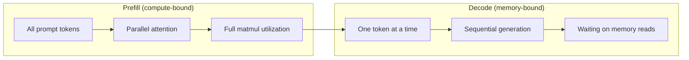
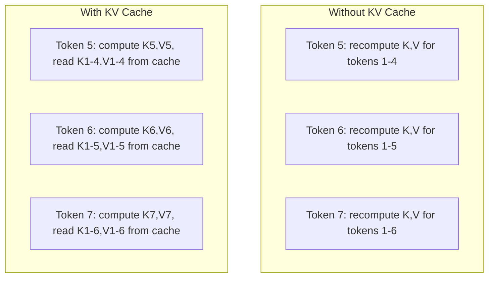
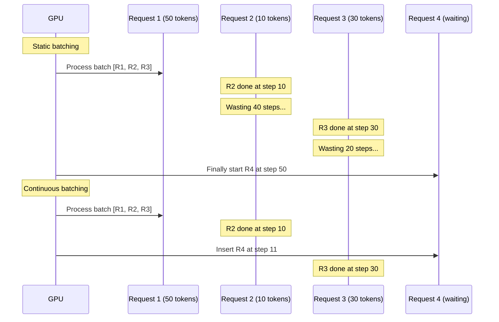
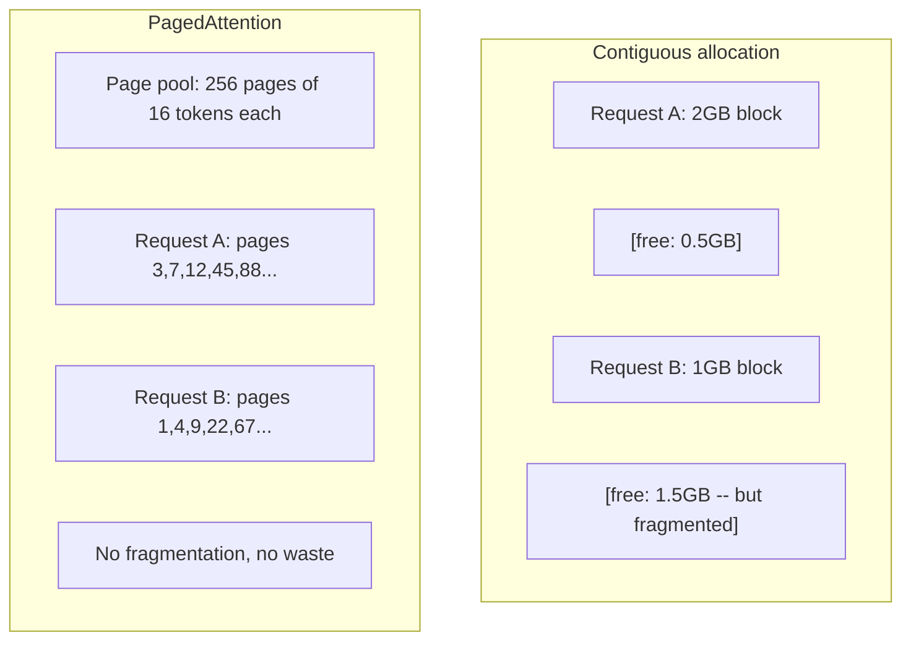
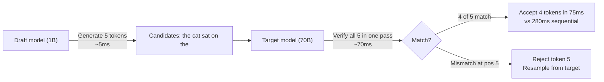

# 추론 최적화

> 두 단계가 LLM 추론을 정의합니다. 미리 작성하는 것은 컴퓨터에 연결된 프롬프트를 병렬로 처리합니다. 디코드는 한 번에 토큰을 생성합니다. 메모리에 연결됩니다. 모든 최적화는 하나 또는 둘 다 목표로합니다.

**Type:** Build
**Languages:** Python
**Prerequisites:** Phase 10, Lessons 01-08 (Transformer architecture, attention)
**Time:** ~120 minutes

## 학습 목표

- 자동 퇴행 토큰 생성 과정에서 과잉 계산을 제거하기 위해 KV 캐시를 구현
- LLM 추론의 사전 채용과 디코딩 단계와 각 단계가 다른 병목을 갖는 이유를 설명하십시오 (컴퓨터와 메모리)
- 동시 요청에 따라 GPU 활용도를 극대화하기 위해 연속 배팅 및 PagedAttention 개념을 구현
- 추론 최적화 기술 (KV 캐시, 추측 해독, 플래시 주의) 과 그 처리량/연연속량 교류를 비교

## 문제

4xA100 GPU에 Llama 3 70B를 배포합니다. 한 사용자가 초당 50개의 토큰을 얻습니다. 그것은 빠르게 느껴집니다. 그러면 100명의 사용자가 동시에 엔드포인트에 도달합니다. 처리량은 2초당 3개의 토큰으로 떨어집니다. 당신의 25,000달러/월 GPU 청구서는 인간 타입보다 느리게 응답을 제공합니다.

모델 자체는 1 사용자에서 100 사용자 사이에 변하지 않습니다. 같은 무게, 같은 건축, 같은 수학. 일정을 바꾸는 방식이 달라진 것 같아요 순진한 추론은 사용 가능한 GPU 계산의 90% 이상을 낭비합니다. 토큰 47를 기다리는 사용자는 GPU 메모리 버스가 매트무들 사이에 비동기 상태에서 전체 패치 슬롯을 열어두고 있습니다. 한편, 새로운 사용자의 2,000개의 토큰의 요청은 유용한 계산으로 그 시간차를 채울 수 있습니다.

이것은 확장 문제가 아니라 스케줄링 문제입니다. 이 수업의 기술들인 KV 캐싱, 연속 배팅, PagedAttention, 추측적 디코딩, 사전 캐싱$25k/month inference bill from a $5k/월 같은 교통을 서비스하는 1개

4xA100-80GB에 Llama 3 70B를 서비스하는 vLLM는 낮은 동시 시점에서 ~50 토큰/초/ 사용자, 그리고 연속 배팅 및 페이지드 애테넌스를 통해 100 개의 동시 요청에서 15-25 TPS/ 사용자를 지원합니다. 이러한 최적화 없이는 동일한 하드웨어는 동시 시점에서 5 TPS/ 사용자에 서비스를 제공합니다. 동일한 GPU, 동일한 모델, 4x 처리량.

## 개념

### 사전 작성 및 디코딩

LLM 추론 요청은 두 가지 단계가 있습니다.

**Prefill**전체 입력 프롬프트를 처리합니다. 모든 토큰은 알려져 있습니다. 따라서 전체 순서 전체에서 관심을 평행적으로 계산할 수 있습니다. 이것은 큰 매트릭스 곱셈입니다. GPU 코어는 바쁘게 유지됩니다. 병목은 계산입니다. 하드웨어가 초당 얼마나 많은 FLOPS를 제공할 수 있습니다. A100는 312 TFLOPS (BF16). 70B 모델에서 4,096-토큰 프롬프트를 미리 작성하는 것은 단일 A100에서 ~ 400ms를 걸립니다.

**Decode**출력 토큰을 하나씩 생성합니다. 새로운 토큰은 이전 모든 토큰에 해당하지만, 전격 패스당 하나의 토큰만 생성됩니다. 무게 매트릭스는 전충식과 같은 크기이지만 매트릭스 대신 하나의 벡터로 곱합니다. GPU 코어는 마이크로초 안에 완성되고 다음 무게가 메모리에서 도착할 때까지 기다립니다. 모형 중량을 HBM에서 계산 단위로 전송할 수 있는 속도 A100는 2TB/s의 대역폭을 가지고 있습니다. FP16의 70B 모델은 140GB입니다. 전체 모델을 한번 읽어내면 70초가 걸립니다. 즉, 한 단계의 디코딩을 할 수 있는 시간입니다.



**ops:byte ratio**(또한 수학적 강도라고도 불립니다) 이 트레이드 오프를 캡처합니다. 메모리에서 로드된 바이트당 얼마나 많은 작업을 수행하는지 측정합니다.

```
ops:byte ratio = FLOPs per token / bytes read from memory
```

4,096개의 토큰을 미리 채우기 동안, 로드 한 무게에 대해 4,096개의 복수 축적 작업을 수행합니다. 비율은 높습니다. 당신은 계산에 묶여 있습니다.

기본 통찰력: *독제는 전체 모델을 읽고 하나의 토큰을 생성하기 때문에 메모리에 묶여 있습니다.* 아래의 모든 최적화는 읽힌 내용을 줄이고, 읽힌 일당 처리되는 토큰의 배치를 증가시키거나 읽기를 완전히 피합니다.

### KV 캐시

주의를 기울이는 동안, 각 토큰의 질의는 이전 토큰의 키와 값 벡터에 관해서는 된다. 캐시 없이, 토큰 N을 생성하는 것은 전 N-1 토큰의 모든 키와 값 예측을 재 계산하는 것을 필요로 한다. 토큰 1은 토큰 2을 생성할 때 프로젝션된다. 다시 토큰 3을 위해, 다시 토큰 4을 위해. 1,000 토큰으로, 당신은 토큰 1을 총 999 번 프로젝션했다.

KV 캐시는 이전 모든 토큰의 키와 값 예측을 저장합니다. 토큰 N을 생성할 때, 당신은 단지 토큰 N의 키와 값을 계산하고, 그 다음 1에서 N-1까지의 토큰에서 캐시된 K/V와 연결합니다.



**Memory formula for KV cache:**

```
KV cache size = 2 * num_layers * num_kv_heads * head_dim * seq_len * bytes_per_param
```

Llama 3 70B (80층, 8 KV 헤드, GQA, head_dim=128, BF16):

```
per token: 2 * 80 * 8 * 128 * 2 bytes = 327,680 bytes = 320 KB
at 4,096 tokens: 320 KB * 4,096 = 1.28 GB
at 128K tokens: 320 KB * 131,072 = 40 GB
```

Llama 3 70B의 단일 128K 컨텍스트 대화는 40GB의 KV 캐시를 소비합니다. A100의 절반의 메모리입니다. 4K 토큰의 각각 100 명의 동시 사용자와 함께, KV 캐시는 128GB가 필요합니다. 이것이 KV 캐시 관리가 추론 최적화의 핵심 과제입니다.

### 계속 된 배팅

정적 배팅은 N 요청의 배트가 도착하기까지 기다립니다. 그것들을 함께 처리하고, 새로운 요청을 받아들이기 전에 *모든*이 완료되기까지 기다립니다. 한 요청이 500 개의 토큰과 다른 요청이 10 개의 토큰이 필요한 경우, 짧은 요청은 완료된 후 490 단계의 디코딩 단계 동안 비동이 됩니다.

연속 배팅 (이터레이션 레벨 배팅이라고도 한다) 은 모든 요청이 완료되면 새로운 요청들을 배트에 삽입한다. 배트는 모든 디코드 단계에 재평가된다. 10 토큰이 끝난 후 종료되는 요청은 즉시 대기 요청으로 대체된다.



출력 길이가 얼마나 달라지는지에 따라 출력량 향상이 달라진다. 일률 길이를 사용하면 연속 배팅은 정적 배팅과 일치합니다. 변수 길이를 사용하면 (일반 사례) 연속 배팅은 GPU 슬롯이 결코 빈 상태로 있지 않기 때문에 2-5배 더 높은 출력을 제공할 수 있습니다.

### 페이지 주의

각 요청의 KV 캐시는 연속된 메모리 블록입니다. 요청이 도착하고 떠날 때 메모리 조각은 운영 체제에서 RAM 분분화와 같습니다. 4K 토큰 요청은 연속적인 1.28 GB가 필요합니다. 무료 총 2 GB가 있으면도 연속적인 1.28 GB가 없을 수도 있습니다.

페이지 어테넌스는 OS 스타일의 가상 메모리를 KV 캐시에 적용합니다. 요청에 따라 하나의 인접 블록을 할당하는 대신 고정 크기의 "페이지" (일반적으로 16 토큰) 를 할당합니다. 페이지는 물리적 GPU 메모리에 어디에서나있을 수 있습니다. 페이지 테이블은 각 요청의 논리적 순서 위치를 물리적 페이지 위치로 지도합니다.



페이지드아테넌스 또한 **copy-on-write**공유 된 사전예약: 50 개의 요청이 동일한 시스템 프롬프트를 공유하면, 해당 시스템 프롬프트의 KV 캐시 페이지는 한 번 저장되어 모든 50 개의 요청에 참조됩니다. 요청이 분할되면 (다른 사용자 메시지) 만 자신의 페이지를 얻습니다. 이것은 공유 된 시스템 프롬프트의 응용 프로그램에서 메모리 사용을 크게 줄입니다.

vLLM는 PagedAttention를 통해 거의 0의 메모리 낭비 (~4% 대 ~60-80%의 순진적 할당) 를 보고합니다.

### 추측적 인 디코딩

디코딩은 느려집니다. 왜냐하면 순서적이기 때문입니다. 하나의 토큰을 생성하고, 다시 공급하고, 다음을 생성합니다. 하지만 다음 5개의 토큰을 값싸게 추측하고,

추측적인 해독은 작은, 빠른 **draft model**K 후보 토큰을 생성하기 위해**target model**다음으로 K 후보자 모두 하나의 전진 패스로 처리합니다 (예전 필름처럼 보입니다. 평행, 계산에 묶여, 효율적입니다). 목표 모델이 드래프트 모델의 예측에 동의한다면, 당신은 하나의 목표 전진의 시간에 모든 K 토큰을 받아들이습니다. 만약 J 위치에서 동의하지 않는다면, 당신은 1에서 j-1까지의 토큰을 받아들이고 나머지는 버립니다.



가속화 가량에 따라 달라질 수 있습니다**acceptance rate**Llama 3 8B의 수립에 따라 Llama 3 70B의 수립률은 자연어에서 70~85%입니다. 이것은 2-3x 디코딩 속도를 의미합니다.

추측적 디코딩에 대한 세 가지 접근법:

| Method | Draft source | Acceptance rate | Overhead |
|--------|-------------|-----------------|----------|
| Draft-target (Leviathan et al.) | Separate small model | 70-85% | Draft model memory |
| EAGLE (Li et al.) | Lightweight head on target | 75-90% | ~1% extra parameters |
| N-gram lookup | Token n-gram table | 40-60% | Negligible |

**EAGLE**표적 모델의 숨겨진 상태 위에 작은 자동 퇴행성 머리를 훈련시킵니다. 목표 모델의 2~last layer 기능을 사용하여 다음 토큰의 임베디션을 예측합니다. 목표 모델의 자신의 표현 ( 별도의 모델이 아닌) 에 따라 작동하기 때문에 최소한의 추가 메모리로 더 높은 수용률을 달성합니다. 이글-2는 컨텍스트에 따라 후보자 수를 조정하는 동적 드래프트 트리를 추가합니다.

**N-gram speculative decoding**현재 맥락에서 n-그램의 연속을 유지하거나 미리 구축된 코퍼스를 유지합니다. 만약 초안이 같은 대화에서 이전에 나타난 것과 일치한다면 (복습 패턴, 코드, 구조화된 출력) 그것은 0 신경 네트워크 오버헤드로 발사합니다. 수용률은 평균적으로 낮지만 추측에 대한 비용은 본질적으로 무료입니다.

추측적 디코딩은 *수학적으로 정확하다* - 출력 분포는 목표 모델의 분포와 동일합니다. 그것은 대략적인 것이 아닙니다. 검증 단계는 승인된 모든 토큰이 목표 모델이 할당했을 확률을 정확히 가지고 있음을 보장합니다.

### 사전 예시 캐시

많은 요청은 동일한 사전을 공유합니다. 채봇 시스템 펌트. RAG 컨텍스트 블록. 몇 번의 촬영 예제 세트. 사전 예시 저장 없이, 모든 요청은 이러한 공유 토큰의 KV 캐시를 처음부터 다시 계산합니다.

사전 예시 저장은 일반적인 사전 예시들을 위한 KV 캐시를 저장하고 요청들 사이를 재사용한다. 새로운 요청이 알려진 사전 예시로 도착하면 시스템에서는 캐시된 KV 항목을 복사 (또는 참조) 하고, 고유한 후자수에 대한 KV를 계산한다.

모든 요청에 공유되는 2,000 토큰 시스템 프롬프트에서, 사전 캐싱은 요청 당 400ms의 사전 채우기를 제거합니다. 100 요청/초에, 이는 초당 40초의 GPU 계산을 절약합니다.

SGLang의 RadixAttention는 로디크스 트리 (tri) 를 통해 미리보기를 캐싱하여 그 토큰 내용에 따라 미리보기를 지표합니다. 저장된 미리보기에 일치하는 모든 요청은 KV 캐시를 무료로 얻을 수 있습니다. 나무는 부분적인 미리보기 일치를 가능하게합니다. 캐시 된 항목과 함께 2000개의 미리보기 토큰 중 1,500개를 공유하면 1,500을 재사용하고 500만을 재정합니다.

### 인퍼런스 엔진

세 개의 엔진이 생산 LLM 서비스를 지배합니다:

| Engine | Key innovation | Best for |
|--------|---------------|----------|
| vLLM | PagedAttention, continuous batching | General-purpose serving, highest compatibility |
| SGLang | RadixAttention (prefix caching), structured generation | Multi-turn chatbots, constrained decoding |
| TensorRT-LLM | NVIDIA kernel fusion, FP8 quantization | Maximum single-GPU throughput on NVIDIA hardware |

**vLLM**기본 시작 지점입니다. 가장 넓은 모델 범위를 지원하고, 모든 GPU 공급업체 (NVIDIA, AMD, Intel) 에서 실행되며, PagedAttention + 연속 배팅을 통해 강력한 처리량을 달성합니다. OpenAI 호환 API는 OpenAI API 호출의 대체로 drop in 할 수 있음을 의미합니다.

**SGLang**vLLM와 동일한 기초를 구축하지만, 구조화된 LLM 프로그램에서 미리보기 캐싱 및 도메인 특정 언어를 위해 RadixAttention를 추가합니다. 작업 부하가 다중 회담, 도구 사용 또는 제한된 디코딩 (JSON 출력, regex 가이드 생성) 를 포함하면, SGLang은 종종 미리보기 재사용으로 vLLM보다 2-5배 더 성능을 발휘합니다.

**TensorRT-LLM**NVIDIA GPU 커널에 모델을 컴파일합니다. 그것은 운영 (중심 + 선형 + 활성화) 를 하나의 커널에서 통합하고, H100 GPU에 FP8를 사용하고, 생산 배포를 위해 NVIDIA Triton 인퍼런스 서버와 통합합니다. NVIDIA 하드웨어에서 가장 높은 단일 GPU 처리량을 달성하지만 더 많은 설정을 필요로하며 NVIDIA GPU에만 작동합니다.

Llama 3 70B (4xA100-80GB, BF16) 의 실제 세계 번호:

| Metric | vLLM | SGLang | TensorRT-LLM |
|--------|------|--------|---------------|
| Throughput (1 user) | ~50 TPS | ~55 TPS | ~65 TPS |
| Throughput (100 users) | ~2,500 total TPS | ~3,200 total TPS | ~3,000 total TPS |
| Time to first token | ~400ms | ~300ms (prefix hit) | ~350ms |
| Max context | 128K | 128K | 128K |

### 운영:바이트 프레임워크

측정하지 않은 것을 최적화할 수는 없습니다. ops:byte 비율은 당신이 컴퓨팅 또는 메모리 제한이 있는지 알려줍니다. 이는 어떤 최적화가 중요하는지 결정합니다.

```
Compute roof: peak FLOPS of the GPU
Memory roof:  peak bandwidth * ops:byte ratio
```

ops:byte가 낮을 때 (독호, 작은 패치) 메모리 대역폭 지붕을 부딪히게 됩니다. 더 많은 계산 (더 높은 시계, 더 많은 코어) 를 추가하는 것은 도움이 되지 않습니다. 더 유용한 작업에 대한 읽기 amortize 하기 위해 메모리 읽기 (분량화, KV 캐시 압축) 를 줄여야 합니다.

ops:byte가 높을 때 (프리플, 큰 패치) 계산 지붕에 타격합니다. 메모리 대역폭 최적화는 도움이 되지 않습니다. 더 많은 FLOPS를 압축하기 위해 더 빠른 GPU, 커널 융합 또는 더 낮은 정확도가 필요합니다.

| Scenario | ops:byte | Bound | Optimize with |
|----------|----------|-------|---------------|
| Prefill, batch=1 | ~4,096 | Compute | Kernel fusion, FP8 |
| Decode, batch=1 | ~1 | Memory | Quantization, KV compression |
| Decode, batch=32 | ~32 | Memory | Larger batch, continuous batching |
| Decode, batch=256 | ~256 | Transitioning | Both matter |
| Decode, batch=1024 | ~1,024 | Compute | Kernel fusion, tensor parallelism |

A100의 크로스오버 포인트는 ops:byte = 156 (312 TFLOPS / 2 TB/s) 의 주위에 있습니다. 156 아래에서는 메모리 구속입니다. 156 위에서는 컴퓨터 구속입니다. 연속적인 배팅은 반복에 더 많은 토큰을 포장함으로써 이 크로스오버로 디코드를 밀어냅니다.

```figure
context-window-slide
```

## 건설 해

### 단계 1: KV 캐시

우리는 여러 헤드 KV 캐시를 만들고 각 층에 대한 키와 값 예측을 저장하고, 각 헤드마다 메모리 성장 패턴을 보여줍니다.

```python
import numpy as np

class KVCache:
    def __init__(self, num_layers, num_heads, head_dim, max_seq_len, dtype=np.float16):
        self.num_layers = num_layers
        self.num_heads = num_heads
        self.head_dim = head_dim
        self.max_seq_len = max_seq_len
        self.dtype = dtype

        self.k_cache = np.zeros(
            (num_layers, num_heads, max_seq_len, head_dim), dtype=dtype
        )
        self.v_cache = np.zeros(
            (num_layers, num_heads, max_seq_len, head_dim), dtype=dtype
        )
        self.seq_len = 0

    def update(self, layer_idx, new_keys, new_values):
        num_new = new_keys.shape[1]
        end = self.seq_len + num_new
        self.k_cache[layer_idx, :, self.seq_len:end, :] = new_keys
        self.v_cache[layer_idx, :, self.seq_len:end, :] = new_values
        return (
            self.k_cache[layer_idx, :, :end, :],
            self.v_cache[layer_idx, :, :end, :]
        )

    def advance(self, num_tokens):
        self.seq_len += num_tokens

    def memory_bytes(self):
        return self.k_cache.nbytes + self.v_cache.nbytes

    def used_bytes(self):
        per_token = 2 * self.num_layers * self.num_heads * self.head_dim * np.dtype(self.dtype).itemsize
        return per_token * self.seq_len
```

### 단계 2: KV 캐시로 주의

KV 캐시를 사용하여 디코드 단계를 수행하는 단순화된 멀티 헤드 관심

```python
def scaled_dot_product_attention(query, keys, values):
    head_dim = query.shape[-1]
    scores = np.matmul(query, keys.transpose(0, 1, 3, 2)) / np.sqrt(head_dim)
    seq_len_q = scores.shape[-2]
    seq_len_k = scores.shape[-1]
    if seq_len_q > 1:
        mask = np.triu(np.ones((seq_len_q, seq_len_k), dtype=np.float32), k=seq_len_k - seq_len_q + 1)
        scores = scores + mask * (-1e9)
    max_scores = np.max(scores, axis=-1, keepdims=True)
    exp_scores = np.exp(scores - max_scores)
    attn_weights = exp_scores / np.sum(exp_scores, axis=-1, keepdims=True)
    return np.matmul(attn_weights, values)


class MultiHeadAttention:
    def __init__(self, d_model, num_heads):
        self.num_heads = num_heads
        self.head_dim = d_model // num_heads
        scale = np.sqrt(2.0 / d_model)
        self.W_q = np.random.randn(d_model, d_model).astype(np.float32) * scale
        self.W_k = np.random.randn(d_model, d_model).astype(np.float32) * scale
        self.W_v = np.random.randn(d_model, d_model).astype(np.float32) * scale
        self.W_o = np.random.randn(d_model, d_model).astype(np.float32) * scale

    def forward(self, x, kv_cache=None, layer_idx=0):
        batch, seq_len, d_model = x.shape
        Q = np.matmul(x, self.W_q).reshape(batch, seq_len, self.num_heads, self.head_dim).transpose(0, 2, 1, 3)
        K = np.matmul(x, self.W_k).reshape(batch, seq_len, self.num_heads, self.head_dim).transpose(0, 2, 1, 3)
        V = np.matmul(x, self.W_v).reshape(batch, seq_len, self.num_heads, self.head_dim).transpose(0, 2, 1, 3)

        if kv_cache is not None:
            K_full, V_full = kv_cache.update(layer_idx, K[0], V[0])
            K = K_full[np.newaxis, :, :, :]
            V = V_full[np.newaxis, :, :, :]
            if seq_len == 1:
                kv_cache.advance(1)

        attn_out = scaled_dot_product_attention(Q, K, V)
        attn_out = attn_out.transpose(0, 2, 1, 3).reshape(batch, -1, d_model)
        return np.matmul(attn_out, self.W_o)
```

### 단계 3: 연속 배팅 시뮬레이터

이것은 정적 및 연속 배열 사이의 스케줄 차이점을 시뮬레이션합니다.

```python
import heapq

class Request:
    def __init__(self, request_id, prompt_tokens, output_tokens, arrival_step):
        self.request_id = request_id
        self.prompt_tokens = prompt_tokens
        self.output_tokens = output_tokens
        self.arrival_step = arrival_step
        self.tokens_generated = 0
        self.start_step = None
        self.end_step = None

    def is_done(self):
        return self.tokens_generated >= self.output_tokens


def simulate_static_batching(requests, batch_size):
    step = 0
    completed = []
    queue = list(requests)
    queue.sort(key=lambda r: r.arrival_step)

    while queue:
        batch = []
        while queue and len(batch) < batch_size:
            r = queue.pop(0)
            r.start_step = max(step, r.arrival_step)
            batch.append(r)

        if batch:
            step = max(step, max(r.start_step for r in batch))
            max_output = max(r.output_tokens for r in batch)
            for r in batch:
                r.tokens_generated = r.output_tokens
                r.end_step = step + max_output
            step += max_output
            completed.extend(batch)

    return completed


def simulate_continuous_batching(requests, batch_size):
    step = 0
    completed = []
    queue = sorted(requests, key=lambda r: r.arrival_step)
    queue_idx = 0
    active = []
    waiting = []

    while queue_idx < len(queue) or active or waiting:
        while queue_idx < len(queue) and queue[queue_idx].arrival_step <= step:
            waiting.append(queue[queue_idx])
            queue_idx += 1

        while waiting and len(active) < batch_size:
            r = waiting.pop(0)
            r.start_step = step
            active.append(r)

        if not active:
            if waiting:
                step += 1
                continue
            elif queue_idx < len(queue):
                step = queue[queue_idx].arrival_step
                continue
            else:
                break

        for r in active:
            r.tokens_generated += 1

        done = [r for r in active if r.is_done()]
        for r in done:
            r.end_step = step + 1
            completed.append(r)
        active = [r for r in active if not r.is_done()]

        step += 1

    return completed


def batching_stats(completed):
    latencies = [r.end_step - r.arrival_step for r in completed]
    total_time = max(r.end_step for r in completed) - min(r.arrival_step for r in completed)
    total_tokens = sum(r.output_tokens for r in completed)
    return {
        "avg_latency": np.mean(latencies),
        "p50_latency": np.median(latencies),
        "p99_latency": np.percentile(latencies, 99),
        "total_time": total_time,
        "throughput": total_tokens / total_time if total_time > 0 else 0,
    }
```

### 단계 4: 사전 예시 캐시

공유 된 사전값을 위한 KV 항목을 저장하는 트리 기반의 사전값 캐시

```python
class TrieNode:
    def __init__(self):
        self.children = {}
        self.kv_data = None
        self.hit_count = 0


class PrefixCache:
    def __init__(self, max_entries=1000):
        self.root = TrieNode()
        self.max_entries = max_entries
        self.total_entries = 0
        self.hits = 0
        self.misses = 0

    def _walk(self, token_ids):
        node = self.root
        depth = 0
        for tid in token_ids:
            if tid not in node.children:
                break
            node = node.children[tid]
            depth += 1
        return node, depth

    def lookup(self, token_ids):
        node, depth = self._walk(token_ids)
        if depth > 0:
            self.hits += 1
            current = self.root
            for tid in token_ids[:depth]:
                current = current.children[tid]
                current.hit_count += 1
            kv_entries = []
            current = self.root
            for tid in token_ids[:depth]:
                current = current.children[tid]
                if current.kv_data is not None:
                    kv_entries.append(current.kv_data)
            return depth, kv_entries
        self.misses += 1
        return 0, []

    def insert(self, token_ids, kv_per_token):
        node = self.root
        for i, tid in enumerate(token_ids):
            if tid not in node.children:
                if self.total_entries >= self.max_entries:
                    return i
                node.children[tid] = TrieNode()
                self.total_entries += 1
            node = node.children[tid]
            if i < len(kv_per_token):
                node.kv_data = kv_per_token[i]
        return len(token_ids)

    def hit_rate(self):
        total = self.hits + self.misses
        return self.hits / total if total > 0 else 0.0
```

### 단계 5: 추측 해독 시뮬레이터

우리는 설정 가능한 수용률을 가진 초안 목표 추측 해독을 시뮬레이션합니다.

```python
class DraftModel:
    def __init__(self, vocab_size, acceptance_rate=0.8):
        self.vocab_size = vocab_size
        self.acceptance_rate = acceptance_rate

    def generate(self, context, num_tokens):
        tokens = np.random.randint(0, self.vocab_size, size=num_tokens)
        return tokens

    def get_probs(self, context, token):
        probs = np.random.dirichlet(np.ones(self.vocab_size))
        return probs


class TargetModel:
    def __init__(self, vocab_size):
        self.vocab_size = vocab_size

    def get_probs(self, context, tokens=None):
        if tokens is not None:
            return [np.random.dirichlet(np.ones(self.vocab_size)) for _ in tokens]
        return np.random.dirichlet(np.ones(self.vocab_size))


def speculative_decode(draft_model, target_model, context, num_speculative=5,
                       draft_cost=1.0, target_cost=10.0, verify_cost=12.0):
    total_tokens = 0
    total_cost = 0.0
    accepted_counts = []
    context = list(context)

    max_tokens = 100

    while total_tokens < max_tokens:
        draft_tokens = draft_model.generate(context, num_speculative)
        total_cost += draft_cost * num_speculative

        target_probs = target_model.get_probs(context, draft_tokens)
        total_cost += verify_cost

        accepted = 0
        for i, token in enumerate(draft_tokens):
            draft_p = draft_model.get_probs(context + list(draft_tokens[:i]), token)
            target_p = target_probs[i]

            r = np.random.random()
            acceptance_prob = min(1.0, target_p[token] / (draft_p[token] + 1e-10))

            if r < draft_model.acceptance_rate:
                accepted += 1
                context.append(token)
                total_tokens += 1
            else:
                new_token = np.random.choice(draft_model.vocab_size, p=target_p)
                context.append(new_token)
                total_tokens += 1
                break

        accepted_counts.append(accepted)

        if accepted == num_speculative:
            bonus_probs = target_model.get_probs(context)
            bonus_token = np.random.choice(draft_model.vocab_size, p=bonus_probs)
            context.append(bonus_token)
            total_tokens += 1

    sequential_cost = total_tokens * target_cost
    return {
        "total_tokens": total_tokens,
        "speculative_cost": total_cost,
        "sequential_cost": sequential_cost,
        "speedup": sequential_cost / total_cost if total_cost > 0 else 1.0,
        "avg_accepted": np.mean(accepted_counts),
        "acceptance_rate": np.mean(accepted_counts) / num_speculative,
    }


def compare_speculation_strategies(vocab_size=1000, num_trials=20):
    results = {}

    for name, acceptance_rate, spec_tokens in [
        ("Draft-target (8B->70B)", 0.78, 5),
        ("EAGLE", 0.85, 6),
        ("N-gram", 0.50, 4),
        ("No speculation", 0.0, 0),
    ]:
        if spec_tokens == 0:
            results[name] = {
                "speedup": 1.0,
                "acceptance_rate": 0.0,
                "avg_accepted": 0.0,
            }
            continue

        trial_results = []
        for _ in range(num_trials):
            draft = DraftModel(vocab_size, acceptance_rate=acceptance_rate)
            target = TargetModel(vocab_size)
            context = list(np.random.randint(0, vocab_size, size=10))
            result = speculative_decode(draft, target, context, num_speculative=spec_tokens)
            trial_results.append(result)

        results[name] = {
            "speedup": np.mean([r["speedup"] for r in trial_results]),
            "acceptance_rate": np.mean([r["acceptance_rate"] for r in trial_results]),
            "avg_accepted": np.mean([r["avg_accepted"] for r in trial_results]),
        }

    return results
```

### 단계 6: KV 캐시 메모리 프로파일러

실제 모델 구성에 대한 KV 캐시 메모리 요구 사항을 계산합니다.

```python
MODEL_CONFIGS = {
    "Llama-3-8B": {
        "num_layers": 32, "num_kv_heads": 8, "head_dim": 128,
        "model_params_b": 8, "gqa": True,
    },
    "Llama-3-70B": {
        "num_layers": 80, "num_kv_heads": 8, "head_dim": 128,
        "model_params_b": 70, "gqa": True,
    },
    "Llama-3-405B": {
        "num_layers": 126, "num_kv_heads": 8, "head_dim": 128,
        "model_params_b": 405, "gqa": True,
    },
    "Mistral-7B": {
        "num_layers": 32, "num_kv_heads": 8, "head_dim": 128,
        "model_params_b": 7, "gqa": True,
    },
    "GPT-4-est": {
        "num_layers": 120, "num_kv_heads": 96, "head_dim": 128,
        "model_params_b": 1800, "gqa": False,
    },
}


def kv_cache_memory(config, seq_len, dtype_bytes=2):
    per_token = 2 * config["num_layers"] * config["num_kv_heads"] * config["head_dim"] * dtype_bytes
    total = per_token * seq_len
    return {
        "per_token_bytes": per_token,
        "per_token_kb": per_token / 1024,
        "total_bytes": total,
        "total_mb": total / (1024 ** 2),
        "total_gb": total / (1024 ** 3),
    }


def memory_budget(config, gpu_memory_gb, model_dtype_bytes=2, kv_dtype_bytes=2):
    model_memory_gb = config["model_params_b"] * 1e9 * model_dtype_bytes / (1024 ** 3)
    overhead_gb = gpu_memory_gb * 0.1
    available_for_kv = gpu_memory_gb - model_memory_gb - overhead_gb

    if available_for_kv <= 0:
        return {"error": "Model does not fit in GPU memory", "model_memory_gb": model_memory_gb}

    per_token = 2 * config["num_layers"] * config["num_kv_heads"] * config["head_dim"] * kv_dtype_bytes
    max_tokens = int(available_for_kv * (1024 ** 3) / per_token)

    return {
        "gpu_memory_gb": gpu_memory_gb,
        "model_memory_gb": round(model_memory_gb, 1),
        "overhead_gb": round(overhead_gb, 1),
        "available_for_kv_gb": round(available_for_kv, 1),
        "max_total_tokens": max_tokens,
        "max_users_at_2k": max_tokens // 2048,
        "max_users_at_4k": max_tokens // 4096,
        "max_users_at_32k": max_tokens // 32768,
    }
```

## 사용 하 고

vLLM:

```python
from vllm import LLM, SamplingParams

llm = LLM(
    model="meta-llama/Meta-Llama-3-70B-Instruct",
    tensor_parallel_size=4,
    enable_prefix_caching=True,
    max_model_len=8192,
    gpu_memory_utilization=0.9,
)

params = SamplingParams(temperature=0.7, max_tokens=256)
outputs = llm.generate(["Explain inference optimization in one paragraph."], params)
```

SGLang와 함께 사전 캐시 + 구조화된 출력:

```python
import sglang as sgl

@sgl.function
def classify(s, text):
    s += sgl.system("You are a classifier. Output JSON only.")
    s += sgl.user(f"Classify this text: {text}")
    s += sgl.assistant(sgl.gen("result", regex=r'\{"label": "(positive|negative|neutral)"\}'))

runtime = sgl.Runtime(model_path="meta-llama/Meta-Llama-3-70B-Instruct", tp_size=4)
sgl.set_default_backend(runtime)

results = classify.run_batch([
    {"text": "This product is amazing!"},
    {"text": "Terrible experience."},
    {"text": "It was okay I guess."},
])
```

TensorRT-LLM:

```python
import tensorrt_llm
from tensorrt_llm.runtime import ModelRunner

runner = ModelRunner.from_dir("./llama-70b-trt-engine/", rank=0)

outputs = runner.generate(
    batch_input_ids=[tokenizer.encode("Explain KV caching.")],
    max_new_tokens=256,
    temperature=0.7,
)
```

## 선박

이 교훈은 다음과 같은 결과를 낳습니다.
- `outputs/skill-inference-optimization.md`-- LLM 추론을 진단하고 최적화하는 기술

## 운동

1. KV 캐시 프로파일러를 수정하여 FP16와 FP8와 INT4 KV 캐시 양량화를 비교하십시오. 4K 컨텍스트에서 Llama 3 70B에 대해, 4xA100-80GB에서 각 사용자 최대 동시 사용자를 계산하십시오. KV 양량화로 INT4는 사용자 용량을 대략 4배로 계산해야합니다.

2. 연속 배팅 시뮬레이터를 확장하여 GPU 활용도를 추적합니다. (단계 개량 중 한 단계로 채워진 분량). 파레토 분포 ( 모양=1.5, 규모=20) 를 따라 출력 길이가 50 개인 정적 및 연속 배팅을 위해 시간적으로 배팅 활용. 연속 배팅은 80% 이상의 활용도를 유지해야합니다.

3. KV 캐시의 그룹화된 질문 관심 (GQA) 버전을 구현하여`num_kv_heads < num_query_heads`. Llama 3 70B는 64개의 쿼리 헤드, 하지만 8개의 KV 헤드만 사용합니다. 메모리 절약과 전체 멀티 헤드 주의 (8배의 KV 캐시 크기의 감소) 를 계산합니다.

4. LRU 배척을 사용하는 사전 캐시를 구축하십시오. 최대_입자를 500으로 설정하고, 60%가 5 가지 일반적인 사전 중 하나를 공유하는 1,000 개의 요청을 생성하십시오. 히트 비율을 측정하고 무제한 캐시를 비교하십시오. 좋은 배척으로, 히트 비율은 55% 이상 유지해야합니다.

5. tree-based speculation (EAGLE-2 스타일) 를 구현하기 위해 spekulative decoding simulator를 확장하십시오. K draft tokens의 단일 체인 대신, 후보자 나무를 생성하십시오. (예를 들어, 3 레벨의 각 2 가지 가지 = 8 개의 잎 후보자) 확인 라운드 vs 선형 추측에 따라 받아들여진 토큰을 비교하십시오.

## 주요 용어

| Term | What people say | What it actually means |
|------|----------------|----------------------|
| Prefill | "Processing the prompt" | Computing attention over all input tokens in parallel -- compute-bound because the full matrix multiplication keeps GPU cores busy |
| Decode | "Generating tokens" | Producing one token per forward pass, reading the full model weights each time -- memory-bound because compute finishes before the next weights arrive |
| KV cache | "Caching attention states" | Storing the key and value projections for all previous tokens so they are not recomputed at each decode step -- trades memory for compute |
| Continuous batching | "Dynamic batching" | Inserting new requests into the running batch as soon as any request finishes, evaluated at every decode iteration rather than waiting for the whole batch |
| PagedAttention | "Virtual memory for KV cache" | Allocating KV cache in fixed-size pages instead of contiguous blocks, eliminating memory fragmentation and enabling copy-on-write for shared prefixes |
| Speculative decoding | "Draft and verify" | Using a fast draft model to propose multiple tokens, then verifying them all in one target model forward pass -- mathematically exact, 2-3x speedup |
| EAGLE | "Self-speculative decoding" | A speculative decoding variant that trains a lightweight head on the target model's own hidden states, achieving higher acceptance rates than a separate draft model |
| Prefix caching | "Reusing system prompt KV" | Storing computed KV cache entries for common prefixes (system prompts, few-shot examples) and reusing them across requests to skip redundant prefill |
| Ops:byte ratio | "Arithmetic intensity" | The ratio of compute operations to memory bytes read -- determines whether a workload is compute-bound (high ratio) or memory-bound (low ratio) |
| Time to first token | "TTFT" | Latency from receiving a request to producing the first output token -- dominated by prefill time for long prompts |

## 더 많은 읽기

- Kwon et al., "페이지 애트런션으로 서비스하는 대형 언어 모델에 대한 효율적인 메모리 관리" (2023) - 페이지 KV 캐시 관리를 도입한 vLLM 논문, 이제 추론 서비스 산업 표준
- 레비아탄 등, "스펙룰레이션 디코딩을 통해 트랜스포머로부터 빠른 추론" (2023) - 초안 확인 추론이 2-3x의 속도를 달성하면서 정확한 목표 모델 배포를 생산한다는 것을 증명하는 기초 논문
- 리 등, "EAGLE: 스펙туа티브 샘플링은 특징 불확실성을 재검토해야 한다" (2024) --는 별도의 드래프트 모델을 사용하지 않고 목표 모델의 특징에 대해 머리를 훈련함으로써 더 높은 수용률을 달성합니다
-  등, "SGLang: Structured Language Model Programs' (2024) - 프레픽스 캐싱에 대한 RadixAttention 및 멀티콜 LLM 프로그램을위한 프로그래밍 모델을 소개합니다
- 윌리엄스 등, "루프라인: 멀티코어 아키텍처의 통찰력 있는 시각적 성능 모델" (2009) - 컴퓨터와 메모리 병목에 대한 추론을 위한 ops:byte 프레임워크를 공식화한 원본 루프라인 논문
