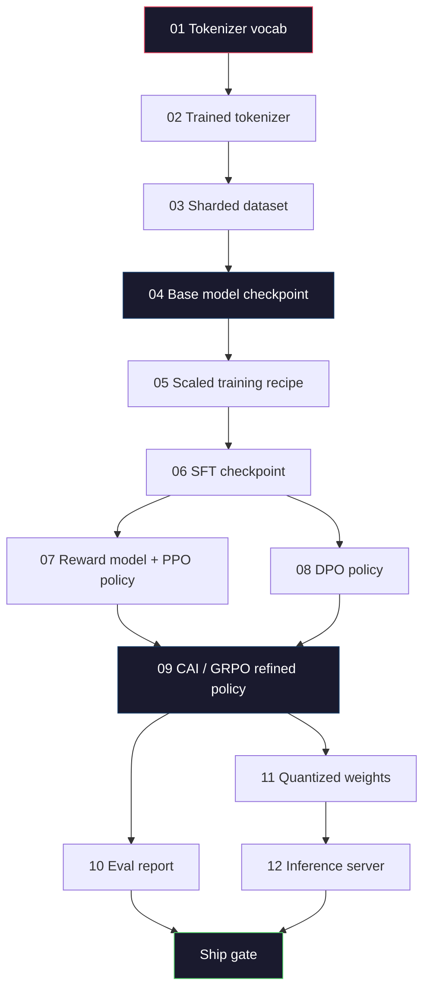
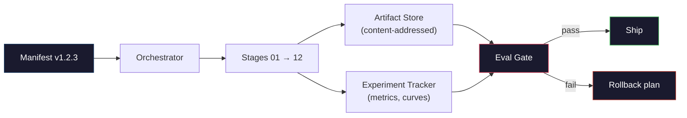

# LLM 파이프라인을 구축

> 1~12강까지 모든 것은 하나의 파이프라인의 한 단계입니다. 이 수업은 그 단계를 하나의 끝에서 끝으로 실행하는 스카프입니다. 토큰화, 전차, 규모, SFT, 정렬, 평가, 양자, 서비스. 70B 모델은 노트북으로 훈련할 수 없습니다. 당신은 오케스트레이션 레이어, 매니페스트, 평가 게이트, 그리고 2026 국경 팀에서 어떤 것을 배송할지 결정하는 롤백 계획을 만들 것입니다. 이쪽은 끝돌입니다.

**Type:** Build
**Languages:** Python (stdlib)
**Prerequisites:** All Phase 10 lessons 01-12
**Time:** ~120 minutes

## 학습 목표

- 11개의 이전 수업 (토케니저, 데이터, 사전 훈련, 스케일링, SFT, RLHF, DPO, CAI, eval, 양분화, 추론) 을 하나의 재생 가능한 파이프라인 스펙으로 구성한다.
- 단계들 사이의 유물 계약: 각 단계가 소비하는 것, 생산하는 것, 그리고 다음 단계가 입력된 것을 어떻게 확인하는지를 정의하십시오.
- 실험을 추적하고, 유물을 해시하고, 평가 임대에서 결정하는 게이트를 만드는 오케스트레이터를 구축하십시오.
- 롤백 계획 을 설계: 재배 를 할 때 어떤 유물 이 저렴 하고, 어떤 유물 이 비싸고, 손상 된 체크포인트 에 드는 비용

## 문제

이전 수업은 모두 작동합니다. 토케니저는 훈련되었습니다. 작은 GPT 사전 훈련되었습니다. SFT 데이터 세트 집합되었습니다. 보상 모델 훈련되었습니다. DPO 실행. 평형 측정되었습니다. 양자 무게가 수출되었습니다. 인퍼런스 서버가 spun up되었습니다. 각 노트북입니다. 각 자신의 컨벤션, 자신의 출력 경로, 자신의 씨앗을 가지고 있습니다.

국경 훈련은 노트북이 아닙니다. Llama 3 405B는 약 54일 동안 3억 H100시간을 걸었습니다. 딥시크V3는 약 2800만 시간 동안 사용했습니다. 그 기간 동안 하나의 손상된 체크포인트, 하나의 데이터 오염, 하나의 평가 회귀는 팀에게 1주간의 벽 시계와 1개월의 GPU 예산이 걸릴 수 있습니다. 팀들이 이 일을 살아남는 방법은 파이프라인 위생에 의해 이루어집니다. 각 단계는 결정적 입력, 결정적 출력, 행군, 해시, 게이트를 가지고 있습니다.

이것은 끝돌입니다. 당신은 노트북에서 파이프라인을 끝에서 끝으로 실행하지 않을 것입니다. 당신은 단계를 조정하는 오케스트레이터, 실행을 설명하는 매니페스트, 선박 결정을 처리하는 검증기, 그리고 하나의 파일에서 작업을 다시 실행할 수있는 3번째 당사자를 허용하는 재생 계획을 작성합니다. 코드는 작지만 규율은 크습니다.

패턴은 100M에서 1T 매개 변수에 변하지 않습니다. 같은 네 가지 구성 요소 - 매니페스트, 오케스트레이터, eval gate, 유물 저장소 - Llama 3를 실행하고 취미 GPT를 실행합니다. 차이점은 각 단계의 구성 안의 숫자의 크기입니다. 파이프 라인의 모양이 아닙니다.

## 개념

### 12 단계

10단계 수업은 단계입니다. 여기 의존성 그래프가 있습니다.



07단계와 08단계는 병행으로 실행될 수 있다. 다른 모든 것은 어려운 의존성이다. 02단계의 변경 (토케니저) 는 하류 유물을 무효로 한다. 10단계의 변경 (eval) 는 배 결정만을 무효로 한다.

### 명백 한 말

매니프트는 실행을 충분히 재생할 수 있도록 설명하는 단일 파일입니다. 파이프라인이 생성하는 것은 매니프트에 없는 상태에 따라 달라서는 안 됩니다. 필드는 지루하고 의무적입니다.

```
pipeline_version: 1.2.3
seed: 42
git_commit: a1b2c3d4
stages:
  01_tokenizer:
    recipe: bpe_32k
    input_hash: sha256:...
    output_hash: sha256:...
    wall_clock_sec: 3600
    cost_usd: 12
```

단계 N의 출력 해시 는 단계 N+1의 입력 해시입니다. 어떤 경각과 파이프라인도 멈추게 됩니다. 이렇게 하면 데이터 부패를 일찍 파악할 수 있습니다. 다른 대륙의 팀 동료가 그들의 재생이 당신과 같은 유물을 생성했는지 확인하는 방법도 마찬가지입니다.

실제 팀들은 작은 YAML 스키마와 이전 성공적인 실행에 비해 다른 매니페스트 커를 사용합니다. 예상된 필드 (비용, 벽 시계) 이외의 모든 델타는 빨간 깃발입니다.

### 유물 기기

각 단계의 출력은 타이핑된 유물입니다. 디렉토리 블로브가 아니라, 오징어도 아니고, 알려진 스케마를 가진 이름 붙여진 타입입니다.

| Stage | Artifact Type | Key Fields |
|-------|--------------|-----------|
| 01-02 | Tokenizer | vocab.json, merges.txt, config.json, hash |
| 03 | Dataset | shards[], row count, token count, dedup stats |
| 04-05 | Checkpoint | weights.safetensors, config.json, optimizer state, step count |
| 06 | SFT Model | checkpoint + SFT recipe + data mix |
| 07 | Reward Model | RM checkpoint + preference data hash |
| 08-09 | Policy | checkpoint + reference hash + beta + KL budget consumed |
| 10 | Eval Report | benchmark scores + regression diffs + eval data hash |
| 11 | Quantized Model | quantized weights + calibration data + accuracy delta vs FP16 |
| 12 | Server Spec | endpoint + model hash + config + observability hooks |

타이핑은 가장 일반적인 실패 모드를 방지합니다. 스테이지 08 출력을 스테이지 06 입력으로 사용하여, SFT 경로를 통해 DPO 훈련된 모델을 전송합니다. 타이핑 된 유물 및 타이핑 된 스테이지 서명은 이러한 오류를 컴파일 시간 오류로 만듭니다.

### 에발 문

배송은 "훈련이 완료"이 아닙니다. 배송은 "훈련이 완료되고 평가 게이트가 통과되었습니다".

```
gates:
  mmlu:      >= baseline + 0.5   # no regression
  humaneval: >= baseline + 1.0
  truthfulqa: >= baseline         # no drop
  safety_refusal_rate: <= 0.05
  kl_from_reference: <= 25.0
  cost_total_usd: <= 50000
```

모든 게이트는 숫자 문입니다. "좋은 것 같다"는 게이트는 없습니다. 주관적 인 서명도 없습니다. 모든 게이트가 통과하면 유물이 배송 가능하다는 표시가 있습니다. 어떤 게이트가 실패하면, 실행은 명명된 리뷰어에 의해 명시적인 오버라이드를 기다리는 동안 유지됩니다.

두 게이트는 대부분의 재난을 포착합니다. * 회귀* 게이트 (새로운 모델은 핵심 기준에 대한 이전 모델만큼 적어도 좋은 것이어야 합니다) 는 훈련 버그를 포착합니다. *KL 예산* 게이트 (일렬 정책은 참조에서 X 이상으로 이동하지 않아야 합니다) 는 조율 과잉을 포착합니다. 모든 생산 파이프라인에는 둘 다 있습니다.

### 오케스트레이터

작은 코드 조각이 매니폼을 읽고, 단계를 보내며, 유물을 추적하고, 계약 위반을 막는 것입니다. 이것은 에어플로우가 아닙니다. 이것은 쿠베플로우가 아닙니다. 파이프라인 위생에 대해 당신이 쓴 지루한 것을 원합니다.

오케스트레이터의 임무는 좁습니다.

1. 일명서에서 DAG를 풀라
2. 각 단계에 대해 예상 출력이 이미 올바른 해시에서 존재하는지 확인합니다 (그렇다면 건너뛰십시오).
3. 무대를 실행하고, stdout/stderr를 캡처하고, 벽 시계와 비용을 측정합니다.
4. 하스트스트림 스테이지의 예상 입력 해시와 출력 해시를 확인합니다.
5. 실패 시 정확한 실패 단계와 함께 부분 행사를 작성하고 비 0을 종료하십시오.

파이썬의 200 줄이네요. 파일처럼 보일 겁니다.`code/main.py`이 수업에서, 뚜 아래, 진짜 파이프라인에서`torchrun`또는`ray`단 하나의 무대를 구성하여 연주할 수 있지만, 오케스트레이터 자체는 하나의 상자에 달려 있습니다.

### 실험 추적 및 유물 저장

두 개의 외부 시스템이 파이프라인을 고정합니다.

**Experiment tracker (wandb, neptune, mlflow).**로그 손실 곡선, 평가 매트릭, 시스템 텔레메트리 각 단계에 따라 추적기입니다. 추적기는 당신이 실행 A와 실행 B를 비교해야 할 때 3주 후에 갈 것입니다. 팀은 거의 항상 호스트 추적기를 사용합니다.

**Artifact store (S3, R2, GCS).**체크포인트, 데이터 세트, 토큰, 평가 보고서에 대한 변경되지 않는 객체 저장소. 유물들은 파일 이름에서 değil 해시로 주소됩니다.`latest.pt`발포기입니다.`ckpt-7b-step-20000-sha256:abc123.safetensors`계약이 되는 거죠.

오케스트레이터가 둘 다 쓰는데, 트래커는 인간들이 차트를 보고 있는 것입니다. 유물 저장소는 다음 단계에 입력물을 찾고 있습니다.

### 비용

국경 경주에는 달러 번호가 붙여져 있습니다. 예산 규율은 두 곳에서 발생합니다.

**Pre-run estimate.**매니프스에 따르면 예상된 FLOP (프레트레이닝: 6 x 파라마스 x 토큰), 예상된 GPU 시간 (FLOP / 최고 처리량 / 사용량) 및 현재 임대율에서 달러 비용을 계산합니다. 추정치가 예산 관문을 초과하면 파이프 라인은 시작하기를 거부합니다.

**In-run tracking.**단계별로 벽 시계와 비용은 매니프에 기록됩니다. 각 단계 후에 남은 예산이 확인됩니다. 단계가 넘어가면 다음 단계의 문이 새로운 남은 예산과 함께 평가됩니다. VC가 전화를 할 때 돈이 부족하다는 것을 알 수 없습니다.

Llama 3의 보고된 비용은$61M. DeepSeek-V3 reported $5.6M가 주요 훈련 전 경기에 있습니다. 이 비율은 대부분 하드웨어 효율성과 전문가들의 혼합입니다. 하지만 두 팀 모두 경기에 따라 추적했기 때문에 구체적인 비용은 눈에 띄습니다.

### 재현 가능성과 결정론

이 두 가지는 동일하지 않습니다. *재생가능한*는 동일한 매니프트를 더해 동일한 코드 더해 동일한 인프라가 동일한 하류 측정값을 가진 체크포인트를 생성합니다. *분명적*은 비트 동일 출력을 의미합니다.

현대 LLM 교육은 재현 가능하지만 결정적이지 않습니다. 분산 훈련의 줄일 순서, GPU 커널 비결정 (cuBLAS, flash-attn) 및 혼합 정밀 라운딩은 1e-5 레벨에서 달리기 수 있는 부동산을 생성합니다. 이것은 마지막 측정값에 적합합니다. 비트 레벨 디프레이션으로 디버깅을 시도하는 경우 치명적입니다. 치료법은 각 단계의 입력 해시, 출력 해시, 제목 메트릭을 기록하는 것입니다. 만약 이 메트릭이 일치한다면, 무게가 비트 동일하지 않더라도 실행이 "복제"됩니다.



### 롤백 계획

경기가 시작되기 전에 각 단계의 실패에 대해 무슨 일이 일어나는지 적어 보세요. 세 가지 유형입니다.

- **Cheap to re-run**토큰화, 평가, 양자화, 추론 서버
- **Medium**(일): SFT, DPO, CAI. 기본 모델을 유지하고, 조화 단계만 다시 실행하십시오.
- **Expensive**(주간과 수백만 달러): 사전 훈련. 여기의 반전 계획은 "다시 실행"이 아닙니다. 그것은 "최후의 좋은 점검점을 사용해서 더 저렴한 하류 단계를 다시 실행하고, 개정된 데이터를 사용한다".

스테이지 의존성이 입력되고 해시되기 때문에 오케스트레이터는 자동으로 롤백 세트를 계산할 수 있습니다. 실패한 스테이지 + 모든 후손을 무효화합니다. 스테이지 06 (SFT) 에서 실패하면 06, 07, 08, 09, 10, 11, 12 무효화됩니다. 11 단계 (분자화) 에서 실패하면 11 및 12 만 무효화됩니다. 이 이름을 앞면으로 지정하면 팀이 새벽 4시에 피하는 동안 즉흥하는 것을 피합니다.

### 2026 년 에 관찰 된 생산 레시피

대부분의 국경팀들은 같은 골격으로 모였습니다.

- 128k BPE, 바이트 패럴백, 작은 균형 잡힌 다국어 슬라이즈에서 훈련
- 사전 훈련: 10-20T 토큰, 대부분 웹 플러스 코드 플러스 합성. Muon 또는 AdamW 최적화. FSDP2 또는 DeepSpeed ZeRO-3.
- SFT: 500k-2M 명령 쌍, 혼합 인체 및 합성, 엄격한 평가 세트에 대한 dedup.
- 조율: DPO 또는 CAI + GRPO. RLHF는 DPO에 너무 다차원화된 선호 신호가 있는 경우에만.
- Eval: MMLU-Pro, MATH, HumanEval+, GPQA, SWE-Bench 검증, 라이브 벤치, 그리고 대중이 볼 수 없는 개인 세트.
- 양자: 4 비트 GPTQ 또는 AWQ를 제공, 8 비트의 안전 평가로 정확도가 중요한 데르타를.
- 서비스: vLLM, TensorRT-LLM, 또는 내부. 지속적인 배팅. 가설적 디코딩. KV 캐시 배척.

숫자는 6개월마다 변하지만 골격은 변하지 않습니다.

```figure
beam-search
```

## 건설 해

수업 코드는 12개의 훈련 스크립트가 아닌 오케스트레이터와 매니페스트 첼커입니다. 각 단계는 올바른 모양과 해시로 출력 유물을 생성하는 प्लेस홀더로 시뮬레이션됩니다. 오케스트레이터를 끝에서 끝으로 실행하면 실제 단계에서 GPU 돈을 태우는 전에 파이프라인의 파이프링 작업이 입증됩니다.

보시다시피`code/main.py`전체적인 실행에 필요한 주요 사항은

- `Manifest`데이터 클래스: 파이프라인 버전, 시드, Git 컴비팅, 스테이지, 게이트
- `Stage`데이터 클래스: 이름, 타입, 입력 (하시스), 출력 (하시스), 벽 시계, 비용.
- `Orchestrator.run()`: DAG를 해결하고 단계들을 전송하고 해시를 확인하고 업데이트를 선언합니다.
- `EvalGate.check()`: 문턱을 읽으며, 최신 평가 보고서와 비교하여, 통과/실패를 반환합니다.
- `ArtifactStore`(in-memory stub): 시로 넣/받아, S3를 시뮬레이션한다.
- `CostTracker`: 단계별 및 누적, 제한이 넘으면 멈춰집니다.

파이프라인`main.py`12개의 위치지식 단계를 실행하고, 매니페스트를 생성하고, 실패한 평가 게이트를 실행하여, 실행된 실행이 어떻게 보이는지 보여줍니다. 각각의 위치지식을 해당 수업에서 실제 훈련 스크립트로 교환하고, 실제 국경 파이프라인이 사용하는 골격을 갖게 됩니다.

## 사용 하 고

정통적인 작업 흐름은 세 가지 명령이 있습니다.

```
python code/main.py plan    # validate manifest, compute cost estimate, print DAG
python code/main.py run     # execute stages, writing to manifest.out.yaml
python code/main.py gate    # read manifest.out.yaml, apply eval gates, ship-or-hold
```

달아`plan`대부분의 파이프라인 오류는 계획 시간에 나타납니다.`plan`무상, 달리는게`run`값싼 편에서 벌레를 잡는다면 돈을 절약할 수 있습니다.

`gate``SHIP`또는`HOLD: <reason>`. 개최된 경기는 실패가 아니라 결정적 지점입니다. 명명된 심사위원 은 우루를 하거나 (그리고 우루를 기록) 또는 우루를 승인 합니다.

## 선박

이 교훈은`outputs/skill-llm-pipeline-reviewer.md`. 제안된 파이프라인 매니페스트를 제공하여 모든 계약서를 확인합니다. 단계 타이핑, 해시 체인, 게이트, 롤백 계획, 비용 추정. 그것은 실종된 평가 게이트, 제한없는 KL 예산, 또는 평가 및 훈련 데이터를 혼합하는 실행의 매니페스트를 승인하기를 거부합니다.

## 운동

1. 07 및 08 단계의 병렬 실행을 지원하기 위해 오케스트레이터를 확장하십시오. stdlib를 사용하십시오.`concurrent.futures`모듈. 최종 행렬은 두 단계의 출력 기록을 확인하고, 단계 09의 입력 해시가 둘의 결정적 조합이라는 것을 확인합니다.

2. "오염 검사" 게이트를 추가하십시오. eval 데이터 세트 해시와 훈련 데이터 세트 셔트를 고려하면, 겹치는 것을 계산하십시오 (정확 문자열 일치 또는 13g 일치). 겹치는 0.1%를 초과하면 게이트가 실패합니다. 오염된 훈련 세트를 입력하고 게이트가 실행을 견지하는지 확인합니다.

3. 첫 번째 원칙에서 비용 추정치를 구현하십시오. 04 단계 (프레트레이닝) 에 대해 FLOP를 6 x 파라마스 x 토큰으로 추정하고, H100에서 989 TFLOPs BF16에서 40% MFU (모델 FLOP 활용) 를 가정합니다. $ 2.50 / GPU-시간. 2T 토큰으로 훈련된 7B 모델의 추정치를 보고하십시오. 발표된 Llama 2 숫자와 비교하십시오.

4. 부분적인 롤백을 구축하십시오. 단계 09 (CAI) 에서 실패를 시뮬레이션하고, 01-08을 캐시로 남겨두고 단계 09 ~ 12을 다시 실행하십시오. 오케스트레이터는 캐시 된 유물을 해시로 감지하고 건너뛰어야합니다. 저장된 벽 시계와 완전한 재 실행을 측정하십시오.

5. 관측가능성을 추가하십시오. 각 단계에 대한 OpenTelemetry 스포드를 발행하고, 매개 변수, 톡이 보이는, 손실 및 비용에 대한 속성을 가지고 있습니다. 지역 수집기에 스포를 파이프하십시오. 문제는 다시보드 아닙니다. 문제는 모든 단계의 건강이 단일 추적 아이디에서 추적된다는 것입니다.

## 주요 용어

| Term | What people say | What it actually means |
|------|----------------|----------------------|
| Manifest | "The recipe file" | YAML or JSON describing pipeline version, seed, per-stage config, and gate thresholds — sufficient to replay a run |
| Content-addressed | "By hash not name" | Artifacts stored by SHA-256 of their contents, so you can never confuse version A with version B |
| Eval gate | "The ship criteria" | Numeric thresholds on benchmark metrics and safety scores that must pass before an artifact is marked shippable |
| KL budget | "How far alignment drifted" | A cap on cumulative $\mathrm{KL}(\text{policy} \Vert \text{reference})$ across alignment stages, enforced as a gate |
| MFU | "How much of the GPU you used" | Model FLOPs Utilization — achieved FLOPs divided by theoretical peak. 40% is typical at 70B scale, 55% at 7B |
| Rollback plan | "What we do when it breaks" | Pre-written set of actions per stage on failure: re-run, fall back, retrain with revised inputs |
| Orchestrator | "The conductor" | The process that reads the manifest, dispatches stages, verifies hashes, halts on any contract violation |
| Artifact store | "Versioned S3 for weights" | Immutable content-addressed object store — single source of truth for checkpoints, datasets, eval reports |
| Reproducible | "Same metrics on replay" | Different bit-level weights but equivalent downstream metrics — the realistic target for distributed LLM training |
| Cost gate | "You cannot exceed X" | Pre-run cost estimate plus in-run tracker — the pipeline refuses to start if the estimate exceeds budget |

## 더 많은 읽기

- [Dubey et al., 2024 -- "The Llama 3 Herd of Models"](https://arxiv.org/abs/2407.21783)-- 데이터, 훈련, 조율, 평가 등 국경 파이프 라인의 가장 상세한 공개 설명
- [DeepSeek-AI, 2024 -- "DeepSeek-V3 Technical Report"](https://arxiv.org/abs/2412.19437)-- 효율성 1차 파이프라인, Llama 3급 교육 비용의 약 1/10
- [Kaplan et al., 2020 -- "Scaling Laws for Neural Language Models"](https://arxiv.org/abs/2001.08361)-- 원래의 컴퓨팅 데이터 파라마스 스케일링 관계
- [Hoffmann et al., 2022 -- "Training Compute-Optimal Large Language Models (Chinchilla)"](https://arxiv.org/abs/2203.15556)-- Kaplan에 대한 수정, 현대 데이터 예산의 재계산
- [PyTorch FSDP2 documentation](https://pytorch.org/docs/stable/fsdp.html)-- PyTorch 2.4+에서 FSDP1를 대체하는 분산 훈련 원시
- [Weights & Biases LLM Reports](https://wandb.ai/site/solutions/llms/)-- 오픈소스 LLM 실행에 실제 매니페스트와 실험 추적자 출력, 플라지아링 템플릿으로 유용
