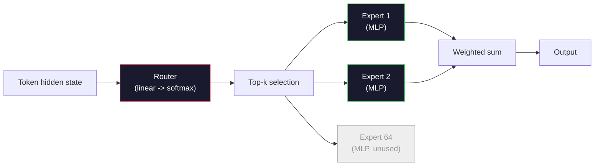

# 오픈 모델: 건축의 걸음걸이

> 4강에서 처음부터 작은 GPT-2를 만들었어요 2026년 국경 개방형 모델은 5~6개의 구체적인 변경사항을 가진 동일한 가족입니다. 레이어노름 대신 RMSNorm 이루 대신 이루 학습된 위치 대신 로페 GQA 또는 MLA 대신 전체 MHA. 전문가들의 혼합형 규모 이미 알고 있는 수학은 95%를 차지합니다. 이 수업은 Llama 3, DeepSeek-V3, Mixtral, Qwen, Gemma를 옆으로 읽고 각 건축물이 다른 지점을 나타내는 정확한 라인을 나열합니다.

**Type:** Learn
**Languages:** Python (stdlib)
**Prerequisites:** Phase 10, Lessons 04, 05, 12 (Pre-training, Scaling, Inference)
**Time:** ~45 minutes

## 학습 목표

- Llama 3, Mistral, Mixtral, Gemma 2, Qwen 2.5 및 DeepSeek-V3의 config.json를 읽어보고 각 필드를 설명하십시오
- 각 모델이 GPT-2 Small에 비해 만든 구체적인 건축적 변화를 명명하고, 첫 번째 원칙에서 정당화하십시오.
- 컴퓨팅 매개 변수 수, KV 캐시 크기와 모든 오픈 모델의 활성화 메모리는 구성에서만
- 래턴시, 메모리 및 기능 제한을 고려하여 배포 대상에 적합한 오픈 모델을 선택하십시오

## 문제

04강에서는 350개의 노선을 썼고 GPT-2형 모델이 있었습니다. Llama 3 405B는 200페이지의 기술보고서를 가지고 있습니다. 네 본능은 이 동물들은 다른 동물들이라는 거야 그렇지 않아요 200 페이지는 동일한 객체를 설명하고 있으며, 5~6가지의 원동력적인 수정과 확장에 대한 1,000개의 구현 세부사항을 포함하고 있습니다. 골격, 임베디션, 트랜스포머 블록, 관심, MLP, 정상, 머리는 변하지 않습니다.

이 수업은 다른 것입니다. 각 주요 오픈 모델 가족에 대해, 우리는 GPT-2에서 변경 된 이유를, 그리고 비용이 무엇인지 정확하게 목록을 제공합니다. 당신이 완료하면 새로운 모델 카드를 읽고 정신적으로 GPT-2 기본으로 번역 할 수 있습니다.

실제적인 보상은 메타가 Llama 5을 출시하거나 DeepSeek가 V4를 출시할 때 새로운 정신적 모델이 필요하지 않을 것입니다. 구성을 살펴보고, 잘 알려진 버튼 중 어느 쪽이 움직인다는 것을 확인하고 하류의 영향이 무엇인지 알 수 있습니다. 2026 아키텍처는 한정된 도구 상자입니다. 새로운 모델마다 다른 하위 집합을 선택합니다.

## 개념

### 변함 없는 핵심

모든 오토레그레시브 오픈 모델은 다음과 같이 공유합니다.

- 토큰 임베디션 매트릭스 (vocab_size x hidden_dim).
- N 디코더 블록의 덩어리: 표준, 자기주의, 잔류, 표준, MLP, 잔류.
- 최종 규범과 선형 머리, vocab_size (일반적으로 임베디드와 중력 묶여) 로 투영된다.
- 인과적 마스크, 다음 톤의 크로스 엔트로피 손실.

그 모양이 있고 나머지는 입니다.

### 실제로 움직이는 여섯 개의 노브

2024~2026년마다 한계 개방형 모델에서 동일한 6가지 디자인 선택이 반복적으로 선택됩니다.

1. **Normalization.**레이어노르 -> RMS노르
2. **Positional encoding.**학습된 절대 -> RoPE (그대 다른 변종: YaRN, NTK).
3. **Activation.**GELU -> SwiGLU (또는 GeGLU).
4. **Attention head sharing.**MHA -> GQA -> MQA -> MLA
5. **Dense vs sparse MLP.**밀집한 -> 전문가들의 혼합물
6. **Pre-norm placement.**전정상태가 남아 있고, 후정상태가 사라져

다른 모든 것 (학습 속도 스케줄, 데이터 믹스, 배치 크기와 컨텍스트 길이는) 은 건축이 아니라 훈련 구성에 있습니다. 6개의 버튼입니다.

### 단추 1: RMSNorm

레이어노름은 평균을 빼고 std, 스케일, 그리고 시프트에 나눈다. RMSNorm은 단지 스케일을 유지합니다.

```math
\mathop{\mathrm{RMSNorm}}(x) = \frac{x}{\sqrt{\mathop{\mathrm{mean}}(x^2) + \epsilon}} \cdot \gamma
```

평균 추출이 없습니다. 편견이 없습니다. 토큰당 1 마트무일 덜입니다. 장과 센리히 (2019) 는 기계 번역에서 레이어노르름과 일치한다고 주장하면서 10% 더 빠르다. 모든 현대 오픈 모델은 그것을 실행합니다.

비용: 전혀 없습니다. 이점은: 작은 처리량 승률, 더 간단한 코드

###  2: 로페

학습된 위치 임베디션은 GPT-2에서 1024 슬롯 검색 테이블입니다. 컨텍스트 1025는 테이블의 끝에서 떨어져 있습니다. 모델은 훈련 길이를 초월하여 추출 할 수 없습니다.

로터리 포지션 임베디션 (RoPE, Su et al. 2021) 는 각 Q 및 K 벡터를 주의점 제품보다 앞서 쌍으로 회전함으로써 위치를 주입합니다. 회전 각은 위치의 결정적 기능이기 때문에 학습할 수 있는 것도 없고, 확장 트릭 (NTK 인식 인터폴레이션, YaRN) 을 사용하면 8k 맥락에서 훈련된 모델은 가벼운 정확성 손실과 함께 추론에서 128k까지 확장 할 수 있습니다.

```
q_rotated = rotate(q, angle(pos))
k_rotated = rotate(k, angle(pos))
score = q_rotated . k_rotated
```

모든 라마, 미스트랄, 큐엔, 딥시크, 제마는 로페를 사용합니다. 제마 2는 하이브리드를 사용합니다 (대부분의 층에 로페, 다른 층에는 로컬 슬라이딩 윈도 주의).

### 3단: SWIGLU

GPT-2의 MLP는`x -> gelu(xW1 + b1) -> (...)W2 + b2`. SwiGLU (Shazeer 2020) 는 활성화 시 게이트 된 제품으로 대체합니다:

```math
\mathop{\mathrm{SwiGLU}}(x) = (xW_1) \cdot \mathop{\mathrm{sigmoid}}(xW_1) \cdot xV
```

스위스 활성화로 게이트된 1개 대신 2개의 평행형 투영이 있습니다. 매개 변수마다 미묘한 것을 경험적으로 더 강하게 한다. Llama 2는 그것을 채택하고 모든 사람들이 따라가며 MLP의 숨겨진 크기는 일반적으로 원래 밀도가 높은 MLP와 일치하도록 설정됩니다.`ff_dim = 4 * hidden`, SwiGLU 사용`ff_dim = (2/3) * 4 * hidden = 8/3 * hidden`- 그래

### 4번 노브: 주의력 헤드 공유

GPT-2 사용 **Multi-Head Attention (MHA)**각 머리는 Q, K, V 투구를 가지고 있습니다.

**Multi-Query Attention (MQA, Shazeer 2019)**모든 헤드에서 K와 V를 공유합니다. KV 캐시를 num_heads로 줄입니다. 이는 전형적인 모델에서 12x에서 32x까지 감소합니다. 하드 벤치마크에서 정확도는 약간 떨어집니다.

**Grouped-Query Attention (GQA, Ainslie et al. 2023)**중간 지점입니다$G$Q 헤드 그룹은 K와 V를 공유한다. Llama 3 8B는 32개의 Q 헤드와 8개의 KV 헤드 ($G=8$), 그래서 KV 캐시는 전체 MHA와 4x 감소합니다.

**Multi-Head Latent Attention (MLA, DeepSeek 2024)**K와 V를 공유된 낮은 순위 잠자리로 압축하여 각 머리에 다시 프로젝합니다. 더 나아가 KV 캐시를 줄이고 각 머리에 표현력을 유지합니다. DeepSeek-V2와 V3는 긴 맥락 성능에 의존합니다.

| Scheme | KV Heads | KV Cache | Accuracy |
|--------|----------|----------|----------|
| MHA    | num_heads | full | best |
| GQA    | num_groups (G < num_heads) | num_heads / G reduction | near-MHA |
| MQA    | 1 | num_heads reduction | small hit |
| MLA    | latent, per-head decompression | smaller than MQA | near-MHA |

~13B 매개 변수 이상의 모든 모델에 대해 GQA 또는 MLA는 사실상 필수적입니다.

### 5단계: 전문가들의 혼합

밀집 MLP는 모든 토큰에 대한 모든 매개 변수를 활성화합니다. MoE MLP는 블록당 K 전문가와 토큰당 (일반적으로 상위-2) 상위 k 전문가들을 선택하는 라우터를 가지고 있습니다. 그 전문가들의 무게만이 해당 토큰에 대한 전진 패스를 볼 수 있습니다.

```
router_logits = xW_r
indices, weights = top_k(router_logits, k=2)
output = sum_i weights[i] * expert[indices[i]](x)
```

호소: 각 7B 크기의 64 명의 전문가 (이므로 전체 파라마 횟수는 매우 크다) 를 가질 수 있으며, 토큰당 2 명의 전문가만 실행할 수 있습니다 (이므로 토큰 당 계산은 밀집한 7B 모델과 일치합니다). 믹스트랄 8x7B에는 47B의 총 매개 변수 있지만 토큰 당 13B만 활성화합니다. 딥시크-V3는 671B의 총 매개 변수를 가지고 있지만 토큰 당 37B만 활성화합니다.



장점: 동일한 계산, 더 많은 매개 변수, 더 나은 용량. 단점: 전문가 메모리는 여전히 어딘가에 있어야 합니다 (이 때문에 서버는 밀집한 동등보다 더 많은 VRAM가 필요합니다), 라우터의 부하 균형을 맞추는 것은 어렵고, 라우터를 정렬하는 동안 정밀 조정하는 것은 자체 연구 영역입니다.

### 6번 노브: 정규기반기 유지

원래의 트랜스포머는 각 하층에 따라 계층 규범을 적용했습니다. GPT-2 이후 모든 오픈 모델은 각 하층에 * 앞서 * 놓습니다. 사전 규범은 깊이에서 훈련하기가 엄격히 쉽습니다. 논쟁 할စရာ 없습니다.

### 모델별 차이

여기 이 콘크리트를 만드는 테이블이 있습니다.

| Model | Year | Total Params | Active Params | Norm | Activation | Position | Attention | MoE | Context |
|-------|------|-------------|---------------|------|-----------|----------|-----------|-----|---------|
| GPT-2 Small | 2019 | 124M | 124M | LayerNorm | GELU | Learned | MHA (12 heads) | no | 1k |
| Llama 3 8B | 2024 | 8B | 8B | RMSNorm | SwiGLU | RoPE | GQA (32/8) | no | 128k |
| Llama 3 70B | 2024 | 70B | 70B | RMSNorm | SwiGLU | RoPE | GQA (64/8) | no | 128k |
| Llama 3 405B | 2024 | 405B | 405B | RMSNorm | SwiGLU | RoPE | GQA (128/16) | no | 128k |
| Mistral 7B | 2023 | 7.2B | 7.2B | RMSNorm | SwiGLU | RoPE | GQA | no | 32k |
| Mixtral 8x7B | 2023 | 47B | 13B | RMSNorm | SwiGLU | RoPE | GQA | yes (8 experts, top-2) | 32k |
| Gemma 2 9B | 2024 | 9B | 9B | RMSNorm (pre+post) | GeGLU | RoPE + sliding | GQA | no | 8k |
| Qwen 2.5 72B | 2024 | 72B | 72B | RMSNorm | SwiGLU | RoPE (YaRN) | GQA (64/8) | no | 128k |
| DeepSeek V2 236B | 2024 | 236B | 21B | RMSNorm | SwiGLU | RoPE | MLA | yes (160 experts, top-6) | 128k |
| DeepSeek V3 | 2024 | 671B | 37B | RMSNorm | SwiGLU | RoPE | MLA | yes (256 experts, top-8) | 128k |
| Spark-X2.5 4B | 2026 | 4.1B | 4.1B | RMSNorm | GeGLU | RoPE + sliding (3:1) | GQA (16/4), gated output | no | 1M |

RMSNorm는 보편적입니다. SwiGLU 또는 그 GeGLU 사촌은 보편적입니다. RoPE는 보편적입니다. GQA는 MLA가 대체되는 경우를 제외하고 7B 이상으로 보편적입니다. MoE는 상단 끝의 차별수입니다.

### config.json를 읽고

Llama 3 8B 구성:

```
{
  "hidden_size": 4096,
  "intermediate_size": 14336,
  "num_hidden_layers": 32,
  "num_attention_heads": 32,
  "num_key_value_heads": 8,
  "max_position_embeddings": 131072,
  "rope_theta": 500000.0,
  "rms_norm_eps": 1e-5,
  "vocab_size": 128256
}
```

각 분야는 이미 구현한 것과 일치합니다.
새로운 구성은 몇 개의 필드를 추가하여 수학적 변화를 일으킨다
그들이 참석할 때 읽습니다.

- `head_dim`: 명시적으로 설정되어 있지 않은 경우`hidden_size / num_attention_heads`제마 2 9B는 3584개와 16개의 머리를 숨겼지만`head_dim`256, 즉 Q 투자는 3584 x 4096이고, 제곱이 아닙니다.
- `tie_word_embeddings`Llama 3 8B는 결합되지 않습니다. 이것은 525M 매개 변수입니다. 당신이 단지 한 번만 임베디션을 계산하면 놓치게됩니다.
- `layer_types`그리고`sliding_window`: 어떤 계층은 전체 맥락을 다루고, 어떤 계층은 마지막 W 토큰만을 다루고 있습니다.

- `hidden_size`: 임베디션 크기가
- `intermediate_size`: MLP 숨겨진 크기는 (3.5x 숨겨진 - SWIGLU 수학)
- `num_hidden_layers`: 스택 깊이
- `num_attention_heads`Q 헤드
- `num_key_value_heads`: KV 헤드 (GQA).
- `max_position_embeddings`: 교육의 맥락 길이가
- `rope_theta`RoPE 기본 주파수: 메타는 긴 맥락 추출을 위해 기본 10k에서 500k까지 확장했습니다.
- `rms_norm_eps`: 수학적 안정성
- `vocab_size`: 토큰

이것들만으로도 전체 매개 변수, KV 캐시, 그리고 최고 활성화 메모리를 계산할 수 있습니다.`code/main.py`정확한 공식에 대해

### 활성화 메모리 예산

몇 억 매개 변수 이상의 훈련 메모리에 활성화가 지배한다. 사전 훈련의 엄지손가락 규칙 (梯度 체크포인팅):

```
activation_mem ~ batch_size * seq_len * hidden_size * num_layers * bytes_per_element
```

Llama 3 8B에 대해, 배트 1, seq 8192, BF16, 32층, 숨겨진 4096: 약 8GB는 체크포인팅으로만 활성화되는 경우, 40GB는 체크포인팅 없이만 활성화되는 경우입니다. 이 때문에 플래시 관심과 링 관심은 중요합니다. 그들은 주의 계산을 다시 작성하여 활성화에 적합합니다.

### KV 캐시 예산

맥락에서 추론을 하기 위해:

```
kv_cache = 2 * num_layers * num_kv_heads * head_dim * max_seq_len * bytes_per_element
```

Llama 3 8B 128k 컨텍스트, BF16, 헤드_디미 = 숨겨진 / 스_헤드 = 128:
`2 * 32 * 8 * 128 * 131072 * 2 = 17.2 GB`순서대로

8B 무게는 BF16에서 16 GB입니다. 단일 128k 순서의 KV 캐시는 무게보다 크다. 이것은 GQA, MLA, KV 캐시 양량화 연구를 주도하는 메모리 압력입니다.

공식은 모든 계층이 전체 순서를 캐시하는 것을 가정합니다. 슬라이딩 창 계층은 마지막 W 토큰만 필요로합니다. 따라서 하이브리드 모델에서는 각 계층에 대한 합이 실행됩니다.

```
kv_cache = 2 * num_kv_heads * head_dim * bytes_per_element
           * (full_layers * max_seq_len + sliding_layers * min(W, max_seq_len))
```

스파크-X2.5 4B는 슬라이딩 창의 3층을 구동합니다.$W = 512$) 는 전체 주의 계층마다 9개의 전체 계층과 36개의 전체 계층에서 27개의 스라이딩이 36개입니다. BF16의 1M 토큰 맥락에서 BF16의 순서당 약 38.7GB (36 GiB) 입니다. 모든 36개의 계층이 전체 계층을 캐시하면 154.6GB (144 GiB) 이 됩니다. 전체 계층은 거의 모든 비용을 부담합니다. 그렇기 때문에 전체 계층과 슬라이딩 계층의 비율은 장기 맥락 모델에서 먼저 읽어야 할 숫자입니다.

### 각각의 모델이 승리 할 때

- **Single 80GB GPU, no MoE**: 라마 3 8B, 미스트랄 7B, 게마 2 9B. 서비스하기 쉽고 넓은 도구.
- **Single node (8x80GB), big capacity**: Llama 3 70B, Qwen 2.5 72B. 가장 높은 밀도가 높은 개방능력.
- **Biggest open capability, accept MoE complexity**: DeepSeek V3, Mixtral 8x22B. 활성 FLOP당 최고의 기능.
- **Long-context needs**: Llama 3 (128k 로페 스케일링), 딥시크 (MLA 장점).
- **Low-latency serving**: Gemma 2 9B (스라이딩 윈도우는 긴 맥락 계산을 절감한다).
- **Long context on a small memory budget**: 스파크-X2.5 4B와 같은 하이브리드 슬라이딩 윈도우 모델, 전체 컨텍스트를 위해 층의 4분의 1만이 지불합니다.

```figure
rmsnorm-vs-layernorm
```

## 건설 해

수업의 코드는 계산기입니다. 어떤 config.json를 사용하면 구성 요소에 따라 매개 변수 수, 최대 맥락에서 KV 캐시, SwiGLU MLP 비율 및 건축에 대한 짧은 판단 (밀고 / GQA / MLA / MoE) 를 인쇄합니다.

```python
config = {
    "hidden_size": 4096, "intermediate_size": 14336,
    "num_hidden_layers": 32, "num_attention_heads": 32,
    "num_key_value_heads": 8, "vocab_size": 128256,
    "max_position_embeddings": 131072,
}
```

스크립트는 아키텍처 필드를 필드별로 이동하여 임베디션, 관심 (GQA 감소 및 명시적인 `head_dim`구성에서 1을 설정할 때), MLP (SwiGLU 또는 GeGLU 확장), 레이어 노르름 및 임베디션에 묶이지 않은 경우 LM 헤드.

밀집 모델에 대해서는 전체가 출판된 매개 변수에 정확히 일치합니다. Llama 3 8B는 8,030,261,248, Gemma 2 9B는 9,241,705,984에서 나오고, Spark-X2.5 4B는 4,112,079,360. Qwen 2.5 72B는 819,200로 떨어져 있습니다.

보시다시피`code/main.py`실행에 옮기기 위해서

## 사용 하 고

스크립트에서 묶인 Llama 3 8B, Mistral 7B, Mixtral 8x7B, 그리고 DeepSeek V3 구성에서 계산기를 실행하십시오. 매개 변수 분해를 비교하십시오. MoE 모델은 밀집한 모델보다 소름이 되는 전체 매개 변수를 가지고 있지만, 종종 작아지는 활성 매개 변수를 가지고 있음을 알아보십시오. 전체 매개 변수를 가지고 있음에도 불구하고 DeepSeek V3의 KV 캐시는 Llama 3 405B보다 작습니다. 즉 MLA가 작동합니다.

다음 Gemma 2 9B와 Spark-X2.5 4B를 비교하십시오. 두 가지에 대해 스크립트는 실제로 필요한 KV 캐시를 인쇄하고 각 레이어가 전체 관심을 가지고 있다면 필요한 KV 캐시를 인쇄합니다. Gemma 2는 8k 맥락에서 1:1를 대조합니다. 따라서 저장량은 소박합니다. Spark-X2.5는 1M에서 512 토큰 창과 3:1입니다. 따라서 저장량은 4x입니다.

그 다음, 지역적으로 가지고 있는 모든 모델에 대한 구성 장치를 연결하고, 요약을 읽어보고 GPU에 맞는지 여부를 결정합니다.

## 선박

이 교훈은`outputs/skill-open-model-picker.md`. 배포 목표 (GPU 타입, VRAM, 컨텍스트 길이가, 지연 예산) 와 작업 프로필 ( 채팅, 코드, 추론, 긴 맥락) 을 고려하면, 오픈 모델, 레슨 11에서 양자화 스키메, 레슨 12에서 추론 스택을 추천하고, 6 개의 아키텍처 버튼에 대한 명시적인 추론을 제공합니다.

## 운동

1. HuggingFace에서 Qwen 2.5 72B 구성을 읽어 보세요. 전체 매개 변수를 처음부터 계산하세요. HF 보고된 값과 비교하고 어떤 델타가 어디에서 왔는지 확인하세요.

2. 딥시크 V3는 톱-8 라우팅을 가진 256명의 전문가들을 사용합니다. 전체 전문가들에 대한 활성 전문가들의 비율을 계산하고 8x7B의 톱-2에 비교하여 8개의  (稀) (25%) 에서 더 밀도가  (稀) (3%) 로의 전환은 FLOP당 용량에 대해 무엇을 의미합니까?

3. FP8 및 BF16에서 128k 컨텍스트에서 Llama 3 405B의 KV 캐시를 계산하십시오. FP8에서는 BF16 번호의 절반입니다. 단일 8xH100 노드에서 몇 개의 병렬 순서를 서비스 할 수 있습니다 (80GB 각각 = 총 640GB, 무게 메모리를 빼면)?

4. Gemma 2는 전체 관심과 슬라이딩-창-주의 계층을 대조한다. KV 캐시의 수학을 작성하면 절반의 계층이 전체 맥락 대신 4096 토큰 슬라이딩 창을 사용합니다. 전체 맥락에서 8k에서 얼마나 많은 메모리를 절약합니까?

5. 이 수업이 쓰여진 후 출시된 최근 국경 개방형 모델을 찾아보세요. 이 수업이 선택한 6개의 버튼 중 어느 쪽을 확인하고 7번째 버튼을 도입했는지 확인하세요. 새로운 건축물이 출시될 순간 교육과정은 쓸모없게 느껴질 것입니다. 목표는 여러분의 정신 모델을 재구성하지 않고 테이블을 업데이트하는 것입니다.

## 주요 용어

| Term | What people say | What it actually means |
|------|----------------|----------------------|
| RMSNorm | "LayerNorm without the mean" | Normalize by root mean square only, with a learned scale — cheaper and comparable to LayerNorm |
| RoPE | "Rotary positions" | Rotate each Q and K vector in 2D pairs by an angle that depends on position — extrapolates beyond training length with scaling tricks |
| SwiGLU | "The new MLP activation" | Gated linear unit with Swish: `(xW1) * sigmoid(xW1) * xV` — standard in every 2024+ open model |
| GQA | "Middle ground attention" | Grouped-Query Attention: G groups of Q heads share one K and one V head — shrinks KV cache without MQA's accuracy hit |
| MLA | "DeepSeek's attention" | Multi-Head Latent Attention: compress K/V into a shared low-rank latent, decompress per head — smallest KV cache for large models |
| MoE | "Sparse experts" | Mixture of Experts: N MLPs per block, router picks top-k per token — huge total params, small active params |
| Top-k routing | "Pick k experts per token" | The router computes a score per expert and activates the k highest — typical k is 2 (Mixtral) to 8 (DeepSeek) |
| YaRN | "Stretch RoPE" | Yet another RoPE extension — interpolates rotary angles to extend context from 8k to 128k+ at inference time |
| Sliding-window attention | "Don't attend to everything" | Each token attends only to the last $W$ tokens — caps attention cost at $O(W)$ per token, used in Gemma 2 and early Mistral |
| Active params | "What runs per token" | For MoE models, the parameter count that sees a forward pass per token (much smaller than total params) — governs per-token FLOPs |

## 더 많은 읽기

- [Dubey et al., 2024 -- "The Llama 3 Herd of Models"](https://arxiv.org/abs/2407.21783)-- 밀집된 라마 3 가족에 대한 건축 및 훈련 참조
- [DeepSeek-AI, 2024 -- "DeepSeek-V3 Technical Report"](https://arxiv.org/abs/2412.19437)-- MLA 더 보조 손실 없는 부하 균형 더 671B MoE
- [Jiang et al., 2024 -- "Mixtral of Experts"](https://arxiv.org/abs/2401.04088)-- 신전적 MOE 오픈 모델 페이퍼
- [Su et al., 2021 -- "RoFormer: Enhanced Transformer with Rotary Position Embedding"](https://arxiv.org/abs/2104.09864)-- RoPE 종이
- [Shazeer, 2020 -- "GLU Variants Improve Transformer"](https://arxiv.org/abs/2002.05202)-- SWIGLU, GEGLU, 그리고 친구들
- [Ainslie et al., 2023 -- "GQA: Training Generalized Multi-Query Transformer Models"](https://arxiv.org/abs/2305.13245)-- GQA 논문
- [Gemma 2 Team, 2024 -- "Gemma 2: Improving Open Language Models at a Practical Size"](https://arxiv.org/abs/2408.00118)-- 하이브리드 풀+스라이딩 관심, 프리+포스트
- [Qwen Team, 2024 -- "Qwen 2.5 Technical Report"](https://arxiv.org/abs/2412.15115)-- YaRN 컨텍스트 확장 및 장기 컨텍스트 교육 레시피
