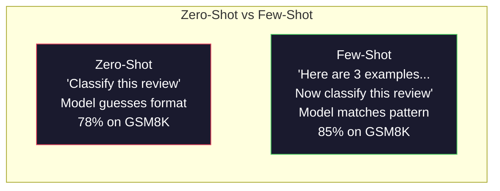
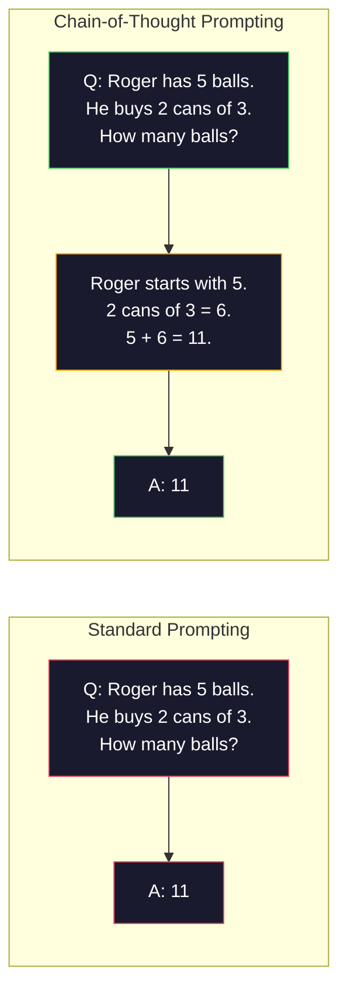
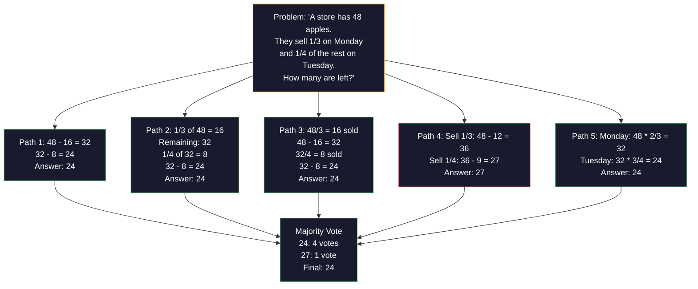
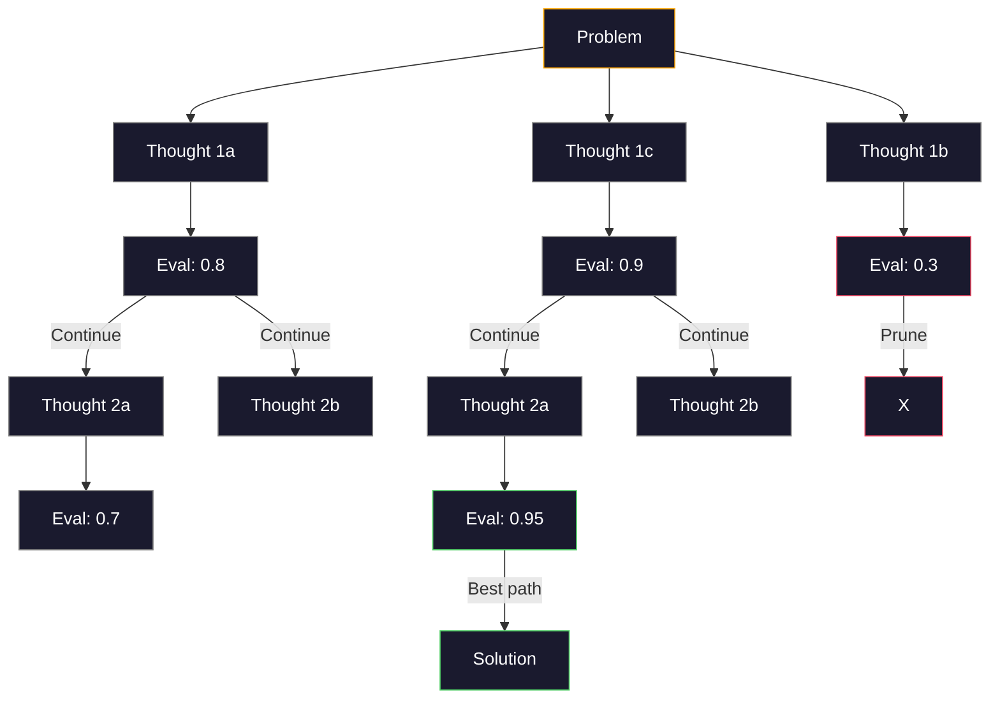
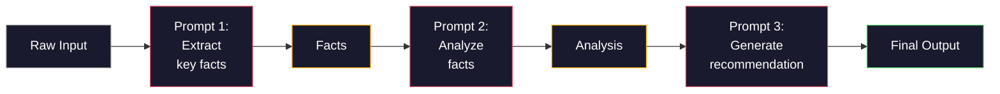

# 몇 가지 발사, 사슬, 생각의 나무

> 모델에게 무엇을 해야 하는지 말해주는 것은 자극입니다. 어떻게 생각하는지 보여주는 것은 공학입니다. 같은 모델, 같은 작업, 같은 데이터에 대한 78%와 91%의 정확성 간격은 더 나은 모델이 아닙니다. 더 나은 추론 전략입니다.

**Type:** Build
**Languages:** Python
**Prerequisites:** Lesson 11.01 (Prompt Engineering)
**Time:** ~45 minutes

## 학습 목표

- 작업 정확도를 극대화하는 예제 시범을 선택하고 포맷하여 몇 샷의 요청을 구현하십시오
- 수학 단어 문제와 같은 다단계 문제에서 정확성을 높이기 위해 사슬의 사고 (CoT) 논리를 적용하십시오
- 여러 가지 논리 경로를 탐구하고 가장 좋은 방법을 선택하는 생각의 나무의 요청을 구축하십시오
- 표준 벤치마크에서 정확성 향상을 측정하는 0샷과 몇 번의 촬영과 CoT

## 문제

수학 교양 앱을 만들면, 여러분의 요청은 "이 단어 문제를 해결해 주세요". GPT-5는 GSM8K에서 94%의 경우도 맞습니다. 초등학교 수학 기준입니다. 여러분은 이미 최고치를 달성했다고 생각합니다.

5개의 단어를 추가해 봅시다. "단계별로 생각해 봅시다". 정확도는 91%로 올라갑니다. 몇 개의 작업된 예를 추가해 보면 95%에 도달합니다. 같은 모델, 같은 온도, 같은 API 비용. 유일한 차이점은 모델에 스크래치 페이퍼를 준다는 것입니다.

이것은 해킹이 아닙니다. 이 논리는 어떻게 작동하는지입니다. 인간은 한 번의 정신적 도약에서 다 단계 문제를 해결하지 않습니다. 트랜스포머도 그렇게하지 않습니다. 중간 토큰을 생성하도록 모델을 강요하면, 그 토큰은 다음 토큰의 맥락의 일부가됩니다. 각 논리 단계는 다음 단계에 영양을 공급합니다. 모델은 문자 그대로 답을 계산합니다.

하지만 "단계별로 생각하라"는 시작이 아니라 끝입니다. 만약 당신이 다섯 가지 논리 경로를 샘플링하고 과반수의 투표를 한다면 어떨까요? 만약 당신이 모델을 가능성의 나무를 탐구하고, 그 가지를 평가하고 절단하도록 한다면 어떨까요? 만약 당신이 논리와 도구 사용을 혼재한다면 어떨까요? 이것들은 가설이 아닙니다. 그것들은 측정된 개선이 있는 출판된 기술입니다. 그리고 이 수업에서 모든 것을 구축할 것입니다.

## 개념

### 제로 샷과 몇 샷: 예제들이 지침을 이길 때

제로샷 인스트링은 모델에게 과제를 부여하고 그 밖에 아무것도 주지 않습니다. 몇 번의 샷 인스트링은 먼저 예를 제공합니다.

웨이 등 (2022) 은 8개의 벤치마크를 통해 이것을 측정했다. 감정 분류와 같은 간단한 작업에 대해, 제로샷과 소 소 소 소 소는 서로 2% 내에 수행된다. 다단계 수학적 및 상징적 추론과 같은 복잡한 작업에 대해서는 소 소 소는 정확도를 10-25% 향상시켰다.

직관: 예제들은 압축된 명령어입니다. 출력 형식을 설명하는 대신, 그것을 보여줍니다. 추론 과정을 설명하는 대신, 그것을 보여줍니다. 모델 패턴은 추상적인 명령어를 해석하는 것보다 더 신뢰할 수 있는 예제와 일치합니다.



**When few-shot wins:**형식 민감한 작업, 분류, 구조화된 추출, 영역별 용어, 모델이 특정 패턴에 맞게 필요한 모든 작업.

**When zero-shot wins:**단순한 사실적인 질문, 예제가 창의력을 제한하는 창의적인 작업, 좋은 예제를 찾는 것이 좋은 지침을 쓰는 것보다 더 어려운 작업.

### 예제 선택: 비슷한 무작위 타격

모든 예제들은 동일하지는 않습니다. 목표 입력과 유사한 예제를 선택하는 것은 분류 작업에서 무작위 선택보다 5-15% 더 나은 결과를 얻습니다. (Liu et al., 2022). 세 가지 원칙:

1. **Semantic similarity**: 임베디드 공간에서 입력에 가장 가까운 예제를 선택
2. **Label diversity**: 본 예제에서 모든 출력 범주를 포함합니다
3. **Difficulty matching**: 목표 문제의 복잡성 수준에 맞추어

대부분의 작업에 최적의 예제 수는 3-5입니다. 3 아래에는 패턴을 추출하기 위해 충분한 신호가 없습니다. 5 위에는 감소하는 수익을 누르고 컨텍스트 창 토큰을 누릅니다. 많은 레이블을 가진 분류에 대해, 레이블마다 하나의 예제를 사용하십시오.

### 사고 체인: 모델 을 제시 하는 스크래치 종이

'관념망' (CoT) 의 계기는 구글 브레인에서 Wei et al. (2022) 에 의해 도입되었다. 아이디어는 간단합니다. 모델에게 단지 답을 요청하는 대신 먼저 그 추론 단계를 보여주도록 요청하십시오.



왜 이 방법은 기계적으로 작동합니까? 트랜스포머가 생성하는 모든 토큰은 다음 토큰의 맥락이 됩니다. CoT 없이, 모델은 모든 추론을 단일 전진 패스의 숨겨진 상태로 압축해야합니다. CoT로 모델은 중간 계산을 토큰으로 외부화합니다. 각 추론 토큰은 효과적인 계산 깊이를 확장합니다.

**GSM8K benchmarks (grade-school math, 8.5K problems):**

| Model | Zero-Shot | Zero-Shot CoT | Few-Shot CoT |
|-------|-----------|---------------|--------------|
| GPT-4o | 78% | 91% | 95% |
| GPT-5 | 94% | 97% | 98% |
| o4-mini (reasoning) | 97% | — | — |
| Claude Opus 4.7 | 93% | 97% | 98% |
| Gemini 3 Pro | 92% | 96% | 98% |
| Llama 4 70B | 80% | 89% | 94% |
| DeepSeek-V3.1 | 89% | 94% | 96% |

**Note on reasoning models.**OpenAI의 o 시리즈 (o3, o4-mini) 및 DeepSeek-R1 같은 모델은 답을 내기 전에 내부적으로 사슬을 실행합니다. 추론 모델에 "단계로 생각하자"를 추가하는 것은 과잉이며 때로는 반효과를 낳습니다.

두 가지 맛의 CoT:

**Zero-shot CoT**이 문장은 "예술, 공감, 상징적 추론 과제에서 정확성을 향상시키는 것을 보여준다.

**Few-shot CoT**이 모델은 당신이 기대하는 정확한 추론 형식을 볼 수 있기 때문에, 0 샷 CoT보다 효과적입니다.

**When CoT hurts**: 간단한 사실적 회수 ("프랑스의 수도는 무엇입니까?"), 단 단계 분류, 정확성보다 속도가 중요하게 작용하는 작업. CoT는 질의당 50-200 토큰의 추론적 전반적인 비용을 추가합니다.

### 자기 일치: 많은 사람 을 샘플링 하여 한 번 투표

Wang et al. (2023) 는 자기 일치성을 도입했다. 통찰력: 단일 CoT 경로는 추론 오류가 포함될 수 있다. 그러나 N 독립적인 추론 경로를 샘플링하면 (온도를 사용하여 > 0) 최종 답변에 대해 과반수의 찬성표를 얻으면 오류는 취소됩니다.



자율성으로 GSM8K 정확도가 56.5% ( 단일 CoT) 에서 74.4%로 향상되었으며, 원래의 PaLM 540B 실험에서 N=40이 있었다. GPT-5의 개선은 기초 정확도가 이미 포화되어 있기 때문에 작습니다 (97%에서 98%) 이 기술은 60-85%의 기본 CoT 정확성을 가진 모델에서 가장 잘 니다. 단방법 오류가 자주 있지만 체계적이지 않은 달콤한 장소입니다. 추론 모델 (o 시리즈, R1) 에서 자기결합은 내장된 내부 샘플링으로 합쳐진다.

타협: N 샘플은 API 비용과 지연을 Nx로 나타냅니다. 실제에서 N=5는 대부분의 이점을 포착합니다. N=3는 의미있는 투표의 최소입니다. N> 10는 대부분의 작업에 대한 수익률이 감소합니다.

### 생각 나무: 분구 탐구

야오 등 (2023) 은 트리 오브 핑크 (ToT) 를 도입하였다. CoT가 한 선형 추론 경로를 따르는 경우, ToT는 계속하기 전에 여러 가지 분야를 탐구하고 가장 유망한 분야를 평가합니다.



TOT는 세 가지 구성 요소를 가지고 있습니다.

1. **Thought generation**: 여러 후보 다음 단계를 생성
2. **State evaluation**: 각 지원자 점수를 (심사평가로서 LLM 자체를 사용할 수 있습니다)
3. **Search algorithm**: BFS 또는 DFS를 나무로 통해 잘라내기

24개의 게임 작업 (수학을 사용하여 4개의 숫자를 합쳐 24을 만들) 에서, 표준 팅을 가진 GPT-4는 7.3%의 문제를 해결합니다. CoT에서는 4.0% (CoT는 실제로 검색 공간이 넓기 때문에 아프다). ToT에서는 74%.

ToT는 비싸다. 나무의 각 노드는 LLM 호출이 필요합니다. 분할 계수 3 및 깊이 3의 나무는 최대 39 개의 LLM 호출이 필요합니다. 검색 공간이 크고 평가 가능한 문제에서만 사용하십시오. 계획, 퍼즐 해결, 제한이있는 창의적인 문제 해결.

### 반응: 생각 + 행동

야오 등 (2022) 은 사유의 흔적을 행동과 결합했다. 모델은 사고 (사유를 생성하는) 과 행동 (툴을 호출하는, 검색, 컴퓨팅) 사이에 대행한다.

```mermaid
graph LR
    Q["Question:\nWhat is the\npopulation of the\ncountry where\nthe Eiffel Tower\nis located?"]
    T1["Thought: I need to\nfind which country\nhas the Eiffel Tower"]
    A1["Action: search\n'Eiffel Tower location'"]
    O1["Observation:\nParis, France"]
    T2["Thought: Now I need\nFrance's population"]
    A2["Action: search\n'France population 2024'"]
    O2["Observation:\n68.4 million"]
    T3["Thought: I have\nthe answer"]
    F["Answer:\n68.4 million"]

    Q --> T1 --> A1 --> O1 --> T2 --> A2 --> O2 --> T3 --> F

    style Q fill:#1a1a2e,stroke:#ffa500,color:#fff
    style T1 fill:#1a1a2e,stroke:#51cf66,color:#fff
    style A1 fill:#1a1a2e,stroke:#e94560,color:#fff
    style O1 fill:#1a1a2e,stroke:#808080,color:#fff
    style T2 fill:#1a1a2e,stroke:#51cf66,color:#fff
    style A2 fill:#1a1a2e,stroke:#e94560,color:#fff
    style O2 fill:#1a1a2e,stroke:#808080,color:#fff
    style T3 fill:#1a1a2e,stroke:#51cf66,color:#fff
    style F fill:#1a1a2e,stroke:#51cf66,color:#fff
```



ReAct은 지식 집중적인 작업에서 순수한 CoT를 능가합니다. 왜냐하면 그것은 실제 데이터에 근거를 두고 논의를 할 수 있기 때문입니다. HotpotQA (다단 질문 응답) 에서, GPT-4와 ReAct은 CoT에서만 35.1%의 정확한 일치와 29.4%를 달성합니다. 실제 힘은 관찰에 의해 논리 오류가 수정된다는 것입니다. 모델은 중 실행에서 계획을 업데이트 할 수 있습니다.

ReAct은 현대 인공지능 에이전트의 기초입니다. 모든 에이전트 프레임워크 (LangChain, CrewAI, AutoGen) 는 생각-행동-관측 루프의 어떤 변형을 구현합니다. 이 수업은 촉구 패턴을 다루고 있습니다.

### 구조화된 프롬팅: XML 태그, дели미터, 헤더

명령어들이 복잡해지면서 구조는 모델의 부분들이 혼란스러울 수 없게 합니다. 세 가지 접근법:

**XML tags**(클로드와 함께 가장 잘 작동합니다.
```
<context>
You are reviewing a pull request.
The codebase uses TypeScript and React.
</context>

<task>
Review the following diff for bugs, security issues, and style violations.
</task>

<diff>
{diff_content}
</diff>

<output_format>
List each issue with: file, line, severity (critical/warning/info), description.
</output_format>
```

**Markdown headers**(전용):
```
## Role
Senior security engineer at a fintech company.

## Task
Analyze this API endpoint for vulnerabilities.

## Input
{api_code}

## Rules
- Focus on OWASP Top 10
- Rate each finding: critical, high, medium, low
- Include remediation steps
```

**Delimiters**(최소이지만 효과적):
```
---INPUT---
{user_text}
---END INPUT---

---INSTRUCTIONS---
Summarize the above in 3 bullet points.
---END INSTRUCTIONS---
```

### 빠른 연쇄: 순서적 분해

일부 작업은 하나의 명령어에 너무 복잡합니다. 명령어 연쇄는 단계로 나뉘어, 한 명령어의 출력이 다음의 입력으로됩니다.



체인 박수는 3가지 이유로 단속적으로 뛰습니다.

1. **Each step is simpler**: 모델은 모든 것을 관절하는 대신 한 가지 집중된 작업을 처리합니다
2. **Intermediate outputs are inspectable**: 단계들 사이에 확인하고 수정할 수 있습니다
3. **Different steps can use different models**: 추출을 위한 값싼 모델을 사용, 추론을 위한 값 비싼 모델을 사용

### 성능 비교

| Technique | Best For | GSM8K Accuracy (GPT-5) | API Calls | Token Overhead | Complexity |
|-----------|----------|------------------------|-----------|----------------|------------|
| Zero-Shot | Simple tasks | 94% | 1 | None | Trivial |
| Few-Shot | Format matching | 96% | 1 | 200-500 tokens | Low |
| Zero-Shot CoT | Quick reasoning boost | 97% | 1 | 50-200 tokens | Trivial |
| Few-Shot CoT | Maximum single-call accuracy | 98% | 1 | 300-600 tokens | Low |
| Self-Consistency (N=5) | High-stakes reasoning | 98.5% | 5 | 5x token cost | Medium |
| Reasoning model (o4-mini) | Drop-in CoT replacement | 97% | 1 | hidden (2-10x internal) | Trivial |
| Tree-of-Thought | Search/planning problems | N/A (74% on Game of 24) | 10-40+ | 10-40x token cost | High |
| ReAct | Knowledge-grounded reasoning | N/A (35.1% on HotpotQA) | 3-10+ | Variable | High |
| Prompt Chaining | Complex multi-step tasks | 96% (pipeline) | 2-5 | 2-5x token cost | Medium |

올바른 기술은 정확성 요구, 지연 예산 및 비용 용납성 등 세 가지 요인에 달려 있습니다. 대부분의 생산 시스템에서 3 샘플 자체 일관성 후퇴의 몇 번의 CoT는 90%의 사용 사례를 차지합니다.

```figure
few-shot-curve
```

## 건설 해

우리는 몇 번의 시사, 사슬의 추론, 그리고 자기결합성 투표를 결합한 수학 문제 해결 방법을 하나의 파이프라인으로 만들 것입니다. 그리고 우리는 어려운 문제들을 위한 생각의 나무를 추가합니다.

전체 시행은`code/advanced_prompting.py`여기 핵심 요소들이 있습니다.

### 단계 1: 몇 장의 예제 저장소

첫 번째 구성 요소는 몇 번의 예제를 관리하고 주어진 문제에 가장 적합한 예제를 선택합니다.

```python
GSM8K_EXAMPLES = [
    {
        "question": "Janet's ducks lay 16 eggs per day. She eats three for breakfast every morning and bakes muffins for her friends every day with four. She sells every egg at the farmers' market for $2. How much does she make every day at the farmers' market?",
        "reasoning": "Janet's ducks lay 16 eggs per day. She eats 3 and bakes 4, using 3 + 4 = 7 eggs. So she has 16 - 7 = 9 eggs left. She sells each for $2, so she makes 9 * 2 = $18 per day.",
        "answer": "18"
    },
    ...
]
```

각각의 예는 세 부분으로 구성되어 있습니다. 질문, 추론망, 그리고 최종 답. 추론망은 일반 몇 발의 예시를 CoT 몇 발의 예로 변환하는 것입니다.

### 2단계: 사상 사상 사상

프롬프트 빌더는 시스템 메시지, 몇 번의 예제와 논리 연쇄와 목표 질문을 하나의 프롬프트로 집합합니다.

```python
def build_cot_prompt(question, examples, num_examples=3):
    system = (
        "You are a math problem solver. "
        "For each problem, show your step-by-step reasoning, "
        "then give the final numerical answer on the last line "
        "in the format: 'The answer is [number]'."
    )

    example_text = ""
    for ex in examples[:num_examples]:
        example_text += f"Q: {ex['question']}\n"
        example_text += f"A: {ex['reasoning']} The answer is {ex['answer']}.\n\n"

    user = f"{example_text}Q: {question}\nA:"
    return system, user
```

형식 제한 (" 답은 [수] "입니다. 그것 없이는 자기 일관성이 샘플들 간의 답을 추출하고 비교할 수 없습니다.

### 3단계: 자기결정 투표

N의 논리 경로를 샘플링하고 대다수의 답을 가져가십시오.

```python
def self_consistency_solve(question, examples, client, model, n_samples=5):
    system, user = build_cot_prompt(question, examples)

    answers = []
    reasonings = []
    for _ in range(n_samples):
        response = client.chat.completions.create(
            model=model,
            messages=[
                {"role": "system", "content": system},
                {"role": "user", "content": user}
            ],
            temperature=0.7
        )
        text = response.choices[0].message.content
        reasonings.append(text)
        answer = extract_answer(text)
        if answer is not None:
            answers.append(answer)

    vote_counts = Counter(answers)
    best_answer = vote_counts.most_common(1)[0][0] if vote_counts else None
    confidence = vote_counts[best_answer] / len(answers) if best_answer else 0

    return best_answer, confidence, reasonings, vote_counts
```

온도는 0.7가 중요합니다. 온도는 0.0에서 모든 N 샘플이 동일하게 됩니다. 목적이 떨어집니다. 다양한 추론 경로에 대한 충분한 무작위로 필요한 것은 아니지만 모델이 거칠게 만들어질 정도로 아닙니다.

### 4단계: 생각 을 풀 수 있는 방법

선형적 추론이 실패하는 문제에 대해 ToT는 여러 가지 접근 방식을 탐구하고 어떤 방향이 가장 유망하다는 것을 평가합니다.

```python
def tree_of_thought_solve(question, client, model, breadth=3, depth=3):
    thoughts = generate_initial_thoughts(question, client, model, breadth)
    scored = [(t, evaluate_thought(t, question, client, model)) for t in thoughts]
    scored.sort(key=lambda x: x[1], reverse=True)

    for current_depth in range(1, depth):
        next_thoughts = []
        for thought, score in scored[:2]:
            extensions = extend_thought(thought, question, client, model, breadth)
            for ext in extensions:
                ext_score = evaluate_thought(ext, question, client, model)
                next_thoughts.append((ext, ext_score))
        scored = sorted(next_thoughts, key=lambda x: x[1], reverse=True)

    best_thought = scored[0][0] if scored else ""
    return extract_answer(best_thought), best_thought
```

평가자는 자기 자신이 LLM입니다. 모델에게 "0.0에서 1.0의 규모에서, 이 논리 경로가 문제를 해결하는데 얼마나 유망한가?"라고 물어보세요. 이것은 ToT의 핵심 통찰력입니다. 모델은 자신의 부분적인 해결책을 평가합니다.

### 5단계: 전체 파이프라인

이 파이프라인에는 모든 기술과 격화 전략이 결합되어 있습니다.

```python
def solve_with_escalation(question, examples, client, model):
    single_answer, _ = few_shot_cot_solve(question, examples, client, model)

    sc_answer, confidence, _, _ = self_consistency_solve(
        question, examples, client, model, n_samples=5
    )

    if confidence >= 0.8 and single_answer == sc_answer:
        return sc_answer, "self_consistency", confidence

    tot_answer, _ = tree_of_thought_solve(question, client, model)
    return tot_answer, "tree_of_thought", None
```

에스컬레이션 로직: 먼저 저렴하게 시도해 보세요. 단일 결정적 경로는 투표율을 주지 않으므로 품질 검사는 동의입니다. 온도-0 응답은 샘플링 경로에서 대다수의 답변과 일치해야합니다. 그렇지 않으면, 또는 자기결합성 신뢰도가 0.8 이하 (5개의 샘플 중 4개 이상 동의) 에 이르면 ToT로 상승한다. 이것은 비용과 정확성을 균형 잡힌 것입니다. 대부분의 문제는 저렴하게 해결되고, 어려운 문제는 더 많은 계산을 할 수 있습니다.

## 사용 하 고

### 템플릿 기반의 몇 장의 샷 명령어

랭체인은 몇 번의 샷 및 CoT 패턴을 단순화하는 프롬프트 템플릿과 출력 분석에 대한 내장 지원 기능을 제공합니다.

```python
from langchain_core.prompts import FewShotPromptTemplate, PromptTemplate
from langchain_openai import ChatOpenAI

example_prompt = PromptTemplate(
    input_variables=["question", "reasoning", "answer"],
    template="Q: {question}\nA: {reasoning} The answer is {answer}."
)

few_shot_prompt = FewShotPromptTemplate(
    examples=examples,
    example_prompt=example_prompt,
    suffix="Q: {input}\nA: Let's think step by step.",
    input_variables=["input"]
)

llm = ChatOpenAI(model="gpt-4o", temperature=0.7)
chain = few_shot_prompt | llm
result = chain.invoke({"input": "If a train travels 120 km in 2 hours..."})
```

랭체인은 또한 `ExampleSelector`의미적 유사성 선택의 클래스:

```python
from langchain_core.example_selectors import SemanticSimilarityExampleSelector
from langchain_openai import OpenAIEmbeddings

selector = SemanticSimilarityExampleSelector.from_examples(
    examples,
    OpenAIEmbeddings(),
    k=3
)
```

### 컴파일 된 명령어

DSPy는 명령어 전략을 최적화 가능한 모듈로 취급합니다. CoT 명령어를 손으로 만드는 대신 서명을 정의하고 DSPy가 명령어를 최적화하도록 합니다.

```python
import dspy

dspy.configure(lm=dspy.LM("openai/gpt-4o", temperature=0.7))

class MathSolver(dspy.Module):
    def __init__(self):
        self.solve = dspy.ChainOfThought("question -> answer")

    def forward(self, question):
        return self.solve(question=question)

solver = MathSolver()
result = solver(question="Janet's ducks lay 16 eggs per day...")
```

DSPy의`ChainOfThought`자동으로 추론의 흔적을 추가합니다.`dspy.majority`자기결합성을 구현합니다.

```python
result = dspy.majority(
    [solver(question=q) for _ in range(5)],
    field="answer"
)
```

### 비교: 스크래치에서 프레임워크에

| Feature | From-Scratch (this lesson) | LangChain | DSPy |
|---------|--------------------------|-----------|------|
| Control over prompt format | Full | Template-based | Automatic |
| Self-consistency | Manual voting | Manual | Built-in (`dspy.majority`) |
| Example selection | Custom logic | `ExampleSelector` | `dspy.BootstrapFewShot` |
| Tree-of-Thought | Custom tree search | Community chains | Not built-in |
| Prompt optimization | Manual iteration | Manual | Automatic compilation |
| Best for | Learning, custom pipelines | Standard workflows | Research, optimization |

## 선박

이 수업은 두 가지 유물을 만들어냅니다.

**1. Reasoning Chain Prompt**(`outputs/prompt-reasoning-chain.md`): 생산 준비 된 자동화 프로그램 템플릿.

**2. CoT Pattern Selection Skill**(`outputs/skill-cot-patterns.md`): 작업 유형, 정확성 요구 사항 및 비용 제한에 따라 올바른 추론 기술을 선택하는 의사 결정 프레임워크.

## 운동

1. **Measure the gap**10개의 GSM8K 문제를 생각해보세요. 각각은 0샷, 0샷, 0샷 CoT, 그리고 0샷 CoT로 해결해 보세요. 각각의 정확도를 기록하세요. 어떤 기술이 모델에서 가장 큰 상승을 가져다줍니다?

2. **Example selection experiment**: 같은 10 가지 문제에서 무작위 사례 선택과 손으로 선택된 유사한 사례를 비교하십시오. 정확성 차이를 측정하십시오. 어떤 시점에서 예제 품질이 양보다 더 중요합니까?

3. **Self-consistency cost curve**N=1, 3, 5, 7, 10을 20 GSM8K 문제에서 실행하십시오. 음반 정확성 vs 비용 (총액 토큰).

4. **Build a ReAct loop**: 계산기 도구로 파이프라인을 확장하십시오. 모델이 수학 표현을 생성하면 파이썬으로 실행하십시오 `eval()`(무더기 상자) 그리고 결과를 다시 공급합니다. 도구 기반의 추론이 순수한 CoT를 능가하는지 측정합니다.

5. **ToT for creative tasks**: 창의적 글쓰기 작업에 Tree-of-Thought-solver를 조정하세요: "미치스럽고 슬픈 6 단어의 이야기를 적으십시오". LLM를 평가자로 사용하세요. 분할 탐구가 단 샷 세대보다 더 나은 창의적 결과물을 만들어 낼 수 있습니까?

## 주요 용어

| Term | What people say | What it actually means |
|------|----------------|----------------------|
| Few-shot prompting | "Give it some examples" | Including input-output demonstrations in the prompt to anchor the model's output format and behavior |
| Chain-of-Thought | "Make it think step by step" | Eliciting intermediate reasoning tokens that extend the model's effective computation before producing a final answer |
| Self-Consistency | "Run it multiple times" | Sampling N diverse reasoning paths at temperature > 0 and selecting the most common final answer by majority vote |
| Tree-of-Thought | "Let it explore options" | Structured search over reasoning branches where each partial solution is evaluated and only promising paths are expanded |
| ReAct | "Thinking + tool use" | Interleaving reasoning traces with external actions (search, compute, API calls) in a Thought-Action-Observation loop |
| Prompt chaining | "Break it into steps" | Decomposing a complex task into sequential prompts where each output feeds the next input |
| Zero-shot CoT | "Just add 'think step by step'" | Appending a reasoning trigger phrase to a prompt without any examples, relying on the model's latent reasoning capability |

## 더 많은 읽기

- [Chain-of-Thought Prompting Elicits Reasoning in Large Language Models](https://arxiv.org/abs/2201.11903)-- Wei et al. 2022. 구글 브레인에서 나온 CoT 논문.
- [Self-Consistency Improves Chain of Thought Reasoning in Language Models](https://arxiv.org/abs/2203.11171)-- Wang et al. 2023. 자기결합 논문. 테이블 1에는 필요한 모든 숫자가 있습니다.
- [Tree of Thoughts: Deliberate Problem Solving with Large Language Models](https://arxiv.org/abs/2305.10601)-- Yao et al. 2023 ToT 논문 24의 게임 결과는 4부에서 가장 중요한 부분입니다.
- [ReAct: Synergizing Reasoning and Acting in Language Models](https://arxiv.org/abs/2210.03629)-- Yao et al. 2022. 현대 인공지능 요원의 기초. 3부에서는 생각-행동-관측 루프를 설명합니다.
- [Large Language Models are Zero-Shot Reasoners](https://arxiv.org/abs/2205.11916)-- Kojima et al. 2022. "발로 생각합시다".라는 논문. 얼마나 간단하냐는 점에서 놀랍도록 효과적입니다.
- [DSPy: Compiling Declarative Language Model Calls into Self-Improving Pipelines](https://arxiv.org/abs/2310.03714)- 타브, 그리고 다른 사람들, 2023년.
- [OpenAI — Reasoning models guide](https://platform.openai.com/docs/guides/reasoning)-- 사상 연쇄가 내부적인 가격표별 "논리" 모드로 변하는 것을 제공자의 지침으로
- [Lightman et al., "Let's Verify Step by Step" (2023)](https://arxiv.org/abs/2305.20050)-- 프로세스 보너스 모델 (PRM) 는 체인의 각 단계를 평가하는; 결과에만 보너스를 얻는 논리 감독 신호.
- [Snell et al., "Scaling LLM Test-Time Compute Optimally" (2024)](https://arxiv.org/abs/2408.03314)-- CoT 길이를 체계적으로 연구하고, 자기결합 샘플링과 MCTS를 수행합니다. 여기서 "단계별로 생각하라"는 정확성이 지연보다 중요하게 할 때입니다.
