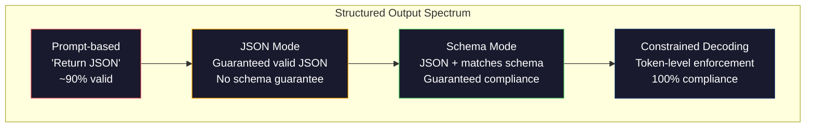
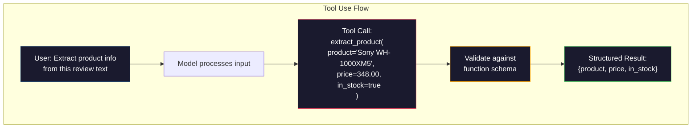

# 구조화된 출력: JSON, 스케마 검증, 제한된 디코딩

> LLM는 문자열을 반환합니다. 응용 프로그램은 JSON가 필요합니다. 그 격차는 어떤 모델 환각보다 더 많은 생산 시스템을 충돌했습니다. 구조화된 출력은 자연 언어와 입력된 데이터 사이의 다리입니다. 그것을 올바르게 수행하면 LLM는 신뢰할 수있는 API가됩니다. 잘못 수행하면 regex로 무료 텍스트를 분석합니다.

**Type:** Build
**Languages:** Python
**Prerequisites:** Phase 10, Lessons 01-05 (LLMs from Scratch)
**Time:** ~90 minutes
**Related:**5 · 20 단계 (구성 출력 및 제한된 디코딩) 는 디코더 수준의 이론 (FSM/CFG 로지트 프로세서, 라인즈, XGrammar) 을 다루고 있습니다. 이 수업은 생산 SDK 표면에 초점을 맞추고 있습니다.`response_format`, 인트로피 도구 사용, 교육자)  API 아래 무슨 일이 일어나고 있는지 이해하려면 먼저 5 · 20 단계를 읽어보십시오.

## 학습 목표

- OpenAI 및 Anthropic API 매개 변수를 사용하여 JSON 모드 및 스키마 제한 출력을 구현
- 잘못된 LLM 출력 및 오류 피드백을 다시 시도하는 Pydantic 검증 계층을 구축
- 제한된 디코딩이 어떻게 요건 수준에서 유효한 JSON를 포스트 처리 없이 유효하게 하는지를 설명합니다.
- 구조화되지 않은 텍스트를 입력된 데이터 구조로 안정적으로 변환하는 강력한 추출 명령어를 설계

## 문제

LLM를 묻는다면 "이 텍스트에서 제품 이름, 가격, 사용 가능성을 추출해 주세요".

```
The product is the Sony WH-1000XM5 headphones, which cost $348.00 and are currently in stock.
```

그것은 완벽하게 올바른 답입니다. 그것은 또한 귀하의 응용 프로그램에 완전히 쓸모 없습니다.`{"product": "Sony WH-1000XM5", "price": 348.00, "in_stock": true}`특정 키, 특정 타입, 특정 값 제한을 가진 JSON 객체가 필요합니다. 문장이 필요하지 않습니다.

순진한 해결책은 "JSON에서 응답"을 요청에 추가합니다. 90%는 효과가 있어요 나머지 10%는 JSON를 마크다운 코드 펜스에 씌우거나 "JSON: 여기있다"와 같은 프리럼블을 추가하거나 조기에 브래킷을 닫았기 때문에 문법적으로 무효 JSON를 생성합니다. JSON 파서가 충돌합니다. 파이프라인이 끊어졌어 다시 시도하고, 다시 시도하는 루프를 추가합니다. 다시 시도하면 때때로 다른 데이터가 생성됩니다. 이제 분석 문제와 함께 일관성 문제가 있습니다.

이것은 즉각적인 엔지니어링 문제가 아닙니다. 그것은 디코딩 문제입니다. 모델은 왼쪽에서 오른쪽으로 토큰을 생성합니다. 각 위치에서 100K+ 옵션의 어휘에서 가장 가능성이 높은 다음 토큰을 선택합니다. 이러한 옵션 대부분은 주어진 위치에서 무효 JSON를 생성합니다. 모델이 방금 발매하면`{"price":`, 다음 기호는 숫자로, 인용 (줄에 대한)`null``true``false`다른 모든 것은 무효 JSON를 생성합니다. 제한 없이, 모델은 매우 합리적인 영어 단어를 선택 할 수 있습니다.

## 개념

### 구조화된 출력 스펙트럼

구조화된 출력 제어의 네 가지 레벨이 있는데, 각각은 마지막보다 더 신뢰할 수 있습니다.



**Prompt-based**("정확된 JSON에서 응답"): 실행이 없습니다. 모델은 일반적으로 준수하지만 때로는 그렇지 않습니다. 신뢰성: ~ 90% . 실패 모드: 마크다운 펜스, 프리럼버스 텍스트, 단축 출력, 잘못된 구조.

**JSON mode**: API는 출력이 유효한 JSON임을 보장합니다.`response_format: { type: "json_object" }`출력값은 오류 없이 분석됩니다. 하지만 예상된 스케마와 일치하지 않을 수도 있습니다. 추가 키, 잘못된 타입, 부족한 필드.

**Schema mode**: API는 JSON 스키마를 취하고 출력과 일치하는 것을 보장합니다. 2026 년 모든 주요 공급자는 이것을 네이티브로 지원합니다: OpenAI의 `response_format: { type: "json_schema", json_schema: {...} }`(또한`tool_choice="required"`), 안드로픽의 도구 사용`input_schema`, 그리고 쌍둥이`response_schema`+ `response_mime_type: "application/json"`출력에는 당신이 지정한 키, 타입, 제한이 있습니다.

**Constrained decoding**: 생성 중 모든 토큰 위치에서 디코더는 유효하지 않은 출력을 생성하는 모든 토큰을 숨깁니다. 스케마에 숫자가 필요하고 모델이 문자를 발급하려고 한다면, 그 토큰은 확률 0으로 설정됩니다. 모델은 유효한 출력을 이끌어내는 토큰만 생성할 수 있습니다. 이것은 OpenAI의 구조화된 출력 모드와 라인즈 및 가이드런스 같은 라이브러리가 뚜 아래 구현하는 것입니다.

### JSON 스키마: 계약 언어

JSON 스키마는 출력 형태가 어떤 형태가어야 하는지 모델 (또는 검증 계층) 에게 알려주는 방법입니다. 모든 주요 구조화된 출력 시스템은 그것을 사용합니다.

```json
{
  "type": "object",
  "properties": {
    "product": { "type": "string" },
    "price": { "type": "number", "minimum": 0 },
    "in_stock": { "type": "boolean" },
    "categories": {
      "type": "array",
      "items": { "type": "string" }
    }
  },
  "required": ["product", "price", "in_stock"]
}
```

이 스케마는: 출력값은 문자열이 있는 객체일 수 있습니다`product`, 비负수`price`, 볼리언`in_stock`, 그리고 선택적으로 문자열의 배열`categories`일치하지 않는 출력은 거부됩니다.

스키마는 어려운 경우를 처리합니다. 둥지를 틀어 놓은 객체, 입력된 항목을 가진 배열, enums (줄을 특정 값으로 제한), 패턴 일치 (줄에 regex), 그리고 조합 (polimorphic 출력에서 oneOf, anyOf, allOf).

### 피단틱 패턴

파이썬에서는 JSON 스키마를 손으로 작성하지 않습니다. 파이썬틱 모델을 정의하고, 그것은 당신을 위해 스키마를 생성합니다.

```python
from pydantic import BaseModel

class Product(BaseModel):
    product: str
    price: float
    in_stock: bool
    categories: list[str] = []
```

이 방법은 위의 것과 같은 JSON 스키마를 생성합니다. 인스트루터 라이브러리 (그리고 OpenAI의 SDK) 는 Pydantic 모델을 직접 받아들이고: 모델 클래스를 통과하고 검증된 인스턴스를 다시 얻습니다. LLM 출력이 일치하지 않으면 인스트루터가 자동으로 다시 시도합니다.

### 기능 호출 / 도구 사용

동일한 문제에 대한 대체 인터페이스. 모델이 JSON를 직접 생성하도록 요청하는 대신, 입력된 매개 변수를 사용하여 "툴" (함수) 를 정의합니다. 모델은 구조화된 주장을 가진 함수 호출을 출력합니다. OpenAI는 이것을 "함수 호출"이라고합니다.



도구 사용은 모델이 매개 변수를 채우기 보다는 어떤 함수를 호출해야 하는지 선택할 때 선호된다. 만약 당신이 10 가지 다른 추출 스키마를 가지고 있고 모델이 입력에 따라 올바른 것을 선택해야 한다면, 도구 사용은 스키마 선택과 구조화된 출력을 모두 제공합니다.

### 흔히 발생하는 실패

심지어 스케마 집행에도 불구하고 구조화된 출력은 미묘한 방법으로 실패할 수 있습니다.

**Hallucinated values**: 출력 시키는 스키마와 일치하지만 발명된 데이터를 포함합니다. 모델은 생성합니다.`{"price": 299.99}`문서는 348달러라고 하면,

**Enum confusion**: 당신은  field을 제한합니다`["in_stock", "out_of_stock", "preorder"]`모델 출력`"available"`- 의미적으로 정확하지만 허용된 집합에 속하지 않습니다. 좋은 제한된 디코딩은 이것을 방지합니다.

**Nested object depth**: 깊이 둥지를 틀어 놓은 스케마 (4+ 레벨) 는 더 많은 오류를 발생시킨다.

**Array length**: 모델은 배열에 너무 많은 또는 너무 적은 항목을 생성할 수 있습니다.`minItems`그리고`maxItems`하지만 모든 공급자는 디코딩 수준에서 적용하지 않습니다.

**Optional field omission**: 모델은 기술적으로 선택적이지만 사용 사례에 의미적으로 중요한 필드를 생략합니다. 데이터를 놓친 경우에도 불구하고 스키마에서 요구되는 대로 설정합니다.`null`분명히

```figure
mx-schema-funnel
```

## 건설 해

### 단계 1: JSON 스키마 검증기

파이썬 객체가 JSON 스키마에 맞는지 여부를 확인하는 검증기를 처음부터 구축하십시오. 이것은 준수를 확인하기 위해 출력면에 실행됩니다.

```python
import json

def validate_schema(data, schema):
    errors = []
    _validate(data, schema, "", errors)
    return errors

def _validate(data, schema, path, errors):
    schema_type = schema.get("type")

    if schema_type == "object":
        if not isinstance(data, dict):
            errors.append(f"{path}: expected object, got {type(data).__name__}")
            return
        for key in schema.get("required", []):
            if key not in data:
                errors.append(f"{path}.{key}: required field missing")
        properties = schema.get("properties", {})
        for key, value in data.items():
            if key in properties:
                _validate(value, properties[key], f"{path}.{key}", errors)

    elif schema_type == "array":
        if not isinstance(data, list):
            errors.append(f"{path}: expected array, got {type(data).__name__}")
            return
        min_items = schema.get("minItems", 0)
        max_items = schema.get("maxItems", float("inf"))
        if len(data) < min_items:
            errors.append(f"{path}: array has {len(data)} items, minimum is {min_items}")
        if len(data) > max_items:
            errors.append(f"{path}: array has {len(data)} items, maximum is {max_items}")
        items_schema = schema.get("items", {})
        for i, item in enumerate(data):
            _validate(item, items_schema, f"{path}[{i}]", errors)

    elif schema_type == "string":
        if not isinstance(data, str):
            errors.append(f"{path}: expected string, got {type(data).__name__}")
            return
        enum_values = schema.get("enum")
        if enum_values and data not in enum_values:
            errors.append(f"{path}: '{data}' not in allowed values {enum_values}")

    elif schema_type == "number":
        if not isinstance(data, (int, float)):
            errors.append(f"{path}: expected number, got {type(data).__name__}")
            return
        minimum = schema.get("minimum")
        maximum = schema.get("maximum")
        if minimum is not None and data < minimum:
            errors.append(f"{path}: {data} is less than minimum {minimum}")
        if maximum is not None and data > maximum:
            errors.append(f"{path}: {data} is greater than maximum {maximum}")

    elif schema_type == "boolean":
        if not isinstance(data, bool):
            errors.append(f"{path}: expected boolean, got {type(data).__name__}")

    elif schema_type == "integer":
        if not isinstance(data, int) or isinstance(data, bool):
            errors.append(f"{path}: expected integer, got {type(data).__name__}")
```

### 단계 2: 피단틱 스타일 모델에서 스케마

최소 클래스에서 스케마 변환기를 구축합니다. 파이썬 클래스를 정의하고 자동으로 JSON 스케마를 생성합니다.

```python
class SchemaField:
    def __init__(self, field_type, required=True, default=None, enum=None, minimum=None, maximum=None):
        self.field_type = field_type
        self.required = required
        self.default = default
        self.enum = enum
        self.minimum = minimum
        self.maximum = maximum

def python_type_to_schema(field):
    type_map = {
        str: "string",
        int: "integer",
        float: "number",
        bool: "boolean",
    }

    schema = {}

    if field.field_type in type_map:
        schema["type"] = type_map[field.field_type]
    elif field.field_type == list:
        schema["type"] = "array"
        schema["items"] = {"type": "string"}
    elif isinstance(field.field_type, dict):
        schema = field.field_type

    if field.enum:
        schema["enum"] = field.enum
    if field.minimum is not None:
        schema["minimum"] = field.minimum
    if field.maximum is not None:
        schema["maximum"] = field.maximum

    return schema

def model_to_schema(name, fields):
    properties = {}
    required = []

    for field_name, field in fields.items():
        properties[field_name] = python_type_to_schema(field)
        if field.required:
            required.append(field_name)

    return {
        "type": "object",
        "properties": properties,
        "required": required,
    }
```

### 단계 3: 제한된 토큰 필터

제한된 디코딩을 시뮬레이션하십시오. 부분적인 JSON 문자열과 스키마를 고려하면 현재 위치에서 어떤 토큰 카테고리가 유효하는지 결정하십시오.

```python
def next_valid_tokens(partial_json, schema):
    stripped = partial_json.strip()

    if not stripped:
        return ["{"]

    try:
        json.loads(stripped)
        return ["<EOS>"]
    except json.JSONDecodeError:
        pass

    last_char = stripped[-1] if stripped else ""

    if last_char == "{":
        return ['"', "}"]
    elif last_char == '"':
        if stripped.endswith('":'):
            return ['"', "0-9", "true", "false", "null", "[", "{"]
        return ["a-z", '"']
    elif last_char == ":":
        return [" ", '"', "0-9", "true", "false", "null", "[", "{"]
    elif last_char == ",":
        return [" ", '"', "{", "["]
    elif last_char in "0123456789":
        return ["0-9", ".", ",", "}", "]"]
    elif last_char == "}":
        return [",", "}", "]", "<EOS>"]
    elif last_char == "]":
        return [",", "}", "<EOS>"]
    elif last_char == "[":
        return ['"', "0-9", "true", "false", "null", "{", "[", "]"]
    else:
        return ["any"]

def demonstrate_constrained_decoding():
    partial_states = [
        '',
        '{',
        '{"product"',
        '{"product":',
        '{"product": "Sony"',
        '{"product": "Sony",',
        '{"product": "Sony", "price":',
        '{"product": "Sony", "price": 348',
        '{"product": "Sony", "price": 348}',
    ]

    print(f"{'Partial JSON':<45} {'Valid Next Tokens'}")
    print("-" * 80)
    for state in partial_states:
        valid = next_valid_tokens(state, {})
        display = state if state else "(empty)"
        print(f"{display:<45} {valid}")
```

### 4단계: 추출 파이프라인

모든 것을 추출 파이프라인으로 결합하여: 스케마를 정의하고, 구조화된 출력을 생산하는 LLM를 시뮬레이션하고, 출력을 검증하고, 재실험을 처리합니다.

```python
def simulate_llm_extraction(text, schema, attempt=0):
    if "headphones" in text.lower() or "sony" in text.lower():
        if attempt == 0:
            return '{"product": "Sony WH-1000XM5", "price": 348.00, "in_stock": true, "categories": ["audio", "headphones"]}'
        return '{"product": "Sony WH-1000XM5", "price": 348.00, "in_stock": true}'

    if "laptop" in text.lower():
        return '{"product": "MacBook Pro 16", "price": 2499.00, "in_stock": false, "categories": ["computers"]}'

    return '{"product": "Unknown", "price": 0, "in_stock": false}'

def extract_with_retry(text, schema, max_retries=3):
    for attempt in range(max_retries):
        raw = simulate_llm_extraction(text, schema, attempt)

        try:
            data = json.loads(raw)
        except json.JSONDecodeError as e:
            print(f"  Attempt {attempt + 1}: JSON parse error -- {e}")
            continue

        errors = validate_schema(data, schema)
        if not errors:
            return data

        print(f"  Attempt {attempt + 1}: Schema validation errors -- {errors}")

    return None

product_schema = {
    "type": "object",
    "properties": {
        "product": {"type": "string"},
        "price": {"type": "number", "minimum": 0},
        "in_stock": {"type": "boolean"},
        "categories": {"type": "array", "items": {"type": "string"}},
    },
    "required": ["product", "price", "in_stock"],
}
```

### 5단계: 전체 파이프 라인을 실행 하십시오

```python
def run_demo():
    print("=" * 60)
    print("  Structured Output Pipeline Demo")
    print("=" * 60)

    print("\n--- Schema Definition ---")
    product_fields = {
        "product": SchemaField(str),
        "price": SchemaField(float, minimum=0),
        "in_stock": SchemaField(bool),
        "categories": SchemaField(list, required=False),
    }
    generated_schema = model_to_schema("Product", product_fields)
    print(json.dumps(generated_schema, indent=2))

    print("\n--- Schema Validation ---")
    test_cases = [
        ({"product": "Test", "price": 10.0, "in_stock": True}, "Valid object"),
        ({"product": "Test", "price": -5.0, "in_stock": True}, "Negative price"),
        ({"product": "Test", "in_stock": True}, "Missing price"),
        ({"product": "Test", "price": "ten", "in_stock": True}, "String as price"),
        ("not an object", "String instead of object"),
    ]

    for data, label in test_cases:
        errors = validate_schema(data, product_schema)
        status = "PASS" if not errors else f"FAIL: {errors}"
        print(f"  {label}: {status}")

    print("\n--- Constrained Decoding Simulation ---")
    demonstrate_constrained_decoding()

    print("\n--- Extraction Pipeline ---")
    texts = [
        "The Sony WH-1000XM5 headphones are priced at $348 and currently available.",
        "The new MacBook Pro 16-inch laptop costs $2499 but is sold out.",
        "This is a random sentence with no product info.",
    ]

    for text in texts:
        print(f"\n  Input: {text[:60]}...")
        result = extract_with_retry(text, product_schema)
        if result:
            print(f"  Output: {json.dumps(result)}")
        else:
            print(f"  Output: FAILED after retries")
```

## 사용 하 고

### OpenAI 구조화된 출력

```python
# from openai import OpenAI
# from pydantic import BaseModel
#
# client = OpenAI()
#
# class Product(BaseModel):
#     product: str
#     price: float
#     in_stock: bool
#
# response = client.beta.chat.completions.parse(
#     model="gpt-5-mini",
#     messages=[
#         {"role": "system", "content": "Extract product information."},
#         {"role": "user", "content": "Sony WH-1000XM5, $348, in stock"},
#     ],
#     response_format=Product,
# )
#
# product = response.choices[0].message.parsed
# print(product.product, product.price, product.in_stock)
```

OpenAI의 구조화된 출력 모드는 내부적으로 제한된 디코딩을 사용합니다. 모델이 생성하는 모든 토큰은 피단틱 스키마에 맞는 출력을 생성할 수 있습니다. 재시험이 필요하지 않습니다. 검증이 필요하지 않습니다. 제한은 디코딩 프로세스에 구워집니다.

### 인류적 도구 사용

```python
# import anthropic
#
# client = anthropic.Anthropic()
#
# response = client.messages.create(
#     model="claude-opus-4-7",
#     max_tokens=1024,
#     tools=[{
#         "name": "extract_product",
#         "description": "Extract product information from text",
#         "input_schema": {
#             "type": "object",
#             "properties": {
#                 "product": {"type": "string"},
#                 "price": {"type": "number"},
#                 "in_stock": {"type": "boolean"},
#             },
#             "required": ["product", "price", "in_stock"],
#         },
#     }],
#     messages=[{"role": "user", "content": "Extract: Sony WH-1000XM5, $348, in stock"}],
# )
```

인트로픽은 도구 사용으로 구조화된 출력을 달성합니다. 모델은 input_schema에 맞는 구조화된 주장으로 도구 호출을 발행합니다. 동일한 결과, 다른 API 표면.

### 교육자 도서관

```python
# pip install instructor
# import instructor
# from openai import OpenAI
# from pydantic import BaseModel
#
# client = instructor.from_openai(OpenAI())
#
# class Product(BaseModel):
#     product: str
#     price: float
#     in_stock: bool
#
# product = client.chat.completions.create(
#     model="gpt-5-mini",
#     response_model=Product,
#     messages=[{"role": "user", "content": "Sony WH-1000XM5, $348, in stock"}],
# )
```

인스트루터 (instructor) 는 LLM 클라이언트를 포장하고 검증과 함께 자동으로 재시험을 추가합니다. 첫 번째 시도가 검증에 실패하면, 오류를 맥락으로 모델로 다시 보내 출력을 수정하도록 요청합니다. 이것은 OpenAI뿐만 아니라 모든 공급자와 함께 작동합니다.

## 선박

이 교훈은`outputs/prompt-structured-extractor.md`-- 스키마 정의를 받은 모든 텍스트에서 구조화된 데이터를 추출하는 재사용 가능한 프롬프트 템플릿. JSON 스키마와 구조화되지 않은 텍스트를 입력하여 검증된 JSON를 반환합니다.

또한 생산합니다`outputs/skill-structured-outputs.md`-- 공급자, 신뢰성 요구 사항 및 스케마 복잡성에 따라 올바른 구조화된 출력 전략을 선택하는 의사 결정 프레임워크

## 운동

1. 스키마 검증기를 지원하도록 확장합니다 `oneOf`(데이터는 여러 스케마 중 하나와 정확히 일치해야 합니다) 이 다형 출력을 처리합니다. 예를 들어,`Product`또는`Service`다른 모양의 물체

2. 두 개의 스키마를 비교하고 깨는 변경 사항 (필요한 필드 제거, 변경된 유형) 을 비해하는 변경 사항 (선택 필드 추가, 완화 된 제한) 을 식별하는 "프로그램 차이" 도구를 구축하십시오. 이것은 생산에서 추출 스키마 버전을 위해 필수적입니다.

3. 보다 현실적인 제한된 디코딩 시뮬레이터를 구현하십시오. JSON 스키마와 100 개의 토큰 (자문, 숫자, 점포, 키워드) 의 어휘를 고려하면, 단계별로 생성 과정을 거쳐, 각 위치에서 무효 토큰을 위장합니다. 각 단계에 유효한 어휘의 비율을 측정합니다.

4. 추출 평가 스위트를 구축하십시오. 50개의 제품 설명서를 손으로 표시된 JSON 출력으로 생성하십시오. 50개의 추출 파이프라인을 실행하여 정확한 일치, 필드 레벨 정확성 및 타입 준수도를 측정합니다. 올바르게 추출하기 가장 어려운 필드를 식별하십시오.

5. 추출 파이프라인에 "신뢰 점수"를 추가하십시오. 추출된 각 필드마다 모델이 얼마나 자신감이 있는지 추정하십시오 (표표표 확률에 따라 또는 추출을 3 번 실행하여 일관성을 측정함으로써). 인간 검토를 위해 낮은 신뢰도를 나타내는 필드를 표시하십시오.

## 주요 용어

| Term | What people say | What it actually means |
|------|----------------|----------------------|
| JSON mode | "Returns JSON" | API flag that guarantees syntactically valid JSON output, but does not enforce any particular schema |
| Structured output | "Typed JSON" | Output that matches a specific JSON Schema with correct keys, types, and constraints |
| Constrained decoding | "Guided generation" | At each token position, mask out tokens that would produce invalid output -- guarantees 100% schema compliance |
| JSON Schema | "A JSON template" | A declarative language for describing the structure, types, and constraints of JSON data (used by OpenAPI, JSON Forms, etc.) |
| Pydantic | "Python dataclasses+" | Python library that defines data models with type validation, used by FastAPI and Instructor to generate JSON Schemas |
| Function calling | "Tool use" | LLM outputs a structured function invocation (name + typed arguments) instead of free text -- OpenAI and Anthropic both support this |
| Instructor | "Pydantic for LLMs" | Python library that wraps LLM clients to return validated Pydantic instances, with automatic retry on validation failure |
| Token masking | "Filtering the vocabulary" | Setting specific token probabilities to zero during generation so the model cannot produce them |
| Schema compliance | "Matches the shape" | The output has every required field, correct types, values within constraints, and no extra disallowed fields |
| Retry loop | "Try again until it works" | Send validation errors back to the model and ask it to fix the output -- Instructor does this automatically, up to a configurable max |

## 더 많은 읽기

- [OpenAI Structured Outputs Guide](https://platform.openai.com/docs/guides/structured-outputs)-- OpenAI API에서 JSON 스키마 기반의 제한적 디코딩에 대한 공식 문서
- [Willard & Louf, 2023 -- "Efficient Guided Generation for Large Language Models"](https://arxiv.org/abs/2307.09702)-- 스라인 문서, 토큰 수준의 제한을 위해 JSON 스키마를 최종 상태 기계로 컴파일하는 방법을 설명합니다
- [Instructor documentation](https://python.useinstructor.com/)-- Pydantic 검증 및 재시험을 가진 LLM에서 구조화된 결과물을 얻는 표준 도서관
- [Anthropic Tool Use Guide](https://docs.anthropic.com/en/docs/tool-use)-- 클로드가 JSON Schema input_schema를 통해 도구 사용으로 구조화된 출력을 구현하는 방법
- [JSON Schema specification](https://json-schema.org/)-- 모든 주요 구조화된 출력 시스템에서 사용되는 스키마 언어의 전체 스펙
- [Outlines library](https://github.com/outlines-dev/outlines)-- 오픈소스 제한된 생성, Regex 및 JSON 스키마를 사용하여
- [Dong et al., "XGrammar: Flexible and Efficient Structured Generation Engine for Large Language Models" (MLSys 2025)](https://arxiv.org/abs/2411.15100)-- 현대의 최첨단 문법 엔진; 토큰을 ~ 100ns / 토큰으로 마스크하는 푸시 다운 자동 컴파일
- [Beurer-Kellner et al., "Prompting Is Programming: A Query Language for Large Language Models" (LMQL)](https://arxiv.org/abs/2212.06094)-- LMQL 종이 프레임링은 타입과 값 제한을 가진 쿼리 언어로 제한된 디코딩을 했습니다.
- [Microsoft Guidance (framework docs)](https://github.com/guidance-ai/guidance)-- 템플릿 기반의 제한된 생성; 판매자 비정상적인 아웃라인과 XGrammar의 보완.
