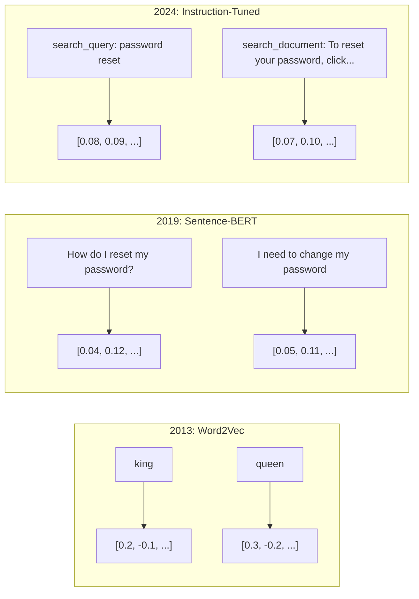
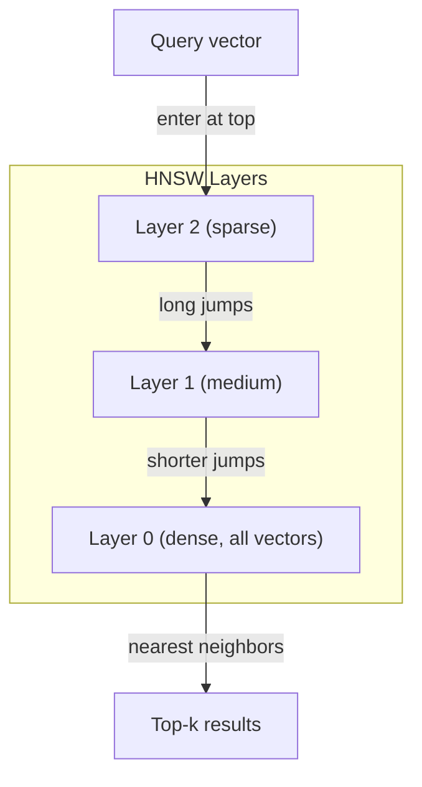
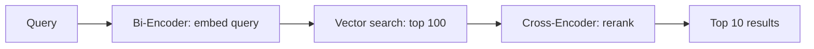

# 임베디션 및 벡터 표현

> 텍스트는 분리된 것입니다. 수학은 연속적입니다. LLM에서 "동일한" 문서를 찾아, 의미를 비교하거나 키워드를 넘어 검색하도록 요청할 때마다, 여러분은 이 두 세계 사이의 다리에 의존하고 있습니다. 그 다리는 임베디션입니다. 임베디션을 이해하지 못한다면, 당신은 현대 인공지능을 이해하지 못합니다. 당신은 그것을 사용합니다.

**Type:** Build
**Languages:** Python
**Prerequisites:** Phase 11, Lesson 01 (Prompt Engineering)
**Time:** ~75 minutes
**Related:**5 · 22 단계 (Embedding Models Deep Dive) 는 밀집한 대 희소한 대 다중벡터, 마트리오스카 단절 및 각 축 모델 선택을 다루고 있습니다. 이 수업은 생산 파이프라인 (벡터 DBs, HNSW, 유사성 수학) 에 초점을 맞추고 있습니다. 모델을 선택하기 전에 5 · 22 단계를 읽으십시오.

## 학습 목표

- API 제공자와 오픈소스 모델을 사용하여 텍스트 임베디션을 생성하고, 그들 사이의 코시노 유사성을 계산합니다.
- 임베디드가 키워드 검색이 처리할 수 없는 어휘 부합 문제를 해결하는 이유를 설명하십시오.
- 정확한 키워드 일치보다는 의미에 따라 문서를 검색하는 의미 검색 지수를 구축
- 검색 기준을 사용하여 임베디션 품질을 평가하고 (precision@k, recall) 작업에 적합한 임베디션 모델을 선택하십시오.

## 문제

당신은 10,000개의 지원 티켓을 가지고 있습니다. 고객이 "내 결제가 이루어지지 않았습니다". 같은 과거 티켓을 찾아야 합니다. 키워드 검색은 "결제"와 "가 이루어지지 않았습니다".

이것은 어휘 부합 문제입니다. 인간 언어는 같은 것을 말하는 수십 가지 방법이 있습니다. 키워드 검색은 각각의 단어를 의미없는 독립적인 상징으로 취급합니다. "하락"과 "내리지 않았습니다"는 같은 개념을 가리키는 것을 알 수 없습니다.

문자 표현은 문자법보다는 의미가 유사성을 결정하는 문장이 필요합니다. "내 지불은 이루어지지 않았다"와 "거래가 거절당했다"를 수학 공간에서 서로 밀접하게 배치하는 방법이 필요합니다. "내 지불은 시간에 도착했습니다"라는 단어를 공유하고 있음에도 불구하고 "결제"라는 단어를 멀리 밀어내는 동안.

그 표현은 임베디션입니다.

## 개념

### 임베디언 은 무엇 입니까?

임베디드는 텍스트의 의미를 나타내는 부동소수점 숫자의 밀집한 벡터입니다. "밀집"라는 단어는 중요합니다. 모든 차원은 거의 모든 차원이 0인 빈어리 표현과 달리 정보를 가지고 있습니다.

"고양이 매트에 앉았어"는 이런 식으로 변합니다.`[0.023, -0.041, 0.087, ..., 0.012]`768에서 3072까지의 숫자의 목록입니다. 모델에 따라. 이 숫자는 의미를 암호화합니다. 당신은 직접 확인하지 않습니다. 당신은 그들을 비교합니다.

### 워드2베크의 돌파구

2013년, 토마스 미코로프와 구글의 동료들은 Word2Vec를 발표했습니다. 핵심 통찰력은: 이웃으로부터 단어를 예측하기 위해 신경망을 훈련시키는 것입니다.

유명한 결과:

```
king - man + woman = queen
```

단어 임베디션에 대한 벡터 수학적 은 의미적 관계를 포착한다. "남자"에서 "여자"의 방향은 "왕"에서 "왕후"의 방향과 대략 동일하다. 이 시점에서는 기하학이 의미를 암호화할 수 있다는 것을 깨달았습니다.

Word2Vec는 300차원 벡터를 생성했습니다. 각 단어는 맥락에 관계없이 하나의 벡터를 얻었습니다. "강변"과 "은행 계좌"는 동일한 임베디션을 가지고있었습니다. 이 제한은 다음 십 년 동안 연구를 주도했습니다.

### 말 에서 문장 까지

워드 임베디션은 단일 토큰을 나타냅니다. 생산 시스템은 전체 문장, 문장 또는 문서를 임베디드해야합니다. 네 가지 접근법이 등장했습니다.

**Averaging**문장 내 모든 단어 벡터의 평균을 보세요. 값싼, 손실이 많고 짧은 텍스트에 놀라울 정도로 괜찮습니다. 단어 순서를 완전히 잃습니다. "개는 사람을 물어요".

**CLS token**: 트랜스포머 모델 (BERT, 2018) 은 전체 입력을 나타내는 특수 [CLS] 토큰 임베디션을 내보내기. 평균보다 낫지만 [CLS] 토큰은 유사성보다는 다음 문장을 예측하기 위해 훈련되었습니다.

**Contrastive learning**: 비슷한 쌍을 서로 밀어내고 다른 쌍을 분리하기 위해 모델을 명시적으로 훈련합니다. Sentence-BERT (Reimers & Gurevych, 2019) 는 이 방법을 사용하여 현대 임베디션 모델의 기초가되었습니다. "나는 암호를 어떻게 재설정합니까?"와 "나는 암호를 변경해야합니까?"를 고려하면 모델은 거의 동일한 벡터를 가져야한다는 것을 알게됩니다.

**Instruction-tuned embeddings**E5 및 GTE와 같은 모델은 모델에 어떤 종류의 임베디션을 생성해야 하는지 알려주는 작업 전두엽 ("search_query:", "search_document:") 를 수용합니다. 이것은 하나의 모델이 여러 작업을 수행 할 수 있습니다.



### 현대적 인 임베디션 모델

시장은 몇 가지 생산급 옵션으로 자리잡았습니다 (MTEB 점수는 2026년 초, MTEB v2):

| Model | Provider | Dimensions | MTEB | Context | Cost / 1M tokens |
|-------|----------|-----------|------|---------|------------------|
| Gemini Embedding 2 | Google | 3072 (Matryoshka) | 67.7 (retrieval) | 8192 | $0.15 |
| embed-v4 | Cohere | 1024 (Matryoshka) | 65.2 | 128K | $0.12 |
| voyage-4 | Voyage AI | 1024/2048 (Matryoshka) | 66.8 | 32K | $0.12 |
| text-embedding-3-large | OpenAI | 3072 (Matryoshka) | 64.6 | 8192 | $0.13 |
| text-embedding-3-small | OpenAI | 1536 (Matryoshka) | 62.3 | 8192 | $0.02 |
| BGE-M3 | BAAI | 1024 (dense+sparse+ColBERT) | 63.0 multilingual | 8192 | Open-weight |
| Qwen3-Embedding | Alibaba | 4096 (Matryoshka) | 66.9 | 32K | Open-weight |
| Nomic-embed-v2 | Nomic | 768 (Matryoshka) | 63.1 | 8192 | Open-weight |

MTEB (Massive Text Embedding Benchmark) v2는 검색, 분류, 클러스터링, 재등급 및 요약 전반에 걸쳐 100+ 작업을 다루고 있습니다. 더 높으면 더 좋겠어 2026년까지, 오픈 웨이트 모델 (Qwen3-Embedding, BGE-M3) 는 대부분의 축에 폐쇄된 호스트 모델과 일치하거나 이길 수 있습니다. 트메니 임베디언 2는 순수한 검색을 이끌고 있습니다. 여행 / 코헤어는 특정 영역 (금융, 법률, 코드) 를 이끌고 있습니다. 항상 자신의 질문들을 기준으로 설정해

### 유사성 측정

두 개의 임베디션 벡터를 고려하면, 세 가지 방법으로 그들이 얼마나 비슷하는지 측정합니다.

**Cosine similarity**: 두 벡터 사이의 각의 코시네스. -1 (반대) 에서 1 (동방향) 까지의 범위입니다. 크기를 무시합니다. 10 단어 문장과 500 단어 문서가 같은 방향으로 표시되면 1.0을 얻을 수 있습니다. 이것은 90%의 사용 사례에서 기본입니다.

```math
\mathop{\mathrm{cosine\_sim}}(a, b) = \frac{\mathop{\mathrm{dot}}(a, b)}{\lVert a \rVert \cdot \lVert b \rVert}
```

**Dot product**: 두 개의 벡터의 원자 내부 산물. 벡터가 정상화될 때 코시네스 유사성과 동일 (단체 길이가). 계산에 더 빨리. OpenAI의 임베디션은 정상화되어 있으므로 점산물과 코시네스 같은 순위를 제공합니다.

```math
\mathop{\mathrm{dot}}(a, b) = \sum_i a_i b_i
```

**Euclidean (L2) distance**: 벡터 공간에서 직선 거리를. 작은 = 더 비슷하다. 크기의 차이에 민감하다. 공간에서 절대적 위치가 중요할 때 사용한다. 방향뿐만 아니라.

```math
\mathop{\mathrm{L2}}(a, b) = \sqrt{\sum_i (a_i - b_i)^2}
```

언제 사용해야 하는 것:

| Metric | Use when | Avoid when |
|--------|----------|------------|
| Cosine similarity | Comparing texts of different lengths; most retrieval tasks | Magnitude carries information |
| Dot product | Embeddings are already normalized; maximum speed | Vectors have varying magnitudes |
| Euclidean distance | Clustering; spatial nearest-neighbor problems | Comparing documents of wildly different lengths |

### 벡터 데이터베이스 및 HNSW

1억 개의 1536개 차원의 벡터에서 1억 500만개의 곱셈 연산을 쿼리에 비교합니다. 너무 느립니다.

벡터 데이터베이스에서는 대략적인 가까운 이웃 (ANN) 알고리즘을 사용하여 이를 해결합니다. 지배적인 알고리즘은 HNSW (위계 내비게블 작은 세계) 이다:

1. 여러 층의 벡터 그래프를 작성
2. 상위층은 희귀합니다. 먼 클러스터들 사이의 긴 거리의 연결
3. 밑층은 밀도가 높습니다. 근처의 벡터들 사이의 미세한 곡물 연결
4. 검색은 상위층에서 시작되며, 탐욕적으로 정제하기 위해 내려갑니다.
5. 에서 대략적인 top-k 결과를 반환합니다$O(\log n)$시간 대신$O(n)$

HNSW는 작은 정확성 손실 (일반적으로 95-99% 회수) 를 대대적인 속도 증가로 거래합니다. 1000만 벡터에서, 무력력은 초를 필요로 합니다. HNSW는 밀리초를 필요로 합니다.



생산 옵션:

| Database | Type | Best for | Max scale |
|----------|------|----------|-----------|
| Pinecone | Managed SaaS | Zero-ops production | Billions |
| Weaviate | Open source | Self-hosted, hybrid search | 100M+ |
| Qdrant | Open source | High performance, filtering | 100M+ |
| ChromaDB | Embedded | Prototyping, local dev | 1M |
| pgvector | Postgres extension | Already using Postgres | 10M |
| FAISS | Library | In-process, research | 1B+ |

### 셈 전략

문서들은 하나의 벡터로 삽입할 수 없을 정도로 길습니다. 50페이지 PDF는 수십 가지 주제들을 다루고 있습니다. 그 삽입은 모든 것의 평균이 됩니다.

**Fixed-size chunking**M-토큰의 초복으로 N 토큰을 나눌 수 있습니다. 간단하고 예측할 수 있습니다. 문서가 명확한 구조가 없을 때 잘 작동합니다. 50 토큰의 초복으로 512 토큰의 조각: 1 조각은 0-511 토큰, 2 조각은 462-973 토큰입니다.

**Sentence-based chunking**문장 한계에 나뉘어 문장을 묶어 칩 한계에 도달할 때까지. 각 조각은 적어도 한 개의 완전한 문장을 의미합니다. 고정 크기의 것보다 더 낫습니다. 왜냐하면 당신은 결코 한 생각을 반으로 잘라내지 않기 때문입니다.

**Recursive chunking**: 가장 큰 경계에서 먼저 분할을 시도하십시오 (부문 헤더) 아직 너무 큰 경우, 문장 경계로 시도하십시오.`RecursiveCharacterTextSplitter`그리고 혼합형체에도 잘 작동합니다.

**Semantic chunking**: 각 문장을 삽입하고, 다음, 삽입이 유사한 연속 문장을 그룹화하십시오. 삽입 유사성이 문턱 아래로 떨어지면 새로운 조각을 시작하십시오. 값 비싼 (모든 문장을 개별적으로 삽입해야 합니다) 하지만 가장 일관된 조각을 생성합니다.

| Strategy | Complexity | Quality | Best for |
|----------|-----------|---------|----------|
| Fixed-size | Low | Decent | Unstructured text, logs |
| Sentence-based | Low | Good | Articles, emails |
| Recursive | Medium | Good | Markdown, HTML, mixed docs |
| Semantic | High | Best | Critical retrieval quality |

대부분의 시스템에서 가장 좋은 점은 50개의 토큰이 겹치는 256-512개의 토큰 조각입니다.

### 바이코더와 크로스코더

이중 앵코더는 질의와 문서를 독립적으로 삽입하고, 다음 벡터를 비교합니다. 빠른 -- 질의를 한 번 삽입하고, 사전 계산된 문서 삽입과 비교합니다. 이것은 검색을 위해 사용하는 것입니다.

크로스코더는 질의와 문서를 하나의 입력으로 받아 관련성 점수를 내보내죠. 느리죠. 전체 모델을 통해 각각의 질의와 문서를 처리합니다. 하지만 질의와 문서 토큰을 동시에 처리할 수 있기 때문에 훨씬 더 정확합니다.

생산 패턴: 바이코더가 상위 100명의 후보자를 검색하고 크로스코더가 상위 10명으로 순위를 다시 올립니다. 이것은 검색-그 다음-재정 순위 파이프라인입니다.



재등급 모델: Cohere Rerank 3.5 (제1000개의 질의당 2달러), BGE-reranker-v2 (자유, 오픈소스), Jina Reranker v2 (자유, 오픈소스).

### 마트리오스카 임베디션

전통적인 임베디션은 모두 또는 아무것도 아닙니다. 1536 차원의 벡터는 1536 개의 부동산을 사용합니다. 다시 훈련하지 않고 256 차원으로 줄일 수 없습니다.

마트리오스카 표현 학습 (Kusupati et al., 2022) 은 이것을 수정합니다. 모델은 첫 번째 N 차원이 러시아의 둥지를 둥지를 둥지를 둥지를 둥지를 둥지를 둥지를 둥지를 둥지를 둥지를 둥지를 둥지를 둥지를 둥지를 둥지를 둥지를 둥지를 둥지를 둥지를 둥지를 둥지를 둥지를 둥지를 둥지를 둥지를 둥지를 둥지를 둥지를 둥지를 둥지를 둥지를 둥지를 둥지를 둥지를 둥지를 둥지를 둥지를 둥지를 둥지를 둥지를 둥지를 둥지를 둥지를 둥지를 둥지를 둥지를 둥지를 둥지를 둥지를 둥지를 둥지를 둥지를 둥지를 둥지를 둥지를 둥지를 둥지를 둥지를 둥지를 둥지를 둥지를 둥지를 둥지를 둥지를 둥지를 둥지를 둥지를 둥지를 둥지를 둥지를 둥지를 둥지를 둥지를 둥지를 둥지를 둥지를 둥지를 둥지를 둥지를 둥지를 둥지를 둥지를 둥지를 둥지를 둥지를 둥지를 둥지를 둥지를 둥지를 둥지를 둥지를 둥지를 둥지를 둥지를 둥지를 둥지를 둥지를 둥지를 둥지를 둥지를 둥지를 둥지를 둥지를 둥지를 둥지를 둥지를 둥지를 둥지를 둥지를 둥지를 둥지를 둥지를 둥지를 둥지를 둥지를 둥지를 둥지를 둥지 둥지를 둥지를 둥지 둥지를 둥지 둥지 둥지 둥지 둥지 둥지 둥지 둥지 둥지 둥지 둥지 둥지 둥지 둥지 둥지 둥지 둥지 둥지 둥지 둥지 둥지 둥지 둥지 둥지 둥지 둥지 둥지 둥지 둥지 둥지 둥지 둥지 둥지 둥지 둥지 둥지 둥지 둥지

OpenAI의 텍스트 임베디션-3-작은 및 텍스트 임베디션-3-큰 지원 `dimensions`매개 변수: 1536개 대신 256개 변수를 요청하면 저장량을 6배로 줄이고 MTEB 기준에서 대략 3~5%의 정확성 손실이 발생한다.

### 양성 양분화

float32로 저장된 1536 차원 임베디션은 6,144 바이트를 사용합니다. 10백만 개의 문서로 곱하면 61 GB가 벡터에만 있습니다.

바이너리 양자화 (binary quantization) 는 각각의 플롯을 하나의 비트로 변환합니다. 긍정적인 값이 1, 부정적인 값이 0이 됩니다. 저장량은 6,144 바이트에서 192 바이트로 떨어집니다. 32x 감소입니다. 유사성은 한미닝 거리를 사용하여 계산됩니다. CPU는 단일 명령어로 할 수 있습니다.

정확성 히트는 검색 회수에서 약 5-10%입니다. 일반적인 패턴은: 수백만 개의 벡터를 통해 첫 번째 통과 검색을 위해 바이너리 양자화, 그리고 완전한 정확성 벡터를 사용하여 상위 1000을 다시 점수합니다. 이것은 32x 적은 메모리에 95%+의 완전한 정확성을 제공합니다.

```figure
cosine-similarity
```

## 건설 해

우리는 처음부터 의미적 검색 엔진을 만들죠. 벡터 데이터베이스도 없고, 외부 임베디션 API도 없고, 수학에 대한 numpy가 있는 순수한 파이썬도 만들죠.

### 단계 1: 텍스트를 쪼개라

```python
def chunk_text(text, chunk_size=200, overlap=50):
    words = text.split()
    chunks = []
    start = 0
    while start < len(words):
        end = start + chunk_size
        chunk = " ".join(words[start:end])
        chunks.append(chunk)
        start += chunk_size - overlap
    return chunks


def chunk_by_sentences(text, max_chunk_tokens=200):
    sentences = text.replace("\n", " ").split(".")
    sentences = [s.strip() + "." for s in sentences if s.strip()]
    chunks = []
    current_chunk = []
    current_length = 0
    for sentence in sentences:
        sentence_length = len(sentence.split())
        if current_length + sentence_length > max_chunk_tokens and current_chunk:
            chunks.append(" ".join(current_chunk))
            current_chunk = []
            current_length = 0
        current_chunk.append(sentence)
        current_length += sentence_length
    if current_chunk:
        chunks.append(" ".join(current_chunk))
    return chunks
```

### 단계 2: 처음부터 임베디션을 구축

우리는 TF-IDF와 L2 정상화를 사용하여 간단한 밀집 임베디션을 구현합니다. 이것은 신경 임베디션이 아닙니다. 하지만 동일한 계약에 따라합니다. 텍스트 인, 고정 크기의 벡터 아웃, 유사한 텍스트는 유사한 벡터를 생성합니다.

```python
import math
import numpy as np
from collections import Counter

class SimpleEmbedder:
    def __init__(self):
        self.vocab = []
        self.idf = []
        self.word_to_idx = {}

    def fit(self, documents):
        vocab_set = set()
        for doc in documents:
            vocab_set.update(doc.lower().split())
        self.vocab = sorted(vocab_set)
        self.word_to_idx = {w: i for i, w in enumerate(self.vocab)}
        n = len(documents)
        self.idf = np.zeros(len(self.vocab))
        for i, word in enumerate(self.vocab):
            doc_count = sum(1 for doc in documents if word in doc.lower().split())
            self.idf[i] = math.log((n + 1) / (doc_count + 1)) + 1

    def embed(self, text):
        words = text.lower().split()
        count = Counter(words)
        total = len(words) if words else 1
        vec = np.zeros(len(self.vocab))
        for word, freq in count.items():
            if word in self.word_to_idx:
                tf = freq / total
                vec[self.word_to_idx[word]] = tf * self.idf[self.word_to_idx[word]]
        norm = np.linalg.norm(vec)
        if norm > 0:
            vec = vec / norm
        return vec
```

### 단계 3: 유사함 기능

```python
def cosine_similarity(a, b):
    dot = np.dot(a, b)
    norm_a = np.linalg.norm(a)
    norm_b = np.linalg.norm(b)
    if norm_a == 0 or norm_b == 0:
        return 0.0
    return float(dot / (norm_a * norm_b))


def dot_product(a, b):
    return float(np.dot(a, b))


def euclidean_distance(a, b):
    return float(np.linalg.norm(a - b))
```

### 단계 4: 부력 검색으로 벡터 지수를 검색

```python
class VectorIndex:
    def __init__(self):
        self.vectors = []
        self.texts = []
        self.metadata = []

    def add(self, vector, text, meta=None):
        self.vectors.append(vector)
        self.texts.append(text)
        self.metadata.append(meta or {})

    def search(self, query_vector, top_k=5, metric="cosine"):
        scores = []
        for i, vec in enumerate(self.vectors):
            if metric == "cosine":
                score = cosine_similarity(query_vector, vec)
            elif metric == "dot":
                score = dot_product(query_vector, vec)
            elif metric == "euclidean":
                score = -euclidean_distance(query_vector, vec)
            else:
                raise ValueError(f"Unknown metric: {metric}")
            scores.append((i, score))
        scores.sort(key=lambda x: x[1], reverse=True)
        results = []
        for idx, score in scores[:top_k]:
            results.append({
                "text": self.texts[idx],
                "score": score,
                "metadata": self.metadata[idx],
                "index": idx
            })
        return results

    def size(self):
        return len(self.vectors)
```

### 5단계: 의미적 검색 엔진

```python
class SemanticSearchEngine:
    def __init__(self, chunk_size=200, overlap=50):
        self.embedder = SimpleEmbedder()
        self.index = VectorIndex()
        self.chunk_size = chunk_size
        self.overlap = overlap

    def index_documents(self, documents, source_names=None):
        all_chunks = []
        all_sources = []
        for i, doc in enumerate(documents):
            chunks = chunk_text(doc, self.chunk_size, self.overlap)
            all_chunks.extend(chunks)
            name = source_names[i] if source_names else f"doc_{i}"
            all_sources.extend([name] * len(chunks))
        self.embedder.fit(all_chunks)
        for chunk, source in zip(all_chunks, all_sources):
            vec = self.embedder.embed(chunk)
            self.index.add(vec, chunk, {"source": source})
        return len(all_chunks)

    def search(self, query, top_k=5, metric="cosine"):
        query_vec = self.embedder.embed(query)
        return self.index.search(query_vec, top_k, metric)

    def search_with_scores(self, query, top_k=5):
        results = self.search(query, top_k)
        return [
            {
                "text": r["text"][:200],
                "source": r["metadata"].get("source", "unknown"),
                "score": round(r["score"], 4)
            }
            for r in results
        ]
```

### 6단계: 유사성 측정값을 비교

```python
def compare_metrics(engine, query, top_k=3):
    results = {}
    for metric in ["cosine", "dot", "euclidean"]:
        hits = engine.search(query, top_k=top_k, metric=metric)
        results[metric] = [
            {"score": round(h["score"], 4), "preview": h["text"][:80]}
            for h in hits
        ]
    return results
```

## 사용 하 고

제작 임베디드 API로, 아키텍처는 동일하게 유지됩니다. 임베디더만 변경됩니다:

```python
from openai import OpenAI

client = OpenAI()

def openai_embed(texts, model="text-embedding-3-small", dimensions=None):
    kwargs = {"model": model, "input": texts}
    if dimensions:
        kwargs["dimensions"] = dimensions
    response = client.embeddings.create(**kwargs)
    return [item.embedding for item in response.data]
```

OpenAI를 이용한 마트리오스카 단축 - 같은 모델, 더 적은 크기와 더 적은 저장소:

```python
full = openai_embed(["semantic search query"], dimensions=1536)
compact = openai_embed(["semantic search query"], dimensions=256)
```

256d 벡터는 6배 더 적은 저장량을 사용합니다. 10백만 개의 문서에서는 10GB와 61GB의 비율이 됩니다. 표준 기준에 따르면 정확성 손실은 대략 3-5%입니다.

코헤어와 재등급한 경우

```python
import cohere

co = cohere.ClientV2()

results = co.rerank(
    model="rerank-v3.5",
    query="What is the refund policy?",
    documents=["Full refund within 30 days...", "No refunds after 90 days..."],
    top_n=3
)
```

API 의존성이 없는 로컬 임베디션에 대해서는:

```python
from sentence_transformers import SentenceTransformer

model = SentenceTransformer("BAAI/bge-small-en-v1.5")
embeddings = model.encode(["semantic search query", "another document"])
```

우리의 빌드에서 vectorIndex 클래스는 이 모든 기능과 함께 작동합니다. 임베디션 함수를 변경하고 검색 논리를 유지합니다.

## 선박

이 교훈은 다음과 같은 결과를 낳습니다.
- `outputs/prompt-embedding-advisor.md`-- 특정 사용 사례에 대한 임베디션 모델과 전략을 선택하는 명령어
- `outputs/skill-embedding-patterns.md`-- 제작에 임베디드를 효과적으로 사용하는 방법을 가르치는 기술

## 운동

1. **Metric comparison**이 자료는, 코시네스 유사성, 점 분량, 유클리드 거리 등을 사용하여 샘플 문서에 대해 동일한 5개의 질문을 수행합니다. 각 항목에 대한 3개의 결과를 기록합니다.

2. **Chunk size experiment**: 50, 100, 200, 500 단어의 조각 크기로 샘플 문서를 표시하십시오. 각각 5 개의 쿼리를 실행하고 1 째 유사점 점수를 기록하십시오. 조각 크기와 검색 품질 사이의 관계를 표시하십시오. 더 큰 조각이 고통받는 지점을 찾아보십시오.

3. **Matryoshka simulation**500d 벡터를 생성하는 SimpleEmbedder를 구축합니다. 50, 100, 200, 500 차원까지 단축합니다. 각 단축에 따라 검색 회수력이 어떻게 악화되는지를 측정합니다. 이것은 실제 훈련 트릭이 필요없이 마트리오스카 행동을 시뮬레이션합니다.

4. **Binary quantization**: 검색 엔진에서 임베디션을 가져다가 바이너리로 변환 (이 경우 긍정적 인 1, 음의 경우 0) 하고 해밍 거리의 검색을 구현하십시오. 전체 정확성 코시노 유사성에 대한 10 위 결과를 비교하십시오. 겹치는 비율을 측정하십시오.

5. **Sentence-based chunking**: 고정형 을 `chunk_by_sentences`같은 질문을 해보고 검색 점수를 비교해 보세요. 문장 경계를 존중하면 결과가 좋아질까요?

## 주요 용어

| Term | What people say | What it actually means |
|------|----------------|----------------------|
| Embedding | "Text to numbers" | A dense vector where geometric proximity encodes semantic similarity |
| Word2Vec | "The OG embedding" | 2013 model that learned word vectors by predicting context words; proved vector arithmetic encodes meaning |
| Cosine similarity | "How similar are two vectors" | Cosine of the angle between vectors; 1 = identical direction, 0 = orthogonal, -1 = opposite |
| HNSW | "Fast vector search" | Hierarchical Navigable Small World graph -- multi-layer structure enabling $O(\log n)$ approximate nearest neighbor search |
| Bi-encoder | "Embed separately, compare fast" | Encodes query and document independently into vectors; enables pre-computation and fast retrieval |
| Cross-encoder | "Slow but accurate reranker" | Processes query-document pair jointly through the full model; higher accuracy, no pre-computation |
| Matryoshka embeddings | "Truncatable vectors" | Embeddings trained so the first N dimensions capture the most important information, enabling variable-size storage |
| Binary quantization | "1-bit embeddings" | Converting float vectors to binary (sign bit only) for 32x storage reduction with Hamming distance search |
| Chunking | "Split docs for embedding" | Breaking documents into 256-512 token segments so each can be independently embedded and retrieved |
| Vector database | "Search engine for embeddings" | Data store optimized for storing vectors and performing approximate nearest neighbor search at scale |
| Contrastive learning | "Train by comparison" | Training approach that pushes similar pair embeddings together and dissimilar pair embeddings apart |
| MTEB | "The embedding benchmark" | Massive Text Embedding Benchmark -- 56 datasets across 8 tasks; standard for comparing embedding models |

## 더 많은 읽기

- Mikolov et al., "Vector Space에서 단어 표현의 효율적인 추정" (2013) - 왕-왕후 유사으로 임베디션 혁명을 시작한 Word2Vec 논문
- 리머스 & 구레비치, "Sentence-BERT: Sentence Embeddings using Siamese BERT-Networks" (2019) -- 문장 수준의 유사성을 위한 바이코더를 훈련시키는 방법, 현대 임베딩 모델의 기초
- 쿠스푸티等人, "마트리오스카 표현 학습" (2022) - OpenAI가 텍스트 임베디팅을 위해 채택한 변수 차원의 임베디션의 기법-3
- 말코프와 야슈닌, "효율적이고 견고한 상위 순위 탐색 가능한 작은 세계 그래프를 사용하여 가까운 이웃을 접근하십시오" (2018) - HNSW 논문, 대부분의 생산 벡터 검색 뒤에 있는 알고리즘
- OpenAI 임베디딩 가이드 (platform.openai.com/docs/guides/embeddings) - 마트리오샤 차원 감축을 포함한 텍스트 임베디딩-3 모델에 대한 실용적인 참조
- MTEB Leaderboard (huggingface.co/spaces/mteb/leaderboard) - 모든 임베디션 모델들을 작업과 언어에 걸쳐 비교하는 라이브 벤치마크
- [Muennighoff et al., "MTEB: Massive Text Embedding Benchmark" (EACL 2023)](https://arxiv.org/abs/2210.07316)-- 랭킹보드에서 보고된 8개의 작업 범위를 정의하는 기준 (분류, 클러스터링, 쌍 분류, 재등급, 검색, STS, 요약, 비트텍스트 마이닝)
- [Sentence Transformers documentation](https://www.sbert.net/)-- 이 수업을 구현하는 이중 앵코더와 크로스 앵코더,
