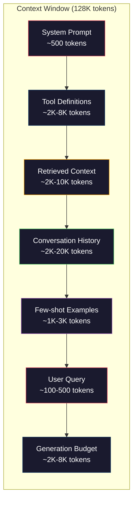
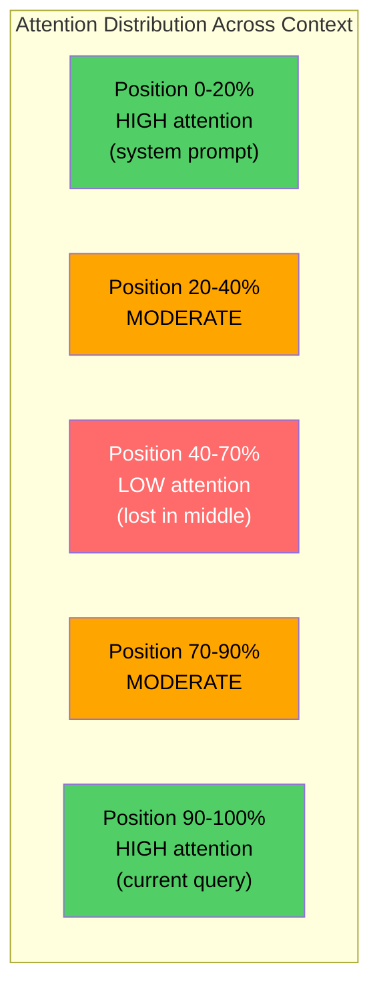
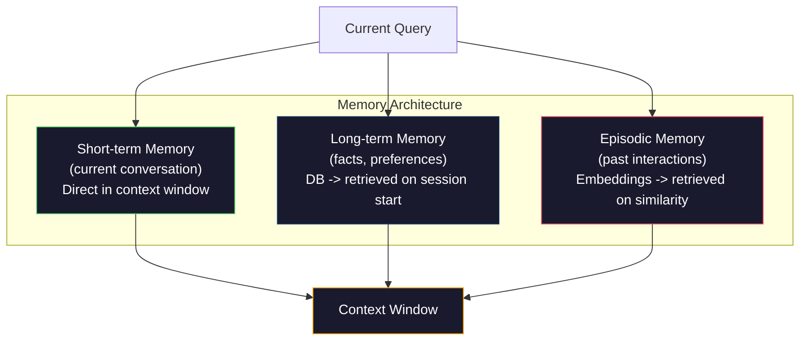

# 컨텍스트 엔지니어링: 윈도우, 예산, 메모리 및 검색

> 프롬프트 엔지니어링은 하위 집합입니다. 컨텍스트 엔지니어링은 전체 게임입니다. 프롬프트는 당신이 입력하는 문자열입니다. 컨텍스트는 모델의 창에 들어가는 모든 것입니다. 시스템 지침, 검색 된 문서, 도구 정의, 대화 역사, 몇 번의 예제 및 프롬프트 자체. 2026 년 최고의 AI 엔지니어는 컨텍스트 엔지니어입니다. 그들은 무엇을 입력하는지, 무엇을 남겨두고 있는지, 어떤 순서로 결정합니다.

**Type:** Build
**Languages:** Python
**Prerequisites:** Phase 10 (LLMs from Scratch), Phase 11 Lesson 01-02
**Time:** ~90 minutes
**Related:**단계 11 · 15 (프롬프트 캐시)  캐시 친화적인 레이아웃은 컨텍스트 엔지니어링의 확장입니다. 단계 5 · 28 (장기 컨텍스트 평가) NIAH/RULER로 중간 손실을 측정하는 방법에 대한.

## 학습 목표

- 모든 컨텍스트 윈도우 구성 요소 (시스템 프롬프트, 도구, 역사, 검색 문서, 생성 헤드룸) 에서 토큰 예산을 계산한다
- 컨텍스트 윈도우 관리 전략을 구현: 대화 역사의 단축, 요약 및 슬라이딩 윈도우
- 가장 관련 있는 정보에 대한 모델의 관심을 극대화하기 위해 우선 순위를 설정하고 컨텍스트 구성 요소를 순서대로 설정합니다.
- 질의 유형과 사용 가능한 창 공간을 기반으로 토큰을 동적으로 할당하는 컨텍스트 어셈블러를 구축

## 문제

클로드 오퍼스 4.7는 200K 토큰 창 (베타 버전 1M) 를 가지고 있습니다. GPT-5는 400K를 가지고 있습니다. Gemini 3 Pro는 2M를 가지고 있습니다. Llama 4는 10M를 주장합니다. 이 숫자는 당신이 그들을 채우기 전까지 엄청나게 들립니다.

코딩 보조기 위한 실제 분해는 다음과 같습니다. 시스템 프롬프트: 500 토큰. 50 도구의 도구 정의: 8,000 토큰. 검색 문서: 4,000 토큰. 대화 역사 (10 회): 6,000 토큰. 현재 사용자 문의: 200 토큰. 생성 예산 (최고 출력): 4,000 토큰. 총: 22,700 토큰. 128K 창의 18%에 불과합니다.

그러나 관심은 맥락 길이를 따라 선형적으로 확장되지 않습니다. 맥락의 128K 토큰을 가진 모델은 사각형 관심 비용을 지불합니다 ($O(n^2)$바닐라 트랜스포머에서 생산 모델의 대부분은 효율적인 주의 변형을 사용하지만). 더 중요한 것은 검색 정확도가 떨어지는 것입니다. "Haystack의 바늘" 테스트는 모델들이 긴 맥락의 한가운데에 놓인 정보를 찾기 위해 어려움을 겪는 것을 보여줍니다. 리우 등 연구 (2023) 는 LLM가 긴 맥락의 시작과 끝에서 거의 완벽한 정확도로 정보를 검색하지만, 중간에 배치된 정보의 정확도는 10-20% 감소 (환경의 40~70%의 위치) 를 보여주었다. 이 "중간에 잃어버린" 효과는 모델에 따라 달라지는 것이지만 모든 현재의 건축물에 영향을 미친다.

실용적인 교훈: 200K 토큰이 사용 가능하다는 것은 200K 토큰을 사용하는 것이 효과적이라는 것을 의미하지는 않습니다. 신중하게 정리한 10K 토큰 컨텍스트는 종종 덤프된 100K 토큰 컨텍스트보다 더 나은 성능을 발휘합니다. 컨텍스트 엔지니어링은 컨텍스트 창 내에서 신호-шум 비율을 극대화하는 학문입니다.

창에 넣은 모든 토큰은 더 관련한 정보를 담아낼 수 있는 토큰을 배제합니다. 모든 무관한 도구 정의, 모든 오래된 대화 회전, 모든 질문에 답하지 않는 텍스트 조각은 각각의 모델이 작업에서 약간 더 악화됩니다.

## 개념

### 컨텍스트 윈도우 는 희귀 한 자원

컨텍스트 윈도우는 디스크가 아닌 RAM라고 생각해 보세요. 그것은 빠르고 직접 접근 가능하지만 제한적입니다. 모든 것을 맞출 수는 없습니다. 당신은 선택해야 합니다.



각 구성 요소는 공간에 경쟁합니다. 더 많은 도구 정의를 추가하면 대화 역사에 대한 공간이 줄어들게 됩니다. 더 많은 검색된 컨텍스트를 추가하면 몇 샷의 예제에 대한 공간이 줄어들게 됩니다. 컨텍스트 엔지니어링은 작업 성능을 극대화하기 위해 이 예산을 할당하는 예술입니다.

### 중간에 잃어버린

컨텍스트 엔지니어링에서 가장 중요한 경험적 발견. 모델은 컨텍스트의 시작과 끝에서 정보를 더 잘 다루고 있습니다. 중간에있는 정보는 더 낮은 관심 점수를 얻으며 무시될 가능성이 높습니다.

리우 등 (2023) 은 이를 체계적으로 테스트하였다. 그들은 20개의 무관한 문서 중 관련 문서를 여러 위치로 배치하고 답변 정확도를 측정하였다. 관련 문서는 처음 또는 마지막이 되었을 때 정확도는 85-90%. 중간 (20의 10 위치) 에 있을 때 정확도는 60-70%로 떨어졌다.

이것은 직접적인 공학적인 영향을 미칩니다.

- 가장 중요한 정보를 먼저 설정 (시스템 신속, 중요한 지침)
- 현재 쿼리와 가장 관련한 맥락을 마지막으로 넣으십시오 (최근 편향이 도움이 됩니다)
- 맥락의 중간 부분을 최하위 우선순위 영역으로 취급한다
- 중간 에 정보를 포함 해야 한다면, 끝 에 핵심 점 을 두 번



### 컨텍스트 구성 요소

**System prompt**: 개인, 제한 및 행동 규칙을 설정합니다. 이것은 먼저 진행되며 회전마다 일정합니다. 클로드 코드는 도구 정의와 행동 지침을 포함하여 시스템 프롬프트에 약 6,000 개의 토큰을 사용합니다. 그것을 단단하게 유지하십시오. 시스템 프롬프트의 모든 단어는 API 호출에 반복됩니다.

**Tool definitions**: 각 도구는 50~200개의 토큰 (명, 설명, 매개 변수 스케마) 를 추가합니다. 150개의 토큰의 50개의 도구는 대화가 일어나기 전에 7,500개의 토큰입니다. 동적 도구 선택은 현재 쿼리에 관련된 도구를 포함해서만, 이를 60%~80% 감소시킬 수 있습니다.

**Retrieved context**: 벡터 데이터베이스에서 문서, 검색 결과, 파일 내용. 검색의 품질은 직접적으로 응답의 품질을 결정합니다. 나쁜 검색은 검색이 없음보다 더 나쁘습니다. 그것은 음으로 창을 채우고 모델을 적극적으로 잘못 만듭니다.

**Conversation history**: 이전 사용자 메시지 및 보조 응답. 대화 길이를 따라 선형적으로 증가합니다. 회전당 200 토큰의 50 회 대화는 10,000 개의 역사 토큰입니다. 대부분의 경우 현재 질의에 관련이 없습니다.

**Few-shot examples**이 두 가지 예 는 종종 수천 개의 명령 도큰 보다 출력 품질을 향상시킵니다. 하지만 그들은 공간을 비용.

**Generation budget**: 모델의 응답에 대한 토큰. 만약 당신이 용량을 위한 창을 채우면, 모델은 응답할 공간이 없습니다. 생성을위한 적어도 2,000-4,000 토큰을 예약.

### 컨텍스트 압축 전략

**History summarization**: 이전 모든 회전을 말 그대로 유지하기 보다는, 회의를 주기적으로 요약하십시오. "X를 논의하고 Y를 결정했고 사용자가 Z를 원한다"는 100 개의 토큰에서 2,000 개의 토큰을 가져온 10 회전을 대체합니다. 역사가 문턱을 초과하면 요약을 실행하십시오 (예를 들어 5,000 개의 토큰).

**Relevance filtering**: 현재 검색된 문서를 각각 상응하여 문서를 열점 아래로 떨어뜨리십시오. 10개의 조각만 검색했지만 3개만 관련 있는 경우 나머지 7개를 폐기하십시오. 10개의 중간적인 조각보다 3개의 매우 관련 있는 조각이 더 낫습니다.

**Tool pruning**: 사용자의 질의 의도를 분류하고 그 의도에 관련된 도구만을 포함합니다. 코드 질문에는 달력 도구가 필요하지 않습니다. 스케줄링 질문에는 파일 시스템 도구가 필요하지 않습니다. 이것은 도구 정의를 8,000 토큰에서 1,000으로 줄일 수 있습니다.

**Recursive summarization**매우 긴 문서 에 대해 단계 로 요약 하십시오. 먼저 각 섹션 을 요약 하고 그 다음 요약 을 요약 하십시오. 50 페이지 의 문서 는 주요 점 을 담고 있는 500 개의 토큰 소재 로 자리 잡습니다.

### 기억 시스템

컨텍스트 엔지니어링은 3가지 시간 지평을 아우르는 것입니다.

**Short-term memory**: 현재 대화. 컨텍스트 창에 직접 저장됩니다. 각 회전과 함께 성장합니다. 요약 및 단축을 통해 관리됩니다.

**Long-term memory**"이용자 는 TypeScript 을 선호 한다". "프로젝트 는 PostgreSQL 을 사용 한다". 데이터베이스 에 저장 되어 있으며 세션 시작 시 검색 됩니다. 클로드 코드는 CLAUDE.md 파일 에 저장 합니다. ChatGPT 는 메모리 기능 에서 저장 합니다.

**Episodic memory**: 관련 있는 특정 과거 상호 작용. "지난 화요일, 우리는 auth 모듈에서 비슷한 문제를 디버깅했다". 임베디션으로 저장되어, 현재 대화가 이전 에피소드에 일치하면 검색됩니다.



### 동적 컨텍스트 집합

핵심 통찰력: 각 질의 경우 다른 맥락이 필요합니다. 정적 시스템 명령어 + 정적 도구 + 정적 역사 는 낭비적입니다. 가장 좋은 시스템은 질의마다 동적으로 맥락을 조립합니다.

1. 질의 의도를 분류
2. 관련 도구를 선택 (모든 도구를 선택하지 않습니다)
3. 관련 문서를 검색 (정부 집합이 아닌)
4. 관련 역사 회전을 포함하십시오 (모든 역사가 포함되지 않습니다)
5. 작업 유형과 일치하는 몇 번의 샷 예제를 추가
6. 중요성으로 모든 것을 순서대로 순서대로 순서대로 순서대로 순서대로 순서대로 순서대로 순서대로 순서대로 순서대로 순서대로 순서대로 순서대로 순서대로 순서대로 순서대로 순서대로 순서대로 순서대로 순서대로 순서대로 순서대로 순서대로 순서대로 순서대로 순서대로 순서대로 순서대로 순서대로 순서대로 순서대로 순서대로 순서대로 순서대로 순서대로 순서대로 순서대로 순서대로 순서대로 순서대로 순서대로 순서대로 순서대로 순서대로 순서대로 순서대로 순서대로 순서대로 순서대로 순서대로 순서대로 순서대로 순서대로 순서대로 순서대로 순서대로 순서대로 순서대로 순서대로 순서대로 순서대로 순서대로 순서대로 순서대로 순서대로 순서대로 순서대로 순서대로 순서대로 순서로 순서로 순서로 순서로

이것이 좋은 인공지능 응용 프로그램을 훌륭한 응용 프로그램에서 분리하는 것입니다. 모델은 동일합니다. 맥락은 차별입니다.

```figure
lost-in-the-middle
```

## 건설 해

### 단계 1: 토큰 카운터

측정할 수 없는 것을 예산으로 만들 수 없습니다. 간단한 토큰 카운터를 만들 수 있습니다. (표현자로부터 정확한 계산이 달라지기 때문에 백공간 분리를 사용하여 근접을 한다).

```python
import json
import numpy as np
from collections import OrderedDict

def count_tokens(text):
    if not text:
        return 0
    return int(len(text.split()) * 1.3)

def count_tokens_json(obj):
    return count_tokens(json.dumps(obj))
```

### 단계 2: 컨텍스트 예산 관리자

기본 추상: 예산 관리자는 각각의 구성 요소가 얼마나 많은 토큰을 사용하고 제한을 부과하는지 추적합니다.

```python
class ContextBudget:
    def __init__(self, max_tokens=128000, generation_reserve=4000):
        self.max_tokens = max_tokens
        self.generation_reserve = generation_reserve
        self.available = max_tokens - generation_reserve
        self.allocations = OrderedDict()

    def allocate(self, component, content, max_tokens=None):
        tokens = count_tokens(content)
        if max_tokens and tokens > max_tokens:
            words = content.split()
            target_words = int(max_tokens / 1.3)
            content = " ".join(words[:target_words])
            tokens = count_tokens(content)

        used = sum(self.allocations.values())
        if used + tokens > self.available:
            allowed = self.available - used
            if allowed <= 0:
                return None, 0
            words = content.split()
            target_words = int(allowed / 1.3)
            content = " ".join(words[:target_words])
            tokens = count_tokens(content)

        self.allocations[component] = tokens
        return content, tokens

    def remaining(self):
        used = sum(self.allocations.values())
        return self.available - used

    def utilization(self):
        used = sum(self.allocations.values())
        return used / self.max_tokens

    def report(self):
        total_used = sum(self.allocations.values())
        lines = []
        lines.append(f"Context Budget Report ({self.max_tokens:,} token window)")
        lines.append("-" * 50)
        for component, tokens in self.allocations.items():
            pct = tokens / self.max_tokens * 100
            bar = "#" * int(pct / 2)
            lines.append(f"  {component:<25} {tokens:>6} tokens ({pct:>5.1f}%) {bar}")
        lines.append("-" * 50)
        lines.append(f"  {'Used':<25} {total_used:>6} tokens ({total_used/self.max_tokens*100:.1f}%)")
        lines.append(f"  {'Generation reserve':<25} {self.generation_reserve:>6} tokens")
        lines.append(f"  {'Remaining':<25} {self.remaining():>6} tokens")
        return "\n".join(lines)
```

### 단계 3: 중간 중간에 잃어버린 재조정

재조정 전략을 실행하라: 가장 중요한 항목은 먼저, 가장 중요한 항목은 중간에서 가장 작습니다.

```python
def reorder_lost_in_middle(items, scores):
    paired = sorted(zip(scores, items), reverse=True)
    sorted_items = [item for _, item in paired]

    if len(sorted_items) <= 2:
        return sorted_items

    first_half = sorted_items[::2]
    second_half = sorted_items[1::2]
    second_half.reverse()

    return first_half + second_half

def score_relevance(query, documents):
    query_words = set(query.lower().split())
    scores = []
    for doc in documents:
        doc_words = set(doc.lower().split())
        if not query_words:
            scores.append(0.0)
            continue
        overlap = len(query_words & doc_words) / len(query_words)
        scores.append(round(overlap, 3))
    return scores
```

### 단계 4: 대화 역사 압축기

오래된 대화를 요약하면 토큰 예산이 되살릴 수 있습니다.

```python
class ConversationManager:
    def __init__(self, max_history_tokens=5000):
        self.turns = []
        self.summaries = []
        self.max_history_tokens = max_history_tokens

    def add_turn(self, role, content):
        self.turns.append({"role": role, "content": content})
        self._compress_if_needed()

    def _compress_if_needed(self):
        total = sum(count_tokens(t["content"]) for t in self.turns)
        if total <= self.max_history_tokens:
            return

        while total > self.max_history_tokens and len(self.turns) > 4:
            old_turns = self.turns[:2]
            summary = self._summarize_turns(old_turns)
            self.summaries.append(summary)
            self.turns = self.turns[2:]
            total = sum(count_tokens(t["content"]) for t in self.turns)

    def _summarize_turns(self, turns):
        parts = []
        for t in turns:
            content = t["content"]
            if len(content) > 100:
                content = content[:100] + "..."
            parts.append(f"{t['role']}: {content}")
        return "Previous: " + " | ".join(parts)

    def get_context(self):
        parts = []
        if self.summaries:
            parts.append("[Conversation Summary]")
            for s in self.summaries:
                parts.append(s)
        parts.append("[Recent Conversation]")
        for t in self.turns:
            parts.append(f"{t['role']}: {t['content']}")
        return "\n".join(parts)

    def token_count(self):
        return count_tokens(self.get_context())
```

### 단계 5: 동적 도구 선택

현재 쿼리에 관련된 도구만 포함하고, 의도 분류하고, 필터링합니다.

```python
TOOL_REGISTRY = {
    "read_file": {
        "description": "Read contents of a file",
        "tokens": 120,
        "categories": ["code", "files"],
    },
    "write_file": {
        "description": "Write content to a file",
        "tokens": 150,
        "categories": ["code", "files"],
    },
    "search_code": {
        "description": "Search for patterns in codebase",
        "tokens": 130,
        "categories": ["code"],
    },
    "run_command": {
        "description": "Execute a shell command",
        "tokens": 140,
        "categories": ["code", "system"],
    },
    "create_calendar_event": {
        "description": "Create a new calendar event",
        "tokens": 180,
        "categories": ["calendar"],
    },
    "list_emails": {
        "description": "List recent emails",
        "tokens": 160,
        "categories": ["email"],
    },
    "send_email": {
        "description": "Send an email message",
        "tokens": 200,
        "categories": ["email"],
    },
    "web_search": {
        "description": "Search the web for information",
        "tokens": 140,
        "categories": ["research"],
    },
    "query_database": {
        "description": "Run a SQL query on the database",
        "tokens": 170,
        "categories": ["code", "data"],
    },
    "generate_chart": {
        "description": "Generate a chart from data",
        "tokens": 190,
        "categories": ["data", "visualization"],
    },
}

def classify_intent(query):
    query_lower = query.lower()

    intent_keywords = {
        "code": ["code", "function", "bug", "error", "file", "implement", "refactor", "debug", "test"],
        "calendar": ["meeting", "schedule", "calendar", "appointment", "event"],
        "email": ["email", "mail", "send", "inbox", "message"],
        "research": ["search", "find", "what is", "how does", "explain", "look up"],
        "data": ["data", "query", "database", "chart", "graph", "analytics", "sql"],
    }

    scores = {}
    for intent, keywords in intent_keywords.items():
        score = sum(1 for kw in keywords if kw in query_lower)
        if score > 0:
            scores[intent] = score

    if not scores:
        return ["code"]

    max_score = max(scores.values())
    return [intent for intent, score in scores.items() if score >= max_score * 0.5]

def select_tools(query, token_budget=2000):
    intents = classify_intent(query)
    relevant = {}
    total_tokens = 0

    for name, tool in TOOL_REGISTRY.items():
        if any(cat in intents for cat in tool["categories"]):
            if total_tokens + tool["tokens"] <= token_budget:
                relevant[name] = tool
                total_tokens += tool["tokens"]

    return relevant, total_tokens
```

### 단계 6: 전체 컨텍스트 집합 파이프라인

모든 것을 연결해 놓습니다. 질의를 고려하면 최적의 맥락을 동적으로 구성합니다.

```python
class ContextEngine:
    def __init__(self, max_tokens=128000, generation_reserve=4000):
        self.budget = ContextBudget(max_tokens, generation_reserve)
        self.conversation = ConversationManager(max_history_tokens=5000)
        self.system_prompt = (
            "You are a helpful AI assistant. You have access to tools for "
            "code editing, file management, web search, and data analysis. "
            "Use the appropriate tools for each task. Be concise and accurate."
        )
        self.knowledge_base = [
            "Python 3.12 introduced type parameter syntax for generic classes using bracket notation.",
            "The project uses PostgreSQL 16 with pgvector for embedding storage.",
            "Authentication is handled by Supabase Auth with JWT tokens.",
            "The frontend is built with Next.js 15 using the App Router.",
            "API rate limits are set to 100 requests per minute per user.",
            "The deployment pipeline uses GitHub Actions with Docker multi-stage builds.",
            "Test coverage must be above 80% for all new modules.",
            "The codebase follows the repository pattern for data access.",
        ]

    def assemble(self, query):
        self.budget = ContextBudget(self.budget.max_tokens, self.budget.generation_reserve)

        system_content, _ = self.budget.allocate("system_prompt", self.system_prompt, max_tokens=1000)

        tools, tool_tokens = select_tools(query, token_budget=2000)
        tool_text = json.dumps(list(tools.keys()))
        tool_content, _ = self.budget.allocate("tools", tool_text, max_tokens=2000)

        relevance = score_relevance(query, self.knowledge_base)
        threshold = 0.1
        relevant_docs = [
            doc for doc, score in zip(self.knowledge_base, relevance)
            if score >= threshold
        ]

        if relevant_docs:
            doc_scores = [s for s in relevance if s >= threshold]
            reordered = reorder_lost_in_middle(relevant_docs, doc_scores)
            doc_text = "\n".join(reordered)
            doc_content, _ = self.budget.allocate("retrieved_context", doc_text, max_tokens=3000)

        history_text = self.conversation.get_context()
        if history_text.strip():
            history_content, _ = self.budget.allocate("conversation_history", history_text, max_tokens=5000)

        query_content, _ = self.budget.allocate("user_query", query, max_tokens=500)

        return self.budget

    def chat(self, query):
        self.conversation.add_turn("user", query)
        budget = self.assemble(query)
        response = f"[Response to: {query[:50]}...]"
        self.conversation.add_turn("assistant", response)
        return budget


def run_demo():
    print("=" * 60)
    print("  Context Engineering Pipeline Demo")
    print("=" * 60)

    engine = ContextEngine(max_tokens=128000, generation_reserve=4000)

    print("\n--- Query 1: Code task ---")
    budget = engine.chat("Fix the bug in the authentication module where JWT tokens expire too early")
    print(budget.report())

    print("\n--- Query 2: Research task ---")
    budget = engine.chat("What is the best approach for implementing vector search in PostgreSQL?")
    print(budget.report())

    print("\n--- Query 3: After conversation history builds up ---")
    for i in range(8):
        engine.conversation.add_turn("user", f"Follow-up question number {i+1} about the implementation details of the system")
        engine.conversation.add_turn("assistant", f"Here is the response to follow-up {i+1} with technical details about the architecture")

    budget = engine.chat("Now implement the changes we discussed")
    print(budget.report())

    print("\n--- Tool Selection Examples ---")
    test_queries = [
        "Fix the bug in auth.py",
        "Schedule a meeting with the team for Tuesday",
        "Show me the database query performance stats",
        "Search for best practices on error handling",
    ]

    for q in test_queries:
        tools, tokens = select_tools(q)
        intents = classify_intent(q)
        print(f"\n  Query: {q}")
        print(f"  Intents: {intents}")
        print(f"  Tools: {list(tools.keys())} ({tokens} tokens)")

    print("\n--- Lost-in-the-Middle Reordering ---")
    docs = ["Doc A (most relevant)", "Doc B (somewhat relevant)", "Doc C (least relevant)",
            "Doc D (relevant)", "Doc E (moderately relevant)"]
    scores = [0.95, 0.60, 0.20, 0.80, 0.50]
    reordered = reorder_lost_in_middle(docs, scores)
    print(f"  Original order: {docs}")
    print(f"  Scores:         {scores}")
    print(f"  Reordered:      {reordered}")
    print(f"  (Most relevant at start and end, least relevant in middle)")
```

## 사용 하 고

### 배너스 관리 된 맥락

클로드 코드는 계층적 접근 방식을 사용하여 컨텍스트를 관리합니다. 시스템 프롬프트에는 행동 규칙과 도구 정의 (~ 6K 토큰) 이 포함되어 있습니다. 파일을 열 때, 그 내용은 컨텍스트로 주입됩니다. 검색을 할 때, 결과는 추가됩니다. 오래된 대화 회전이 요약됩니다. CLAUDE.md는 세션 중 지속되는 장기 메모리를 제공합니다.

핵심 엔지니어링 결정: 클로드 코드는 전체 코드베이스를 맥락으로 내놓지 않습니다. 요구에 따라 관련 파일을 검색합니다. 이것은 실제 맥락 엔지니어링입니다.

### 역동적인 컨텍스트 로딩

커서 (cursor) 는 전체 코드베이스를 임베디션으로 지표한다. 질서를 입력하면 벡터 유사성을 사용하여 가장 관련한 파일과 코드 블록을 검색합니다. 그 조각들만 컨텍스트 창에 들어가게 됩니다. 500K 라인 코드베이스는 5-10 개의 가장 관련한 코드 블록으로 압축됩니다.

이것은 패턴입니다. 모든 것을 삽입하고, 요구에 따라 검색하고, 중요한 것을 포함합니다.

### 장기 기억 보조

ChatGPT는 사용자 선호도와 사실을 장기적인 메모리로 저장합니다. 대화 시작마다 관련 메모리는 검색되어 시스템 프롬프트에 포함됩니다. "이용자가 파이썬을 선호합니다"는 5 개의 토큰이 소요되지만 대화 중 수백 개의 반복된 명령어를 저장합니다.

### RAG는 컨텍스트 엔지니어링으로

검색- 증강된 세대란 컨텍스트 엔지니어링이 공식화되었습니다. 모델의 무게 (훈련) 또는 시스템 프롬프트 (정형적 컨텍스트) 에 지식을 넣는 대신, 당신은 문의 시간에 관련 문서를 검색하고 컨텍스트 창에 주입합니다. RAG 파이프라인 전체 -- 쪼개서, 삽입, 검색, 재등급 -- 한 가지 문제를 해결하기 위해 존재합니다. 올바른 정보를 컨텍스트 창에 넣는 것입니다.

## 선박

이 교훈은`outputs/prompt-context-optimizer.md`-- 재사용 가능한 프롬프트, 컨텍스트 어셈블리 전략을 감사하고 최적화를 추천합니다. 시스템 프롬프트, 도구 수, 평균 역사 길, 검색 전략에 대한 정보를 제공하여 토큰 낭비를 식별하고 개선 사항을 제안합니다.

또한 생산합니다`outputs/skill-context-engineering.md`-- 작업 유형, 컨텍스트 창 크기와 지연 예산에 따라 컨텍스트 어셈블리 파이프라인을 설계하는 의사 결정 프레임워크.

## 운동

1. ContextBudget 클래스에 "토큰 폐기물 탐지기"를 추가합니다. 그것은 예산의 30% 이상을 사용하는 구성 요소를 표시하고 각 구성 요소 유형에 특화된 압축 전략을 제안해야 합니다 (역사, 정제 도구, 재등급 문서).

2. 검색된 맥락에 대한 의미적 분배를 구현하십시오. 검색된 문서가 80% 이상 유사 (말적 중복 또는 임베디션의 코시네 유사성) 으로, 높은 점수를 얻은 문서만 유지하십시오. 이 문서가 얼마나 많은 토큰 예산을 복구하는지 측정하십시오.

3. "콘텍스트 재생" 도구를 구축하십시오. 대화 표본을 제공하면 ContextEngine를 통해 재생하고 예산 할당이 차례대로 어떻게 변화하는지 시각화하십시오. 시간 내에 구성 요소별 토큰 사용량을 일괄적으로 표시하십시오. 컨텍스트가 압축되기 시작하는 차례를 식별하십시오.

4. 우선순위 기반 도구 선택자를 구현하십시오. 바이너리 포함/제폐하기 대신, 각각의 도구를 현재 쿼리에 관련성 점수를 할당하십시오. 도구 예산이 채용될 때까지 관련성 순서를 낮추는 도구를 포함하십시오. 포함된 5, 10, 20 및 50 도구와 작업 성능을 비교하십시오.

5. 다 전략 컨텍스트 압축기를 구축하세요. 세 가지 압축 전략을 구현하세요 (부단, 요약, 핵심 문장 추출) 그리고 20 개의 문서에 대한 벤치마크를 작성하세요. 압축 비율과 정보 저장 사이의 타협을 측정하세요 (압축 버전은 여전히 질의 답변을 포함합니까?).

## 주요 용어

| Term | What people say | What it actually means |
|------|----------------|----------------------|
| Context window | "How much the model can read" | The maximum number of tokens (input + output) the model processes in a single forward pass -- 400K for GPT-5, 200K (1M beta) for Claude Opus 4.7, 2M for Gemini 3 Pro |
| Context engineering | "Advanced prompt engineering" | The discipline of deciding what goes into the context window, in what order, and at what priority -- encompasses retrieval, compression, tool selection, and memory management |
| Lost-in-the-middle | "Models forget stuff in the middle" | Empirical finding that LLMs attend better to the beginning and end of context, with 10-20% accuracy drop for information placed in the middle |
| Token budget | "How many tokens you have left" | An explicit allocation of context window capacity across components (system prompt, tools, history, retrieval, generation) with per-component limits |
| Dynamic context | "Loading stuff on the fly" | Assembling the context window differently for each query based on intent classification, relevant tool selection, and retrieval results |
| History summarization | "Compressing the conversation" | Replacing verbatim old conversation turns with a concise summary, reducing token cost while preserving key information |
| Tool pruning | "Only including relevant tools" | Classifying query intent and only including tool definitions that match, reducing tool token cost by 60-80% |
| Long-term memory | "Remembering across sessions" | Facts and preferences stored in a database and retrieved at session start -- CLAUDE.md, ChatGPT Memory, and similar systems |
| Episodic memory | "Remembering specific past events" | Past interactions stored as embeddings and retrieved when the current query is similar to a past conversation |
| Generation budget | "Room for the answer" | Tokens reserved for the model's output -- if the context fills the window completely, the model has no room to respond |

## 더 많은 읽기

- [Liu et al., 2023 -- "Lost in the Middle: How Language Models Use Long Contexts"](https://arxiv.org/abs/2307.03172)-- 위치 의존적 관심에 대한 최종적인 연구, 모델들이 긴 맥락의 한가운데서 정보와 어려움을 겪고 있음을 보여줍니다.
- [Anthropic's Contextual Retrieval blog post](https://www.anthropic.com/news/contextual-retrieval)-- 어떻게 인트로피가 맥락을 인식하는 조각 검색을 접근하는지를, 검색 실패를 49% 감소시키는
- [Simon Willison's "Context Engineering"](https://simonwillison.net/2025/Jun/27/context-engineering/)-- 학문의 이름을 붙여서,
- [LangChain documentation on RAG](https://python.langchain.com/docs/tutorials/rag/)-- 구조공학 패턴으로 검색 증강 발전을 실질적으로 구현
- [Greg Kamradt's Needle in a Haystack test](https://github.com/gkamradt/LLMTest_NeedleInAHaystack)-- 모든 주요 모델에서 위치에 따라 검색 실패를 밝혀낸 기준
- [Pope et al., "Efficiently Scaling Transformer Inference" (2022)](https://arxiv.org/abs/2211.05102)-- 왜 맥락 길이가 메모리와 지연을 좌우하는지, 그리고 KV 캐시, MQA, GQA가 예산 계산을 어떻게 변화시키는지는
- [Agrawal et al., "SARATHI: Efficient LLM Inference by Piggybacking Decodes with Chunked Prefills" (2023)](https://arxiv.org/abs/2308.16369)-- TTFT에서 긴 구문을 비싼 것으로 만들지만 TPOT에서 저렴하게 만드는 두 가지 추론의 단계;
- [Ainslie et al., "GQA: Training Generalized Multi-Query Transformer Models from Multi-Head Checkpoints" (EMNLP 2023)](https://arxiv.org/abs/2305.13245)-- 생산 디코더에서 품질 손실 없이 KV 메모리를 8배로 줄이는 그룹화된 질문 관심 페이퍼
