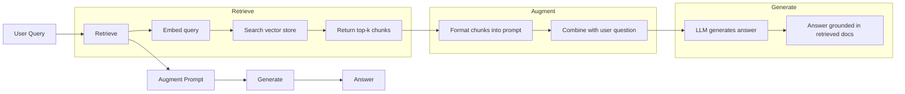
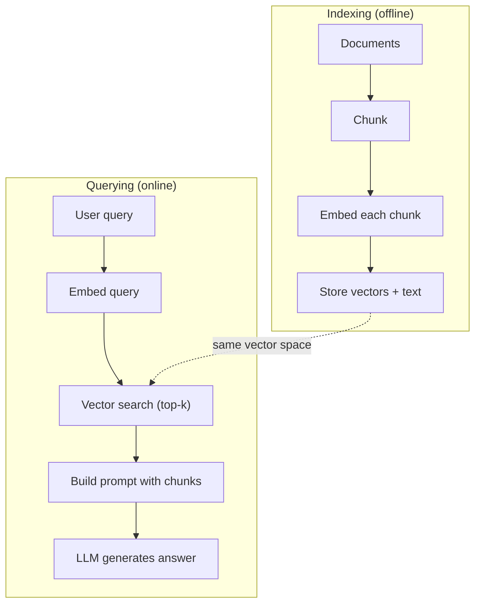

# RAG (회복 증강된 세대)

> LLM는 교육 기간까지 모든 것을 알고 있습니다. 회사 문서, 코드베이스 또는 지난 주 회의 메모에 대해 아무것도 모릅니다. RAG는 관련 문서를 검색하고 프롬프트에 넣음으로써 문제를 해결합니다. 이것은 생산 인공지능에서 가장 많이 배치 된 패턴입니다. 이 코스로부터 한 가지 물건을 만들면 RAG 파이프라인을 구축하십시오.

**Type:** Build
**Languages:** Python
**Prerequisites:** Phase 10 (LLMs from Scratch), Phase 11 Lessons 01-05
**Time:** ~90 minutes
**Related:**5 · 23 단계 (RAG의 킹 전략) 은 6개의 킹 알고리즘과 각각의 승률을 나타냅니다. 5 · 22 단계 (Embedding Models Deep Dive) 는 임베더를 선택하는데, 11 · 07 단계 (Advanced RAG) 은 하이브리드 검색, 재등급 및 쿼리 변환에 사용됩니다.

## 학습 목표

- 완전한 RAG 파이프라인을 구축: 문서 로딩, 쪼개림, 임베디션, 벡터 저장, 검색 및 생성
- 적절한 인덱싱을 통해 벡터 데이터베이스 (ChromaDB, FAISS, 또는 Pinecone) 를 사용하여 의미 검색을 구현
- 지식 기반 응용 프로그램 (비용, 신선함, 배정) 에 대한 미세 조정보다 RAG이 선호되는 이유를 설명하십시오.
- 검색 매개 변수 (정확성, 회수) 및 생성 매개 변수 (신실성, 관련성) 를 사용하여 RAG 품질을 평가한다

## 문제

당신은 당신의 회사에 대해 채팅 로봇을 만듭니다. 고객이 "기업 계획에 대한 환불 정책은 무엇입니까?"라고 묻습니다. LLM는 일반적인 SaaS 환불 정책에 대한 일반적 답변으로 응답합니다. 실제 정책은 200 페이지의 내부 위키에 묻혀 있으며, 기업 고객은 60일간의 환불을 받을 수 있다고 말합니다. LLM는 이 문서를 본 적이 없습니다. 어떤 교육을 받지 않았는지 알 수 없습니다.

정렬은 하나의 해결책입니다. LLM를 취하고 내부 문서에 훈련하고 업데이트 된 모델을 배포하십시오. 이것은 효과가 있지만 심각한 문제점이 있습니다. 정렬은 계산에 수천 달러가 소요됩니다. 문서가 변경되는 순간 모델이 구석됩니다. 모델이 어느 소스에서 나왔는지 알 수있는 방법은 없습니다. 그리고 회사가 다음 달 다른 제품 라인을 인수하면 다시 정렬합니다.

RAG는 다른 해결책입니다. 모델은 손길이 닿지 않는 상태로 남겨두세요. 질문이 들어올 때 관련 문서를 검색하고 질문 전에 해당 문서를 입력하는 문장에 붙여서 해당 문서를 맥락으로 사용하여 모델에 답하도록 하십시오. 문서 저장소는 몇 분 안에 업데이트 될 수 있습니다. 정확히 어떤 서류가 검색되었는지 알 수 있습니다. 모델 자체는 절대 변하지 않습니다. 그래서 RAG는 생산에서 지배적인 패턴입니다. 그것은 더 저렴하고 신선하고, 더 감사 가능하며, 모든 LLM와 함께 작동합니다.

## 개념

### RAG 패턴

전체 패턴은 네 단계로 잘 맞습니다.



쿼리 -> 검색 -> 증강 프롬프트 -> 생성. 모든 RAG 시스템은 이 패턴을 따르고 있습니다. 생산 RAG 시스템 사이의 차이점은 각 단계의 세부 사항입니다. 어떻게 쪼개지, 어떻게 임베드하는지, 어떻게 검색하는지, 어떻게 프롬프트를 구성하는지.

### 왜 RAG 은 정렬 을 능가 하는 것 입니까?

| Concern | Fine-tuning | RAG |
|---------|------------|-----|
| Cost | $1,000-$100,000+ per training run | $0.01-$0.10 per query (embedding + LLM) |
| Freshness | Stale until retrained | Updated in minutes by re-indexing docs |
| Auditability | Cannot trace answer to source | Can show exact retrieved passages |
| Hallucination | Still hallucinates freely | Grounded in retrieved documents |
| Data privacy | Training data baked into weights | Documents stay in your vector store |

정렬은 모델의 무게를 영구적으로 변경합니다. RAG는 모델의 맥락을 일시적으로 변경합니다. 대부분의 응용 프로그램에서는 일시적인 맥락이 원하는 것입니다.

미세조정이 승리하는 유일한 경우: 당신이 모형이 특정 스타일, 음색 또는 추론 패턴을 채택해야 할 때, 이는 단독으로 촉구하는 것으로 달성 될 수 없습니다. 사실적인 지식 검색을 위해, RAG는 항상 승리합니다.

### 모델 을 삽입

임베디언 모델은 텍스트를 밀집한 벡터로 변환합니다. 비슷한 텍스트는 이 고차원 공간에서 서로 가까운 벡터를 생성합니다. "나는 암호를 어떻게 재설정합니까?"와 "나는 암호를 변경해야 합니다"는 거의 동일한 벡터를 생성합니다. 몇 가지 단어를 공유하고 있음에도 불구하고. "고양이 매트에 앉아 있습니다"는 매우 다른 벡터를 생성합니다.

일반적인 임베디션 모델 (2026 라인업  본 단계 5 · 22 본 단계 전체 분석):

| Model | Dimensions | Provider | Notes |
|-------|-----------|----------|-------|
| text-embedding-3-small | 1536 (Matryoshka) | OpenAI | Best price/performance for most use cases |
| text-embedding-3-large | 3072 (Matryoshka) | OpenAI | Higher accuracy, truncatable to 256/512/1024 |
| Gemini Embedding 2 | 3072 (Matryoshka) | Google | Top MTEB retrieval; 8K context |
| voyage-4 | 1024/2048 (Matryoshka) | Voyage AI | Domain variants (code, finance, law) |
| Cohere embed-v4 | 1024 (Matryoshka) | Cohere | Strong multilingual, 128K context |
| BGE-M3 | 1024 (dense + sparse + ColBERT) | BAAI (open-weight) | Three views from one model |
| Qwen3-Embedding | 4096 (Matryoshka) | Alibaba (open-weight) | Top open-weight retrieval score |
| all-MiniLM-L6-v2 | 384 | Open-weight (Sentence Transformers) | Prototyping baseline |

이 수업을 위해 우리는 TF-IDF를 사용하여 우리의 간단한 임베디션을 구축합니다. 생산 시스템은 TF-IDF를 사용하기 때문에 아닙니다. 하지만 그것은 개념을 구체화하기 때문에: 텍스트가 들어와 벡터가 나오고, 유사한 텍스트가 유사한 벡터를 생성합니다.

### 벡터 유사성

두 개의 벡터를 고려하면 어떻게 유사성을 측정할 수 있을까요?

**Cosine similarity**: 두 가중 사이의 각의 코시네스. -1 (반대) 에서 1 (동대) 까지의 범위. 크기를 무시하고 방향만 신경쓰고 있습니다. 이것은 RAG의 기본입니다.

```math
\mathop{\mathrm{cosine\_sim}}(a, b) = \frac{\mathop{\mathrm{dot}}(a, b)}{\lVert a \rVert \cdot \lVert b \rVert}
```

**Dot product**: 원료 내부 제품. 더 큰 벡터는 더 높은 점수를 얻습니다. 크기가 정보를 가지고 있을 때 유용합니다 (장기 문서가 더 관련이있을 수 있습니다).

```math
\mathop{\mathrm{dot}}(a, b) = \sum_i a_i b_i
```

**L2 (Euclidean) distance**: 직선 거리 가 벡터 공간 에서 더 작은 거리 = 더 비슷. 크기의 차이 에 민감 합니다.

```math
\mathop{\mathrm{L2}}(a, b) = \sqrt{\sum_i (a_i - b_i)^2}
```

코시노 유사성은 표준입니다. 그것은 크기로 정상화되기 때문에 다른 길이의 문서를 우아하게 처리합니다. 누군가가 "벡터 검색"이라고 말할 때 거의 항상 코시노 유사성을 의미합니다.

### 셈 전략

문서들은 하나의 벡터로 삽입할 수 없을 정도로 길다. 50페이지 PDF는 수십 개의 주제를 포함하고 있기 때문에 끔찍한 삽입을 만들 수 있습니다. 대신, 당신은 문서들을 조각으로 나눕니다. 그리고 각 조각을 개별적으로 삽입합니다.

**Fixed-size chunking**N 토큰을 분할합니다. 간단하고 예측 가능합니다. 50 토큰의 초복이 있는 512 토큰 조각은 1 조각은 0-511 토큰, 2 조각은 462-973 토큰 등입니다. 초복은 불행한 경계에 문장을 분할하지 않도록 보장합니다.

**Semantic chunking**각 부분 은 일관된 의미 단위 이다. 구현 하기 보다 복잡하지만 더 나은 검색을 생산 한다.

**Recursive chunking**: 가장 큰 경계에서 먼저 분할하려고 시도하십시오 (부문 헤더). 섹션이 여전히 너무 큰 경우, 문장 경계에서 분할하십시오. 문장이 여전히 너무 큰 경우, 문장 경계에서 분할하십시오. 이것은 LangChain RecursiveCharacterTextSplitter 접근 방식이며 실제로 잘 작동합니다.

사람들은 생각하는 것보다 더 큰 문제가 있습니다.

- 너무 작다 (64-128 토큰): 각 조각은 맥락이 부족합니다. "이번 분기 15% 증가했다"는 "이"가 무엇을 의미하는지 알지 못하면 아무 의미도 없습니다.
- 너무 큰 (2048+ 토큰): 각 조각은 여러 주제를 다루고 관련성을 희석합니다. 수익 데이터를 검색하면 10%의 수익과 90%의 직원을 차지하는 조각을 얻습니다.
- 달콤한 점 (256-512 토큰): 자립할 수 있는 충분한 맥락, 관련성이 있을 수 있는 충분한 집중.

대부분의 생산 RAG 시스템은 256-512개의 토큰 조각을 50개의 토큰으로 겹치며 사용합니다.

### 벡터 데이터베이스

일단 배포된 것을 가지고 나면 저장하고 검색할 곳이 필요합니다.

| Database | Type | Best for |
|----------|------|----------|
| FAISS | Library (in-process) | Prototyping, small to medium datasets |
| Chroma | Lightweight DB | Local development, small deployments |
| Pinecone | Managed service | Production without ops overhead |
| Weaviate | Open source DB | Self-hosted production |
| pgvector | Postgres extension | Already using Postgres |
| Qdrant | Open source DB | High-performance self-hosted |

이 수업을 위해 우리는 간단한 메모리 내 벡터 저장소를 구축합니다. 이 벡터를 목록에 저장하고 무력 코시노 유사성 검색을 수행합니다. 이것은 평평 인덱스있는 FAISS에 해당합니다. 느리기 전에 약 100,000 벡터로 확장됩니다. 생산 시스템은 HNSW와 같은 대략적인 가까운 이웃 (ANN) 알고리즘을 사용하여 밀리초에 수백만 벡터를 검색합니다.

### 전체 파이프라인



인덱싱 단계는 문서마다 한 번 실행됩니다. (또는 문서 업데이트를 할 때). 쿼리 단계는 모든 사용자 요청에 실행됩니다. 생산에서 인덱싱은 수 시간 동안 수백만 개의 문서를 처리 할 수 있습니다. 쿼리는 초 이내에 응답해야합니다.

### 실제 숫자

대부분의 생산 RAG 시스템은 다음과 같은 매개 변수를 사용합니다.

- **k = 5 to 10**검색에 따라 검색된 조각
- **Chunk size = 256 to 512 tokens**50개의 토큰이 겹쳐
- **Context budget**: 검색당 검색된 콘텐츠의 2,500~5,000개의 토큰
- **Total prompt**: ~ 8,000-16,000 토큰 (시스템 프롬프트 + 검색된 덩어리 + 대화 역사 + 사용자 쿼리)
- **Embedding dimension**: 384-3072 모델에 따라
- **Indexing throughput**: API 임베디드된 초당 100~1,000개의 문서
- **Query latency**: 50~200ms의 검색, 500~3000ms의 생성

```figure
rag-chunking
```

## 건설 해

### 단계 1: 문서 쪼개

```python
def chunk_text(text, chunk_size=200, overlap=50):
    words = text.split()
    chunks = []
    start = 0
    while start < len(words):
        end = start + chunk_size
        chunk = " ".join(words[start:end])
        chunks.append(chunk)
        start += chunk_size - overlap
    return chunks
```

### 단계 2: TF-IDF 임베디션

우리는 간단한 임베디션 기능을 구축합니다. TF-IDF (Term Frequency-Inverse Document Frequency) 는 신경적 임베디션이 아니라 단어의 중요성을 포착하는 방식으로 텍스트를 벡터로 변환합니다. 문서의 빈번한 단어들은 TF를 높인다. 코퍼스에서 희귀한 단어들은 IDF를 높습니다. 제품이 중요한, 구별되는 단어들이 높은 값을 갖는 벡터를 제공합니다.

```python
import math
from collections import Counter

def build_vocabulary(documents):
    vocab = set()
    for doc in documents:
        vocab.update(doc.lower().split())
    return sorted(vocab)

def compute_tf(text, vocab):
    words = text.lower().split()
    count = Counter(words)
    total = len(words)
    return [count.get(word, 0) / total for word in vocab]

def compute_idf(documents, vocab):
    n = len(documents)
    idf = []
    for word in vocab:
        doc_count = sum(1 for doc in documents if word in doc.lower().split())
        idf.append(math.log((n + 1) / (doc_count + 1)) + 1)
    return idf

def tfidf_embed(text, vocab, idf):
    tf = compute_tf(text, vocab)
    return [t * i for t, i in zip(tf, idf)]
```

### 3단계: 코시네 유사성 검색

```python
def cosine_similarity(a, b):
    dot = sum(x * y for x, y in zip(a, b))
    norm_a = math.sqrt(sum(x * x for x in a))
    norm_b = math.sqrt(sum(x * x for x in b))
    if norm_a == 0 or norm_b == 0:
        return 0.0
    return dot / (norm_a * norm_b)

def search(query_embedding, stored_embeddings, top_k=5):
    scores = []
    for i, emb in enumerate(stored_embeddings):
        sim = cosine_similarity(query_embedding, emb)
        scores.append((i, sim))
    scores.sort(key=lambda x: x[1], reverse=True)
    return scores[:top_k]
```

### 4단계: 신속 한 건축

RAG에서 " 증강"이 일어나는 곳입니다. 검색된 조각을 가져가, 포맷하여 프롬프트로 포맷하고 제공된 맥락에 따라 LLM에게 답변을 요청하십시오.

```python
def build_rag_prompt(query, retrieved_chunks):
    context = "\n\n---\n\n".join(
        f"[Source {i+1}]\n{chunk}"
        for i, chunk in enumerate(retrieved_chunks)
    )
    return f"""Answer the question based ONLY on the following context.
If the context doesn't contain enough information, say "I don't have enough information to answer that."

Context:
{context}

Question: {query}

Answer:"""
```

### 단계 5: 완전 한 RAG 파이프 라인

```python
class RAGPipeline:
    def __init__(self):
        self.chunks = []
        self.embeddings = []
        self.vocab = []
        self.idf = []

    def index(self, documents):
        all_chunks = []
        for doc in documents:
            all_chunks.extend(chunk_text(doc))
        self.chunks = all_chunks
        self.vocab = build_vocabulary(all_chunks)
        self.idf = compute_idf(all_chunks, self.vocab)
        self.embeddings = [
            tfidf_embed(chunk, self.vocab, self.idf)
            for chunk in all_chunks
        ]

    def query(self, question, top_k=5):
        query_emb = tfidf_embed(question, self.vocab, self.idf)
        results = search(query_emb, self.embeddings, top_k)
        retrieved = [(self.chunks[i], score) for i, score in results]
        prompt = build_rag_prompt(
            question, [chunk for chunk, _ in retrieved]
        )
        return prompt, retrieved
```

### 단계 6: 세대 (시뮬레이션)

이 수업에서는 검색된 맥락에서 가장 관련있는 문장을 추출하여 생성 시뮬레이션을 합니다.

```python
def simple_generate(prompt, retrieved_chunks):
    query_words = set(prompt.lower().split("question:")[-1].split())
    best_sentence = ""
    best_score = 0
    for chunk in retrieved_chunks:
        for sentence in chunk.split("."):
            sentence = sentence.strip()
            if not sentence:
                continue
            words = set(sentence.lower().split())
            overlap = len(query_words & words)
            if overlap > best_score:
                best_score = overlap
                best_sentence = sentence
    return best_sentence if best_sentence else "I don't have enough information."
```

## 사용 하 고

실제 임베디션 모델과 LLM로 코드는 거의 변하지 않습니다.

```python
from openai import OpenAI

client = OpenAI()

def embed(text):
    response = client.embeddings.create(
        model="text-embedding-3-small",
        input=text
    )
    return response.data[0].embedding

def generate(prompt):
    response = client.chat.completions.create(
        model="gpt-4o-mini",
        messages=[{"role": "user", "content": prompt}],
        temperature=0
    )
    return response.choices[0].message.content
```

아니면 Anthropic:

```python
import anthropic

client = anthropic.Anthropic()

def generate(prompt):
    response = client.messages.create(
        model="claude-sonnet-5",
        max_tokens=1024,
        messages=[{"role": "user", "content": prompt}]
    )
    return response.content[0].text
```

파이프라인은 동일합니다. 임베디션 기능을 변경합니다. 생성 기능을 변경합니다. 검색 논리, 쪼개림, 신속한 구축 - 모든 것이 동일한 것입니다. 어떤 모델을 사용하든 상관없이.

규모의 벡터 저장을 위해, 부동력 검색을 적절한 벡터 데이터베이스로 대체하십시오.

```python
import chromadb

client = chromadb.Client()
collection = client.create_collection("my_docs")

collection.add(
    documents=chunks,
    ids=[f"chunk_{i}" for i in range(len(chunks))]
)

results = collection.query(
    query_texts=["What is the refund policy?"],
    n_results=5
)
```

크로마는 내장 기능을 내부적으로 처리하고 (전본적으로 모든 미니LM-L6-v2를 사용합니다) 그리고 현지 데이터베이스에 벡터를 저장합니다. 동일한 패턴, 다른 파이프링.

## 선박

이 교훈은 다음과 같은 결과를 낳습니다.
- `outputs/prompt-rag-architect.md`-- 특정 사용 사례를 위한 RAG 시스템을 설계하는 명령어
- `outputs/skill-rag-pipeline.md`-- 에이전트들에게 RAG 파이프라인을 만드는 법을 가르치는 기술

## 운동

1. TF-IDF 임베디션을 간단한 단어 팩 방식 (다진: 단어 가 있는 경우 1, 없는 경우 0) 으로 대체하십시오. 샘플 문서의 검색 품질을 비교하십시오. TF-IDF는 희귀 단어의 무게가 높기 때문에 더 좋은 성능을 발휘해야합니다.

2. fragment 사이즈를 실험해보세요. 같은 문서 세트에 50, 100, 200, 500 단어를 시도해 보세요. 각 사이즈에 대해 동일한 5 개의 쿼리를 실행하고 상위 3부에서 해당 fragment을 얼마나 많이 반환하는지 계산하세요. 검색 품질이 최고를 차지하는 달콤한 점을 찾아보세요.

3. 각 조각에 메타데이터를 추가하십시오 (원 문서 이름, 조각 위치). 원천 배정 사항을 포함하도록 요청 템플릿을 수정하여 LLM가 원천을 인용합니다.

4. 간단한 평가: 10 개의 질문과 답변 쌍을 주어, 각 질문을 RAG 파이프라인에서 실행하고, 검색된 조각의 비율이 답을 포함하는 것을 측정합니다. 이것은 k에서 검색 회수입니다.

5. 대화에 대한 인식이 있는 RAG 파이프 라인을 구축하세요: 마지막 3 개의 거래소의 역사를 유지하고 검색된 조각과 함께 프롬프트에 포함하십시오. 가격에 대한 질문을 한 후 "기업에 대해 어떻게합니까?"와 같은 후속 질문을 사용하여 테스트하십시오.

## 주요 용어

| Term | What people say | What it actually means |
|------|----------------|----------------------|
| RAG | "AI that reads your docs" | Retrieve relevant documents, paste them into the prompt, and generate an answer grounded in those documents |
| Embedding | "Convert text to numbers" | A dense vector representation of text where similar meanings produce similar vectors |
| Vector database | "Search engine for AI" | A data store optimized for storing vectors and finding the nearest neighbors by similarity |
| Chunking | "Split docs into pieces" | Breaking documents into smaller segments (typically 256-512 tokens) so each can be embedded and retrieved independently |
| Cosine similarity | "How similar are two vectors" | The cosine of the angle between two vectors; 1 = identical direction, 0 = orthogonal, -1 = opposite |
| Top-k retrieval | "Get the k best matches" | Return the k most similar chunks to the query from the vector store |
| Context window | "How much text the LLM can see" | The maximum number of tokens the LLM can process in a single request; retrieved chunks must fit within this |
| Augmented generation | "Answer using given context" | Generating a response using retrieved documents as context rather than relying solely on trained knowledge |
| TF-IDF | "Word importance scoring" | Term Frequency times Inverse Document Frequency; weights words by how distinctive they are within a corpus |
| Indexing | "Preparing docs for search" | The offline process of chunking, embedding, and storing documents so they can be searched at query time |

## 더 많은 읽기

- 루이스 등, "지식 강대 NLP 작업에 대한 검색 증강 세대는" (2020) - 페이스북 AI 연구에서 공식화된 RAG 논문
- 인트로피크의 RAG 문서 (docs.anthropic.com) - 조각 크기와 신속한 구축 및 평가에 대한 실용적인 지침
- 파인코네 학습 센터, "RAG이란 무엇인가?"
- 문장-BERT: Reimers & Gurevych (2019) - 모든 MiniLM 임베디션 모델 뒤에 있는 논문, 의미적 유사성을 위한 양호기자를 훈련시키는 방법을 보여줍니다
- [Karpukhin et al., "Dense Passage Retrieval for Open-Domain Question Answering" (EMNLP 2020)](https://arxiv.org/abs/2004.04906)- 두 개의 복제기구 중 밀도가 높은 복원력을 증명한 DPR 논문은 BM25를 비겼고, 오픈 도메인 QA에 대한 패턴을 세웠습니다.
- [LlamaIndex High-Level Concepts](https://docs.llamaindex.ai/en/stable/getting_started/concepts.html)-- RAG 파이프라인 구축을 할 때 알아야 할 주요 개념: 데이터 로더, 노드 파서, 인덱스, 리트리버, 응답 합성기.
- [LangChain RAG tutorial](https://python.langchain.com/docs/tutorials/rag/)-- 반대 맛의 오케스트레이터; 같은 검색-그 다음 생성 패턴의 실행물들의 체인 관측.
