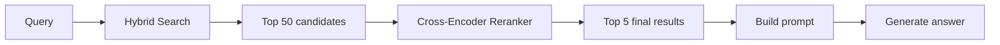
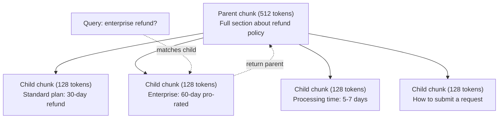
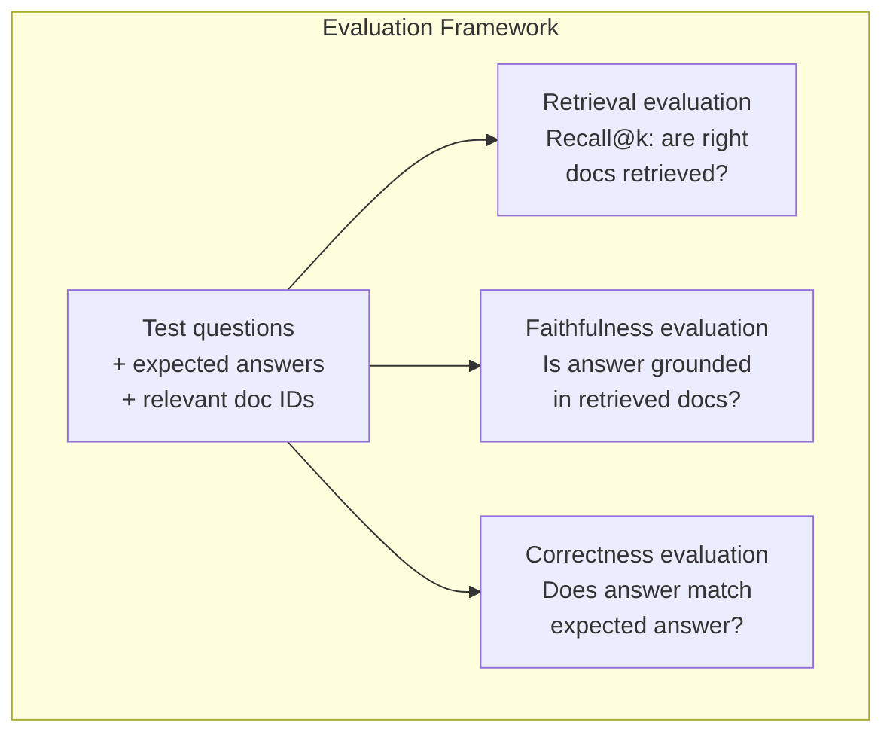

# 고급 RAG (중소화, 재등급, 하이브리드 검색)

> 기본 RAG는 가장 유사한 상위 k 조각을 검색합니다. 간단한 질문에는 효과가 있습니다. 다중 홉 추론, 모호한 질의 및 큰 코퍼에 분해됩니다. 고급 RAG는 10 개의 문서에서 작동하는 데모와 10 백만 개의 시스템에 대한 차이입니다.

**Type:** Build
**Languages:** Python
**Prerequisites:** Phase 11, Lesson 06 (RAG)
**Time:** ~90 minutes
**Related:**5 · 23 단계 (RAG의 쪼개기 전략) 은 6가지 쪼개기 알고리즘을 모두 포함하고 있습니다.  재발성, 의미, 문장, 부모 문서, 늦은 쪼개기, 맥락 검색  Vectara/Anthropic 벤치마크를 사용한다. 이 수업은 위를 기반으로 한다. 하이브리드 검색, 재등급, 쿼리 변환.

## 학습 목표

- 문서 구조와 맥락을 보존하는 고급 쪼개기 전략을 구현 (말론적, 재발적, 부모-아동)
- BM25 키워드 일치와 의미 벡터 검색 및 크로스 앵코더 리랜커를 결합한 하이브리드 검색 파이프라인을 구축
- 모호하거나 복잡한 질문에서 검색을 개선하기 위해 질의 변환 기술을 적용 (HyDE, 멀티 질의, 단계적)
- 일반적인 RAG 오류를 진단하고 수정: 잘못된 조각을 검색, 맥락에서 없는 답변, 멀티-홉 추론 분해

## 문제

레슨 06에서 기본적인 RAG 파이프라인을 만들었습니다. 작은 코퍼스에서 간단한 질문에 대해 작동합니다. 이제 이것들을 시도해보세요:

**Ambiguous query**"이번 분기 매출은 무엇이었습니까?" 의미 검색은 매출 전략, 매출 예측 및 매출 성장에 대한 CFO의 생각에 대한 조각을 반환합니다. 모두 의미적으로 " 매출" 단어와 비슷합니다. 실제 숫자를 포함하지 않습니다. 올바른 조각은 "$47.2M in Q3 2025" but uses the word "earnings" instead of "revenue." The embedding model thinks "revenue strategy" is closer to the query than "Q3 earnings were $47.2M".

**Multi-hop question**"어떤 팀 이 고객 만족도 점수 를 가장 높게 향상 시켰습니까?" 이것은 각 팀 에 대한 만족도 점수를 찾아보고 비교하고 최대 점수를 확인 하는 것을 요구 합니다. 단 한 부분 이 답 을 포함 하지 않습니다. 정보는 팀 보고서 에 흩어져 있습니다.

**Large corpus problem**: 2백만 개의 조각이 있습니다. 올바른 답은 조각 #1,847,293입니다. 당신의 5위 검색은 조각 #1,89,201, #1,200,000, #44, #901,333을 끌어냅니다. 임베딩 공간에 가깝지만 답을 포함하지 않습니다. 이 규모에서, 대략적인 가까운 이웃 검색은 관련 결과를 상위 k에서 밀어내는 충분한 오류를 도입합니다.

기본 RAG는 벡터 유사성이 관련성과 동일하지 않기 때문에 실패합니다. 조각은 의미적으로 질문에 비슷한데 답에 유용하지 않을 수 있습니다. 고급 RAG는 네 가지 기술을 통해 이를 해결합니다. 하이브리드 검색 (키워드 일치 추가), 재랭킹 (후보자들을 더 신중하게 점수), 쿼리 변환 ( 검색 전에 쿼리를 수정), 그리고 더 나은 쪼개리 (옳은 미분성에서 검색).

## 개념

### 하이브리드 검색: 의미 + 키워드

의미 검색 (벡터 유사성) 은 의미를 이해하는 데 좋다. "내가 구독을 취소하는 방법"은 "당신의 계획을 종료하는 단계"과 일치한다. 비록 그들은 단어를 공유하지 않는다. 그러나 정확한 일치가 생기지 않는다. "실동 코드 E-4021"는 임베디션 모델이 소음으로 취급한다면 "E-4021"를 포함하는 조각과 일치하지 않을 수 있습니다.

키워드 검색 (BM25) 은 반대입니다. 정확한 일치에서 우수합니다. "E-4021"는 완벽하게 일치합니다. 그러나 문서에서 "계약을 취소하십시오"가 "계획을 종료하십시오"라고 말하면 "내 구독을 취소하십시오"는 0 결과를 반환합니다.

하이브리드 검색은 둘 다 실행하고, 그 결과들을 합쳐줍니다.

**BM25**(Best Matching 25) 는 표준 키워드 검색 알고리즘이다. 1990년대부터 검색 엔진의 척추 역할을 해왔다.

```
BM25(q, d) = sum over terms t in q:
    IDF(t) * (tf(t,d) * (k1 + 1)) / (tf(t,d) + k1 * (1 - b + b * |d| / avgdl))
```

tf(t,d) 는 문서 d에서 t의 용어 주파수이고, IDF(t) 는 역 문서 주파수이고, ᄂd는 문서 길이가, avgdl는 문서 평균 길이가, k1는 용어 주파수 포화 (전설 1.2), b는 길이 정상화를 (전설 0.75) 제어합니다.

단순하게 말하면: BM25는 문서가 질의 용어를 포함하면 (특히 드문 경우) 높은 점수를 얻지만 반복된 용어에 대한 수익률이 감소한다. "이윤"이라는 단어 50배가 있는 문서는 한 번보다 50배 더 관련이 없습니다.

### 상호 순위 합병 (RRF)

두 개의 순위 목록이 있습니다. 하나는 벡터 검색에서, 하나는 BM25에서입니다. 어떻게 결합합니까?

```
RRF_score(d) = sum over rankings R:
    1 / (k + rank_R(d))
```

k는 상위 순위의 결과가 지배하는 일정 (일반적으로 60) 이므로

벡터 검색에서 1위를 차지하고 BM25에서 5위를 차지하는 문서는: 1/(60+1) + 1/(60+5) = 0.0164 + 0.0154 = 0.0318

벡터 검색에서 #3위와 BM25에서 #2위를 차지하는 문서는: 1/(60+3) + 1/(60+2) = 0.0159 + 0.0161 = 0.0320

RRF는 자연적으로 두 신호를 균형 잡는다. 두 목록에서 높은 순위를 차지하는 문서는 최고의 점수를 얻는다. 한 목록에서 1위를 차지하지만 다른 목록에서 অনুপস্থিত 있는 문서는 중소 점수를 얻는다. 이것은 순위를 사용하기 때문에 견고하다. 원자 점수는 아닙니다. 따라서 두 시스템 사이의 점수 분포의 차이점은 중요하지 않습니다.

### 순위를 재평가

검색 (벡터, 키워드 또는 하이브리드) 은 빠르고 정확하지 않습니다. 이중 앵코더를 사용합니다. 질의와 각 문서는 독립적으로 임베디드되고 비교됩니다. 임베디드는 한 번 계산되고 캐시됩니다. 이것은 수백만 개의 문서를 확장합니다.

순위 순위는 크로스 코더를 사용합니다: 질의와 후보 문서가 관련성 점수를 내놓는 모델로 함께 공급됩니다. 모델은 두 텍스트를 동시에 볼 수 있으며 그 사이의 미세한 상호 작용을 캡처 할 수 있습니다. 크로스 코더는 "Q3 수익은 무엇입니까?"라는 것을 이해할 수 있습니다.

교류: 크로스 코더는 바이코더보다 100-1000배 느리므로 질의문서쌍을 공동으로 처리합니다. 백만 문서의 크로스 코더 점수를 미리 계산할 수 없습니다. 해결책은: 더 큰 후보 세트를 검색합니다.



일반적인 재등급 모델 (2026 라인업):
- Cohere Rerank 3.5: 관리된 API, 다국어, 혼합된 코로에서 가장 좋은 회수
- 여행 재등급-2.5: 관리된 API, 호스트 옵션 중 가장 낮은 지연시간
- Jina-Reranker-v2 다국어: 오픈 웨이트, 100+ 언어
- bge-reanker-v2-m3: 열린 무게, 강한 기본
- 크로스코더/ms-marco-MiniLM-L-6-v2: 오픈 웨이트, 프로토타입을 위해 CPU에 실행됩니다
- 콜버트v2 / 지나 콜버트v2: 늦은 상호작용 멀티 벡터 리랜커$O(\text{tokens})$아니$O(\text{docs})$점수를 받을 때

### 질문 변환

때때로 문제는 검색이 아니라 검색 자체입니다. "새 정책 변경에 대한 그 일은 무엇입니까?"는 끔찍한 검색 검색 질문입니다. 특정 용어가 포함되어 있지 않습니다. 임베디션은 모호합니다. 검색 시스템은 이것에서 올바른 문서를 찾을 수 없습니다.

**Query rewriting**이 경우, LLM는 다음과 같은 작업을 수행할 수 있습니다.

```
User: "What was that thing about the new policy change?"
Rewritten: "Recent policy changes and updates"
```

**HyDE (Hypothetical Document Embeddings)**: 질문으로 검색하는 대신 가상의 답을 생성하고, 그것을 삽입하고, 유사한 실제 문서를 검색합니다.

```
Query: "What is the refund policy for enterprise?"
Hypothetical answer: "Enterprise customers are eligible for a full refund
within 60 days of purchase. Refunds are pro-rated based on the remaining
subscription period and processed within 5-7 business days."
```

가상의 답을 삽입하고 그와 유사한 실제 문서를 검색합니다. 직관: 가상의 대답은 원래 질문에 비해 실제 질문에 더 가까운 공간에 삽입되어 있습니다. 질문과 답변은 다른 언어 구조를 가지고 있습니다. 가상의 답을 생성함으로써, 당신은 임베디션에서 "문제 공간"과 " 답변 공간" 사이의 격차를 다치게합니다.

HyDE는 검색 전에 한 번의 LLM 호출을 추가합니다. 이것은 500-2000ms로 지연을 증가시킵니다. 원료 검색에서 검색 품질이 좋지 않을 때 가치가 있습니다.

### 부모-아동의 거

표준 쪼개는 타협을 강요합니다. 정확한 검색을 위해 작은 조각, 충분한 맥락을 위해 큰 조각. 부모-아동 쪼개는 이 타협을 제거합니다.

작은 조각 (128 토큰) 을 검색하기 위해 표시하십시오. 작은 조각이 검색되면, 프롬프트에 대한 부모 조각 (512 토큰) 을 반환하십시오. 작은 조각은 질의와 정확하게 일치합니다. 부모 조각은 LLM에 좋은 답을 생성하기에 충분한 맥락을 제공합니다.



"기업 환불?"라는 질문은 아이 부분 C2와 정확하게 일치합니다. 하지만 프롬프트는 처리 시간 및 제출 프로세스에 대한 주변 맥락을 포함하는 전체 부모 부분 P를 수신합니다.

### 메타데이터 필터링

벡터 검색을 실행하기 전에 메타데이터: 날짜, 원천, 카테고리, 저자, 언어에 따라 필터링을 수행하여 검색 공간을 줄이고 무관한 결과를 방지합니다.

"지난 달 보안 정책에 무슨 변화가 있었나요?"는 보안 범주에 있는 지난 30일 문서만을 검색해야 합니다. 메타데이터 필터링이 없으면 전체 코퍼스를 검색하고 2년 된 보안 문서가 의미적으로 비슷하게 찾아낼 수 있습니다.

생산RAG 시스템은 각 조각과 함께 메타데이터를 저장합니다. 원본 문서, 생성 날짜, 카테고리, 저자, 버전. 벡터 데이터베이스는 유사성 검색 전에 메타데이터로 미리 필터링을 지원합니다. 이는 규모의 성능에 중요합니다.

### 평가

RAG 시스템을 만들었는데 어떻게 알 수 있을까요?

**Retrieval relevance (Recall@k)**: 알려진 관련 문서들을 가진 시험 질문 집합에 있어서, 관련 문서의 비율은 상위 k 결과에서 얼마나 나타납니다?

**Faithfulness**: 생성된 답은 검색된 문서에 근거하는가? 검색된 조각들이 "60일 환불 창"라고 말하고 모델은 "90일 환불 창"라고 한다면, 그것은 충실성 오류입니다. 모델은 올바른 맥락을 가지고 있음에도 불구하고 환각했습니다.

**Answer correctness**: 생성된 답은 예상된 답과 일치하는가? 이것은 끝에서 끝까지의 측정입니다. 그것은 검색 품질과 생성 품질을 결합합니다.

간단한 신뢰성 검증: 생성된 답변의 각 주장을 가지고 검색된 조각에 (물질적으로) 나타난 것을 확인합니다. 응답이 검색된 조각에 없는 사실을 포함한다면, 그것은 환각을 일으키는 것일 가능성이 있습니다.



```figure
agentic-rag-loop
```

## 건설 해

### 단계 1: BM25 구현

```python
import math
from collections import Counter

class BM25:
    def __init__(self, k1=1.2, b=0.75):
        self.k1 = k1
        self.b = b
        self.docs = []
        self.doc_lengths = []
        self.avg_dl = 0
        self.doc_freqs = {}
        self.n_docs = 0

    def index(self, documents):
        self.docs = documents
        self.n_docs = len(documents)
        self.doc_lengths = []
        self.doc_freqs = {}

        for doc in documents:
            words = doc.lower().split()
            self.doc_lengths.append(len(words))
            unique_words = set(words)
            for word in unique_words:
                self.doc_freqs[word] = self.doc_freqs.get(word, 0) + 1

        self.avg_dl = sum(self.doc_lengths) / self.n_docs if self.n_docs else 1

    def score(self, query, doc_idx):
        query_words = query.lower().split()
        doc_words = self.docs[doc_idx].lower().split()
        doc_len = self.doc_lengths[doc_idx]
        word_counts = Counter(doc_words)
        score = 0.0

        for term in query_words:
            if term not in word_counts:
                continue
            tf = word_counts[term]
            df = self.doc_freqs.get(term, 0)
            idf = math.log((self.n_docs - df + 0.5) / (df + 0.5) + 1)
            numerator = tf * (self.k1 + 1)
            denominator = tf + self.k1 * (1 - self.b + self.b * doc_len / self.avg_dl)
            score += idf * numerator / denominator

        return score

    def search(self, query, top_k=10):
        scores = [(i, self.score(query, i)) for i in range(self.n_docs)]
        scores.sort(key=lambda x: x[1], reverse=True)
        return scores[:top_k]
```

### 단계 2: 상호 순위 합병

```python
def reciprocal_rank_fusion(ranked_lists, k=60):
    scores = {}
    for ranked_list in ranked_lists:
        for rank, (doc_id, _) in enumerate(ranked_list):
            if doc_id not in scores:
                scores[doc_id] = 0.0
            scores[doc_id] += 1.0 / (k + rank + 1)
    fused = sorted(scores.items(), key=lambda x: x[1], reverse=True)
    return fused
```

### 3단계: 하이브리드 검색 파이프라인

```python
def hybrid_search(query, chunks, vector_embeddings, vocab, idf, bm25_index, top_k=5, fusion_k=60):
    query_emb = tfidf_embed(query, vocab, idf)
    vector_results = search(query_emb, vector_embeddings, top_k=top_k * 3)
    bm25_results = bm25_index.search(query, top_k=top_k * 3)
    fused = reciprocal_rank_fusion([vector_results, bm25_results], k=fusion_k)
    return fused[:top_k]
```

### 4단계: 간단한 재등급

제작에서는 크로스 코더 모델을 사용합니다. 여기서 우리는 단어 중복, 용어 중요성, 문장 일치를 사용하여 질의 문서 관련성을 점수를 제공하는 재등급기를 만듭니다.

```python
def rerank(query, candidates, chunks):
    query_words = set(query.lower().split())
    stop_words = {"the", "a", "an", "is", "are", "was", "were", "what", "how",
                  "why", "when", "where", "do", "does", "for", "of", "in", "to",
                  "and", "or", "on", "at", "by", "it", "its", "this", "that",
                  "with", "from", "be", "has", "have", "had", "not", "but"}
    query_terms = query_words - stop_words

    scored = []
    for doc_id, initial_score in candidates:
        chunk = chunks[doc_id].lower()
        chunk_words = set(chunk.split())

        term_overlap = len(query_terms & chunk_words)

        query_bigrams = set()
        q_list = [w for w in query.lower().split() if w not in stop_words]
        for i in range(len(q_list) - 1):
            query_bigrams.add(q_list[i] + " " + q_list[i + 1])
        bigram_matches = sum(1 for bg in query_bigrams if bg in chunk)

        position_boost = 0
        for term in query_terms:
            pos = chunk.find(term)
            if pos != -1 and pos < len(chunk) // 3:
                position_boost += 0.5

        rerank_score = (
            term_overlap * 1.0
            + bigram_matches * 2.0
            + position_boost
            + initial_score * 5.0
        )
        scored.append((doc_id, rerank_score))

    scored.sort(key=lambda x: x[1], reverse=True)
    return scored
```

### 단계 5: HyDE (기반 문서 임베디션)

```python
def hyde_generate_hypothesis(query):
    templates = {
        "what": "The answer to '{query}' is as follows: Based on our documentation, {topic} involves specific policies and procedures that define how the process works.",
        "how": "To address '{query}': The process involves several steps. First, you need to initiate the request. Then, the system processes it according to the defined rules.",
        "default": "Regarding '{query}': Our records indicate specific details and policies related to this topic that provide a comprehensive answer."
    }
    query_lower = query.lower()
    if query_lower.startswith("what"):
        template = templates["what"]
    elif query_lower.startswith("how"):
        template = templates["how"]
    else:
        template = templates["default"]

    topic_words = [w for w in query.lower().split()
                   if w not in {"what", "is", "the", "how", "do", "does", "a", "an",
                                "for", "of", "to", "in", "on", "at", "by", "and", "or"}]
    topic = " ".join(topic_words) if topic_words else "this topic"

    return template.format(query=query, topic=topic)


def hyde_search(query, chunks, vector_embeddings, vocab, idf, top_k=5):
    hypothesis = hyde_generate_hypothesis(query)
    hypothesis_emb = tfidf_embed(hypothesis, vocab, idf)
    results = search(hypothesis_emb, vector_embeddings, top_k)
    return results, hypothesis
```

### 단계 6: 부모-아동의 뭉개

```python
def create_parent_child_chunks(text, parent_size=200, child_size=50):
    words = text.split()
    parents = []
    children = []
    child_to_parent = {}

    parent_idx = 0
    start = 0
    while start < len(words):
        parent_end = min(start + parent_size, len(words))
        parent_text = " ".join(words[start:parent_end])
        parents.append(parent_text)

        child_start = start
        while child_start < parent_end:
            child_end = min(child_start + child_size, parent_end)
            child_text = " ".join(words[child_start:child_end])
            child_idx = len(children)
            children.append(child_text)
            child_to_parent[child_idx] = parent_idx
            child_start += child_size

        parent_idx += 1
        start += parent_size

    return parents, children, child_to_parent
```

### 7단계: 충실 한 사람 을 평가

```python
def evaluate_faithfulness(answer, retrieved_chunks):
    answer_sentences = [s.strip() for s in answer.split(".") if len(s.strip()) > 10]
    if not answer_sentences:
        return 1.0, []

    grounded = 0
    ungrounded = []
    context = " ".join(retrieved_chunks).lower()

    for sentence in answer_sentences:
        words = set(sentence.lower().split())
        stop_words = {"the", "a", "an", "is", "are", "was", "were", "and", "or",
                      "to", "of", "in", "for", "on", "at", "by", "it", "this", "that"}
        content_words = words - stop_words
        if not content_words:
            grounded += 1
            continue

        matched = sum(1 for w in content_words if w in context)
        ratio = matched / len(content_words) if content_words else 0

        if ratio >= 0.5:
            grounded += 1
        else:
            ungrounded.append(sentence)

    score = grounded / len(answer_sentences) if answer_sentences else 1.0
    return score, ungrounded


def evaluate_retrieval_recall(queries_with_relevant, retrieval_fn, k=5):
    total_recall = 0.0
    results = []

    for query, relevant_indices in queries_with_relevant:
        retrieved = retrieval_fn(query, k)
        retrieved_indices = set(idx for idx, _ in retrieved)
        relevant_set = set(relevant_indices)
        hits = len(retrieved_indices & relevant_set)
        recall = hits / len(relevant_set) if relevant_set else 1.0
        total_recall += recall
        results.append({
            "query": query,
            "recall": recall,
            "hits": hits,
            "total_relevant": len(relevant_set)
        })

    avg_recall = total_recall / len(queries_with_relevant) if queries_with_relevant else 0
    return avg_recall, results
```

## 사용 하 고

진짜 크로스코더로 재등급을 할 수 있습니다.

```python
from sentence_transformers import CrossEncoder

reranker = CrossEncoder("cross-encoder/ms-marco-MiniLM-L-6-v2")

def rerank_with_cross_encoder(query, candidates, chunks, top_k=5):
    pairs = [(query, chunks[doc_id]) for doc_id, _ in candidates]
    scores = reranker.predict(pairs)
    scored = list(zip([doc_id for doc_id, _ in candidates], scores))
    scored.sort(key=lambda x: x[1], reverse=True)
    return scored[:top_k]
```

코헤어의 리너랭커를 통해

```python
import cohere

co = cohere.Client()

def rerank_with_cohere(query, candidates, chunks, top_k=5):
    docs = [chunks[doc_id] for doc_id, _ in candidates]
    response = co.rerank(
        model="rerank-english-v3.0",
        query=query,
        documents=docs,
        top_n=top_k
    )
    return [(candidates[r.index][0], r.relevance_score) for r in response.results]
```

실제 LLM를 가진 HyDE:

```python
import anthropic

client = anthropic.Anthropic()

def hyde_with_llm(query):
    response = client.messages.create(
        model="claude-sonnet-5",
        max_tokens=256,
        messages=[{
            "role": "user",
            "content": f"Write a short paragraph that would be a good answer to this question. Do not say you don't know. Just write what the answer would look like.\n\nQuestion: {query}"
        }]
    )
    return response.content[0].text
```

Weaviate와 생산 하이브리드 검색:

```python
import weaviate

client = weaviate.connect_to_local()

collection = client.collections.get("Documents")
response = collection.query.hybrid(
    query="enterprise refund policy",
    alpha=0.5,
    limit=10
)
```

알파 매개 변수는 균형을 제어한다: 0.0 = 순수 키워드 (BM25), 1.0 = 순수 벡터, 0.5 = 동등한 무게. 대부분의 생산 시스템은 0.3에서 0.7 사이의 알파를 사용합니다.

## 선박

이 교훈은 다음과 같은 결과를 낳습니다.
- `outputs/prompt-advanced-rag-debugger.md`-- RAG 품질 문제를 진단하고 해결하는 시키는
- `outputs/skill-advanced-rag.md`-- 하이브리드 검색 및 재등급을 통해 생산급 RAG를 구축하는 기술

## 운동

1. 샘플 문서에서 BM25와 벡터 검색과 하이브리드 검색을 비교하십시오. 5 가지 테스트 쿼리 중 각각, 어떤 접근 방식이 가장 관련있는 부분을 위치 # 1로 반환하는지 기록하십시오. 하이브리드 검색은 5 개 중 적어도 3 개에서 승리해야합니다.

2. 메타데이터 필터를 구현하십시오. 각 문서 (안전, 청구, API, 제품) 에 "분자" 필드를 추가하십시오. 벡터 검색을 실행하기 전에 해당 범주에만 펌프를 필터하십시오. "어떤 암호화 사용합니까?"를 사용하여 테스트하고 보안 범주 펌프를 검색하는 것을 확인하십시오.

3. 06 수업에서 간단한 생성 기능을 사용하여 HyDE 파이프라인을 작성하십시오. 직접 쿼리 검색과 HyDE 검색 사이의 검색 품질 (최고 3의 관련성) 을 비교하십시오. HyDE는 미묘한 쿼리 결과물을 개선해야합니다.

4. 샘플 문서에 부모-아동 분량 전략을 구현하십시오. child_size=30 및 parent_size=100을 사용하십시오. 어린이 분량으로 검색하지만 프롬프트에서 부모 분량으로 반환하십시오. 표준 분량에 대한 생성 된 답변을 chunk_size=50와 비교하십시오.

5. 평가 데이터 세트를 생성: 알려진 답변 조각을 가진 10 가지 질문. (a) 벡터 검색, (b) BM25에서만, (c) 하이브리드 검색, (d) 하이브리드 + 재등급을 위해 Recall@3, Recall@5 및 Recall@10을 측정하십시오. 결과를 일괄적으로 파악하고 재등급이 가장 도움이되는 곳을 확인하십시오.

## 주요 용어

| Term | What people say | What it actually means |
|------|----------------|----------------------|
| BM25 | "Keyword search" | A probabilistic ranking algorithm that scores documents by term frequency, inverse document frequency, and document length normalization |
| Hybrid search | "Best of both worlds" | Running semantic (vector) and keyword (BM25) search in parallel, then merging results with rank fusion |
| Reciprocal Rank Fusion | "Merge ranked lists" | Combining multiple ranked lists by summing 1/(k + rank) for each document across all lists |
| Reranking | "Second pass scoring" | Using a more expensive cross-encoder model to re-score a candidate set from initial retrieval |
| Cross-encoder | "Joint query-document model" | A model that takes a query and document as a single input, producing a relevance score; more accurate than bi-encoders but too slow for full corpus search |
| Bi-encoder | "Independent embedding model" | A model that embeds queries and documents independently; fast because embeddings are precomputed, but less accurate than cross-encoders |
| HyDE | "Search with a fake answer" | Generate a hypothetical answer to the query, embed it, and search for real documents similar to it |
| Parent-child chunking | "Small search, big context" | Index small chunks for precise retrieval but return the larger parent chunk to provide sufficient context |
| Metadata filtering | "Narrow before searching" | Filtering documents by attributes (date, source, category) before running vector search to reduce the search space |
| Faithfulness | "Did it stay grounded" | Whether the generated answer is supported by the retrieved documents, as opposed to hallucinated from the model's training data |

## 더 많은 읽기

- 로버트슨 & 사라고사, "가능성 관련 프레임워크: BM25 및 그 이상의 2009" - BM25의 최종 참조, 공식 뒤에 있는 확률적 기초를 설명
- 코맥 등, "반응적 순위 합병은 콘도르셋과 개인 순위 학습 방법을 능가한다" (2009) - 더 복잡한 합병 방법을 이길 수 있는 원래 RRF 논문
- Gao et al., "Relevance Labels 없이 정확한 Zero-Shot Dense Retrieval" (2022) - 가이데 논문
- 노게이라 & 쇼, "BERT로 패스레이스 리랭킹" (2019) -- BM25 위에 크로스코더 리랭킹이 검색 품질을 크게 향상시키는 것을 보여주었습니다
- [Khattab et al., "DSPy: Compiling Declarative Language Model Calls into Self-Improving Pipelines" (2023)](https://arxiv.org/abs/2310.03714)-- 신속한 건설 및 무게 선택은 검색 파이프라인을 위한 최적화 문제로 취급합니다. "프로그램 LLM" 대신 "프로그램 LLM"를 읽으십시오.
- [Edge et al., "From Local to Global: A Graph RAG Approach to Query-Focused Summarization" (Microsoft Research 2024)](https://arxiv.org/abs/2404.16130)-- GraphRAG 논문: 엔티티 관계 추출 + 검색 중심의 요약을 위한 레이든 커뮤니티 검출; 글로벌 vs 로컬 검색 구별.
- [Asai et al., "Self-RAG: Learning to Retrieve, Generate, and Critique through Self-Reflection" (ICLR 2024)](https://arxiv.org/abs/2310.11511)-- 반사 토큰을 가진 자율 평가 RAG; 정적 검색-이후 생성을 넘어서는 기관적 경계가.
- [LangChain Query Construction blog](https://blog.langchain.dev/query-construction/)-- 자연어 질의를 구조화된 데이터베이스 질의로 번역하는 방법 (Text-to-SQL, Cypher)
