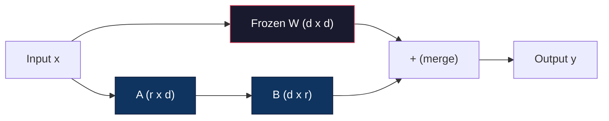
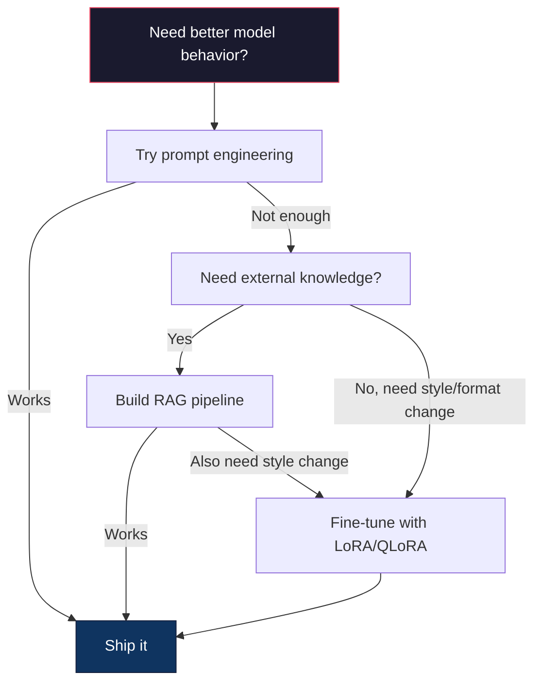

# 로라 & QLoRA와 정렬

> 7B 모델의 정밀 조정에는 56GB의 VRAM가 필요합니다. 여러분은 그것을 가지고 있지 않습니다. 대부분의 회사도 그렇지 않습니다. LoRA는 매개 변수의 1% 미만을 훈련함으로써 동일한 모델을 6GB에 정밀 조정할 수 있습니다. 이것은 타협이 아닙니다. 대부분의 작업에 대한 정밀 조정 품질과 일치합니다. 전체 오픈 소스 정밀 조정 생태계는 이 한 가지 트릭에 달려 있습니다.

**Type:** Build
**Languages:** Python
**Prerequisites:** Phase 10, Lesson 06 (Instruction Tuning / SFT)
**Time:** ~75 minutes
**Related:**10단계에서는 SFT/DPO 루프를 처음부터 다루고 있습니다. 이 수업은 2026 PEFT 도구 키트 (PEFT, TRL, Unsloth, Axolotl, LLaMA-Factory) 에 연결합니다.

## 학습 목표

- 로라를 구현하여, 예전에 훈련된 모델의 관심층에 낮은 순위 어댑터 매트릭스 (A 및 B) 를 주입한다.
- 로라와 전체 미세조정의 매개 변수 절감량을 계산한다: 순위 $r$$d_{\text{model}}$차원 열차$2 \cdot r \cdot d$ 대신 매개 변수$d^2$
- QLoRA (4 비트 양자 기반 + LoRA 어댑터) 를 사용하여 소비자의 GPU 메모리에 맞게 모델을 정렬하십시오
- 배포를 위한 기본 모델로 로라 무게를 통합하고 어댑터와 그렇지 않은 추론 속도를 비교

## 문제

기본 모델은 Llama 3 8B입니다. 고객 지원 티켓에 대한 답변을 회사 목소리로 해주고 싶으세요. SFT는 답입니다. 하지만 SFT는 비용 문제입니다.

전체 정렬은 모델의 모든 매개 변수를 업데이트합니다. Llama 3 8B에는 8억 매개 변수가 있습니다. fp16에서는 각 매개 변수가 2 바이트를 필요로합니다. 그것은 무게를 로드하기 위해 16GB입니다. 훈련 중에, 당신은 또한 gradients (16GB), Adam (32GB의 운동량 + 변동) 의 최적화 상태와 활성화가 필요합니다. 총: 단일 8B 모델에 대한 VRAM의 약 56GB.

A100 80GB는 거의 여기에 맞지 않습니다. A100 2개가 비싸습니다.$3-4/hour on cloud providers. Training for 3 epochs on 50,000 examples takes 6-10 hours. That's $실험당 30-40개, 10개의 실험을 해 hyperparameters를 제대로 해내면 400달러를 써버렸어

Llama 3 70B로 확장하면 숫자가 터무니없게 됩니다. 무게만 140GB입니다. 클러스터가 필요합니다. 실험당 100달러 이상입니다.

더 깊은 문제도 있습니다. 완전한 정렬은 모델의 모든 무게를 수정합니다. 고객 지원 데이터를 정렬하면 모델의 일반적인 능력을 떨어뜨릴 수 있습니다. 이것을 재앙적인 잊는다고 합니다. 모델은 당신의 작업에서 더 좋아지고 다른 모든 일에 더 나쁘게됩니다.

더 적은 매개 변수를 훈련시키고, 메모리를 덜 사용하고, 모델의 기존 지식을 파괴하지 않는 방법이 필요합니다.

## 개념

### 로라: 낮은 순위 적응

에드워드 후와 마이크로소프트의 동료들은 2021년 6월에 LoRA를 발표하였다. 논문의 통찰력은: 정렬 중의 무게 업데이트는 본질적으로 낮은 순위를 가지고 있다. 4096x4096 중 매트릭스에서 모든 16.7 백만 매트릭스를 업데이트할 필요가 없다. 업데이트에 있는 유용한 정보는 16 또는 32 순위 매트릭스에 의해 캡처될 수 있다.

여기 수학이 있습니다. 표준 선형층은 계산합니다.

```math
y = Wx
```

어디$W$$d_{\text{out}} \times d_{\text{in}}$4096x4096의 관심사 투사에서 16,777,216개의 매트릭스입니다.

로라가 얼어붙는다$W$그리고 낮은 순위 분해를 추가합니다.

```math
y = Wx + BAx
```

어디$B$ $(d_{\text{out}} \times r)$그리고$A$ $(r \times d_{\text{in}})$- 순위$r$$d$-- 일반적으로 8, 16, 32개

$r=16$4096x4096층에:
- 원래 매개 변수는: 4096 x 4096 = 16,777,216
- 로라 매개 변수는: (4096 x 16) + (16 x 4096) = 65,536 + 65,536 = 131,072
- 감소: 131,072 / 16,777,216 = 0.78%

매개 변수 0.78%를 훈련시키고 95-100%의 품질을 얻습니다.



A는 무작위 가우시안으로 초기화 됩니다. B는 0으로 초기화 됩니다. 이것은 LoRA 기여가 0에서 시작된다는 것을 의미합니다. 모델은 원래 행동에서 훈련하기 시작하며 점차 적응을 배우게 됩니다.

### 확장 요소: 알파

로라는 확장 요소를 도입합니다 $\alpha$저급 업데이트가 출력에 얼마나 영향을 미치는지 제어하는

```math
y = Wx + \frac{\alpha}{r} \cdot BAx
```

언제$\alpha = r$, 스케일링은 1x입니다.$\alpha = 2r$이 과다 매개 변수는 기본 학습 속도와 독립적으로 LoRA 경로의 학습 속도를 제어합니다.

실용적 지침:
- $\alpha = 2 \cdot \text{rank}$공동 공동체의 협약 (본 문서 사용 $\alpha = \text{rank}$대부분의 실험에서)
- $\alpha = \text{rank}$1x 스케일링을 제공합니다. 보수적이지만 안정적입니다.
- 더 높습니다$\alpha$단계별로 더 큰 업데이트를 의미하며, 이는 회화 속도를 높일 수 있거나 불안정을 유발할 수 있습니다.

### 로라 를 적용 하는 곳

트랜스포머는 많은 선형 층을 가지고 있습니다. 로라를 모두 추가할 필요가 없습니다. 원래의 종이 다른 조합을 테스트했습니다.

| Target Layers | Trainable Params (7B) | Quality |
|--------------|----------------------|---------|
| q_proj only | 4.7M | Good |
| q_proj + v_proj | 9.4M | Better |
| q_proj + k_proj + v_proj + o_proj | 18.9M | Best for attention |
| All linear (attention + MLP) | 37.7M | Marginal gain, 2x params |

대부분의 작업의 달콤한 점: q_proj + v_proj. 이것은 모델이 무엇을 수행하고 어떤 정보를 추출하는지 제어하는 자부심을 가지고 질의와 값 예측을 목표로합니다. MLP 계층을 추가하면 코드 생성과 같은 복잡한 작업에 도움이되지만 더 간단한 작업에서 감소하는 수익을 위해 매개 변수 수를 두 배로 증가시킵니다.

### 순위 선택

순위$r$적응의 표현성을 제어한다.

| Rank | Trainable Params (per layer) | Best For |
|------|---------------------------|----------|
| 4 | 32,768 | Simple classification, sentiment |
| 8 | 65,536 | Single-domain Q&A, summarization |
| 16 | 131,072 | Multi-domain tasks, instruction following |
| 32 | 262,144 | Complex reasoning, code generation |
| 64 | 524,288 | Diminishing returns for most tasks |
| 128 | 1,048,576 | Rarely justified |

Hu et al.는 그것을 보여주었습니다.$r=4$이미 간단한 작업에 대한 적응의 대부분을 포착합니다. $r=8$그리고$r=16$실제에서 가장 흔한 선택입니다.$r=64$거의 품질을 향상시키지 못하고, 로라의 기억력 향상을 잃게 됩니다.

### QLoRA: 4 비트 양자화 + LoRA

팀 데트머스와 워싱턴 대학교의 동료들은 2023년 5월 QLoRA를 발표하였다. 이 아이디어는: 얼어붙은 기본 모델을 4비트 정밀도로 양자화하고, 위에 fp16에 있는 LoRA 어댑터를 붙여넣는 것이다.

이것은 기억 방정식을 크게 변화시킵니다.

| Method | Weight Memory (7B) | Training Memory (7B) | GPU Required |
|--------|-------------------|---------------------|-------------|
| Full fine-tune (fp16) | 14GB | ~56GB | 1x A100 80GB |
| LoRA (fp16 base) | 14GB | ~18GB | 1x A100 40GB |
| QLoRA (4-bit base) | 3.5GB | ~6GB | 1x RTX 3090 24GB |

QLoRA는 세 가지 기술적인 기여를 합니다.

**NF4 (Normal Float 4-bit)**: 신경 네트워크 중량에 특별히 설계된 새로운 데이터 유형. 신경 네트워크 중량은 대략 정상적인 분포를 따르고 있습니다. NF4는 16 개의 양량화 수준을 표준 정상적인 분포의 양량에 배치합니다. 이것은 일반적으로 분포된 데이터에 대해 정보 이론적으로 최적입니다. 그것은 균일한 4 비트 양량화 (INT4) 또는 표준 플로트4보다 적은 정보를 잃습니다.

**Double quantization**양자화 상수 자체는 메모리를 가져옵니다. 64 무게의 각 블록은 fp32 규모 인수를 (4 바이트) 필요로 합니다. 7B 모델에서는 추가 0.4GB입니다. 이중 양자화 이 상수를 fp8로 양자화합니다. 상용 비용을 0.1GB로 줄입니다. 작지만 합됩니다.

**Paged optimizers**: 훈련 중에 최적화 상태 (아담의 운동량 및 변동성) 는 긴 염기서에서 GPU 메모리를 초과할 수 있습니다. 페이지 최적화자는 NVIDIA의 통일 메모리를 사용하여 GPU 메모리가 고갈되면 자동으로 GPU RAM에 최적화 상태를 페이지하고 필요한 경우 다시 페이지합니다. 이것은 일부 처리량 비용으로 OOM 충돌을 방지합니다.

### 질적 문제

기하급수적 인 측정이나 기하급수적 인 측정은 품질에 해를 끼치는가?

| Method | MMLU (5-shot) | MT-Bench | HumanEval |
|--------|--------------|----------|-----------|
| Full fine-tune (Llama 2 7B) | 48.3 | 6.72 | 14.6 |
| LoRA r=16 | 47.9 | 6.68 | 14.0 |
| QLoRA r=16 (NF4) | 47.5 | 6.61 | 13.4 |
| QLoRA r=64 (NF4) | 48.1 | 6.70 | 14.2 |

로라$r=16$대부분의 기준에 따라 전체 미세조정 1% 내에 있습니다.$r=16$또 다른 분자 1퍼센트의 손실을 입습니다.$r=64$기본적으로 전체 미세조정을 맞춘 반면 90% 적은 메모리를 사용한다.

### 실제 세계 비용

50,000개의 예제 (3시대) 에 걸쳐 Llama 3 8B의 정밀 조정:

| Method | GPU | Time | Cost |
|--------|-----|------|------|
| Full fine-tune | 2x A100 80GB | 8 hours | ~$32 |
| LoRA r=16 | 1x A100 40GB | 4 hours | ~$8 |
| QLoRA r=16 | 1x RTX 4090 24GB | 6 hours | ~$5 |
| QLoRA r=16 (Unsloth) | 1x RTX 4090 24GB | 2.5 hours | ~$2 |
| QLoRA r=16 | 1x T4 16GB | 12 hours | ~$4 |

단일 소비자 GPU에 대한 QLoRA는 점심식사보다 저렴합니다. 이 때문에 오픈 웨이트 미세조정 커뮤니티는 2023년에 폭발적으로 증가했으며, 이보다 낮은 모든 교육 프레임워크는 2026년에 QLoRA를 기본으로 배포합니다.

### 2026년 PEFT 스택

| Framework | What it is | Pick when |
|-----------|-----------|-----------|
| **Hugging Face PEFT** | The canonical LoRA/QLoRA/DoRA/IA3 library | You want raw control and your training loop is already on `transformers.Trainer` |
| **TRL** | HF's reinforcement-from-feedback trainers (SFT, DPO, GRPO, PPO, ORPO) | You need DPO/GRPO after SFT; built on top of PEFT |
| **Unsloth** | Triton-kernel rewrite of the forward/backward pass | You want 2-5x speedup + half the VRAM with no accuracy loss; Llama/Mistral/Qwen family |
| **Axolotl** | YAML-config wrapper over PEFT + TRL + DeepSpeed + Unsloth | You want reproducible, version-controlled training runs |
| **LLaMA-Factory** | GUI/CLI/API over PEFT + TRL | You want zero-code fine-tuning; 100+ model families supported |
| **torchtune** | Native PyTorch recipes, no `transformers` dep | You want minimal deps and your org already standardizes on PyTorch |

엄지손가락 규칙: 연구 사용 또는 일회성 실험 → PEFT. 반복 가능한 생산 파이프라인 → Unsloth 커널을 활성화한 Axolotl. 투하 프로토타입 → LLaMA-팩토리.

### 어댑터 를 통합 하는 것

훈련 후에는 두 가지 요소가 있습니다. 얼어붙은 기본 모델과 작은 LoRA 어댑터 (일반적으로 10-100MB)

1. **Keep them separate**: 기본 모델을 로드하고, 어댑터를 위로 로드합니다. 다양한 작업에 대한 어댑터를 교환합니다. 이렇게 한 기본 모델에서 여러 가지 정렬 된 변형을 제공합니다.

2. **Merge them permanently**: 계산$W' = W + (\alpha/r) \cdot BA$그리고 결과를 새 전체 모델로 저장합니다. 합병된 모델은 원래와 같은 크기로 있습니다. 추론 대가 없습니다. 관리할 어댑터도 없습니다.

여러 작업 (고객 지원 어댑터, 코드 어댑터, 번역 어댑터) 을 수행하려면 분리하여 유지하십시오. 단일 전문 모델을 배포하려면 통합하십시오.

여러 어댑터를 결합하는 고급 융합 기술:

- **TIES-Merging**(Yadav et al. 2023): 작은 크기의 매개 변수를 단축하고 신호 충돌을 해결하고, 합병합니다. 어댑터 간의 간섭을 줄입니다.
- **DARE**(Yu et al. 2023): 어댑터 매개 변수를 합병하기 전에 무작위로 떨어뜨리고 나머지는 재 확장합니다.
- **Task arithmetic**: 단순히 어댑터 무게를 추가하거나 빼면 됩니다. "코드" 어댑터와 "수학" 어댑터를 추가하면 종종 양쪽 모두에 좋은 모델을 만들어 낼 수 있습니다.

### 언제 정규화 하지 않을 것 입니까?

정렬은 첫 번째가 아니라 세 번째 옵션입니다.

**First: prompt engineering.**더 나은 시스템 프로포트를 작성하세요. 몇 번의 예제를 추가하세요. 사슬을 사용하세요. 이것은 아무 것도 비용이 들지 않고 몇 분 걸립니다. 프로포트가 80%의 길을 얻는다면, 당신은 아마도 미세 조정이 필요하지 않을 것입니다.

**Second: RAG.**모델이 특정 데이터 (문서, 지식 기반, 제품 카탈로그) 를 알아야 한다면, 그것을 무게로 구하는 것보다 검색은 더 저렴하고 유지보수가 더 가능하다.

**Third: fine-tuning.**이 방법은 특정 스타일, 형식 또는 추론 패턴을 채택하는 데 필요한 경우, 요청으로 달성할 수 없는 경우, 일관된 구조화된 출력이 필요할 때, 큰 모델을 작은 모델로 수정해야 할 때, 지연이 중요하고 몇 번의 요청으로 추가 토큰을 감당할 수 없을 때 사용하십시오.



```figure
lora-params
```

## 건설 해

우리는 LoRA를 순수한 PyTorch에서 처음부터 구현합니다. 도서관도 없고 마법도 없습니다. 당신은 LoRA 계층을 만들고, 모델을 주입하고, 훈련하고, 무게를 다시 합쳐줍니다.

### 단계 1: 로라 계층

```python
import torch
import torch.nn as nn
import math

class LoRALayer(nn.Module):
    def __init__(self, in_features, out_features, rank=8, alpha=16):
        super().__init__()
        self.rank = rank
        self.alpha = alpha
        self.scaling = alpha / rank

        self.A = nn.Parameter(torch.randn(in_features, rank) * (1 / math.sqrt(rank)))
        self.B = nn.Parameter(torch.zeros(rank, out_features))

    def forward(self, x):
        return (x @ self.A @ self.B) * self.scaling
```

A는 스케일된 무작위 값으로 초기화된다. B는 0으로 초기화된다. 제품 BA는 0에서 시작된다. 따라서 모델은 원래 행동으로 시작된다.

### 단계 2: 로라 로라 로라 로라 로라 로라 로라 로라 로라 로라 로라 로라 로라 로라 로라 로라 로라 로라 로라 로라 로라 로라 로라 로라 로라 로라 로라 로라 로라 로라 로라 로라 로라 로라 로라 로라 로라 로라 로라 로라 로라 로라 로라 로라 로라 로라 로라 로라 로라 로라 로라 로라 로라 로라 로라 로라 로라 로라 로라 로라 로라 로라 로라 로라 로라 로라 로라 로라 로라 로라 로라 로라 로라 로라 로라 로라 로라 로라 로라 로라 로라 로라 로라 로라 로라 로라 로라 로라 로라 로라 로라 로라 로라 로라 로라 로라 로라 로라 로라 로라 로라 로라 로라 로라 로라 로라 로라 로라 로라 로라 로라 로라 로라 로라 로라 로라 로라 로라 로라 로라 로라 로라 로라 로라 로라 로라 로라 로라 로라 로라 로라 로라 로라 로라 로라 로라 로라 로라 로라 로라 로라 로라 로라 로라 로라 로라 로라 로라 로라 로라 로라 로라 로라 로라 로라 로라 로라 로라 로라 로라 로라 로라 로라 로라 로라 로라 로라 로라 로라 로라 로라 로라 로라 로라 로라 로라 로라 로라 로라 로라 로라 로라 로라 로라 로라 로라 로라 로라 로라 로라 로라 로라 로라 로라 로라 로라 로라 로라 로라 로라 로라 로라 로라 로라 로라 로라 로라 로라 로라 로라 로라 로라 로라 로라 로라 로라 로라 로라 로라 로라 로라 로라 로라 로라 로라 로라 로라 로라 로라 로라 로라 로라 로라 로라 로라 로라 로라 로라 로라 로라 로라 로라 로라 로라 로라 로라 로라 로라 로라 로라 로라 로라 로라 로라

```python
class LinearWithLoRA(nn.Module):
    def __init__(self, linear, rank=8, alpha=16):
        super().__init__()
        self.linear = linear
        self.lora = LoRALayer(
            linear.in_features, linear.out_features, rank, alpha
        )

        for param in self.linear.parameters():
            param.requires_grad = False

    def forward(self, x):
        return self.linear(x) + self.lora(x)
```

원래의 선형층은 얼어붙어 있습니다. LoRA 매개 변수 (A 및 B) 만 훈련 할 수 있습니다.

### 단계 3: 모델에 LoRA를 주입한다

```python
def inject_lora(model, target_modules, rank=8, alpha=16):
    for param in model.parameters():
        param.requires_grad = False

    lora_layers = {}
    for name, module in model.named_modules():
        if isinstance(module, nn.Linear):
            if any(t in name for t in target_modules):
                parent_name = ".".join(name.split(".")[:-1])
                child_name = name.split(".")[-1]
                parent = dict(model.named_modules())[parent_name]
                lora_linear = LinearWithLoRA(module, rank, alpha)
                setattr(parent, child_name, lora_linear)
                lora_layers[name] = lora_linear
    return lora_layers
```

먼저 모델의 모든 매개 변수를 얼어붙이십시오. 그 다음 모델 트리를 걸어, 목표 이름과 일치하는 선형 층을 찾아, 로라 포장된 버전으로 교체하십시오. 로라 A와 B 매트릭스는 전체 모델에서 유일하게 훈련 가능한 매개 변수입니다.

### 4단계: 매개 변수를 계산

```python
def count_parameters(model):
    total = sum(p.numel() for p in model.parameters())
    trainable = sum(p.numel() for p in model.parameters() if p.requires_grad)
    frozen = total - trainable
    return {
        "total": total,
        "trainable": trainable,
        "frozen": frozen,
        "trainable_pct": 100 * trainable / total if total > 0 else 0
    }
```

### 5단계: 무게를 다시 합쳐

```python
def merge_lora_weights(model):
    for name, module in model.named_modules():
        if isinstance(module, LinearWithLoRA):
            with torch.no_grad():
                merged = (
                    module.lora.A @ module.lora.B
                ) * module.lora.scaling
                module.linear.weight.data += merged.T
            parent_name = ".".join(name.split(".")[:-1])
            child_name = name.split(".")[-1]
            if parent_name:
                parent = dict(model.named_modules())[parent_name]
            else:
                parent = model
            setattr(parent, child_name, module.linear)
```

합병 후, LoRA 계층은 사라집니다. 모델은 원래와 같은 크기로 무게에 적응이 구워졌습니다. 추론 대가 없습니다.

### 단계 6: QLoRA 양자 추상

```python
def quantize_to_nf4(tensor, block_size=64):
    blocks = tensor.reshape(-1, block_size)
    scales = blocks.abs().max(dim=1, keepdim=True).values / 7.0
    scales = torch.clamp(scales, min=1e-8)
    quantized = torch.round(blocks / scales).clamp(-8, 7).to(torch.int8)
    return quantized, scales

def dequantize_from_nf4(quantized, scales, original_shape):
    dequantized = quantized.float() * scales
    return dequantized.reshape(original_shape)
```

이것은 64 블록 내에서 16 개의 분단 수준으로 무게를 지도하여 4 비트 양자화를 시뮬레이션합니다. 생산 QLoRA는 GPU에서 진정한 NF4를 위해 비트와 바이트 라이브러리를 사용합니다.

### 7단계: 훈련 로프

```python
def train_lora(model, data, epochs=5, lr=1e-3, batch_size=4):
    optimizer = torch.optim.AdamW(
        [p for p in model.parameters() if p.requires_grad], lr=lr
    )
    criterion = nn.MSELoss()

    losses = []
    for epoch in range(epochs):
        epoch_loss = 0.0
        n_batches = 0
        indices = torch.randperm(len(data["inputs"]))

        for i in range(0, len(indices), batch_size):
            batch_idx = indices[i:i + batch_size]
            x = data["inputs"][batch_idx]
            y = data["targets"][batch_idx]

            output = model(x)
            loss = criterion(output, y)

            optimizer.zero_grad()
            loss.backward()
            optimizer.step()

            epoch_loss += loss.item()
            n_batches += 1

        avg_loss = epoch_loss / n_batches
        losses.append(avg_loss)

    return losses
```

### 8단계: 전체 디모

```python
def demo():
    torch.manual_seed(42)
    d_model = 256
    n_classes = 10

    model = nn.Sequential(
        nn.Linear(d_model, 512),
        nn.ReLU(),
        nn.Linear(512, 512),
        nn.ReLU(),
        nn.Linear(512, n_classes),
    )

    n_samples = 500
    x = torch.randn(n_samples, d_model)
    y = torch.randint(0, n_classes, (n_samples,))
    y_onehot = torch.zeros(n_samples, n_classes).scatter_(1, y.unsqueeze(1), 1.0)

    data = {"inputs": x, "targets": y_onehot}

    params_before = count_parameters(model)

    lora_layers = inject_lora(
        model, target_modules=["0", "2"], rank=8, alpha=16
    )

    params_after = count_parameters(model)

    losses = train_lora(model, data, epochs=20, lr=1e-3)

    merge_lora_weights(model)
    params_merged = count_parameters(model)

    return {
        "params_before": params_before,
        "params_after": params_after,
        "params_merged": params_merged,
        "losses": losses,
    }
```

데모는 작은 모델을 만들고, 로라를 두 층으로 주입하고, 훈련하고, 무게를 다시 통합합니다. 파라미터 수치는 로라 훈련 중에 완전히 훈련 가능한 ~ 1%로 떨어지며, 합병 후 원래 아키텍처로 돌아옵니다.

## 사용 하 고

Hugging Face 생태계에서는 실제 모델에 대한 LoRA는 약 20개의 라인을 사용합니다.

```python
from transformers import AutoModelForCausalLM, AutoTokenizer
from peft import LoraConfig, get_peft_model, TaskType

model = AutoModelForCausalLM.from_pretrained("meta-llama/Llama-3.1-8B")
tokenizer = AutoTokenizer.from_pretrained("meta-llama/Llama-3.1-8B")

lora_config = LoraConfig(
    task_type=TaskType.CAUSAL_LM,
    r=16,
    lora_alpha=32,
    lora_dropout=0.05,
    target_modules=["q_proj", "v_proj"],
)

model = get_peft_model(model, lora_config)
model.print_trainable_parameters()
```

QLoRA에 대해, 비트와 바이트 양자화를 추가하십시오:

```python
from transformers import BitsAndBytesConfig

bnb_config = BitsAndBytesConfig(
    load_in_4bit=True,
    bnb_4bit_quant_type="nf4",
    bnb_4bit_compute_dtype=torch.bfloat16,
    bnb_4bit_use_double_quant=True,
)

model = AutoModelForCausalLM.from_pretrained(
    "meta-llama/Llama-3.1-8B",
    quantization_config=bnb_config,
    device_map="auto",
)

model = get_peft_model(model, lora_config)
```

그게 다예요. 같은 훈련 루프, 같은 데이터 파이프라인. 기본 모델은 4비트, LoRA 어댑터들은 FP16에서 훈련되고, 모든 것은 6GB에 적합합니다.

Hugging Face Trainer (아름끼지 얼굴 훈련) 를 이용해서 훈련:

```python
from transformers import TrainingArguments, Trainer
from datasets import load_dataset

dataset = load_dataset("tatsu-lab/alpaca", split="train[:5000]")

training_args = TrainingArguments(
    output_dir="./lora-llama",
    num_train_epochs=3,
    per_device_train_batch_size=4,
    gradient_accumulation_steps=4,
    learning_rate=2e-4,
    fp16=True,
    logging_steps=10,
    save_strategy="epoch",
    optim="paged_adamw_8bit",
)

trainer = Trainer(
    model=model,
    args=training_args,
    train_dataset=dataset,
)

trainer.train()

model.save_pretrained("./lora-adapter")
```

저장된 어댑터는 10~100MB입니다. 기본 모델은 손상되지 않습니다. 전체 모델을 재배포하지 않고도 어댑터를 Hugging Face Hub에서 공유할 수 있습니다.

## 선박

이 교훈은 다음과 같은 결과를 낳습니다.
- `outputs/prompt-lora-advisor.md`-- 로라 순위, 목표 모듈 및 특정 작업에 대한 하이퍼 파라미터 결정하는 데 도움이되는 프롬프트
- `outputs/skill-fine-tuning-guide.md`-- 에이전트들에게 언제 어떻게 정렬해야 하는지 결정하는 방법을 가르치는 기술입니다

## 운동

1. **Rank ablation study.**2, 4, 8, 16, 32, 64 순위와 함께 디모를 실행하십시오. 최종 손실을 순위와 비교하십시오. 순위를 두 배로 두 배로 더 이상 손실을 절반으로 줄이지 않는 감소 수익의 지점을 찾으십시오. 256-차원 기능에 대한 간단한 분류 작업에 대해서는, 이것은 r = 8-16 정도가 있어야합니다.

2. **Target module comparison.**인젝트_로라를 수정하여 단지 계층 "0", 계층 "2", 계층 "4" 및 세 가지만을 대상으로 한다. 각 변형을 20 시대 동안 훈련한다. 환승 속도와 최종 손실을 비교한다. 이것은 모든 선형 계층에 대한 q_proj vs v_proj의 실제 결정을 반영한다.

3. **Quantization error analysis.**양자_to_nf4 / dequantize_from_nf4 이전과 이후 훈련된 모델의 무게 매트릭스를 계산하십시오. 평균 제곱 오류, 최대 절대 오류, 원본 및 재구성 된 무게 사이의 상관관계를 계산하십시오. 블록_ 사이즈 값 32, 64, 128 및 256을 실험하십시오.

4. **Multi-adapter serving.**데이터의 다른 하위 집합에 두 개의 LoRA 어댑터를 훈련하십시오 (인덱스와 홀수 인덱스까지) 두 어댑터를 저장하십시오. 기본 모델을 한 번 로드하고, 다음 어댑터를 교환하고 각각의 동일한 입력에서 다른 출력을 생성하는지 확인하십시오. 이렇게 생산 시스템은 하나의 기본에서 여러 정렬된 모델을 제공합니다.

5. **Merge vs. unmerged inference.**같은 100개의 입력값에서 merge_lora_weight의 이전과 후 LoRA 모델의 출력을 비교하십시오. 출력이 동일하다는 것을 확인하세요. (플로팅 포인트 용납량 1e-5의 범위 내에서)

## 주요 용어

| Term | What people say | What it actually means |
|------|----------------|----------------------|
| LoRA | "Efficient fine-tuning" | Low-Rank Adaptation: freeze base weights, train two small matrices A and B whose product approximates the full weight update |
| QLoRA | "Fine-tune on a laptop" | Quantized LoRA: load the base model in 4-bit NF4, train LoRA adapters in fp16 on top, enabling 7B fine-tuning in 6GB VRAM |
| Rank (r) | "How much the model can learn" | The inner dimension of the A and B matrices; controls expressiveness vs. parameter count |
| Alpha | "LoRA learning rate" | Scaling factor applied to the LoRA output; $\alpha/r$ scales the adaptation's contribution to the final output |
| NF4 | "4-bit quantization" | Normal Float 4: a 4-bit data type with quantization levels at normal distribution quantiles, optimal for neural network weights |
| Adapter | "The small trained part" | The LoRA A and B matrices saved as a separate file (10-100MB), loadable on top of any copy of the base model |
| Target modules | "Which layers to LoRA" | The specific linear layers (q_proj, v_proj, etc.) where LoRA adapters are injected |
| Merging | "Bake it in" | Computing $W + (\alpha/r) \cdot BA$ and replacing the original weight, eliminating the adapter overhead at inference |
| Paged optimizers | "Don't OOM during training" | Offloading optimizer states (Adam momentum, variance) to CPU when GPU memory is exhausted |
| Catastrophic forgetting | "Fine-tuning broke everything else" | When updating all weights causes the model to lose previously learned capabilities |

## 더 많은 읽기

- Hu et al., "LoRA: Low-Rank Adaptation of Large Language Models" (2021) -- 저급 분해 방법을 소개하는 원본 논문, GPT-3 175B에서 시험된 4등급으로
- Dettmers et al., "QLoRA: Quantized Language Models의 효율적인 미니튜닝" (2023) -- NF4, 이중 양량화 및 페이지 최적화 기능을 도입하여 단일 48GB GPU에서 65B 미니튜닝을 가능하게 합니다.
- PEFT 라이브러리 문서 (huggingface.co/docs/peft) - Hugging Face 생태계에서 LoRA, QLoRA 및 기타 매개 변수 효율적인 방법의 표준 라이브러리
- Yadav et al., "TIES-Merging: Solving Interference When Merging Models" (2023) - 품질 저하 없이 여러 로라 어댑터를 결합하는 기술
- [Rafailov et al., "Direct Preference Optimization: Your Language Model is Secretly a Reward Model" (NeurIPS 2023)](https://arxiv.org/abs/2305.18290)-- DPO 추리; SFT 이후의 선호도 조율 단계, 보너스 모델이 필요하지 않습니다.
- [TRL documentation](https://huggingface.co/docs/trl/)-- 공식적인 참고 자료`SFTTrainer``DPOTrainer``KTOTrainer`, 그리고 PEFT/bitsandbytes/Unsloth의 통합 표면.
- [Unsloth documentation](https://docs.unsloth.ai/)-- 미세조정 처리량을 두 배로 늘리고 메모리를 반으로 줄이는 핵융합; TRL 아래의 성능 계층.
- [Axolotl documentation](https://axolotl-ai-cloud.github.io/axolotl/)-- YAML로 구성된 멀티GPU SFT/DPO/QLoRA 트레이너; 수동으로 작성된 스크립트에 대한 구성-코드 대안.
