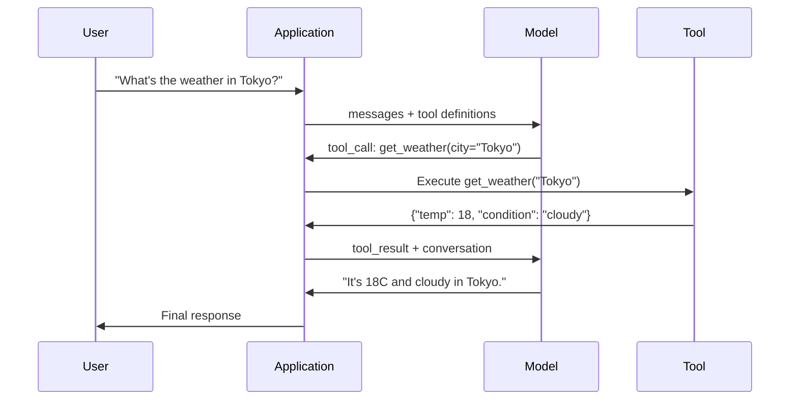

# 기능 호출 및 도구 사용

> LLM는 아무것도 할 수 없습니다. 문자 메시지를 생성합니다. 그게 모든 능력입니다. 날씨를 확인하거나 데이터베이스에 문의하거나 이메일을 보내거나 코드를 실행하거나 파일을 읽을 수 없습니다. 여러분이 본 모든 인공지능 에이전트는 JSON를 생성하는 LLM입니다. 어떤 함수를 호출해야 하는지 알려주는 것입니다. 그리고 코드가 실제로 호출하는 것입니다. 모델은 뇌입니다. 도구는 손입니다. 기능 호출은 신경계로 연결됩니다.

**Type:** Build
**Languages:** Python
**Prerequisites:** Phase 11 Lesson 03 (Structured Outputs)
**Time:** ~75 minutes
**Related:**11 · 14 단계 (모델 컨텍스트 프로토콜)  도구가 호스트 간 공유될 때, 인라인 함수 호출에서 MCP 서버로 졸업합니다. 이 수업은 인라인 케이스를 다루고 있으며 MCP는 프로토콜 케이스를 다루고 있습니다.

## 학습 목표

- 함수 호출 루프를 구현: 도구 스케마를 정의하고, 모델의 도구 호출 JSON를 분석하고, 함수를 실행하고 결과를 반환합니다
- 모델이 신뢰할 수 있는 명확한 설명과 타이핑 매개 변수를 가진 설계 도구 스케임
- 복잡한 질의에 응답하기 위해 여러 함수 호출을 연쇄하는 멀티 턴 에이전트 루프를 구축
- 랜지 케이스 호출 함수: 병렬 도구 호출, 오류 확산, 무한한 도구 루프를 방지

## 문제

채팅 로봇을 만들면 사용자가 "지금 도쿄의 날씨는 어떠세요?"

모델은 "진짜 시간 날씨 자료를 얻을 수 없지만, 계절에 따라 도쿄는 아마도 15도 정도가 될 것 같다"...라고 답합니다.

그건 해명서로 옷을 입은 환각입니다. 모델은 날씨를 알지 못합니다. 절대 모릅니다. 날씨는 시간마다 변합니다. 모델의 훈련 데이터는 몇 달 전에 있습니다.

올바른 대답은 OpenWeatherMap API를 호출하고, 현재 온도를 얻으며 실제 번호를 반환하는 것을 요구합니다. 모델은 API를 호출할 수 없습니다. 코드도 할 수 있습니다. 부족한 조각은: 모델이 "이 주장으로 날씨 API를 호출해야 한다"라고 말할 수 있는 구조화된 프로토콜입니다. 그리고 당신의 코드가 실행하고 결과를 입력하도록 합니다.

이것은 함수 호출입니다. 모델은 어떤 용어를 사용해서 어떤 함수를 호출해야 하는지 설명하는 구조화된 JSON를 내보내죠. 응용 프로그램은 함수를 실행합니다. 결과는 대화로 돌아갑니다. 모델은 최종 답을 생성하기 위해 결과를 사용합니다.

기능적 소환 없이 LLM는 백과사전입니다.

## 개념

### 로프 를 호출 하는 기능

모든 도구 사용 상호작용은 동일한 5 단계 루프를 따르습니다.



단계 1: 사용자가 메시지를 보내게 됩니다. 단계 2: 모델은 도구 정의와 함께 메시지를 수신합니다 (가용 기능을 설명하는 JSON 스키마). 3단계: 텍스트로 응답하는 대신 모델은 도구 호출을 내보내죠. 함수 이름과 논증으로 구성된 JSON 객체입니다. 단계 4: 당신의 코드는 함수를 실행하고 결과를 캡처합니다. 5단계: 결과는 모델로 돌아가서 최종 답을 얻기 위해 실제 데이터를 가지고 있습니다.

모델은 절대 아무것도 실행하지 않습니다. 그것은 단지 무엇을 호출하고 어떤 주장으로 결정합니다. 당신의 코드는 실행자입니다.

### 도구 정의: JSON 스키마 계약

각각의 도구는 JSON 스키마에 의해 정의되며, 모델은 함수가 무엇을 하는지, 어떤 주장이 필요하고, 어떤 종류의 주장이 있어야 하는지 알려줍니다.

```json
{
  "type": "function",
  "function": {
    "name": "get_weather",
    "description": "Get current weather for a city. Returns temperature in Celsius and conditions.",
    "parameters": {
      "type": "object",
      "properties": {
        "city": {
          "type": "string",
          "description": "City name, e.g. 'Tokyo' or 'San Francisco'"
        },
        "units": {
          "type": "string",
          "enum": ["celsius", "fahrenheit"],
          "description": "Temperature units"
        }
      },
      "required": ["city"]
    }
  }
}
```

`description`이 모델은 도구를 언제 어떻게 사용할지 결정하기 위해 읽습니다. "기후가 나오면"와 같은 모호한 설명은 "도시의 현재 날씨를 얻으십시오. 온도를 섭씨와 조건으로 반환합니다".보다 더 나쁜 도구 선택을 생성합니다.

### 공급자 비교

모든 주요 공급자는 함수 호출을 지원하지만 API 표면은 다릅니다.

| Provider | API Parameter | Tool Call Format | Parallel Calls | Forced Calling |
|----------|--------------|-----------------|---------------|----------------|
| OpenAI (GPT-5, o4) | `tools` | `tool_calls[].function` | Yes (multiple per turn) | `tool_choice="required"` |
| Anthropic (Claude 4.6/4.7) | `tools` | `content[].type="tool_use"` | Yes (multiple blocks) | `tool_choice={"type":"any"}` |
| Google (Gemini 3) | `function_declarations` | `functionCall` | Yes | `function_calling_config` |
| Open-weight (Llama 4, Qwen3, DeepSeek-V3) | Native `tools` on Llama 4; Hermes or ChatML on others | Mixed | Model-dependent | Prompt-based or `tool_choice` if supported |

2026 년 까지, 세 개의 폐쇄 된 공급자는 거의 동일 JSON-Schema 기반 형식으로 합쳐졌습니다.`tools`OpenAI의 모양과 일치하는 필드. 오픈 웨이트 미세조는 여전히 다양합니다. Hermes 형식 (NousResearch) 은 타사 미세조는 가장 일반적입니다. 호스트 간 공유 도구에 대해서는, MCP (Phase 11 · 14) 를 직선 기능 호출에 비해 선호합니다. 서버는 모두 동일합니다.

### 도구 선택: 자동, 요구 사항, 특정

모델이 도구를 사용할 때 통제할 수 있습니다.

**Auto**(전설상): 모델은 도구를 호출할지 아니면 직접적으로 응답할지 결정합니다. "2+2은 무엇입니까?" - 직접적으로 응답합니다. " 날씨는 무엇입니까?" - 도구를 호출합니다.

**Required**이 모델은 적어도 하나의 도구를 호출해야 합니다. 사용자의 의도가 도구를 필요로 한다는 것을 알 때 이것을 사용하십시오. 실제 데이터를 검색하는 대신 모델이 추측하는 것을 방지합니다.

**Specific function**: 모델을 특정 함수를 호출하도록 강요합니다. `tool_choice={"type":"function", "function": {"name": "get_weather"}}`기상 도구가 호출되는 것을 보장합니다. 질의와 상관없이. 로우팅을 위해 이것을 사용하십시오.

### 병렬 함수 호출

GPT-4o와 클로드는 하나의 턴에서 여러 함수를 호출할 수 있습니다. 사용자가 "토키오와 뉴욕의 날씨는 어떠세요?"라고 묻습니다. 모델은 동시에 두 개의 도구 호출을 내립니다.

```json
[
  {"name": "get_weather", "arguments": {"city": "Tokyo"}},
  {"name": "get_weather", "arguments": {"city": "New York"}}
]
```

코드 (이념적으로 동시에) 모두 실행하고, 두 결과를 반환하고, 모델은 단일 응답을 합성합니다. 이것은 2에서 1으로 돌아가는 여행을 줄입니다. 질의당 5-10 도구 호출을 가진 에이전트에게는, 병렬 호출은 60 ~ 80%로 지연을 줄입니다.

### 구조화된 출력과 함수 호출

수업 03 은 구조화된 출력 을 다루었다. 함수 호출 은 동일한 JSON 스키마 기계 를 사용 하지만 다른 목적 을 위해 사용 한다.

**Structured outputs**: 모델을 특정 형태로 생성하도록 강요합니다. 출력은 최종 제품입니다. 예제: 텍스트에서 제품 정보를 추출합니다.`{name, price, in_stock}`- 그래

**Function calling**: 모델은 동작을 실행하려는 의도를 선언합니다. 출력은 중간 단계입니다. 예제: `get_weather(city="Tokyo")`-- 모델은 행동을 요청하고 최종 답을 제시하지 않습니다.

데이터 추출을 원하는 경우 구조화된 출력을 사용하거나 모델이 외부 시스템과 상호 작용하기를 원하는 경우 함수 호출을 사용하십시오.

### 안전: 협상 할 수 없는 규칙

함수 호출은 LLM에 줄 수 있는 가장 위험한 기능입니다. 모델은 실행하는 것을 선택합니다. 도구 집합은 데이터베이스 쿼리를 포함하면 모델은 쿼리를 구성합니다. 셸 명령어를 포함하면 모델은 작성합니다.

**Rule 1: Never pass model-generated SQL directly to a database.**모델은 DROP TABLE, UNION 주입 또는 모든 줄을 반환하는 질서를 생성 할 수 있으며 생성할 것입니다. 항상 매개 변수를 정의합니다. 항상 유효합니다. 항상 연산의 허용 목록을 사용합니다.

**Rule 2: Allowlist functions.**모델은 당신이 명시적으로 정의한 함수를 호출할 수 있습니다. 일반 "명으로 어떤 함수를 실행" 도구를 만들지 마십시오. 50 개의 내부 함수를 가지고 있다면, 사용자가 필요로 하는 5 개만을 노출하십시오.

**Rule 3: Validate arguments.**모델은 도시 이름을 통과할 수 있습니다`"; DROP TABLE users; --"`. 실행 전에 예상된 타입, 범위 및 형식에 대한 모든 주장을 검증합니다.

**Rule 4: Sanitize tool results.**도구가 민감한 데이터를 반환하는 경우 (API 키, PII, 내부 오류) 모델로 전송하기 전에 필터링하십시오. 모델은 도구 결과를 문자 그대로 응답에 포함합니다.

**Rule 5: Rate limit tool calls.**루프 속 모델은 도구를 수백 번 호출할 수 있습니다. 최대 (10-20번의 통화가 합리적입니다.) 무한한 루프를 끊으십시오.

### 오류 처리

도구가 실패하고 API가 종료되고 데이터베이스가 사라지고 파일은 존재하지 않습니다. 모델은 도구가 언제 실패하는지 그리고 왜 실패하는지 알아야합니다.

구조화된 도구 결과로 오류를 반환하고 예외가 아닙니다.

```json
{
  "error": true,
  "message": "City 'Toky' not found. Did you mean 'Tokyo'?",
  "code": "CITY_NOT_FOUND"
}
```

모델은 이것을 읽고, 논증을 조정하고 다시 시도합니다. 모델은 구조화된 오류 메시지에서 자정하는 데 잘합니다. 빈 응답 또는 일반 "어떤 일이 잘못되었습니다" 오류에서 복구하는 데 좋지 않습니다.

### MCP: 모델 컨텍스트 프로토콜

MCP는 인트로피의 도구 상호 운용성 개방 표준이다. MCP는 모든 응용 프로그램이 자체 도구를 정의하는 대신 보편적 프로토콜을 제공합니다. 도구는 MCP 서버에서 서비스되며 MCP 클라이언트 (클로드 코드, 커서, 또는 귀하의 응용 프로그램) 에서 소비됩니다.

하나의 MCP 서버는 모든 호환성 클라이언트에게 도구를 노출시킬 수 있습니다. 포스트그레스 MCP 서버는 모든 MCP 호환성 에이전트 데이터베이스에 액세스 할 수 있습니다. GitHub MCP 서버는 모든 에이전트 저장소에 액세스 할 수 있습니다. 도구는 한 번 정의되어 모든 곳에서 사용됩니다.

MCP는 네트워크에 HTTP가 어떤 기능을 하는지를 호출하는 기능을 합니다.

```figure
mx-tool-call-loop
```

## 건설 해

### 단계 1: 도구 레지스트리를 정의 하십시오

도구 정의와 구현을 저장하는 레지스트리를 구축하십시오. 각 도구에는 JSON 스키마 정의 (모델이 보는 것) 과 파이썬 함수 (코드가 실행하는 것) 이 있습니다.

```python
import ast
import json
import math
import time
import hashlib


TOOL_REGISTRY = {}


def register_tool(name, description, parameters, function):
    TOOL_REGISTRY[name] = {
        "definition": {
            "type": "function",
            "function": {
                "name": name,
                "description": description,
                "parameters": parameters,
            },
        },
        "function": function,
    }
```

### 2단계: 5개의 도구를 구현

계산기, 날씨 검색, 웹 검색 시뮬레이터, 파일 리더, 코드 런러를 만들 수 있습니다.

```python
def calculator(expression, precision=2):
    allowed = set("0123456789+-*/.() ")
    if not all(c in allowed for c in expression):
        return {"error": True, "message": f"Invalid characters in expression: {expression}"}
    try:
        result = eval(expression, {"__builtins__": {}}, {"math": math})
        return {"result": round(float(result), precision), "expression": expression}
    except Exception as e:
        return {"error": True, "message": str(e)}


WEATHER_DB = {
    "tokyo": {"temp_c": 18, "condition": "cloudy", "humidity": 72, "wind_kph": 14},
    "new york": {"temp_c": 22, "condition": "sunny", "humidity": 45, "wind_kph": 8},
    "london": {"temp_c": 12, "condition": "rainy", "humidity": 88, "wind_kph": 22},
    "san francisco": {"temp_c": 16, "condition": "foggy", "humidity": 80, "wind_kph": 18},
    "sydney": {"temp_c": 25, "condition": "sunny", "humidity": 55, "wind_kph": 10},
}


def get_weather(city, units="celsius"):
    key = city.lower().strip()
    if key not in WEATHER_DB:
        suggestions = [c for c in WEATHER_DB if c.startswith(key[:3])]
        return {
            "error": True,
            "message": f"City '{city}' not found.",
            "suggestions": suggestions,
            "code": "CITY_NOT_FOUND",
        }
    data = WEATHER_DB[key].copy()
    if units == "fahrenheit":
        data["temp_f"] = round(data["temp_c"] * 9 / 5 + 32, 1)
        del data["temp_c"]
    data["city"] = city
    return data


SEARCH_DB = {
    "python function calling": [
        {"title": "OpenAI Function Calling Guide", "url": "https://platform.openai.com/docs/guides/function-calling", "snippet": "Learn how to connect LLMs to external tools."},
        {"title": "Anthropic Tool Use", "url": "https://docs.anthropic.com/en/docs/tool-use", "snippet": "Claude can interact with external tools and APIs."},
    ],
    "MCP protocol": [
        {"title": "Model Context Protocol", "url": "https://modelcontextprotocol.io", "snippet": "An open standard for connecting AI models to data sources."},
    ],
    "weather API": [
        {"title": "OpenWeatherMap API", "url": "https://openweathermap.org/api", "snippet": "Free weather API with current, forecast, and historical data."},
    ],
}


def web_search(query, max_results=3):
    key = query.lower().strip()
    for db_key, results in SEARCH_DB.items():
        if db_key in key or key in db_key:
            return {"query": query, "results": results[:max_results], "total": len(results)}
    return {"query": query, "results": [], "total": 0}


FILE_SYSTEM = {
    "data/config.json": '{"model": "gpt-4o", "temperature": 0.7, "max_tokens": 4096}',
    "data/users.csv": "name,email,role\nAlice,alice@example.com,admin\nBob,bob@example.com,user",
    "README.md": "# My Project\nA tool-use agent built from scratch.",
}


def read_file(path):
    if ".." in path or path.startswith("/"):
        return {"error": True, "message": "Path traversal not allowed.", "code": "FORBIDDEN"}
    if path not in FILE_SYSTEM:
        available = list(FILE_SYSTEM.keys())
        return {"error": True, "message": f"File '{path}' not found.", "available_files": available, "code": "NOT_FOUND"}
    content = FILE_SYSTEM[path]
    return {"path": path, "content": content, "size_bytes": len(content), "lines": content.count("\n") + 1}


def run_code(code, language="python"):
    if language != "python":
        return {"error": True, "message": f"Language '{language}' not supported. Only 'python' is available."}
    try:
        tree = ast.parse(code)
    except SyntaxError as e:
        return {"error": True, "message": f"SyntaxError: {e}", "code": "SYNTAX_ERROR"}
    unsafe_names = {"exec", "eval", "compile", "__import__", "open", "globals", "locals", "vars", "getattr", "setattr", "delattr"}
    for node in ast.walk(tree):
        if isinstance(node, (ast.Import, ast.ImportFrom)):
            return {"error": True, "message": "Forbidden operation: import is not allowed", "code": "SECURITY_VIOLATION"}
        if isinstance(node, ast.Attribute) and node.attr.startswith("__") and node.attr.endswith("__"):
            return {"error": True, "message": "Forbidden operation: dunder attribute access is not allowed", "code": "SECURITY_VIOLATION"}
        if isinstance(node, ast.Name) and node.id in unsafe_names:
            return {"error": True, "message": f"Forbidden operation: {node.id} is not allowed", "code": "SECURITY_VIOLATION"}
    try:
        local_vars = {}
        exec(code, {"__builtins__": {"print": print, "range": range, "len": len, "str": str, "int": int, "float": float, "list": list, "dict": dict, "sum": sum, "min": min, "max": max, "abs": abs, "round": round, "sorted": sorted, "enumerate": enumerate, "zip": zip, "map": map, "filter": filter, "math": math}}, local_vars)
        result = local_vars.get("result", None)
        return {"success": True, "result": result, "variables": {k: str(v) for k, v in local_vars.items() if not k.startswith("_")}}
    except Exception as e:
        return {"error": True, "message": f"{type(e).__name__}: {e}"}
```

하부 문자열 블록 리스트는 코드를 텍스트로 읽어서 문자열 일치가 문자 그대로 쓰지 않는 모든 것을 놓치게 됩니다. 코드를 문법 트리로 파싱하고 걸어가는 것은 경비자가 거부하도록 합니다.`import`진술, Dunder 속성 액세스 (`__class__`그리고`__globals__`실제 통역자까지 도달하는 연쇄), 그리고 철자보다는 구조에 의해 안전하지 않은 구조를 지어내는 이름. 하지만, 이 문제 는 실제 한계 로서는 아니라, 교육 필터 로 간주 하십시오. 프로세스 중 있는 모든 경비자는 인터프리터를 실행하는 코드와 공유하고, 결정된 호출자는 여전히 접근 가능한 객체를 찾을 수 있습니다. 생산 시스템은 신뢰할 수 없는 코드를 별도의 프로세스 또는 컨테이너 (유권이 떨어지는 하위 프로세스, gVisor, Firecracker 또는 호스트 코드 런러) 에서 실행합니다.

### 3단계: 모든 도구 를 등록 하십시오

```python
def register_all_tools():
    register_tool(
        "calculator", "Evaluate a mathematical expression. Supports +, -, *, /, parentheses, and decimals. Returns the numeric result.",
        {"type": "object", "properties": {"expression": {"type": "string", "description": "Math expression, e.g. '(10 + 5) * 3'"}, "precision": {"type": "integer", "description": "Decimal places in result", "default": 2}}, "required": ["expression"]},
        calculator,
    )
    register_tool(
        "get_weather", "Get current weather for a city. Returns temperature, condition, humidity, and wind speed.",
        {"type": "object", "properties": {"city": {"type": "string", "description": "City name, e.g. 'Tokyo' or 'San Francisco'"}, "units": {"type": "string", "enum": ["celsius", "fahrenheit"], "description": "Temperature units, defaults to celsius"}}, "required": ["city"]},
        get_weather,
    )
    register_tool(
        "web_search", "Search the web for information. Returns a list of results with title, URL, and snippet.",
        {"type": "object", "properties": {"query": {"type": "string", "description": "Search query"}, "max_results": {"type": "integer", "description": "Maximum results to return", "default": 3}}, "required": ["query"]},
        web_search,
    )
    register_tool(
        "read_file", "Read the contents of a file. Returns the file content, size, and line count.",
        {"type": "object", "properties": {"path": {"type": "string", "description": "Relative file path, e.g. 'data/config.json'"}}, "required": ["path"]},
        read_file,
    )
    register_tool(
        "run_code", "Run a small Python snippet behind a static-analysis guard and a restricted interpreter. This is a teaching filter, not real isolation. Set a 'result' variable to return output.",
        {"type": "object", "properties": {"code": {"type": "string", "description": "Python code to execute"}, "language": {"type": "string", "enum": ["python"], "description": "Programming language"}}, "required": ["code"]},
        run_code,
    )
```

### 4단계: '콜 루프' 기능을 구축

이것은 핵심 엔진입니다. 이 모델은 어떤 도구를 호출해야 하는지 결정하고, 도구를 실행하고, 결과를 배포합니다.

```python
def simulate_model_decision(user_message, tools, conversation_history):
    msg = user_message.lower()

    if any(word in msg for word in ["weather", "temperature", "forecast"]):
        cities = []
        for city in WEATHER_DB:
            if city in msg:
                cities.append(city)
        if not cities:
            for word in msg.split():
                if word.capitalize() in [c.title() for c in WEATHER_DB]:
                    cities.append(word)
        if not cities:
            cities = ["tokyo"]
        calls = []
        for city in cities:
            calls.append({"name": "get_weather", "arguments": {"city": city.title()}})
        return calls

    if any(word in msg for word in ["calculate", "compute", "math", "what is", "how much"]):
        for token in msg.split():
            if any(c in token for c in "+-*/"):
                return [{"name": "calculator", "arguments": {"expression": token}}]
        if "+" in msg or "-" in msg or "*" in msg or "/" in msg:
            expr = "".join(c for c in msg if c in "0123456789+-*/.() ")
            if expr.strip():
                return [{"name": "calculator", "arguments": {"expression": expr.strip()}}]
        return [{"name": "calculator", "arguments": {"expression": "0"}}]

    if any(word in msg for word in ["search", "find", "look up", "google"]):
        query = msg.replace("search for", "").replace("look up", "").replace("find", "").strip()
        return [{"name": "web_search", "arguments": {"query": query}}]

    if any(word in msg for word in ["read", "file", "open", "cat", "show"]):
        for path in FILE_SYSTEM:
            if path.split("/")[-1].split(".")[0] in msg:
                return [{"name": "read_file", "arguments": {"path": path}}]
        return [{"name": "read_file", "arguments": {"path": "README.md"}}]

    if any(word in msg for word in ["run", "execute", "code", "python"]):
        return [{"name": "run_code", "arguments": {"code": "result = 'Hello from the sandbox!'", "language": "python"}}]

    return []


def execute_tool_call(tool_call):
    name = tool_call["name"]
    args = tool_call["arguments"]

    if name not in TOOL_REGISTRY:
        return {"error": True, "message": f"Unknown tool: {name}", "code": "UNKNOWN_TOOL"}

    tool = TOOL_REGISTRY[name]
    func = tool["function"]
    start = time.time()

    try:
        result = func(**args)
    except TypeError as e:
        result = {"error": True, "message": f"Invalid arguments: {e}"}

    elapsed_ms = round((time.time() - start) * 1000, 2)
    return {"tool": name, "result": result, "execution_time_ms": elapsed_ms}


def run_function_calling_loop(user_message, max_iterations=5):
    conversation = [{"role": "user", "content": user_message}]
    tool_definitions = [t["definition"] for t in TOOL_REGISTRY.values()]
    all_tool_results = []

    for iteration in range(max_iterations):
        tool_calls = simulate_model_decision(user_message, tool_definitions, conversation)

        if not tool_calls:
            break

        results = []
        for call in tool_calls:
            result = execute_tool_call(call)
            results.append(result)

        conversation.append({"role": "assistant", "content": None, "tool_calls": tool_calls})

        for result in results:
            conversation.append({"role": "tool", "content": json.dumps(result["result"]), "tool_name": result["tool"]})

        all_tool_results.extend(results)
        break

    return {"conversation": conversation, "tool_results": all_tool_results, "iterations": iteration + 1 if tool_calls else 0}
```

### 5단계: 주장 을 증명 하는 것

실행 전에 JSON 스키마에 대한 도구 호출 주장을 검사하는 검증기를 구축하십시오.

```python
def validate_tool_arguments(tool_name, arguments):
    if tool_name not in TOOL_REGISTRY:
        return [f"Unknown tool: {tool_name}"]

    schema = TOOL_REGISTRY[tool_name]["definition"]["function"]["parameters"]
    errors = []

    if not isinstance(arguments, dict):
        return [f"Arguments must be an object, got {type(arguments).__name__}"]

    for required_field in schema.get("required", []):
        if required_field not in arguments:
            errors.append(f"Missing required argument: {required_field}")

    properties = schema.get("properties", {})
    for arg_name, arg_value in arguments.items():
        if arg_name not in properties:
            errors.append(f"Unknown argument: {arg_name}")
            continue

        prop_schema = properties[arg_name]
        expected_type = prop_schema.get("type")

        type_checks = {"string": str, "integer": int, "number": (int, float), "boolean": bool, "array": list, "object": dict}
        if expected_type in type_checks:
            if not isinstance(arg_value, type_checks[expected_type]):
                errors.append(f"Argument '{arg_name}': expected {expected_type}, got {type(arg_value).__name__}")

        if "enum" in prop_schema and arg_value not in prop_schema["enum"]:
            errors.append(f"Argument '{arg_name}': '{arg_value}' not in {prop_schema['enum']}")

    return errors
```

### 단계 6: 데모를 실행

```python
def run_demo():
    register_all_tools()

    print("=" * 60)
    print("  Function Calling & Tool Use Demo")
    print("=" * 60)

    print("\n--- Registered Tools ---")
    for name, tool in TOOL_REGISTRY.items():
        desc = tool["definition"]["function"]["description"][:60]
        params = list(tool["definition"]["function"]["parameters"].get("properties", {}).keys())
        print(f"  {name}: {desc}...")
        print(f"    params: {params}")

    print(f"\n--- Argument Validation ---")
    validation_tests = [
        ("get_weather", {"city": "Tokyo"}, "Valid call"),
        ("get_weather", {}, "Missing required arg"),
        ("get_weather", {"city": "Tokyo", "units": "kelvin"}, "Invalid enum value"),
        ("calculator", {"expression": 123}, "Wrong type (int for string)"),
        ("unknown_tool", {"x": 1}, "Unknown tool"),
    ]
    for tool_name, args, label in validation_tests:
        errors = validate_tool_arguments(tool_name, args)
        status = "VALID" if not errors else f"ERRORS: {errors}"
        print(f"  {label}: {status}")

    print(f"\n--- Tool Execution ---")
    direct_tests = [
        {"name": "calculator", "arguments": {"expression": "(10 + 5) * 3 / 2"}},
        {"name": "get_weather", "arguments": {"city": "Tokyo"}},
        {"name": "get_weather", "arguments": {"city": "Mars"}},
        {"name": "web_search", "arguments": {"query": "python function calling"}},
        {"name": "read_file", "arguments": {"path": "data/config.json"}},
        {"name": "read_file", "arguments": {"path": "../etc/passwd"}},
        {"name": "run_code", "arguments": {"code": "result = sum(range(1, 101))"}},
        {"name": "run_code", "arguments": {"code": "import os; os.system('rm -rf /')"}},
    ]
    for call in direct_tests:
        result = execute_tool_call(call)
        print(f"\n  {call['name']}({json.dumps(call['arguments'])})")
        print(f"    -> {json.dumps(result['result'], indent=None)[:100]}")
        print(f"    time: {result['execution_time_ms']}ms")

    print(f"\n--- Full Function Calling Loop ---")
    test_queries = [
        "What's the weather in Tokyo?",
        "Calculate (100 + 250) * 0.15",
        "Search for MCP protocol",
        "Read the config file",
        "Run some Python code",
        "Tell me a joke",
    ]
    for query in test_queries:
        print(f"\n  User: {query}")
        result = run_function_calling_loop(query)
        if result["tool_results"]:
            for tr in result["tool_results"]:
                print(f"    Tool: {tr['tool']} ({tr['execution_time_ms']}ms)")
                print(f"    Result: {json.dumps(tr['result'], indent=None)[:90]}")
        else:
            print(f"    [No tool called -- direct response]")
        print(f"    Iterations: {result['iterations']}")

    print(f"\n--- Parallel Tool Calls ---")
    multi_city_query = "What's the weather in tokyo and london?"
    print(f"  User: {multi_city_query}")
    result = run_function_calling_loop(multi_city_query)
    print(f"  Tool calls made: {len(result['tool_results'])}")
    for tr in result["tool_results"]:
        city = tr["result"].get("city", "unknown")
        temp = tr["result"].get("temp_c", "N/A")
        print(f"    {city}: {temp}C, {tr['result'].get('condition', 'N/A')}")

    print(f"\n--- Security Checks ---")
    security_tests = [
        ("read_file", {"path": "../../etc/passwd"}),
        ("run_code", {"code": "import subprocess; subprocess.run(['ls'])"}),
        ("calculator", {"expression": "__import__('os').system('ls')"}),
    ]
    for tool_name, args in security_tests:
        result = execute_tool_call({"name": tool_name, "arguments": args})
        blocked = result["result"].get("error", False)
        print(f"  {tool_name}({list(args.values())[0][:40]}): {'BLOCKED' if blocked else 'ALLOWED'}")
```

## 사용 하 고

### OpenAI 함수 호출

```python
# from openai import OpenAI
#
# client = OpenAI()
#
# tools = [{
#     "type": "function",
#     "function": {
#         "name": "get_weather",
#         "description": "Get current weather for a city",
#         "parameters": {
#             "type": "object",
#             "properties": {
#                 "city": {"type": "string"},
#                 "units": {"type": "string", "enum": ["celsius", "fahrenheit"]}
#             },
#             "required": ["city"]
#         }
#     }
# }]
#
# response = client.chat.completions.create(
#     model="gpt-4o",
#     messages=[{"role": "user", "content": "Weather in Tokyo?"}],
#     tools=tools,
#     tool_choice="auto",
# )
#
# tool_call = response.choices[0].message.tool_calls[0]
# args = json.loads(tool_call.function.arguments)
# result = get_weather(**args)
#
# final = client.chat.completions.create(
#     model="gpt-4o",
#     messages=[
#         {"role": "user", "content": "Weather in Tokyo?"},
#         response.choices[0].message,
#         {"role": "tool", "tool_call_id": tool_call.id, "content": json.dumps(result)},
#     ],
# )
# print(final.choices[0].message.content)
```

OpenAI는 도구 호출을 `response.choices[0].message.tool_calls`모든 전화는`id`그 결과로, 그 결과로, 그 결과로, 그 결과로, 그 결과로, 그 결과로, 그 결과로, 그 결과로, 그 결과로, 그 결과로, 그 결과로, 그 결과로, 그 결과로, 그 결과로, 그 결과로, 그 결과로, 그 결과로, 그 결과로 일치하는 것을 모델이 사용합니다.

### 인류적 도구 사용

```python
# import anthropic
#
# client = anthropic.Anthropic()
#
# response = client.messages.create(
#     model="claude-sonnet-5",
#     max_tokens=1024,
#     tools=[{
#         "name": "get_weather",
#         "description": "Get current weather for a city",
#         "input_schema": {
#             "type": "object",
#             "properties": {
#                 "city": {"type": "string"},
#                 "units": {"type": "string", "enum": ["celsius", "fahrenheit"]}
#             },
#             "required": ["city"]
#         }
#     }],
#     messages=[{"role": "user", "content": "Weather in Tokyo?"}],
# )
#
# tool_block = next(b for b in response.content if b.type == "tool_use")
# result = get_weather(**tool_block.input)
#
# final = client.messages.create(
#     model="claude-sonnet-5",
#     max_tokens=1024,
#     tools=[...],
#     messages=[
#         {"role": "user", "content": "Weather in Tokyo?"},
#         {"role": "assistant", "content": response.content},
#         {"role": "user", "content": [{"type": "tool_result", "tool_use_id": tool_block.id, "content": json.dumps(result)}]},
#     ],
# )
```

Antropic는   콘텐츠 블록으로 도구 호출을 반환합니다`type: "tool_use"`. 도구 결과는 사용자 메시지에 `type: "tool_result"`. 주요 차이점을 알아두세요: 인류학 용어`input_schema`도구 매개 변수 정의에 대해 OpenAI가 사용하지만`parameters`- 그래

### MCP 통합

```python
# MCP servers expose tools over a standardized protocol.
# Any MCP-compatible client can discover and call these tools.
#
# Example: connecting to a Postgres MCP server
#
# from mcp import ClientSession, StdioServerParameters
# from mcp.client.stdio import stdio_client
#
# server_params = StdioServerParameters(
#     command="npx",
#     args=["-y", "@modelcontextprotocol/server-postgres", "postgresql://localhost/mydb"],
# )
#
# async with stdio_client(server_params) as (read, write):
#     async with ClientSession(read, write) as session:
#         await session.initialize()
#         tools = await session.list_tools()
#         result = await session.call_tool("query", {"sql": "SELECT count(*) FROM users"})
```

MCP는 도구 구현과 도구 소비를 분리합니다. 포스트그레스 서버는 SQL를 알고 있습니다. GitHub 서버는 API를 알고 있습니다. 당신의 에이전트는 도구를 발견하고 호출합니다. 그것은 모든 통합에 대한 공급자 특정 코드가 필요하지 않습니다.

## 선박

이 교훈은`outputs/prompt-tool-designer.md`-- 도구 정의를 설계하는 데 사용할 수 있는 반복적인 프롬프트 템플릿. 도구가 무엇을 해야 하는지 설명해 주세요. 그리고 설명, 유형 및 제한을 가진 완전한 JSON 스키마 정의를 생성합니다.

또한 생산합니다`outputs/skill-function-calling-patterns.md`-- 생산에 필요한 기능 구현을 위한 의사결정 프레임워크, 도구 설계, 오류 처리, 보안 및 공급자별 패턴을 포함합니다.

## 운동

1. **Add a 6th tool: database query.**메모리 테이블을 가진 시뮬레이션 SQL 도구를 구현합니다. 도구는 테이블 이름과 필터 조건을 받아들이습니다. (자연 SQL가 아닙니다). 테이블 이름이 허용 목록에 있는지 확인하고 필터 운영자가 제한되어 있습니다.`=``>``<``>=``<=`JSON로 일치하는 행을 반환합니다.

2. **Implement retry with error feedback.**도구 호출이 실패할 때 (예를 들어, 도시가 발견되지 않은 경우), 오류 메시지를 모델 결정 기능에 다시 입력하고 그 주장을 수정하도록하십시오. 각 호출이 얼마나 많은 재실험을 수행하는지 추적하십시오. 도구 호출에 최대 3 번의 재실험을 설정하십시오.

3. **Build a multi-step agent.**일부 쿼리는 체인 도구 호출을 요구합니다. "konfig 파일을 읽고 어떤 모델이 구성되어 있는지 말해 주십시오. 그 모델의 가격에 대해 웹에서 검색하십시오". 모델이 더 이상 도구가 필요하지 않다고 결정하기 전까지 실행되는 루프를 구현하여 축적된 결과를 각 결정 단계로 전달합니다. 무한한 루프를 방지하기 위해 10 번의 반복으로 제한합니다.

4. **Measure tool selection accuracy.**예상되는 도구 이름들을 가진 30개의 테스트 쿼리를 생성하세요. 모든 30개의 쿼리에 의사결정 기능을 실행하고 올바른 툴을 선택하는 시간의 비율을 측정하세요. 쿼리가 툴들 사이에서 가장 많은 혼란을 일으키는 경우를 확인하세요.

5. **Implement tool call caching.**60 초 이내에 동일한 문구가 동일한 도구로 호출되면 다시 실행하는 대신 캐시 된 결과를 반환하십시오.`(tool_name, frozenset(args.items()))`20개의 질문을 통해 대화에서 캐시 샷을 측정합니다.

## 주요 용어

| Term | What people say | What it actually means |
|------|----------------|----------------------|
| Function calling | "Tool use" | The model outputs structured JSON describing a function to invoke with specific arguments -- your code executes it, not the model |
| Tool definition | "Function schema" | A JSON Schema object describing a tool's name, purpose, parameters, and types -- the model reads this to decide when and how to use the tool |
| Tool choice | "Calling mode" | Controls whether the model must call a tool (required), may call a tool (auto), or must call a specific tool (named) |
| Parallel calling | "Multi-tool" | The model outputs multiple tool calls in a single turn, reducing round trips -- GPT-4o and Claude both support this |
| Tool result | "Function output" | The return value from executing a tool, sent back to the model as a message so it can use real data in its response |
| Argument validation | "Input checking" | Verifying that model-generated arguments match the expected types, ranges, and constraints before executing the tool |
| MCP | "Tool protocol" | Model Context Protocol -- Anthropic's open standard for exposing tools via servers that any compatible client can discover and call |
| Agent loop | "ReAct loop" | The iterative cycle of model-decides-tool, code-executes-tool, result-feeds-back until the model has enough information to respond |
| Tool poisoning | "Prompt injection via tools" | An attack where tool results contain instructions that manipulate the model's behavior -- sanitize all tool outputs |
| Rate limiting | "Call budget" | Setting a maximum number of tool calls per conversation to prevent infinite loops and runaway API costs |

## 더 많은 읽기

- [OpenAI Function Calling Guide](https://platform.openai.com/docs/guides/function-calling)-- GPT-4o와 함께 도구 사용에 대한 최종 참조, 병렬 호출, 강제 호출 및 구조화된 주장을 포함하여
- [Anthropic Tool Use Guide](https://docs.anthropic.com/en/docs/tool-use)-- 클로드의 도구는 input_schema, 멀티 도구 응답, 그리고 tool_choice 구성으로 구현을 사용합니다
- [Model Context Protocol Specification](https://modelcontextprotocol.io)-- 서버/클라이언트 아키텍처를 이용한 인공지능 애플리케이션들 간의 도구 상호 운용성 위한 개방형 표준
- [Schick et al., 2023 -- "Toolformer: Language Models Can Teach Themselves to Use Tools"](https://arxiv.org/abs/2302.04761)-- 외부 도구 를 언제 어떻게 호출 할 것 을 결정 하는 LLM 를 훈련 하는 기본 문서
- [Patil et al., 2023 -- "Gorilla: Large Language Model Connected with Massive APIs"](https://arxiv.org/abs/2305.15334)-- 환각 감소로 1,645개의 API에서 정확한 API 호출을 위한 LLM를 정밀 조정
- [Berkeley Function Calling Leaderboard](https://gorilla.cs.berkeley.edu/leaderboard.html)-- 실시간 벤치마크 GPT-4o, 클로드, 트윈리, 오픈 모델에서 정확한 호출 함수를 비교
- [Yao et al., "ReAct: Synergizing Reasoning and Acting in Language Models" (ICLR 2023)](https://arxiv.org/abs/2210.03629)-- 생각-행동-시경 루프, 모든 도구 호출을 둘러싼 외부 요원 루프입니다. 이 수업이 끝날 때,
- [Anthropic — Building effective agents (Dec 2024)](https://www.anthropic.com/research/building-effective-agents)-- 5개의 구성 가능한 패턴 (프라트 체인, 라우팅, 병렬화, 오케스트레이터-노동자, 평가자-오프티마저)
