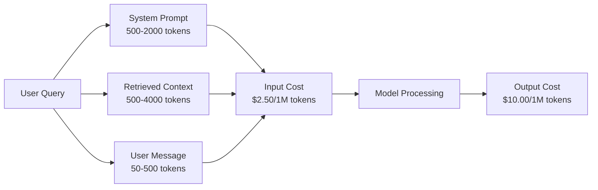
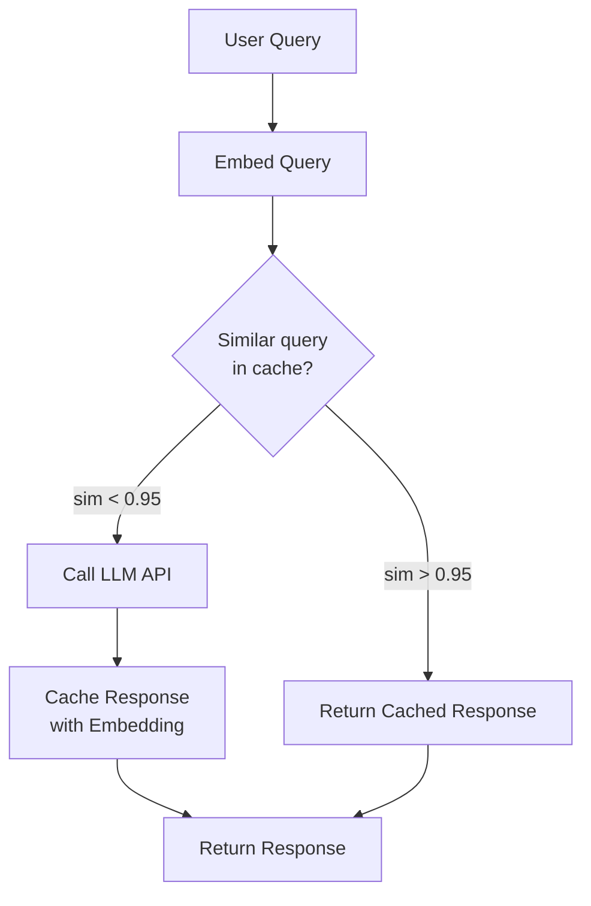
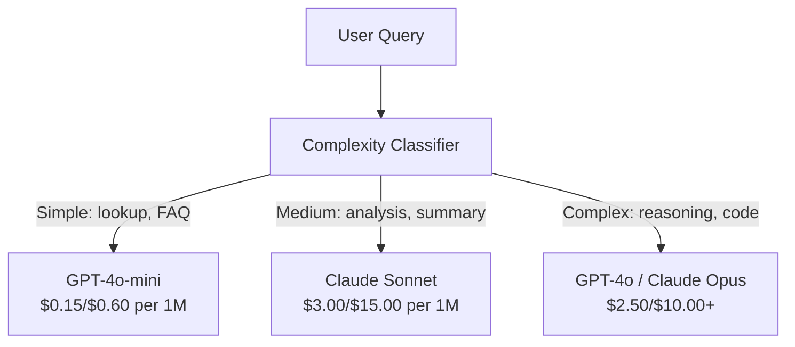

# 캐시, 비율 제한 및 비용 최적화

> 대부분의 인공지능 스타트업은 나쁜 모델로 인해 죽지 않습니다. 그들은 나쁜 단위 경제로 인해 죽습니다. 하나의 GPT-4o 통화에는 1센트의 분자가 소요됩니다. 하루에 10개의 전화를 하는 10천 명의 사용자가 입력 토큰으로만 250달러를 지불합니다. 당신은 한 달러도 청구하기 전에. 살아남은 기업은 API 호출을 금융 거래로 취급하는 회사입니다. 기능 호출이 아닙니다.

**Type:** Build
**Languages:** Python
**Prerequisites:** Phase 11 Lesson 09 (Function Calling)
**Time:** ~45 minutes
**Related:**단계 11 · 15 (프롬프트 캐시)  이 수업은 애플리케이션 레이어 캐시 (말목적 캐시, 정확한 해시 캐시, 모델 라우팅) 를 다루고 있습니다. 수업 15 은 공급자 레이어 프롬프트 캐시 (Anthropic cache_control, OpenAI 자동, Gemini CachedContent) 를 다루고 있습니다. 두 가지를 조합하여 비용 절감 50-95%를 제공합니다.

## 학습 목표

- 새로운 API 호출을 하기 보다는 캐시에서 반복되거나 유사한 쿼리를 제공하는 의미 캐싱을 구현
- 제공자마다 요청에 따른 비용을 계산하고 토큰 인식 요금 제한 및 예산 알림을 구현
- 신속한 압축, 모델 라우팅 (비싼 대 값) 및 응답 캐시링으로 비용 최적화 계층을 구축하십시오
- 정확한 일치, 의미적 유사성, 그리고 각종 쿼리 유형에 대한 사전 캐싱을 사용하여 계층 캐싱 전략을 설계

## 문제

RAG 채팅 로봇을 만들면 아주 잘 작동합니다.

그 다음에는 청구서가 도착합니다.

GPT-5 비용$5 per million input tokens and $1백만 개 생산량 15달러. 클로드 오퍼스 4.7달러$15 input / $75출력, Gemini 3 Pro가 드는 값$1.25 input / $5 출력. GPT-5 미니$0.25/$2. 아래의 가격 은 일러스트적 인 것 이다. 항상 공급자 의 현재 가격 책정 페이지를 확인 하십시오.

스타트업을 죽이는 수학은 다음과 같습니다.

- 매일 10만 명의 활성 사용자
- 하루 1 사용자당 10개의 문의
- 1,000 입력 토큰 (시스템 프롬프트 + 컨텍스트 + 사용자 메시지)
- 응답당 500개의 출력 토큰

**Daily input cost:**10만 x 10만 x 1,000 / 1,000만 x$2.50 = **$250/일**
**Daily output cost:**10,000 x 10 x 500 / 1,000,000 x $10.00 = **$500/일**
**Monthly total:** **$22,500/month**

이 프로그램은 단지 LLM입니다. 임베디션, 벡터 데이터베이스 호스팅, 인프라를 추가합니다. 채봇을 위해 한 달에 30,000달러를 지불합니다.

잔인한 부분은: 40~60%의 질의는 거의 복제입니다. 사용자는 약간 다른 단어로 동일한 질문을 합니다. 모든 요청에 동일한 시스템 요청은 매번 청구됩니다. RAG에서 검색한 컨텍스트 문서는 동일한 주제에 대해 묻는 사용자들에게 반복됩니다.

당신은 과잉 계산에 대한 완전한 가격을 지불하고 있습니다.

## 개념

### LLM 초청의 비용 해부

모든 API 호출에는 5개의 비용 요소가 있습니다.



시스템 명령은 침묵의 살인자입니다 1,500개의 토큰이 모든 요청 비용과 함께 전송됩니다$3.75 per million requests just for that prefix. At 100K requests per day, that is $375일, 월 11,250달러, 변하지 않는 텍스트를 위해

### 제공자 캐싱: 내장 할인

세 가지 주요 공급업체는 모두 2026년에 공급자 측의 신속한 캐시 제공을 제공하지만 메커니즘은 다릅니다. 깊이 잠수기 단계 11 · 15을 참조하십시오.

| Provider | Mechanism | Discount | Minimum | Cache Duration |
|----------|-----------|----------|---------|----------------|
| Anthropic | Explicit cache_control markers | 90% on cache hits (pay 25% extra on write) | 1,024 tokens (Sonnet/Opus), 2,048 (Haiku) | 5 min default; 1h extended (2x write premium) |
| OpenAI | Automatic prefix matching | 50% on cache hits | 1,024 tokens | Best-effort up to 1 hour |
| Google Gemini | Explicit CachedContent API | ~75% reduction (plus storage) | 4,096 (Flash) / 32,768 (Pro) | User-configurable TTL |

**Anthropic's approach**문장: `cache_control: {"type": "ephemeral"}`첫 번째 요청은 25%의 쓰기 수수료를 지불합니다. 같은 사전과 같은 후속 요청은 90% 할인됩니다. 2,000 토큰 시스템으로 비용이 발생합니다.$0.005 normally costs $캐시 접속에 0.000625개, 100만 건 이상의 요청으로 하루에 437.50달러를 절약할 수 있습니다.

**OpenAI's approach**자동으로 실행됩니다. 이전 요청에 해당하는 모든 프롬프트 프리픽스는 50% 할인 혜택을 받게 됩니다. 마크가 필요하지 않습니다. 트레이드: 할인 덜, 통제 덜, 하지만 구현 노력은 무합니다.

### 의미 캐싱: 사용자 지정 레이어

제공자 캐싱은 동일한 사전값에서만 작동합니다. 의미 캐싱은 더 어려운 경우를 처리합니다. 같은 의미의 다른 쿼리입니다.

"회복 정책은 무엇입니까?"와 "어떻게 항목을 반환합니까?"는 서로 다른 문자열이지만 동일한 의도가 있습니다. 의미 캐시는 두 개의 질서를 모두 내장하고, 코시노 유사성을 계산하고, 유사성이 임계점을 초과하면 캐쉬 응답을 반환합니다 (일반적으로 0.92-0.95).



임베디션 비용은 무시할 수 없습니다. OpenAI의 텍스트 임베디션-3-마일 비용은 백만 토큰당 0.02 달러입니다. 캐시를 확인하는 것은 LLM 전체 호출과 비교하면 거의 아무것도 아닙니다.

### 정확한 캐싱: 해시와 일치

결정적 호출 (온도=0, 동일한 모델, 동일한 프롬프트) 에 대해서는 정확한 캐싱은 더 간단하고 더 빠르다.

이것은 다음과 같은 경우에 완벽하게 작동합니다.
- 시스템 프롬프트 + 고정된 컨텍스트 + 동일 사용자 쿼리
- 동일한 도구 정의를 가진 함수 호출
- 동일한 문서가 여러 번 처리되는 배트 처리

### 비용 제한: 예산 을 보호 하는 것

비율 제한은 공정성만이 아니라 생존에 관한 것입니다.

**Token bucket algorithm:**각 사용자는 N 토큰의 덤불을 받으며, 초당 속도 R로 재충전한다. 요청은 덤불에서 토큰을 소비한다. 덤불이 빈다면 요청은 거절된다. 이것은 평균 속도를 강요하는 동안 폭발 (완전 덤불을 한 번에 사용) 을 허용한다.

**Per-user quotas:**사용자 계층별로 일일/월별 토큰 제한을 설정합니다.

| Tier | Daily Token Limit | Max Requests/min | Model Access |
|------|------------------|------------------|-------------|
| Free | 50,000 | 10 | GPT-4o-mini only |
| Pro | 500,000 | 60 | GPT-4o, Claude Sonnet |
| Enterprise | 5,000,000 | 300 | All models |

### 모델 로팅: 올바른 직업에 적합한 모델

모든 질문에는 GPT-4o가 필요하지 않습니다.

"점들이 언제 문을 닫나요?"는$10/M-output model. GPT-4o-mini at $0.60M 출력은 완벽하게 처리합니다. 클로드 하이쿠는 $1.25/M 출력은 처리합니다. 간단한 분류기는 저렴한 모델로 저렴한 질문과 비싼 모델로 복잡한 질문을 전달합니다.



잘 조정된 라우터는 모델 비용만 40%~70%를 절약합니다.

### 비용 추적: 돈 이 어디로 가는지 알 수 있다

측정하지 않은 것을 최적화할 수 없습니다. API 호출을 로그인하는 모든 경우:

- 시간표
- 모델 이름
- 입력 토큰
- 출력 토큰
- 지연 (ms)
- 계산 비용 ($)
- 사용자 ID
- 캐시 히트/미스
- 요청 범주

이 데이터는 어떤 기능들이 비싸고 어떤 사용자가 무거운 소비자이며 캐싱이 가장 큰 영향을 미치는지를 보여줍니다.

### 배팅: 대량 할인

OpenAI의 배트 API는 50% 할인으로 비동기적으로 요청을 처리합니다. 최대 50,000개의 배트를 제출하면 24시간 이내에 결과가 나옵니다.

배팅을 사용:
- 밤마다 문서 처리
- 대량 분류
- 평가 경주
- 데이터 부양 파이프라인

실시간 사용자에 대한 질문 (연연 문제) 에 해당되지 않습니다.

### 예산 경고 및 회로 단절

한계 를 밟으면 회로 차단 장치 는 지출 을 중단 합니다. 한계 를 밟으면, 버그 또는 학대 가 몇 시간 내에 월간 예산 을  수 있습니다.

세 가지 임대점을 설정:
1. **Warning**(예산의 70%): 경고를 보내
2. **Throttle**(85%의 예산): 저렴한 모델로만 전환
3. **Stop**(95%의 예산): 새로운 요청을 거부하고 캐시된 답변만 반환

### 최적화 스택

다음 기술들을 순서대로 적용해 보세요. 각 층은 이전 층에 합쳐집니다.

| Layer | Technique | Typical Savings | Implementation Effort |
|-------|-----------|----------------|----------------------|
| 1 | Provider prompt caching | 30-50% | Low (add cache markers) |
| 2 | Exact caching | 10-20% | Low (hash + dict) |
| 3 | Semantic caching | 15-30% | Medium (embeddings + similarity) |
| 4 | Model routing | 40-70% | Medium (classifier) |
| 5 | Rate limiting | Budget protection | Low (token bucket) |
| 6 | Prompt compression | 10-30% | Medium (rewrite prompts) |
| 7 | Batching | 50% on eligible | Low (batch API) |

RAG 앱은 1-5층을 적용하면 일반적으로 $22,500/month to $달당 4,000~6,000만원, 그게 노선을 태우거나 사업을 짓는 것의 차이점이죠.

### 실제 저축: 전과 후

여기 RAG 채팅 로봇의 실제 분해가 있습니다. 10,000 DAU를 서비스합니다.

| Metric | Before Optimization | After Optimization | Savings |
|--------|--------------------|--------------------|---------|
| Monthly LLM cost | $22,500 | $5,200 | 77% |
| Avg cost per query | $0.0075 | $0.0017 | 77% |
| Cache hit rate | 0% | 52% | -- |
| Queries routed to mini | 0% | 65% | -- |
| P95 latency | 2,800ms | 900ms (cache hits: 50ms) | 68% |
| Monthly embedding cost | $0 | $180 | (new cost) |
| Total monthly cost | $22,500 | $5,380 | 76% |

의미 캐시 (semantic caching) 를 위한 임베디션 비용은 매월 180달러 (약 1천만 달러) 로 캐시 접속 후 첫 시간 내에 스스로 보상됩니다.

```figure
semantic-cache
```

## 건설 해

### 단계 1: 비용 계산기

주요 모델의 현재 가격을 아는 토큰 비용 계산기를 만들십시오.

```python
import hashlib
import time
import json
import math
from dataclasses import dataclass, field


MODEL_PRICING = {
    "gpt-4o": {"input": 2.50, "output": 10.00, "cached_input": 1.25},
    "gpt-4o-mini": {"input": 0.15, "output": 0.60, "cached_input": 0.075},
    "gpt-4.1": {"input": 2.00, "output": 8.00, "cached_input": 0.50},
    "gpt-4.1-mini": {"input": 0.40, "output": 1.60, "cached_input": 0.10},
    "gpt-4.1-nano": {"input": 0.10, "output": 0.40, "cached_input": 0.025},
    "o3": {"input": 2.00, "output": 8.00, "cached_input": 0.50},
    "o3-mini": {"input": 1.10, "output": 4.40, "cached_input": 0.55},
    "o4-mini": {"input": 1.10, "output": 4.40, "cached_input": 0.275},
    "claude-opus-4": {"input": 15.00, "output": 75.00, "cached_input": 1.50},
    "claude-sonnet-4": {"input": 3.00, "output": 15.00, "cached_input": 0.30},
    "claude-haiku-3.5": {"input": 0.80, "output": 4.00, "cached_input": 0.08},
    "gemini-2.5-pro": {"input": 1.25, "output": 10.00, "cached_input": 0.3125},
    "gemini-2.5-flash": {"input": 0.15, "output": 0.60, "cached_input": 0.0375},
}


def calculate_cost(model, input_tokens, output_tokens, cached_input_tokens=0):
    if model not in MODEL_PRICING:
        return {"error": f"Unknown model: {model}"}
    pricing = MODEL_PRICING[model]
    non_cached = input_tokens - cached_input_tokens
    input_cost = (non_cached / 1_000_000) * pricing["input"]
    cached_cost = (cached_input_tokens / 1_000_000) * pricing["cached_input"]
    output_cost = (output_tokens / 1_000_000) * pricing["output"]
    total = input_cost + cached_cost + output_cost
    return {
        "model": model,
        "input_tokens": input_tokens,
        "output_tokens": output_tokens,
        "cached_input_tokens": cached_input_tokens,
        "input_cost": round(input_cost, 6),
        "cached_input_cost": round(cached_cost, 6),
        "output_cost": round(output_cost, 6),
        "total_cost": round(total, 6),
    }
```

### 2단계: 정확한 캐시

전체 프롬프트를 해시하고 동일한 요청에 대한 캐시 응답을 반환합니다.

```python
class ExactCache:
    def __init__(self, max_size=1000, ttl_seconds=3600):
        self.cache = {}
        self.max_size = max_size
        self.ttl = ttl_seconds
        self.hits = 0
        self.misses = 0

    def _hash(self, model, messages, temperature):
        key_data = json.dumps({"model": model, "messages": messages, "temperature": temperature}, sort_keys=True)
        return hashlib.sha256(key_data.encode()).hexdigest()

    def get(self, model, messages, temperature=0.0):
        if temperature > 0:
            self.misses += 1
            return None
        key = self._hash(model, messages, temperature)
        if key in self.cache:
            entry = self.cache[key]
            if time.time() - entry["timestamp"] < self.ttl:
                self.hits += 1
                entry["access_count"] += 1
                return entry["response"]
            del self.cache[key]
        self.misses += 1
        return None

    def put(self, model, messages, temperature, response):
        if temperature > 0:
            return
        if len(self.cache) >= self.max_size:
            oldest_key = min(self.cache, key=lambda k: self.cache[k]["timestamp"])
            del self.cache[oldest_key]
        key = self._hash(model, messages, temperature)
        self.cache[key] = {
            "response": response,
            "timestamp": time.time(),
            "access_count": 1,
        }

    def stats(self):
        total = self.hits + self.misses
        return {
            "hits": self.hits,
            "misses": self.misses,
            "hit_rate": round(self.hits / total, 4) if total > 0 else 0,
            "cache_size": len(self.cache),
        }
```

### 단계 3: 의미 캐시

유사성이 임브레크를 넘으면 쿼리를 삽입하고 캐시된 응답을 반환합니다.

```python
def simple_embed(text):
    words = text.lower().split()
    vocab = {}
    for w in words:
        vocab[w] = vocab.get(w, 0) + 1
    norm = math.sqrt(sum(v * v for v in vocab.values()))
    if norm == 0:
        return {}
    return {k: v / norm for k, v in vocab.items()}


def cosine_similarity(a, b):
    if not a or not b:
        return 0.0
    all_keys = set(a) | set(b)
    dot = sum(a.get(k, 0) * b.get(k, 0) for k in all_keys)
    return dot


class SemanticCache:
    def __init__(self, similarity_threshold=0.85, max_size=500, ttl_seconds=3600):
        self.entries = []
        self.threshold = similarity_threshold
        self.max_size = max_size
        self.ttl = ttl_seconds
        self.hits = 0
        self.misses = 0

    def get(self, query):
        query_embedding = simple_embed(query)
        now = time.time()
        best_match = None
        best_sim = 0.0
        for entry in self.entries:
            if now - entry["timestamp"] > self.ttl:
                continue
            sim = cosine_similarity(query_embedding, entry["embedding"])
            if sim > best_sim:
                best_sim = sim
                best_match = entry
        if best_match and best_sim >= self.threshold:
            self.hits += 1
            best_match["access_count"] += 1
            return {"response": best_match["response"], "similarity": round(best_sim, 4), "original_query": best_match["query"]}
        self.misses += 1
        return None

    def put(self, query, response):
        if len(self.entries) >= self.max_size:
            self.entries.sort(key=lambda e: e["timestamp"])
            self.entries.pop(0)
        self.entries.append({
            "query": query,
            "embedding": simple_embed(query),
            "response": response,
            "timestamp": time.time(),
            "access_count": 1,
        })

    def stats(self):
        total = self.hits + self.misses
        return {
            "hits": self.hits,
            "misses": self.misses,
            "hit_rate": round(self.hits / total, 4) if total > 0 else 0,
            "cache_size": len(self.entries),
        }
```

### 단계 4: 비율 제한

사용자 개개인 비중 제한기

```python
class TokenBucketRateLimiter:
    def __init__(self):
        self.buckets = {}
        self.tiers = {
            "free": {"capacity": 50_000, "refill_rate": 500, "max_requests_per_min": 10},
            "pro": {"capacity": 500_000, "refill_rate": 5_000, "max_requests_per_min": 60},
            "enterprise": {"capacity": 5_000_000, "refill_rate": 50_000, "max_requests_per_min": 300},
        }

    def _get_bucket(self, user_id, tier="free"):
        if user_id not in self.buckets:
            tier_config = self.tiers.get(tier, self.tiers["free"])
            self.buckets[user_id] = {
                "tokens": tier_config["capacity"],
                "capacity": tier_config["capacity"],
                "refill_rate": tier_config["refill_rate"],
                "last_refill": time.time(),
                "request_timestamps": [],
                "max_rpm": tier_config["max_requests_per_min"],
                "tier": tier,
                "total_tokens_used": 0,
            }
        return self.buckets[user_id]

    def _refill(self, bucket):
        now = time.time()
        elapsed = now - bucket["last_refill"]
        refill = int(elapsed * bucket["refill_rate"])
        if refill > 0:
            bucket["tokens"] = min(bucket["capacity"], bucket["tokens"] + refill)
            bucket["last_refill"] = now

    def check(self, user_id, tokens_needed, tier="free"):
        bucket = self._get_bucket(user_id, tier)
        self._refill(bucket)
        now = time.time()
        bucket["request_timestamps"] = [t for t in bucket["request_timestamps"] if now - t < 60]
        if len(bucket["request_timestamps"]) >= bucket["max_rpm"]:
            return {"allowed": False, "reason": "rate_limit", "retry_after_seconds": 60 - (now - bucket["request_timestamps"][0])}
        if bucket["tokens"] < tokens_needed:
            deficit = tokens_needed - bucket["tokens"]
            wait = deficit / bucket["refill_rate"]
            return {"allowed": False, "reason": "token_limit", "tokens_available": bucket["tokens"], "retry_after_seconds": round(wait, 1)}
        return {"allowed": True, "tokens_available": bucket["tokens"]}

    def consume(self, user_id, tokens_used, tier="free"):
        bucket = self._get_bucket(user_id, tier)
        bucket["tokens"] -= tokens_used
        bucket["request_timestamps"].append(time.time())
        bucket["total_tokens_used"] += tokens_used

    def get_usage(self, user_id):
        if user_id not in self.buckets:
            return {"error": "User not found"}
        b = self.buckets[user_id]
        return {
            "user_id": user_id,
            "tier": b["tier"],
            "tokens_remaining": b["tokens"],
            "capacity": b["capacity"],
            "total_tokens_used": b["total_tokens_used"],
            "utilization": round(b["total_tokens_used"] / b["capacity"], 4) if b["capacity"] else 0,
        }
```

### 단계 5: 비용 추적

모든 전화를 기록하고 실행 총수를 계산합니다.

```python
class CostTracker:
    def __init__(self, monthly_budget=1000.0):
        self.logs = []
        self.monthly_budget = monthly_budget
        self.alerts = []

    def log_call(self, model, input_tokens, output_tokens, cached_input_tokens=0, latency_ms=0, user_id="anonymous", cache_status="miss"):
        cost = calculate_cost(model, input_tokens, output_tokens, cached_input_tokens)
        entry = {
            "timestamp": time.time(),
            "model": model,
            "input_tokens": input_tokens,
            "output_tokens": output_tokens,
            "cached_input_tokens": cached_input_tokens,
            "latency_ms": latency_ms,
            "cost": cost["total_cost"],
            "user_id": user_id,
            "cache_status": cache_status,
        }
        self.logs.append(entry)
        self._check_budget()
        return entry

    def _check_budget(self):
        total = self.total_cost()
        pct = total / self.monthly_budget if self.monthly_budget > 0 else 0
        if pct >= 0.95 and not any(a["level"] == "stop" for a in self.alerts):
            self.alerts.append({"level": "stop", "message": f"Budget 95% consumed: ${total:.2f}/${self.monthly_budget:.2f}", "timestamp": time.time()})
        elif pct >= 0.85 and not any(a["level"] == "throttle" for a in self.alerts):
            self.alerts.append({"level": "throttle", "message": f"Budget 85% consumed: ${total:.2f}/${self.monthly_budget:.2f}", "timestamp": time.time()})
        elif pct >= 0.70 and not any(a["level"] == "warning" for a in self.alerts):
            self.alerts.append({"level": "warning", "message": f"Budget 70% consumed: ${total:.2f}/${self.monthly_budget:.2f}", "timestamp": time.time()})

    def total_cost(self):
        return round(sum(e["cost"] for e in self.logs), 6)

    def cost_by_model(self):
        by_model = {}
        for e in self.logs:
            m = e["model"]
            if m not in by_model:
                by_model[m] = {"calls": 0, "cost": 0, "input_tokens": 0, "output_tokens": 0}
            by_model[m]["calls"] += 1
            by_model[m]["cost"] = round(by_model[m]["cost"] + e["cost"], 6)
            by_model[m]["input_tokens"] += e["input_tokens"]
            by_model[m]["output_tokens"] += e["output_tokens"]
        return by_model

    def cache_savings(self):
        cache_hits = [e for e in self.logs if e["cache_status"] == "hit"]
        if not cache_hits:
            return {"saved": 0, "cache_hits": 0}
        saved = 0
        for e in cache_hits:
            full_cost = calculate_cost(e["model"], e["input_tokens"], e["output_tokens"])
            saved += full_cost["total_cost"]
        return {"saved": round(saved, 4), "cache_hits": len(cache_hits)}

    def summary(self):
        if not self.logs:
            return {"total_calls": 0, "total_cost": 0}
        total_latency = sum(e["latency_ms"] for e in self.logs)
        cache_hits = sum(1 for e in self.logs if e["cache_status"] == "hit")
        return {
            "total_calls": len(self.logs),
            "total_cost": self.total_cost(),
            "avg_cost_per_call": round(self.total_cost() / len(self.logs), 6),
            "avg_latency_ms": round(total_latency / len(self.logs), 1),
            "cache_hit_rate": round(cache_hits / len(self.logs), 4),
            "cost_by_model": self.cost_by_model(),
            "cache_savings": self.cache_savings(),
            "budget_remaining": round(self.monthly_budget - self.total_cost(), 2),
            "budget_utilization": round(self.total_cost() / self.monthly_budget, 4) if self.monthly_budget > 0 else 0,
            "alerts": self.alerts,
        }
```

### 단계 6: 모델 라우터

가장 저렴한 모델로 로드 요청을 처리할 수 있습니다.

```python
SIMPLE_KEYWORDS = ["what time", "hours", "address", "phone", "price", "return policy", "hello", "hi", "thanks", "yes", "no"]
COMPLEX_KEYWORDS = ["analyze", "compare", "explain why", "write code", "debug", "architect", "design", "trade-off", "evaluate"]


def classify_complexity(query):
    q = query.lower()
    if len(q.split()) <= 5 or any(kw in q for kw in SIMPLE_KEYWORDS):
        return "simple"
    if any(kw in q for kw in COMPLEX_KEYWORDS):
        return "complex"
    return "medium"


def route_model(query, tier="pro"):
    complexity = classify_complexity(query)
    routing_table = {
        "simple": {"free": "gpt-4.1-nano", "pro": "gpt-4o-mini", "enterprise": "gpt-4o-mini"},
        "medium": {"free": "gpt-4o-mini", "pro": "claude-sonnet-4", "enterprise": "claude-sonnet-4"},
        "complex": {"free": "gpt-4o-mini", "pro": "gpt-4o", "enterprise": "claude-opus-4"},
    }
    model = routing_table[complexity].get(tier, "gpt-4o-mini")
    return {"query": query, "complexity": complexity, "model": model, "tier": tier}
```

### 7단계: 데모를 실행

```python
def simulate_llm_call(model, query):
    input_tokens = len(query.split()) * 4 + 500
    output_tokens = 150 + (len(query.split()) * 2)
    latency = 200 + (output_tokens * 2)
    return {
        "model": model,
        "response": f"[Simulated {model} response to: {query[:50]}...]",
        "input_tokens": input_tokens,
        "output_tokens": output_tokens,
        "latency_ms": latency,
    }


def run_demo():
    print("=" * 60)
    print("  Caching, Rate Limiting & Cost Optimization Demo")
    print("=" * 60)

    print("\n--- Model Pricing ---")
    for model, pricing in list(MODEL_PRICING.items())[:6]:
        cost_1k = calculate_cost(model, 1000, 500)
        print(f"  {model}: ${cost_1k['total_cost']:.6f} per 1K in + 500 out")

    print("\n--- Cost Comparison: 100K Requests ---")
    for model in ["gpt-4o", "gpt-4o-mini", "claude-sonnet-4", "claude-haiku-3.5"]:
        cost = calculate_cost(model, 1000 * 100_000, 500 * 100_000)
        print(f"  {model}: ${cost['total_cost']:.2f}")

    print("\n--- Anthropic Cache Savings ---")
    no_cache = calculate_cost("claude-sonnet-4", 2000, 500, 0)
    with_cache = calculate_cost("claude-sonnet-4", 2000, 500, 1500)
    saving = no_cache["total_cost"] - with_cache["total_cost"]
    print(f"  Without cache: ${no_cache['total_cost']:.6f}")
    print(f"  With 1500 cached tokens: ${with_cache['total_cost']:.6f}")
    print(f"  Savings per call: ${saving:.6f} ({saving/no_cache['total_cost']*100:.1f}%)")

    exact_cache = ExactCache(max_size=100, ttl_seconds=300)
    semantic_cache = SemanticCache(similarity_threshold=0.75, max_size=100)
    rate_limiter = TokenBucketRateLimiter()
    tracker = CostTracker(monthly_budget=100.0)

    print("\n--- Exact Cache ---")
    messages_1 = [{"role": "user", "content": "What is the return policy?"}]
    result = exact_cache.get("gpt-4o-mini", messages_1, 0.0)
    print(f"  First lookup: {'HIT' if result else 'MISS'}")
    exact_cache.put("gpt-4o-mini", messages_1, 0.0, "You can return items within 30 days.")
    result = exact_cache.get("gpt-4o-mini", messages_1, 0.0)
    print(f"  Second lookup: {'HIT' if result else 'MISS'} -> {result}")
    result = exact_cache.get("gpt-4o-mini", messages_1, 0.7)
    print(f"  With temp=0.7: {'HIT' if result else 'MISS (non-deterministic, skip cache)'}")
    print(f"  Stats: {exact_cache.stats()}")

    print("\n--- Semantic Cache ---")
    test_queries = [
        ("What is the return policy?", "Items can be returned within 30 days with receipt."),
        ("How do I return an item?", None),
        ("What are your store hours?", "We are open 9am-9pm Monday through Saturday."),
        ("When does the store open?", None),
        ("Tell me about quantum computing", "Quantum computers use qubits..."),
        ("Explain quantum mechanics", None),
    ]
    for query, response in test_queries:
        cached = semantic_cache.get(query)
        if cached:
            print(f"  '{query[:40]}' -> CACHE HIT (sim={cached['similarity']}, original='{cached['original_query'][:40]}')")
        elif response:
            semantic_cache.put(query, response)
            print(f"  '{query[:40]}' -> MISS (stored)")
        else:
            print(f"  '{query[:40]}' -> MISS (no match)")
    print(f"  Stats: {semantic_cache.stats()}")

    print("\n--- Rate Limiting ---")
    for i in range(12):
        check = rate_limiter.check("user_1", 1000, "free")
        if check["allowed"]:
            rate_limiter.consume("user_1", 1000, "free")
        status = "OK" if check["allowed"] else f"BLOCKED ({check['reason']})"
        if i < 5 or not check["allowed"]:
            print(f"  Request {i+1}: {status}")
    print(f"  Usage: {rate_limiter.get_usage('user_1')}")

    print("\n--- Model Routing ---")
    routing_queries = [
        "What time do you close?",
        "Summarize this quarterly earnings report",
        "Analyze the trade-offs between microservices and monoliths",
        "Hello",
        "Write code for a binary search tree with deletion",
    ]
    for q in routing_queries:
        route = route_model(q, "pro")
        print(f"  '{q[:50]}' -> {route['model']} ({route['complexity']})")

    print("\n--- Full Pipeline: Before vs After Optimization ---")
    queries = [
        "What is the return policy?",
        "How do I return something?",
        "What are your hours?",
        "When do you open?",
        "Explain the difference between TCP and UDP",
        "Compare TCP vs UDP protocols",
        "Hello",
        "What is your phone number?",
        "Write a Python function to sort a list",
        "Analyze the pros and cons of serverless architecture",
    ]

    print("\n  [Before: no caching, single model (gpt-4o)]")
    tracker_before = CostTracker(monthly_budget=1000.0)
    for q in queries:
        result = simulate_llm_call("gpt-4o", q)
        tracker_before.log_call("gpt-4o", result["input_tokens"], result["output_tokens"], latency_ms=result["latency_ms"], cache_status="miss")
    before = tracker_before.summary()
    print(f"  Total cost: ${before['total_cost']:.6f}")
    print(f"  Avg cost/call: ${before['avg_cost_per_call']:.6f}")
    print(f"  Avg latency: {before['avg_latency_ms']}ms")

    print("\n  [After: caching + routing + rate limiting]")
    exact_c = ExactCache()
    semantic_c = SemanticCache(similarity_threshold=0.75)
    tracker_after = CostTracker(monthly_budget=1000.0)

    for q in queries:
        messages = [{"role": "user", "content": q}]
        cached = exact_c.get("gpt-4o", messages, 0.0)
        if cached:
            tracker_after.log_call("gpt-4o-mini", 0, 0, latency_ms=5, cache_status="hit")
            continue
        sem_cached = semantic_c.get(q)
        if sem_cached:
            tracker_after.log_call("gpt-4o-mini", 0, 0, latency_ms=15, cache_status="hit")
            continue
        route = route_model(q)
        result = simulate_llm_call(route["model"], q)
        tracker_after.log_call(route["model"], result["input_tokens"], result["output_tokens"], latency_ms=result["latency_ms"], cache_status="miss")
        exact_c.put(route["model"], messages, 0.0, result["response"])
        semantic_c.put(q, result["response"])

    after = tracker_after.summary()
    print(f"  Total cost: ${after['total_cost']:.6f}")
    print(f"  Avg cost/call: ${after['avg_cost_per_call']:.6f}")
    print(f"  Avg latency: {after['avg_latency_ms']}ms")
    print(f"  Cache hit rate: {after['cache_hit_rate']:.0%}")

    if before["total_cost"] > 0:
        savings_pct = (1 - after["total_cost"] / before["total_cost"]) * 100
        print(f"\n  SAVINGS: {savings_pct:.1f}% cost reduction")
        print(f"  Latency improvement: {(1 - after['avg_latency_ms'] / before['avg_latency_ms']) * 100:.1f}% faster")

    print("\n--- Budget Alerts Demo ---")
    alert_tracker = CostTracker(monthly_budget=0.01)
    for i in range(5):
        alert_tracker.log_call("gpt-4o", 5000, 2000, latency_ms=500)
    print(f"  Total spent: ${alert_tracker.total_cost():.6f} / ${alert_tracker.monthly_budget}")
    for alert in alert_tracker.alerts:
        print(f"  ALERT [{alert['level'].upper()}]: {alert['message']}")

    print("\n--- Cost Breakdown by Model ---")
    multi_tracker = CostTracker(monthly_budget=500.0)
    for _ in range(50):
        multi_tracker.log_call("gpt-4o-mini", 800, 200, latency_ms=150)
    for _ in range(30):
        multi_tracker.log_call("claude-sonnet-4", 1500, 500, latency_ms=400)
    for _ in range(10):
        multi_tracker.log_call("gpt-4o", 2000, 800, latency_ms=600)
    for _ in range(10):
        multi_tracker.log_call("claude-opus-4", 3000, 1000, latency_ms=1200)
    breakdown = multi_tracker.cost_by_model()
    for model, data in sorted(breakdown.items(), key=lambda x: x[1]["cost"], reverse=True):
        print(f"  {model}: {data['calls']} calls, ${data['cost']:.6f}, {data['input_tokens']:,} in / {data['output_tokens']:,} out")
    print(f"  Total: ${multi_tracker.total_cost():.6f}")

    print("\n" + "=" * 60)
    print("  Demo complete.")
    print("=" * 60)


if __name__ == "__main__":
    run_demo()
```

## 사용 하 고

### 인류적 간첩 저장

```python
# import anthropic
#
# client = anthropic.Anthropic()
#
# response = client.messages.create(
#     model="claude-sonnet-5",
#     max_tokens=1024,
#     system=[
#         {
#             "type": "text",
#             "text": "You are a helpful customer support agent for Acme Corp...",
#             "cache_control": {"type": "ephemeral"},
#         }
#     ],
#     messages=[{"role": "user", "content": "What is the return policy?"}],
# )
#
# print(f"Input tokens: {response.usage.input_tokens}")
# print(f"Cache creation tokens: {response.usage.cache_creation_input_tokens}")
# print(f"Cache read tokens: {response.usage.cache_read_input_tokens}")
```

첫 번째 호출은 캐시 (프리미엄 25%) 에 작성됩니다. 같은 시스템 프롬프트 프리픽스를 가진 모든 후속 호출은 캐시 (90% 할인) 에서 읽습니다. 캐시는 5 분 동안 지속되며 모든 히트에서 타이머를 재설정합니다.

### 오픈AI 자동 캐싱

```python
# from openai import OpenAI
#
# client = OpenAI()
#
# response = client.chat.completions.create(
#     model="gpt-4o",
#     messages=[
#         {"role": "system", "content": "You are a helpful customer support agent..."},
#         {"role": "user", "content": "What is the return policy?"},
#     ],
# )
#
# print(f"Prompt tokens: {response.usage.prompt_tokens}")
# print(f"Cached tokens: {response.usage.prompt_tokens_details.cached_tokens}")
# print(f"Completion tokens: {response.usage.completion_tokens}")
```

오픈AI 캐시 자동으로 합니다. 최근 요청에 해당하는 1,024+ 토큰의 임시 사전값은 50% 할인 혜택을 받을 수 있습니다. 코드 변경이 필요하지 않습니다. 확인만하세요.`prompt_tokens_details.cached_tokens`그 반응은 효과가 있는지 확인하기 위해서입니다.

### OpenAI 배트 API

```python
# import json
# from openai import OpenAI
#
# client = OpenAI()
#
# requests = []
# for i, query in enumerate(queries):
#     requests.append({
#         "custom_id": f"request-{i}",
#         "method": "POST",
#         "url": "/v1/chat/completions",
#         "body": {
#             "model": "gpt-4o-mini",
#             "messages": [{"role": "user", "content": query}],
#         },
#     })
#
# with open("batch_input.jsonl", "w") as f:
#     for r in requests:
#         f.write(json.dumps(r) + "\n")
#
# batch_file = client.files.create(file=open("batch_input.jsonl", "rb"), purpose="batch")
# batch = client.batches.create(input_file_id=batch_file.id, endpoint="/v1/chat/completions", completion_window="24h")
# print(f"Batch ID: {batch.id}, Status: {batch.status}")
```

배치 API는 모든 토큰에 50% 할인 혜택을 제공합니다. 결과는 24 시간 이내에 도착합니다. 실시간 작업 부하: 평가, 데이터 레이블, 대량 요약

### 생산 레디스와 함께 의미 캐시

```python
# import redis
# import numpy as np
# from openai import OpenAI
#
# r = redis.Redis()
# client = OpenAI()
#
# def get_embedding(text):
#     response = client.embeddings.create(model="text-embedding-3-small", input=text)
#     return response.data[0].embedding
#
# def semantic_cache_lookup(query, threshold=0.95):
#     query_emb = np.array(get_embedding(query))
#     keys = r.keys("cache:emb:*")
#     best_sim, best_key = 0, None
#     for key in keys:
#         stored_emb = np.frombuffer(r.get(key), dtype=np.float32)
#         sim = np.dot(query_emb, stored_emb) / (np.linalg.norm(query_emb) * np.linalg.norm(stored_emb))
#         if sim > best_sim:
#             best_sim, best_key = sim, key
#     if best_sim >= threshold and best_key:
#         response_key = best_key.decode().replace("cache:emb:", "cache:resp:")
#         return r.get(response_key).decode()
#     return None
```

제작에서 선형 스캔을 벡터 지표 (Redis Vector Search, Pinecone, pgvector) 로 대체하십시오. 선형 스캔은 <1,000 항목에 작동합니다. 그 외에도 ANN (최근 인접 인접 인접 인접 인접 인접 인접 인접 인접 인접 인접 인접 인접 인접 인접 인접 인접 인접 인접 인접 인접 인접 인접 인접 인접 인접 인접 인접 인접 인접 인접 인접 인접 인접 인접 인접 인접 인접 인접 인접 인접 인접 인접 인접 인접 인접 인접 인접 인접 인접 인 인접 인접 인접 인접 인접 인접 인접 인접 인접 인접 인접 인접 인접 인접 인접 인접 인접 인접 인접 인접 인접 인접 인접 인접 인접 인접 인접 인접 인접 인접 인접 인접 인접 인접 인접 인접 인접 인접 인접 인접 인접 인접 인접 인접 인접 인접 인접 인접$O(\log n)$- 찾아봐

## 선박

이 교훈은`outputs/prompt-cost-optimizer.md`-- 재사용 가능한 프롬프트가 LLM 신청서를 분석하고 예상된 저축으로 구체적인 비용 최적화를 추천합니다.

또한 생산합니다`outputs/skill-cost-patterns.md`-- 적절한 캐시 전략을 선택하기 위한 결정 프레임워크, 속도 제한 구성, 그리고 사용 사례에 대한 모델 라우팅 규칙

## 운동

1. **Implement LRU eviction for the semantic cache.**가장 오래된 첫 번째 배척을 가장 최근에 사용된 것으로 교체하십시오. 각 항목의 마지막 액세스 시간을 추적하고 캐시가 가득했을 때 가장 오래된 액세스 시간을 가진 항목을 배척하십시오. 100 개 이상의 쿼리 중 두 전략 사이의 샷률을 비교하십시오.

2. **Build a cost projection tool.**API 호출 로그 (CostTracker 로그) 를 고려하면, 7 일 평균을 기반으로 한 월간 비용을 예측하십시오. 평일/주간 패턴을 계산하십시오. 예상 한 월간 비용은 예산보다 20% 이상 이상이면 알림을 유발합니다.

3. **Implement tiered semantic caching.**두 가지 유사성 임대값을 사용: 높은 신뢰성 히트 (즉시 반환) 에 대해 0.98 및 중간 신뢰성 히트 (무책임사항을 포함한 반환): " 유사한 이전 질문에 근거하여...") 각 히트의 계층을 추적하고 사용자 만족도 차이를 측정합니다.

4. **Build a model routing classifier.**키워드 기반 분류기를 임베디드 기반 분류기로 교체하십시오. 50 개의 라벨화된 쿼리를 (단순/중중중/복합) 삽입하고, 가장 가까운 라벨 된 예제를 찾아 새로운 쿼리를 분류하십시오. 20 개의 쿼리의 테스트 세트에 대한 분류 정확성을 측정하십시오.

5. **Implement a circuit breaker with degradation levels.**70% 예산에서 경고를 기록하십시오. 85%에서는 모든 라우팅을 가장 저렴한 모델 (gpt-4o-mini) 로 자동으로 전환하십시오. 95%에서는 캐시 된 응답만을 제공하며 새로운 요청을 거부합니다. 1,000 개의 요청을 1.00 달러 예산에 따라 시뮬레이션하여 테스트하고 각 임계값이 올바르게 작동하는지 확인합니다.

## 주요 용어

| Term | What people say | What it actually means |
|------|----------------|----------------------|
| Prompt caching | "Cache the system prompt" | Provider-level caching where repeated prompt prefixes get a discount (90% Anthropic, 50% OpenAI) -- no code changes for OpenAI, explicit markers for Anthropic |
| Semantic caching | "Smart caching" | Embedding the query, computing similarity to past queries, and returning the cached response if similarity exceeds a threshold -- catches paraphrases that exact matching misses |
| Exact caching | "Hash caching" | Hashing the full prompt (model + messages + temperature) and returning the cached response for identical inputs -- only works for temperature=0 deterministic calls |
| Token bucket | "Rate limiter" | An algorithm where each user has a bucket of N tokens that refills at rate R per second -- allows bursts up to N while enforcing an average rate of R |
| Model routing | "Cheapskate routing" | Using a classifier to send simple queries to cheap models (GPT-4o-mini, Haiku) and complex queries to expensive models (GPT-4o, Opus) -- saves 40-70% on model costs |
| Cost tracking | "Metering" | Logging every API call with model, tokens, latency, cost, and user ID so you know exactly where money goes and which features are expensive |
| Circuit breaker | "Kill switch" | Automatically degrading service (cheaper models, cached-only) or stopping requests entirely when spending approaches the budget limit |
| Batch API | "Bulk discount" | OpenAI's asynchronous processing at 50% discount -- submit up to 50,000 requests, get results within 24 hours |
| Prompt compression | "Token diet" | Rewriting system prompts and context to use fewer tokens while preserving meaning -- shorter prompts cost less and often perform better |
| Cache hit rate | "Cache efficiency" | The percentage of requests served from cache instead of calling the LLM -- 40-60% is typical for production chatbots, saves proportionally on cost |

## 더 많은 읽기

- [Anthropic Prompt Caching Guide](https://docs.anthropic.com/en/docs/build-with-claude/prompt-caching)-- Anthropic의 명시적인 캐시_컨트롤 마크, 가격, 그리고 캐시 평생 행동의 공식 문서
- [OpenAI Prompt Caching](https://platform.openai.com/docs/guides/prompt-caching)-- OpenAI의 자동 캐시, 사용 필드에서 캐시 샷을 확인하는 방법, 그리고 최소 프리픽스 길이는
- [OpenAI Batch API](https://platform.openai.com/docs/guides/batch)-- 비동기 처리, JSONL 형식, 24시간 완료 창 및 50K 요청 제한에 50% 할인
- [GPTCache](https://github.com/zilliztech/GPTCache)-- 오픈소스 의미 캐싱 라이브러리, 여러 배포 백엔드, 벡터 스토어 및 배척 정책을 지원합니다
- [Martian Model Router](https://docs.withmartian.com)-- 생산 모델 라우팅은 자동으로 모든 쿼리를 처리할 수 있는 가장 저렴한 모델을 선택합니다
- [Not Diamond](https://www.notdiamond.ai)-- ML 기반 모델 라우터, 트래픽 패턴에서 학습하여 공급자 간 비용/품질 교류를 최적화합니다
- [Helicone](https://www.helicone.ai)-- 비용 추적, 캐시, 비율 제한 및 예산 알림과 함께
- [Dean & Barroso, "The Tail at Scale" (CACM 2013)](https://research.google/pubs/the-tail-at-scale/)-- 지연성, 처리량, TTFT/TPOT 분자, 그리고 보호 요청; "P95에 여전히 만족하는 가장 저렴한 모델을 선택하십시오".
- [Kwon et al., "Efficient Memory Management for Large Language Model Serving with PagedAttention" (SOSP 2023)](https://arxiv.org/abs/2309.06180)-- vLLM 논문; 왜 페이지 KV 캐시 + 연속 배팅이 순진 서버를 24x로 밀고, 인프라 레이어 "캐시 및 비용"에 해당하는
- [Dao et al., "FlashAttention-2: Faster Attention with Better Parallelism and Work Partitioning" (ICLR 2024)](https://arxiv.org/abs/2307.08691)-- 커널 레벨 비용 절감 정렬으로 캐시 prompt; 가설적 디코딩과 GQA와 함께 읽으십시오
