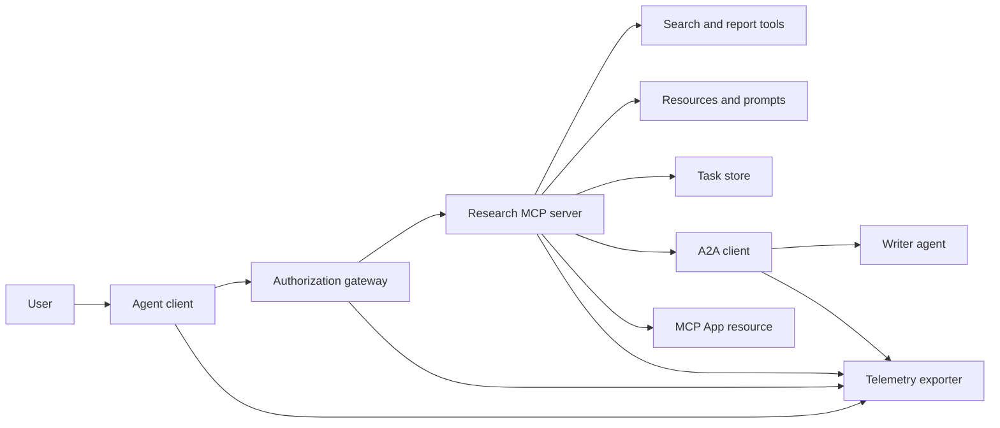
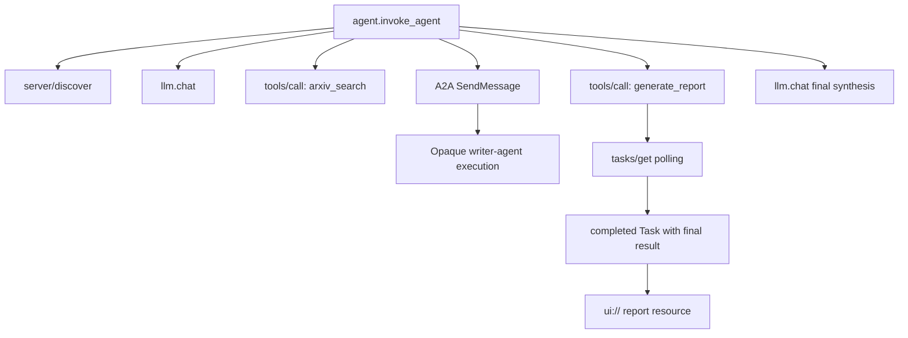
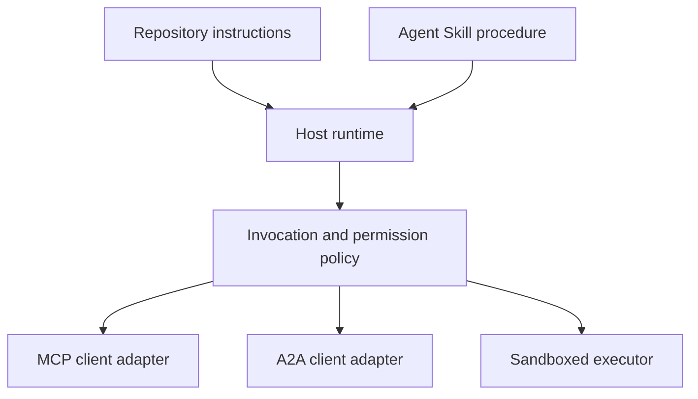

# 돌: 국적 없는 도구 생태계

> 생산 에이전트 시스템은 한계 집합이 아니라 특징의 집합입니다. 이 톱스톤은 실제 배포가 필요한 프로토콜 클라이언트, 권한 서버, 샌드박스 및 텔레메트리 수출자로부터 읽을 수 있는 프로세스 시뮬레이션을 분리합니다.

**Type:** Build
**Languages:** Python (stdlib, in-process simulation)
**Prerequisites:** Phase 13 · 01 through 22, using MCP revision `2026-07-28`
**Time:** ~120 minutes

## 학습 목표

- 도구 호출, 작업 모양의 결과, 위임 작업, UI 자원, 권한 정책 및 추적 기록을 하나의 흐름으로 작성하십시오.
- 연결 세션에 의존하는 대신 각 MCP 요청에 프로토콜 버전, 클라이언트 아이덴티티 및 기능을 휴대합니다.
- 사용 전에 서버를 발견하고 공식 작업 확장 프로그램을 통해 긴 작업을 수행하십시오.
- 프로토콜 모양의 시뮬레이션을 MCP, A2A, OAuth 또는 OpenTelemetry 구현에서 구별한다.
- 시뮬레이션된 각 경계를 교체해야 하는 생산 부품에 지도화하십시오.
- 계속`AGENTS.md`, 에이전트 스킬, 런타임 어댑터, 도구, 그리고 보안 정책
- 지역 출력으로 어떤 주장을 확인할 수 있고, 어떤 주장이 실시간 통합 테스트를 필요로 하는지 설명해 주십시오.

## 문제

연구 및 보고 시스템 설계. 사용자는 에이전트 프로토콜에 관한 논문을 요청합니다. 시스템은 종이 카탈로그를 검색하고, 요약을 위임하여 보고서를 생성하고, UI 리소스를 반환하고, 시스템을 통해 경로를 기록합니다.

그 문장은 여러 독립적인 계약들을 숨기고 있습니다.

- 모델에 맞춘 도구 스케마
- 국적 없는 요청 봉투 및 서버 발견 계약
- 행위자, 범위 및 도구 정체성에 대한 게이트웨이 결정
- 장기적인 운용 계약
- 위임 프로토콜
- 호스트에서 앱에 대한 다리
- 흔적 배양 및 수출
- 재사용 가능한 운영 절차

`code/main.py`일반 파이썬 기능과 사전으로 그 경계를 가시하게 합니다. 이 방법은 트랜스포트를 열거나 arXiv에 연락하거나 OAuth를 수행하거나 A2A 서버에 호출하거나 MCP 앱을 렌더링하거나 텔레메트리를 수출하지 않습니다. 이는 시뮬레이션을 컴플라이언스 서비스로 제시하지 않고 제어 흐름을 쉽게 검사 할 수 있습니다.

## 개념

### 목표 구조



건축은 공공 프로토콜 패턴의 개념적 구성입니다. 그것은 어떤 제품의 개인 내부에 대한 주장이 아닙니다.

### 목표물 추적



실제 구현에서, 모든 홉은 추적 컨텍스트를 전파합니다. 스팸 이름과 속성은 선택한 기기 버전에서 지원되는 OpenTelemetry 의미 협정을 따라야 합니다. 공유 된 추적 식별자는 그 자체로 올바른 유족, 수출 또는 백엔드 섭취를 증명하지 않습니다.

### 현재 프로토콜 표면

기존의 드래프트에서 기억된 이름보다는 현 프로토콜에서 정의된 방법 이름들을 사용한다.

| Boundary | Current surface | What the capstone simulates |
|---|---|---|
| MCP discovery | Mandatory `server/discover` | A direct function returning versions, capabilities, and server identity |
| MCP request context | Version, capabilities, and client identity in every `params._meta` | Fresh request metadata passed to every simulated call |
| MCP tool call | `tools/call` | Direct Python function dispatch |
| MCP task polling | `io.modelcontextprotocol/tasks` with `tasks/get` | A working handle followed by a completed task carrying its final result |
| A2A delegation | `SendMessage` in gRPC and JSON-RPC; `POST /message:send` in HTTP+JSON | One nested span with no remote call or artificial delay |
| MCP App calling a server tool | `app.callServerTool({ name, arguments })` | An HTML string with no live bridge |
| OAuth authorization | Authorization server, protected-resource metadata, audience and scope validation | Static token lookup and scope membership |
| OpenTelemetry | SDK, propagator, exporter, and collector or backend | In-memory span dictionaries |

프로토콜 이름은 첫 번째 층에 불과하다. 생산 테스트는 실제 와이어에서 일련화, 인증 실패, 취소, 타임아웃, 재시험 및 버전 호환성을 수행해야합니다.

### 국적을 상실한 MCP는 통합 경계를 변경합니다

개정`2026-07-28`프로토콜 세션 및`initialize`- `notifications/initialized`손잡이도 빼내죠`Mcp-Session-Id`모든 요청에는 이 이름들이 있습니다`_meta`필드:

```json
{
  "io.modelcontextprotocol/protocolVersion": "2026-07-28",
  "io.modelcontextprotocol/clientCapabilities": {
    "extensions": {
      "io.modelcontextprotocol/tasks": {}
    }
  },
  "io.modelcontextprotocol/clientInfo": {
    "name": "capstone-client",
    "version": "1.0.0"
  }
}
```

서버가 구현해야 합니다`server/discover`. 일반 결과 사용 `resultType: "complete"`; 작업 핸들 사용 `resultType: "task"`. 각 결과에서 서버를 식별해야 합니다 `_meta.io.modelcontextprotocol/serverInfo`- 그래

작업 연장`tasks/get``tasks/update`그리고`tasks/cancel`도구가 먼저 돌아올 수 있습니다`resultType: "task"``tasks/get`그 자체로 돌아옵니다`resultType: "complete"`, 그리고 완료된`Task`최종 결과물을 포함합니다.`tasks/result`그리고`tasks/list`현재 확장 프로그램에는 메소드가 포함되어 있지 않습니다. 클라이언트는 광고를 해야 합니다.`io.modelcontextprotocol/tasks`작업 핸들 을 수신 할 수 있는 동일한 요청에 해당합니다. 그렇지 않으면 서버가 반환합니다 `-32021``requiredCapabilities` 포함된 클라이언트 능력의 미흡한 객체로 형성된`extensions.io.modelcontextprotocol/tasks`- 그래

### 보안 자세

의도된 배치에는 깊이 있는 방어를 사용합니다.

- 클라이언트 타입이 요구하는 경우 PKCE와 OAuth 권한
- 발행된 액세스 토큰에 대한 자원 및 관객 결합
- 요청된 도구와 범위를 확인하는 게이트웨이 RBAC
- 모델 가시적인 맥락에서 벗어나 보관된 상류 자격증
- 거나 검토된 도구 설명서;
- 신뢰되지 않은 입력, 민감한 데이터 및 그 결과행위를 위한 두 번째 규칙 검토
- 파일 시스템, 프로세스, 네트워크, 인증서 및 리소스 제한이 기술 이외에 적용되는 실행 샌드박스

데모는 단지 정적 토큰, 범위를 확인하고 설명 해시만 구현합니다. 정책 흐름에 유용하지만 보안 검증은 아닙니다.

### 기술은 절차가 아니라 운송입니다

에이전트 스킬은 연구 작업 흐름을 수행하는 방법, 어떤 도구 계약이 예상되는지, 어떤 증거를 저장해야 하는지, 언제 중단해야 하는지 실행 시간에 말할 수 있습니다. MCP 서버가 존재하도록 만들거나 A2A 호환성을 설정하거나 범위를 부여하거나 모래 상자를 만들 수 없습니다.



절차가 동반 파일들을 참조할 때 완전한 기술 디렉토리를 보내십시오. 이 오래된 톱스톤의 평면 유물은 호스트가 휴대용 팩을 보존한다는 증거가 아닌 과정의 청사진입니다. 24~27 수업은 전체 팩의 라이프 사이클을 구성하고 테스트합니다.

### 코스 유물 메타데이터는 로컬 어댑터입니다

과정 카탈로그와 설치 프로그램은 `skill-*.md`이 강의는 휴대용 아이덴티티 필드와 코스 카탈로그 필드를 같은 수준으로 유지합니다.

```yaml
---
name: ecosystem-blueprint
description: Produce a full Phase 13 ecosystem architecture for a product need.
version: "1.0.0"
phase: "13"
lesson: "23"
tags: [mcp, capstone, ecosystem, architecture, a2a, otel]
---
```

`name`그리고`description`휴대용 아이덴티티 필드입니다.`version``phase``lesson`그리고`tags`코스 특수한 카탈로그 확장 프로그램입니다.`tags`이 목록은`--tag capstone`이 점도 맞을 수 있어요

휴대용 디렉토리 능력은 선택적 `metadata`문자열 값의 확장 데이터 지도.`metadata`이 저장소의 카탈로그 스키마와 교환될 수 있습니다. 이 평면 파일 둥지를 다면`version`또는`tags`아래`metadata`, 최소 파서가 그 어있는 키를 건너뛰고, 카탈로그는 빈 버전을 기록하고, 태그 필터링은 유물을 찾을 수 없습니다. 제작 호스트는 안전한 YAML 파서를 사용하여 자신의 문서화된 스키마를 검증해야합니다.

### 시뮬레이션과 생산

| Layer | `code/main.py` | Production replacement | Required evidence |
|---|---|---|---|
| Discovery | `server_discover()` plus static `TOOLS` | `server/discover` followed by cache-aware `tools/list` | Wire transcript, deterministic order, and schema validation |
| Authentication | Token-keyed dictionary | OAuth authorization and resource server validation | Issuer, audience, scope, expiry, and failure tests |
| Authorization | Scope membership | Gateway policy bound to actor, tool, target, and tenant | Allow and deny audit cases |
| Search | Static paper fixtures | Search API or MCP server | Source provenance, ranking, and error tests |
| Tasks | Local handle plus immediate `tasks/get` | Durable `io.modelcontextprotocol/tasks` store with `tasks/get`, `tasks/update`, `tasks/cancel`, and TTL | State-transition, input, cancellation, and recovery tests |
| Delegation | Sleep plus nested span | A2A client and remote Agent Card | Contract, timeout, retry, and opacity tests |
| App | HTML string and URI | MCP Apps resource and `App` bridge | CSP, permissions, tool-call, and browser tests |
| Telemetry | In-memory list | OTel SDK and exporter | Collector receipt and trace-parent assertions |
| Sandbox | None | Host-enforced isolated executor | Escape, egress, secret, and resource-limit tests |

이 테이블은 전달 경계가에요. 녹색 로컬 런은 시뮬레이션을만 유효하게 합니다.

### 단계 13 지도

| Lessons | Contribution |
|---|---|
| 01-05 | Tool interfaces, calls, schemas, structured results, and deterministic validation |
| 06-14 | Stateless MCP request envelopes, discovery, transports, resources, prompts, extensions, and Apps |
| 15-18 | Poisoning defenses, OAuth, gateways, registries, and production authentication |
| 19 | A2A message and task delegation |
| 20 | OpenTelemetry GenAI trace design |
| 21 | Model-provider routing |
| 22 | Portable skill contract and runtime boundary |

```figure
t3-capstone-chain
```

## 건설 해

처리 중인 배너스를 실행:

```bash
cd phases/13-tools-and-protocols/23-capstone-tool-ecosystem
python3 code/main.py
```

다섯 가지 점들을 살펴보세요.

1. `server/discover`광고 개정 `2026-07-28`그리고 임무 연장
2. 앨리스가 보고서를 읽고 생성할 수 있지만, 밥의 문자전화 전화는 거절당합니다.
3. 하나의 오케스트레이터 런의 모든 로컬 스파인들은 하나의 트레이스 식별자를 공유하고 부모 스파인 식별자를 기록합니다.
4. 보고서는 작업 처리로 시작됩니다.`tasks/get`완료된 작업을 반환하여 최종 결과에는 텍스트와 `ui://`참고
5. 위임받은 작가는 비명성적이기 때문에 오케스트레이터가 기록하는 것은 경계를 기록하는 것뿐입니다.
6. 출력 주장은 네트워크 연결, OAuth 교환, 수집기 수출, 브라우저 렌더링 또는 샌드박스 실행이 발생하지 않았습니다.

스크립트는 두 번 실행되므로 두 개의 루트 트레이스를 생성합니다. 감사 항목은 프로세스 로컬이며 다음 실행에 다시 설정됩니다.

## 사용 하 고

한 층씩 추진한다:

1. 대체`server_discover()`그리고 실제와 함께 정적 도구 목록`server/discover`그리고`tools/list`모든 요청에 버전, 정체성, 기능들을 전송합니다.
2. 정적 토큰을 권한 서버와 보호된 리소스 검증으로 교체하십시오.
3. `io.modelcontextprotocol/tasks`확장 및 시험`tasks/get``tasks/update``tasks/cancel`, 타임아웃, TTL, 그리고 재발전 복구`tasks/result`또는`tasks/list`- 그래
4. A2A 클라이언트로 위임 대리본을 교체해
5. 공식 SDK를 사용하여 앱을 구축하고 서버 도구를 통해 호출합니다 `app.callServerTool`- 그래
6. 시험 수집자에게 수출 기간을 기록하고 수신자에게 부모를 주장합니다.
7. 레슨 26에서 샌드박스 계약 안에 도구와 스크립트 실행을 실행하십시오.
8. 절차를 전체 디렉토리 팩으로 포장하고 레슨 27 풀게이트를 통과하십시오.

각 프로모션에는 새로운 경계를 넘는 통합 테스트가 필요합니다.

## 선박

이 교훈은`outputs/skill-ecosystem-blueprint.md`, 기존의 단일 파일 과정 유물. 원시, 보안, 위임, 텔레메트리, 패키징 및 가장 어려운 운영 위험을 다루는 한 페이지 구조를 요구합니다. 최고 수준의 카탈로그 필드는 저장소의 실제 카탈로그 및 설치 파서러에 의해 수행됩니다.

이 책 은 디렉토리 팩트 이 아니기 때문에 참조, 스크립트, 자산 또는 평가 장치 를 수록 할 수 없습니다. 이 과정 이외 에 재사용 가능한 기술을 게시 할 때 레슨 22 및 24 에서 27까지의 패키지 형식을 사용 하십시오.

## 운동

1. 달아`code/main.py`생산 주장에서 생산 결과로 증명된 사실들, 아직 통합 증거가 필요한 사실들.
2. 두 번째 정적 백엔드를 추가하고 같은 이름의 두 도구의 충돌 규칙을 정의합니다.`tools/list`전화.
3. A2A 테스트 서버로 작성자 줄거리를 교체해 주자 카드, 메시지 요청, 타임아웃 경로, 반환된 유물을 기록해
4. 프로세스 재부팅을 살아남은 작업 저장소를 추가합니다. 클라이언트가 재개할 수 있음을 증명합니다.`tasks/get`, 존경심`pollIntervalMs`, 그리고 완료된 작업의 최종 결과를 읽지 않고`tasks/result`- 그래
5. 최소 MCP 앱을 구축하고 확인`app.callServerTool`제한적인 CSP 및 명시적인 권한이 있는 브라우저에서
6. OTel SDK를 통해 시뮬레이션된 스랜드를 로컬 컬렉터로 수출합니다. 수신, 추적 식별자, 유족 및 오류 상태를 확인합니다.
7. 글쓰기`AGENTS.md`리포지토리 전체 유지 관리 규칙과 재사용 가능한 연구 절차에 대한 별도의 기술 패키지. 파일 중 어느 하나에서도 도구 권한을 부여하는 이유를 설명하십시오.

## 주요 용어

| Term | What people say | What it actually means |
|---|---|---|
| Capstone | "Everything wired together" | A staged integration whose simulated and live boundaries remain explicit |
| Protocol-shaped simulation | "It is basically MCP" | Local data and calls that resemble a protocol without implementing its wire contract |
| Tasks extension | "Long tool call" | An optional `io.modelcontextprotocol/tasks` lifecycle with durable identity, polling, client input, final result, and cancellation semantics |
| Opacity boundary | "The other agent handles it" | The caller sees the declared interface and artifacts, not private reasoning or internal state |
| Runtime adapter | "Skill integration" | Host code that maps portable procedure to discovery, invocation, tools, policy, and context |
| Integration evidence | "It passed" | A transcript, artifact, or receiver-side observation proving the real boundary was crossed |

## 더 많은 읽기

- [MCP specification 2026-07-28](https://modelcontextprotocol.io/specification/2026-07-28)국적 없는 요청, 발견, 도구, 허가 및 운송 행위에 대한
- [MCP 2026-07-28 key changes](https://modelcontextprotocol.io/specification/2026-07-28/changelog)세션 제거, 요청에 따른 메타데이터, MRTR, 확장 및 소멸
- [MCP Tasks extension](https://tasks.extensions.modelcontextprotocol.io/specification/draft/tasks)`tasks/get``tasks/update``tasks/cancel`, 그리고 최종 과제들에 의해 수행되는 최종 결과.
- [MCP Apps SDK](https://github.com/modelcontextprotocol/ext-apps/blob/main/docs/overview.md)`App`그리고`app.callServerTool`- 그래
- [A2A protocol](https://a2a-protocol.org/latest/)에이전트 카드, 메시지 전달, 작업, 유물 및 운송 연결
- [OpenTelemetry GenAI semantic conventions](https://opentelemetry.io/docs/specs/semconv/gen-ai/)추적 및 속성 협약에 대해
- [Agent Skills specification](https://agentskills.io/specification)절차 계층에서 사용되는 휴대용 패키지 계약에 대해.
