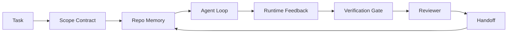

# 에이전트 워크 벤치 엔지니어링: 왜 능력 있는 모델들이 여전히 실패하는 걸까요?

> 능력 있는 모델은 충분하지 않습니다. 신뢰할 수 있는 에이전트는 작업 테이블: 지침, 상태, 범위, 피드백, 검증, 검토, 전달. 그들을 제거하고 심지어 국경 모델은 운송에 안전하지 않은 작업을 생산합니다.

**Type:** Learn + Build
**Languages:** Python (stdlib)
**Prerequisites:** Phase 14 · 01 (Agent Loop), Phase 14 · 26 (Failure Modes)
**Time:** ~45 minutes

## 학습 목표

- 실행 신뢰성에서 모델 능력의 분리
- 에이전트가 출입하는지 여부를 결정하는 7개의 작업 테이블 표면을 명명하세요.
- 작은 리포 작업에서 단시간 실행과 작업 테이블에서 안내되는 실행을 비교하십시오.
- 실패 모드 보고서를 작성하여 각 부실 표면을 그 증상으로 표시합니다.

## 문제

실제 repo에 한계 모델을 떨어뜨리고 입력 검증을 추가하도록 요청합니다. 그것은 네 개의 파일을 열고, 유연한 코드를 작성하고, 성공을 선언하고 중지합니다. 테스트를 실행합니다. 두 가지 실패합니다. 검증과 관련이없는 세 번째 파일은 만집니다. 에이전트가 무엇을 가정했는지, 먼저 시도했는지 또는 무엇을 할 수 있는지에 대한 기록이 없습니다.

파이썬에 대한 모델은 틀리지 않았습니다. 작업에 대한 모델은 틀렸습니다. 어떤 작업이 완료되었는지, 어디서 쓸 수 있는지, 어떤 테스트가 권위있는지, 다음 세션이 어떻게 시작될지 전혀 몰랐습니다.

이것은 모델 버그가 아니라 작업 테이블 버그입니다. 에이전트를 둘러싼 표면은 일샷 세대를 신뢰할 수 있고 재사용 가능한 엔지니어링으로 바꾸는 부품이 부족합니다.

## 개념

작업 테이블은 작업 중에 모델을 엮는 운영 환경입니다.

| Surface | What it carries | Failure when missing |
|---------|-----------------|----------------------|
| Instructions | Startup rules, forbidden actions, definition of done | Agent guesses what shipping means |
| State | Current task, touched files, blockers, next action | Each session restarts from zero |
| Scope | Allowed files, forbidden files, acceptance criteria | Edits leak into unrelated code |
| Feedback | Real command output captured into the loop | Agent declares success on a 400 |
| Verification | Tests, lint, smoke run, scope check | "Looks good" reaches main |
| Review | A second pass with a different role | Builder marks own homework |
| Handoff | What changed, why, what is left | Next session re-discovers everything |

작업 테이블은 모델에 독립적입니다. 당신은 모델을 교환하고 표면을 유지할 수 있습니다. 당신은 표면을 교환하고 신뢰성을 유지할 수 없습니다.



이 루프는 채팅 역사에서 아닌 상태 파일에서 닫힌다. 채팅은 변동적입니다. 레포는 기록 시스템입니다.

### 작업 테이블과 프롬프트 엔지니어링

프팅은 모델에게 이 차례에서 원하는 것을 알려줍니다. 프팅은 모델에게 프팅과 프팅을 통해 작업을 수행하는 방법을 알려줍니다. 대부분의 에이전트 실패 사례는 프팅 엔지니어링 옷을 입고 작업 프팅 실패입니다.

### 워크 벤치와 프레임워크

프레임워크는 런타임 (LangGraph, AutoGen, Agents SDK) 를 제공합니다. 작업 테이블은 에이전트에 해당 런타임 내에서 일할 수있는 장소를 제공합니다. 두 가지 모두 필요합니다. 이 미니 트랙은 두 번째에 관한 것입니다.

### 원시적에서 논리하는 것이 아니라 공급자 분류학에서 논리하는 것

"하네스 엔지니어링"에 대해 많은 글이 있습니다. 애디 오스마니, 오픈아이, 앤트로피크, 랭체인, 마틴 파울러, 몽고DB, 휴먼레이어, 증강 코드, 핑크워크, 워킹랩의 멋진 목록, 그리고 매체와 해커 뉴스의 꾸준한 드럼 비트 모두 그것을 가지고 있습니다. 그들은 어떤 배끼가 무엇인지, 어떤 범위에서 사용해야 하는지, 어떤 어휘를 사용해야 하는지에 대해 서로 의견이 일치하지 않습니다. 우리는 어느 쪽을 선택할 필요가 없습니다. 일곱 개의 표면은 UX 계층입니다. 모든 작업 테이블 아래에는 신뢰할 수있는 백엔드를 유지하는 동일한 분산 시스템 원시체입니다.

에이전트 라벨을 잠시 꺼내라. 에이전트 러닝은 시간, 프로세스, 기계를 가로지르는 계산입니다. 신뢰성을 높이기 위해서는 모든 생산 시스템에서 필요로 하는 원시적인 것들이 필요합니다.

| Primitive | What it is | What it carries for an agent |
|-----------|------------|------------------------------|
| Function | Typed handler. Pure where possible. Owns its inputs and outputs. | A tool call, a rule check, a verification step, a model invocation |
| Worker | Long-lived process that owns one or more functions and a lifecycle | The builder, the reviewer, the verifier, an MCP server |
| Trigger | Event source that invokes a function | Agent loop tick, HTTP request, queue message, cron, file change, hook |
| Runtime | The boundary that decides what runs where, with what timeouts and resources | Claude Code's process, LangGraph's runtime, a worker container |
| HTTP / RPC | The wire between caller and worker | Tool-call protocol, MCP request, model API |
| Queue | Durable buffer between trigger and worker; back-pressure, retry, idempotency | The task board, the feedback log, the review inbox |
| Session persistence | State that survives crashes, restarts, model swaps | `agent_state.json`, checkpoints, KV stores, the repo itself |
| Authorization policy | Who can call what function with which scope | Allowed/forbidden files, approval boundaries, MCP capability lists |

이제 7개의 작업 테이블 표면을 그 원시형에 지도화해 보세요.

- **Instructions** 정책 + 기능 메타 데이터. 규칙은 검사 (역수) 이다. 라우터 (`AGENTS.md`) 는 실행시간의 시작에 부착된 정책입니다.
- **State** 세션 지속성. 키 스토어에서는 실행 시간을 모든 단계에서 읽습니다. 파일, KV 또는 DB; 지속성 의미학은 중요하지만 저장 백엔드는 그렇지 않습니다.
- **Scope** 작업별 허가 정책. 허용/ 금지 된 볼은 ACL입니다. 승인이 필요한 것은 허가망입니다.
- **Feedback** 호출 로그는 줄을 서고 있습니다. 각 셸 호출은 기록, 내구성, 재생 가능한입니다.
- **Verification** 함수. 입력에 대한 결정적. 작업 종료 시 발동. 실패 종료.
- **Review** 건설자 유물 에 대한 독서적 권리와 검토 보고서 에 대한 독서적 권리와
- **Handoff** 세션 종료 트리거에 의해 발매되는 내구성 기록. 다음 세션의 시작 트리거는 그것을 읽습니다.

에이전트 루프는 이벤트 (이용자 메시지, 도구 결과, 타이머 틱) 를 소비하는 작업자이며, 함수를 호출 (모델, 모델이 선택한 도구), 기록 ( 상태, 피드백) 을 작성하고 트리거를 발송 (확인, 검토, 전달) 합니다. 미스터리 없이 작업 프로세서와 같은 모양입니다.

### 원시로 번역된 유형

모든 인기 있는 배너 패턴은 8개의 원시형으로 줄여요.

| Vendor or community pattern | What it actually is |
|------------------------------|--------------------|
| Ralph Loop (Claude Code, Codex, agentic_harness book) — re-inject original intent into a fresh context window when the agent tries to stop early | A trigger that re-enqueues a task with a clean context; session persistence carries the goal forward |
| Plan / Execute / Verify (PEV) | Three workers, one per role, communicating via state and a queue between phases |
| Harness-compute separation (OpenAI Agents SDK, April 2026) — split control plane from execution plane | Restating control-plane / data-plane. Predates the agent label by decades |
| Open Agent Passport (OAP, March 2026) — sign and audit every tool call against a declarative policy before execution | An authorization policy enforced by a pre-action worker, with a signed audit queue |
| Guides and Sensors (Birgitta Böckeler / Thoughtworks) — feedforward rules + feedback observability | Authorization policy + verification functions + observability traces |
| Progressive compaction, 5-stage (Claude Code reverse engineering, April 2026) | A state-management worker that runs cron-like over session persistence to keep it within a budget |
| Hooks / middleware (LangChain, Claude Code) — intercept model and tool calls | Triggers + functions wrapped around the runtime's invocation path |
| Skills as Markdown with progressive disclosure (Anthropic, Flue) | A function registry where the function metadata is loaded into context just-in-time |
| Sandbox agents (Codex, Sandcastle, Vercel Sandbox) | The compute plane: a runtime with isolated filesystem, network, and lifecycle |
| MCP servers | Workers exposing functions over a stable RPC, with capability lists as authorization |

이 테이블의 모든 항목은 이미 분산 시스템에서 이름을 가지고 있던 원시적인 것으로 도착하는 에이전트 커뮤니티입니다. 마케팅에 유용한 레이블, 엔지니어링 어휘로 유용하지 않습니다.

### 실은 영수권에 나오는 내용

"아름다운 모델을 기다려야 한다"는 주장은 사실 사실에 대한 유일한 주장이기 때문에,

- 터미널 벤치 2.0  동일한 모델, 배너스 변경은 코딩 에이전트를 상위 30위 밖에서 5위로 옮겼다 (랑체인, * 에이전트 배너스의 아나토미*).
- 베르셀은 의 에이전트 도구의 80%를 삭제하고 성공률은 80%에서 100%로 급등했다 (MongoDB).
- 하비  법정 에이전트는 리너스 최적화를 통해서만 정확도를 두 배 이상 높였다 (MongoDB).
- 기업 AI 에이전트 프로젝트의 88%가 생산에 도달하지 못합니다. 실패는 추론이 아닌 실행 시간에 관한 것입니다 (preprints.org, *Harmness Engineering for Language Agents*, 2026년 3월).
- 2025년 공개소스 프레임워크의 세 가지 인기 있는 벤치마크 연구에서는 ~50%의 작업 완료가 보고되었다. 장 맥락 웹 에이전트는 장 맥락 조건에서 40-50%에서 10% 이하로 붕괴되었다. 대부분 무한 루프와 목표 손실 (2026년 초에 널리 다루어졌다).

이 점 은 "하인스 이 영원 히 승리 한다"는 것 이 아닙니다. 모델 들 은 시간 이 지나면서 하인스 트릭 을 흡수 합니다. 이 점 은 오늘날, 부담 을 짊어지는 기술 은 모델 에 관한 것 이며, 그 내부 에 있는 것 이 아니라, 그 부담 을 짊어지는 원시물 은 모든 생산 시스템 이 항상 필요로 하는 것 이다.

### 판매자 서브가 짧은 것을 멈추는 곳

이건 예의가 필요 없는 부분입니다.

- 랭체인의 * 에이전트 하네스의 아나토미*는 11개의 구성 요소를 나열합니다.  명령어, 도구, 해킹, 샌드박스, 오케스트레이션, 메모리, 기술, 서바게인트 및 런타임 "더미 loop".
- 애디 오스마니의 에이전트 하네스 엔지니어링은 프레임링을 착륙시킵니다`Agent = Model + Harness`그리고 래시트 패턴은, 하지만 어떤 배지가 만들어졌는지 말하지 않습니다.
- 인트로픽과 오픈AI는 표면에 가장 깊게 들어가지만 자신의 실행 시간 내에 머물러 있습니다. 2026년 4월 에이전트 SDK의 "하네스-컴퓨트 분리" 발표는 제어 평면 / 데이터-플레인 분리를 명시적으로 승인하는 첫 번째 공급자 작품입니다. 이것은 원시적인 아이디어입니다. 새로운 것이 아닙니다.
- 에이전티스크_하네스 책에서는 하네스를 구성 객체로 취급합니다 (Jaymin West의 *Agentic Engineering* 6장) 그리고 가장 강력한 라인은 "하네스는 에이전티스크 시스템에서 주요 보안 경계가 있습니다".
- 해커 뉴스 스레드는 계속 같은 장소에 도착합니다. 2026년 4월 스레드는 * 에이전트 하네스가 샌드박스 외부에 속한다* 하네스가 "모든 것을 외부에 앉아 있으며 컨텍스트와 사용자에 따라 액세스 권한을 부여하는 하이퍼바이저처럼 앉아야 한다"고 주장합니다. 다시 말해서, 허가 정책은 별도의 평면으로.

이 부분 중 하나를 반대하는 것은 필요 없습니다. 그들은 이미 존재하는 시스템의 UX 설명을 작성하고 있습니다. 우리는 시스템을 작성하고 있습니다. 시스템이 올바르게 구축되면, 일곱 표면이 원시에서 떨어집니다. 잘못 구축되면, 양이 없습니다.`AGENTS.md`폴리쉬는 결실된 줄을 수정합니다.

그래서 다른 곳에서 "하네스 엔지니어링"을 들으면 원시적인 것으로 번역하세요. 명령과 규칙은 정책과 기능입니다. 스카프도딩은 실행시간입니다. 경비선들은 허가+확인입니다. 해킹은 트리거입니다. 기억은 세션 지속입니다. 랄프 루프 큐어 부부족은 노동자입니다. 모래 상자는 컴퓨터 비행기입니다. 어휘는 변하지만 공학은 변하지 않습니다. 작업 테이블은 에이전트-대면 UX입니다. 다음 공급자 재편에 살아남는 의미에서, 은 기능, 노동자, 트리거, 실행 시간, 줄을, 끈기, 정책이 올바르게 연결됩니다.

```figure
wb-seven-surfaces
```

## 건설 해

`code/main.py`작은 리포 작업을 두 번 실행합니다. 먼저 프롬프트에서만, 다음에는 일곱 개의 표면이 연결되어 있습니다. 같은 모델, 동일한 작업. 스크립트는 실패 실행에서 실종된 표면을 계산하고 실패 모드 보고서를 인쇄합니다.

레포 작업은 의도적으로 작습니다. 한 파일 FastAPI 스타일의 핸들러에 입력 검증을 추가하고 합격 테스트를 작성합니다.

실행하세요:

```
python3 code/main.py
```

출력: 두 경기의 옆으로 기록, a `failure_modes.json`단시간 출마를 요약하고, 일판 출마를 위한 단행 판결을 내리는 것입니다.

이 미니 트랙의 나머지 부분에서는 모든 표면을 실제적이고 재사용 가능한 유물처럼 재구성합니다.

## 사용 하 고

3개의 작업 테이블 표면은 이미 야생에 존재합니다. 아무도 그렇게 부르지 않더라도:

- **Claude Code, Codex, Cursor.** `AGENTS.md`그리고`CLAUDE.md`명령은 범위이고, 해킹은 검증입니다.
- **LangGraph, OpenAI Agents SDK.**체크포인트와 세션 매장들은 주 표면이고, 송신은 송신 표면입니다.
- **CI on a real repo.**테스트,  lint, 그리고 타입 확인은 검증입니다. PR 템플릿은 전달입니다. 코디오너들은 검토입니다.

작업 테이블 엔지니어링은 각 팀에서 다시 발견하는 대신 그 표면을 명시적이고 재사용 가능한 것으로 만드는 학문입니다.

## 선박

`outputs/skill-workbench-audit.md`그것은 7개의 작업 테이블 표면과 보고서를 검사하는 휴대용 기술입니다.

## 운동

1. 이미 에이전트를 운영하는 repo를 선택하고 7개의 표면을 0 (실종) 에서 2 (건강) 으로 점수하십시오. 가장 약한 표면은 무엇입니까?
2. 확장`main.py`그래서 단숨에 실행하는 것은 가짜 "성공" 주장을 생성합니다. 검증 게이트가 그것을 잡았을 것입니다.
3. 네 제품에는 8번째 표면을 추가하고, 왜 기존 7개 제품 중 하나에 붕괴되지 않는지 설명해 주세요.
4. 다른 스터브 에이전트로 스크립트를 다시 실행해 추가 파일 작성을 환각시키는 것
5. 14 · 26 단계 에서 산업 에서 반복 되는 5 가지 실패 모드를 7개의 표면 에 표시 하십시오. 각 표면 은 어떤 모드를 흡수 할 수 있도록 설계 되어 있습니다?

## 주요 용어

| Term | What people say | What it actually means |
|------|----------------|------------------------|
| Workbench | "The setup" | Engineered surfaces around the model that make work reliable |
| Surface | "A doc" or "a script" | A named, machine-readable input the agent reads or writes every turn |
| System of record | "The notes" | The file the agent treats as truth when chat history is gone |
| Definition of done | "Acceptance" | An objective, file-backed checklist the agent cannot fake |
| Workbench audit | "Repo readiness check" | A pass over the seven surfaces that flags missing pieces before work begins |

## 더 많은 읽기

이 모든 개념은 부분적인 분류학입니다. 모든 개념을 원시로 번역하십시오 (함수, 작업자, 트리거, 런타임, HTTP/RPC, 줄을, 지속성, 정책)

판매자 프레임:

- [Addy Osmani, Agent Harness Engineering](https://addyosmani.com/blog/agent-harness-engineering/)`Agent = Model + Harness`그리고 이 모양이, 인프라에 가늘고
- [LangChain, The Anatomy of an Agent Harness](https://blog.langchain.com/the-anatomy-of-an-agent-harness/) 11개의 구성요소: 명령어, 도구, 해킹, 오케스트레이션, 샌드박스, 메모리, 기술, 서바게인트, 런타임; 줄을 제외, 배포, authz
- [OpenAI, Harness engineering: leveraging Codex in an agent-first world](https://openai.com/index/harness-engineering/) 코덱스 팀의 경전 시점 주변 표면의 시각
- [OpenAI, Unrolling the Codex agent loop](https://openai.com/index/unrolling-the-codex-agent-loop/) 에이전트 루프가 A로 줄여`while`함수 호출에 대한
- [Anthropic, Effective harnesses for long-running agents](https://www.anthropic.com/engineering/effective-harnesses-for-long-running-agents) 특정 실행 시간 내에 긴 지평선 표면
- [Anthropic, Harness design for long-running application development](https://www.anthropic.com/engineering/harness-design-long-running-apps) 적용된 설계 메모
- [LangChain Deep Agents harness capabilities](https://docs.langchain.com/oss/python/deepagents/harness) 실행시간 구성 표면

사용 가능한 세부 사항의 연습자 조각:

- [Martin Fowler / Birgitta Böckeler, Harness engineering for coding agent users](https://martinfowler.com/articles/harness-engineering.html) 가이드 (전보전보전보전보전보전보전보전보전보전보전보전보전보전보전보전보전보전보전보전보전보전보전보전보전보전보전보전보전보전보전보전보전보전보전보전보전보전보전보전보전보전보전보전보전보전보전보전보전보전보전보전보전보전보전보전보전보전보전보전보전보전보전보전보전보전보전보전보전보전보전보전보전보전보전보전보전보전보전보전보전보전보전보전보전보전보전보전보전보전보전보전보전보전보전보전보전보전보전보전보전보전보전보전보전보전보전보전보전보전보전보전보전보전보전보전보전보전보전보전보전보전보전보전보전보전보전보전보전보전보전보전보전보전보전보전보전보전보전보전보전보전보전보전보전보전보전보전보전보전보전보전보전보전보전보전보전보전보전보전보전보전보전보전보전보전보전보전보전보전보전보전보전보전보전보전보전보전보전보전보전보전보전보전보전보전보전보전보전보전보전보전보전보전보전보전보전보전보전보전보전보전보전보전보전보전보전보전보전보전보전보전보전보전보전보전보전보전보전보전보전보전보전보전보전보전보전보전보전보전보전보전보전보전보전보전보전보전보전보전보전보전보전보전보전보전보전보전보전보전보전보전보전
- [HumanLayer, Skill Issue: Harness Engineering for Coding Agents](https://www.humanlayer.dev/blog/skill-issue-harness-engineering-for-coding-agents) "그건 모델 문제가 아니라 구성 문제"
- [MongoDB, The Agent Harness: Why the LLM Is the Smallest Part of Your Agent System](https://www.mongodb.com/company/blog/technical/agent-harness-why-llm-is-smallest-part-of-your-agent-system) 영수증: 80%~100%의  Версель, 하비 2배의 정확성, 터미널 벤치 30~5위
- [Augment Code, Harness Engineering for AI Coding Agents](https://www.augmentcode.com/guides/harness-engineering-ai-coding-agents) 제약- 첫 번째 걸음
- [Sequoia podcast, Harrison Chase on Context Engineering Long-Horizon Agents](https://sequoiacap.com/podcast/context-engineering-our-way-to-long-horizon-agents-langchains-harrison-chase/) 모델 문제보다 실행 시간 문제

책, 논문 및 참고 구현:

- [Jaymin West, Agentic Engineering — Chapter 6: Harnesses](https://www.jayminwest.com/agentic-engineering-book/6-harnesses) 책 길이를 처리, 리네스를 주요 보안 경계로 취급합니다
- [preprints.org, Harness Engineering for Language Agents (March 2026)](https://www.preprints.org/manuscript/202603.1756) 통제/기계/경영시간으로서의 학술적 프레임
- [walkinglabs/awesome-harness-engineering](https://github.com/walkinglabs/awesome-harness-engineering) 컨텍스트, 평가, 관찰 가능, 오케스트라에 따라 큐레이션 된 읽기 목록
- [ai-boost/awesome-harness-engineering](https://github.com/ai-boost/awesome-harness-engineering) 대안적인 큐레이션 목록 (툴, 평가, 메모리, MCP, 권한)
- [HKUDS/OpenHarness](https://github.com/HKUDS/OpenHarness) 내장된 개인 요원인 오픈 에이전트 리네스

해커 뉴스 스레드들은 합의가 아닌 의견 차이에 대해 읽어야 합니다.

- [HN: Effective harnesses for long-running agents](https://news.ycombinator.com/item?id=46081704)
- [HN: Improving 15 LLMs at Coding in One Afternoon. Only the Harness Changed](https://news.ycombinator.com/item?id=46988596)
- [HN: The agent harness belongs outside the sandbox](https://news.ycombinator.com/item?id=47990675) 별도의 비행기로 허가받기를 주장합니다

이 교육과정 내의 교차 참조:

- 14 · 23  OpenTelemetry GenAI 협약: 센서 문헌에서 지적되는 관찰성 계층
- 단계 14 · 26  실패 모드 카탈로그 7 개의 표면은 흡수하도록 설계되었습니다
- 단계 14 · 27  허가 정책 원시에 있는 즉각적인 주입 방어
- 단계 14 · 29  생산 실행 시간 (열, 이벤트, 크론): 이 수업의 원시들이 배포 중인
