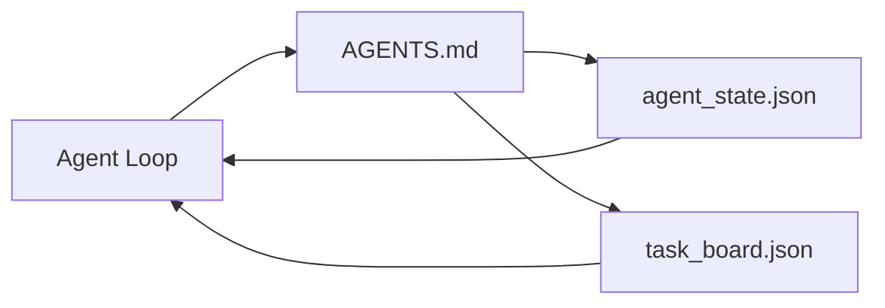

# 최소 에이전트 작업 테이블

> 가장 작은 유용한 작업 테이블은 3개의 파일입니다. 루트 명령어 라우터, 상태 파일, 작업 게시판. 다른 모든 것은 위에 층화되어 있습니다. 레포가 이 세 가지를 휴대할 수 없다면, 어떤 모델도 저장하지 않습니다.

**Type:** Build
**Languages:** Python (stdlib)
**Prerequisites:** Phase 14 · 31 (Why Capable Models Still Fail)
**Time:** ~45 minutes

## 학습 목표

- 최소 실행 가능한 작업 테이블을 구성하는 세 파일을 정의하십시오.
- 왜 짧은 루트 라우터가 긴 모놀리틱 라우터를 이길 지 설명해 주세요`AGENTS.md`- 그래
- 에이전트가 모든 턴에서 읽을 수 있는 상태 파일을 만들고 마지막에 쓸 수 있습니다.
- 채팅 역사 없이 멀티 세션 작업을 유지할 수 있는 작업 게시판을 만들 수 있습니다.

## 문제

대부분의 팀은 3000 줄을 작성함으로써 작업 테이블을 찾습니다 `AGENTS.md`모델은 그것을 로드하고, 요약할 수 없는 부분을 무시하고, 항상 실패한 표면과 같은 표면에서 실패합니다.

반대편이 필요합니다. 에이전트를 더 깊은 파일로 로우트하는 작은 루트 파일. 에이전트가 행동하기 전에 읽고 다음으로 작성하는 내구성 상태. 비행에 있는 것이 무엇인지, 차단된 것이 무엇인지, 다음으로 무엇이 있는지 말하는 작업 게시판.

3개의 파일, 각각의 작업이 있고, 각각의 파일은 기계적으로 읽을 수 있을 만큼, 나중에 실제 시스템으로 진화할 수 있을 만큼

## 개념



### AGENTS.md는 라우터이고 매뉴얼이 아닙니다

좋은 `AGENTS.md`짧은 글자입니다.

- 국가 파일 (당신이 있는 곳)
- 작업 게시판 (무엇이 남아있는지)
- 더 깊은 규칙 (`docs/agent-rules.md`)
- 검증 명령 (어떻게 작동하는지 알 수 있습니다).

더 긴 것은 더 깊은 문서에 들어가서 필요한 경우에만 로드됩니다. 긴 매뉴얼은 무시됩니다. 짧은 라우터들은 따라집니다.

### agent_state.json는 기록 시스템입니다

상태는: 활성 작업 아이디, 접촉된 파일, 가정, 차단기 및 다음 동작을 포함합니다. 에이전트는 매 번마다 읽습니다. 다음 세션에서는 채팅을 재생하는 대신 읽습니다.

주체는 채팅 기록이 신뢰할 수 없기 때문에 파일에 살고 있습니다. 세션이 죽습니다. 대화는 단축됩니다. 파일은 그렇지 않습니다.

### task_board.json는 줄을

작업 게시판은 모든 작업을 상태와 함께 수행합니다 `todo | in_progress | done | blocked`- 에이전트가 빈 상태에서 는 줄을, 그리고 에이전트가 궤도에 있는지 알고 싶을 때 읽은 줄을.

보드에서 작업이 있는 것은 아이디, 목표, 소유자 (`builder``reviewer`또는`human`), 그리고 수용 기준. 보드는 의도적으로 작습니다. 화면을 넘어 성장하면, 당신은 계획 문제, 보드 문제가 아닙니다.

### 세 파일이 바닥이고 천장이 아닙니다

나중에 수업에 범위 계약, 피드백 러너, 확인 게이트, 리뷰어 체크리스트, 그리고 전달 패키지가 추가됩니다. 여기 세 파일이 모두 가정합니다.

```figure
wb-three-files
```

## 건설 해

`code/main.py`최소 작업 테이블을 빈 repo로 작성하고 하나의 에이전트가 이렇게 전환하는 것을 보여줍니다:

1. 읽는다`agent_state.json`- 그래
2. 다음 작업을 에서 끌어내죠`task_board.json`만약 상태가 빈 상태라면
3. 범위 내에서 한 개의 파일을 만집니다.
4. 업데이트된 상태로 다시 작성합니다.

실행하세요:

```
python3 code/main.py
```

시나리오는`workdir/`3개의 파일을 그 옆에 두고 1회 회전하고 그 차이를 인쇄하고 2회 회전이 1회 회전에서 멈추는 것을 다시 회전합니다.

## 사용 하 고

생산물 대리품의 내부에는 동일한 3개의 파일들이 다른 이름으로 표시됩니다.

- **Claude Code:** `AGENTS.md`또는`CLAUDE.md`라우터에 대해`.claude/state.json`-국가용 매장, 이사회용 
- **Codex / Cursor:**라우터 작업 공간 규칙, 상태 세션 메모리, 게시판의 채팅 사이드바에서 줄을 잇는 작업
- **Custom Python agent:**방금 작성한 파일 같은 것

이름이 바뀌지만 형태는 변하지 않습니다.

## 야생에서의 생산 패턴

최소 작업 테이블은 실제 모노레포와 접촉을 유지하는데, 그 위에 세 개의 패턴이 층 위에 놓여 있다.

**Nested `AGENTS.md` with nearest-wins precedence.**오프나이 해박 88 `AGENTS.md`코덱스, 커서, 클로드 코드, 코피로트 모두 작업 파일에서 레포 루트에 걸어`AGENTS.md`이 파일은 루트 파일의 확장입니다. 코덱스는 추가합니다.`AGENTS.override.md`확장보다는 대체할 수 있도록 하기 위한 것; 과장 메커니즘은 코덱스 특이하고, 크로스 도구 작업에서 피하기 위한 것.`AGENTS.md`파일들은 하이쿠에서 오푸스로 업그레이드하는 것과 동등한 품질 점프를 제공합니다. 최악의 파일들은 전혀 파일이 없는 것보다 더 나쁜 결과를 만듭니다.

**Anti-patterns to refuse, even when they look like coverage.**충돌하는 명령어들은 상호작용적인 모드에서 탐욕적인 모드로 (ICLR 2026 AMBIG-SWE: 48.8% → 28% 해상률) 를 조용히 떨어뜨립니다. 검증되지 않는 스타일 규칙 ("Google 파이썬 스타일 가이드에 따라") 집행 명령 없이 에이전트가 컴플라이언스를 발명하도록 허용합니다. 모든 스타일 규칙과 정확한 lint 명령과 결합합니다. 명령 대신 스타일을 사용해서 선두가 되면 검증 경로가 묻어집니다. 명령이 먼저, 스타일은 마지막입니다. 에이전트 대신 사람을 위해 쓰는 것은 컨텍스트 예산을 낭비합니다. 간결함은 특징입니다.

**Cross-tool symlinks.**시뮬레이션 링크를 가진 단일 루트 파일 (`ln -s AGENTS.md CLAUDE.md``ln -s AGENTS.md .github/copilot-instructions.md``ln -s AGENTS.md .cursorrules`) 는 모든 코딩 에이전트를 같은 진실의 원천에 보관합니다.`nx ai-setup`클로드 코드, 커서, 코피로트, 트메니, 코덱스, 오픈코드에서 자동화합니다.

## 선박

`outputs/skill-minimal-workbench.md`새로운 repo를 위한 3 파일 작업 테이블을 생성합니다:`AGENTS.md`로우터가 프로젝트에 맞춰져 있고,`agent_state.json`올바른 키와 함께, 그리고`task_board.json`현재 부진한

## 운동

1. `last_run`시간표`agent_state.json`. 운영자가 확인하지 않는 한 파일의 나이 24시간 이상이면 실행을 거부합니다.
2. `priority`작업판에 필드를 입력하고 항상 가장 높은 우선 순위를 선택하도록 `todo`- 그래
3. 이주하라`task_board.json`JSON 라인으로 각 작업은 라인이고, 디프스는 버전 제어에서 깨끗합니다.
4. 글씨를 써`lint_workbench.py`실패하면`AGENTS.md`80 줄 이상이나 존재하지 않는 파일에 참조합니다.
5. 3개의 파일 중 어느 파일이 가장 큰 피해를 입을지 결정하고 방어해

## 주요 용어

| Term | What people say | What it actually means |
|------|----------------|------------------------|
| Router | `AGENTS.md` | Short root file that points the agent at deeper docs and files |
| State file | "The notes" | Machine-readable record of where the agent is, written every turn |
| Task board | "The backlog" | JSON queue of work with status, owner, acceptance |
| System of record | "Source of truth" | The file the workbench treats as authoritative when chat is gone |

## 더 많은 읽기

- [agents.md — the open spec](https://agents.md/) Cursor, Codex, Claude Code, Copilot, Gemini, OpenCode에서 채택
- [Augment Code, A good AGENTS.md is a model upgrade. A bad one is worse than no docs at all](https://www.augmentcode.com/blog/how-to-write-good-agents-dot-md-files) 측정된 품질 점프
- [Blake Crosley, AGENTS.md Patterns: What Actually Changes Agent Behavior](https://blakecrosley.com/blog/agents-md-patterns) 경험적으로 작동하는 것, 그렇지 않은 것
- [Datadog Frontend, Steering AI Agents in Monorepos with AGENTS.md](https://dev.to/datadog-frontend-dev/steering-ai-agents-in-monorepos-with-agentsmd-13g0) 실무에서 가장 우선순위가
- [Nx Blog, Teach Your AI Agent How to Work in a Monorepo](https://nx.dev/blog/nx-ai-agent-skills) 6개의 도구에서 단일 소스 생성
- [The Prompt Shelf, AGENTS.md Best Practices: Structure, Scope, and Real Examples](https://thepromptshelf.dev/blog/agents-md-best-practices/) 검토를 이겨낼 수 있는 섹션
- [Anthropic, Claude Code subagents](https://code.claude.com/docs/en/sub-agents)
- 단계 14 · 31  이 최소 흡수 장애 모드
- 단계 14 · 34  이 수업의 내구성 상태 스케마
