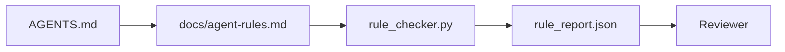

# 요원 명령은 실행 가능한 제한으로

> 시로 작성된 지침은 소망입니다. 제한으로 작성된 지침은 시험입니다. 작업 테이블은 모든 규칙을 실행 시간에 에이전트가 확인할 수 있는 것으로 만들고 재검토자가 사실을 확인 할 수 있습니다.

**Type:** Build
**Languages:** Python (stdlib)
**Prerequisites:** Phase 14 · 32 (Minimal Workbench)
**Time:** ~50 minutes

## 학습 목표

- 운영 규칙과 로우팅 프로즈를 분리한다.
- 정식 시작 규칙, 금지된 행동, 완료 된 정의, 불확실성 처리 및 승인 경계는 기계 검증 가능한 제한 사항으로 명시됩니다.
- 규칙 세트를 상대로 실행을 하는 규칙 검사를 실행합니다.
- 규칙 세트를 서로 친화적으로 만들어서 리뷰가 변경된 것을 볼 수 있습니다.

## 문제

전형적인`AGENTS.md`3일 후, 에이전트는 테스트 없이 변경서를 보내서 금지된 디렉토리에 글을 쓰고, 그 줄을 알 수 없기 때문에 묻지 않습니다.

명령은 실행적이면 강력하고, 희망적이면 약합니다. 작업 테이블이 해석할 수 있고 평가가 점수를 얻을 수 있는 규칙을 작성하는 것이 해결입니다.

## 개념

규칙은`docs/agent-rules.md`각 규칙은 이름, 카테고리, 체크가 있습니다.



### 대부분의 규칙을 포함하는 다섯 가지 범주

| Category | Question the rule answers | Example |
|----------|---------------------------|---------|
| Startup | What must be true before work begins? | "state file exists and is fresh" |
| Forbidden | What must never happen? | "do not edit `scripts/release.sh`" |
| Definition of done | What proves the task is complete? | "pytest exits 0 and acceptance line passes" |
| Uncertainty | What does the agent do when unsure? | "open a question note instead of guessing" |
| Approval | What requires human approval? | "any new dependency, any prod write" |

이 다섯 가지 규칙 중 하나에 맞지 않는 규칙은 보통 두 가지 규칙이 되고 싶어합니다.

### 규칙은 기계로 읽을 수 있습니다

각 규칙에는 총알, 카테고리, 일 줄의 설명, 그리고 `check` 함수의 이름을 붙인 필드`rule_checker.py`규칙이 추가되는 것은 체크를 추가하는 것을 의미합니다. 체크는 작업 테이블과 함께 성장합니다.

### 규칙은 다양합니다

규칙은 하나의 마크다운 파일에서 각 제목에 하나씩 생깁니다. 명칭은 디프스에 표시됩니다. 새로운 규칙은 그 카테고리의 상단에 위치합니다. 기존 규칙은 삭제되며 댓글이 나오지 않습니다. 왜냐하면 작업 테이블이 지난 분기에 팀의 느낌에 대한 채팅 로그가 아닌 진실의 원천이기 때문입니다.

### 규칙과 프레임워크 보호막

프레임워크 경비 (OpenAI Agents SDK 경비, LangGraph 인터럽트) 는 실행 시간 수준에서 규칙을 집행합니다. 이 수업에서 설정된 규칙은 인간으로 읽을 수 있고 검토 할 수 있는 계약입니다. 당신은 둘 다 필요합니다. 실행 시간은 회전 중에 위반을 잡습니다. 규칙 집합은 실행 시간이 올바른 일을 수행한다는 것을 증명합니다.

### 점진적 인 공개: 지도, 백과사전 아닙니다

그 이유는`AGENTS.md`모든 사건은 규칙을 추가하고 어떤 사건도 하나를 제거하지 않습니다. 한 해 후에 파일은 두 천 줄이고, 에이전트는 첫 번째 화면을 읽고, 주의 예산이 부족하고, 알려졌던 것의 일부에 따라 행동합니다. 거대한 명령 파일은 40 페이지의 내장 문서가 실패하는 것과 같은 이유로 실패합니다. 독자는 한 번 스크린을 해보고 중요했던 부분에 다시 돌아오지 않습니다.

수정은 더 짧은 파일이 아닙니다. 그것은 계층형입니다. 루트 라우터는 모든 세션을 읽을 만큼 작고 포인터를 제외하고는 아무것도 보관하지 않습니다. 깊이는 에이전트가 작업이 닿을 때만 로드하는 주제 파일에서 살고 있습니다. 에이전트에 전체 백과사전을 아닌 지도를 제공하여 필요한 페이지로 걸어갈 수 있습니다.

```
AGENTS.md                  # router, < 50 lines: what this repo is, where to look, the 5 hard rules
docs/
  agent-rules.md           # the full rule set (this lesson)
  architecture.md          # loaded when the task touches module boundaries
  testing.md               # loaded when the task writes or runs tests
  deploy.md                # loaded only for release work, gated behind an approval rule
feature_list.json          # the backlog (Phase 14 · 36)
```

| Tier | Lives in | Read when | Size budget |
|------|----------|-----------|-------------|
| Router | `AGENTS.md` | Every session, always | Under ~50 lines |
| Rules | `docs/agent-rules.md` | Every session, on startup | One screen per category |
| Topic docs | `docs/<topic>.md` | Only when the task touches that topic | As deep as needed |

두 가지 테스트로 레이어링이 정직하게 유지됩니다. 접근성 테스트: 에이전트는 라우터에서 최대 두 번 도약하는 동안 어떤 규칙에 도달해야하므로 라우터는 모든 주제 문서를 경로로 연결해야 하며, 시로 설명하지 않습니다. 신선성 테스트: 라우터는 충분히 짧아서 평론가들은 모든 PR에 다시 읽어보죠. 이것이 유일하게 그 백과사전으로 다시 다시 성장하는 것을 막는 것입니다. 더 이상 해결되지 않는 포인터는 결실된 규칙보다 더 나쁜 실패입니다. 따라서 라우터의 갱신 링크는 자체적으로 시작 확인 위반입니다.

```figure
wb-rule-checkoff
```

## 건설 해

`code/main.py`배:

- `agent-rules.md`데이터 클래스에 규칙을 로드하는 파서
- `rule_checker.py`스타일 체크커 기능, 1 개`check`참고
- 두 가지 규칙을 위반한 데모 에이전트와 그들을 잡은 체크 패스

실행하세요:

```
python3 code/main.py
```

출력: 분석 규칙 집합, 실행 추적, 규칙별 통과/실패, 그리고 `rule_report.json`스크립트 옆에 저장된

## 야생에서의 생산 패턴

세 가지 패턴이 1주 안에 붕괴되는 규칙과 1/4의 규칙을 분리합니다.

**Severity tagging at write time.**모든 규칙은`severity`이 책:`block``warn`또는`info`검사는 세 가지 모두 보고합니다. 실행 시간은 단지 거절합니다.`block`대부분의 팀들은 초기에 심각성을 과장하고, 그 다음에는 제한시간 압력으로 조용히 약화합니다. 작성 시점에 태그링을 하는 것은 기계를 앞쪽으로 밀어넣습니다. 검증 게이트 (단계 14 · 38) 와 결합하여, 이는 어떤 과장도`block``overrides.jsonl`감사 기록

**Rule expiry as a forcing function.**모든 규칙에는`expires_at`기 (작기 90일 후 기본)  검증기 는 유효기간이 미치지 않은 규칙이 60일 연속으로 침해되지 않은 경우 경고를 발급합니다. 다음 분기 검토는 그 규칙이 유지되는 것을 정당화하거나 약화시키는 경우`info`클라우드플레어의 생산 AI 코드 리뷰 데이터 (2026년 4월, 131,246 개 리뷰가 30일 동안 5,169개의 레포를 통해 실행되었다) 는 명시적인 만료로 된 규칙 세트가 레포당 30개의 규칙 아래 유지되었음을 보여주었습니다.

**Markdown-as-source, JSON-as-cache.** `agent-rules.md`저작자 파일입니다. `agent-rules.lock.json`은 이 이 이 이 이 이 이 이 이 이 이 이 이 이 이 이 이 이 이 이 이 이 이 이 이 이 이 이 이 이 이 이 이 이 이 이 이 이 이 이 이 이 이 이 이 이 이 이 이 이 이 이 이 이 이 이 이 이 이 이 이 이 이 이 이 이 이 이 이 이 이 이 이 이 이 이 이 이 이 이 이 이 이 이 이 이 이 이 이 이 이 이 이 이 이 이 이 이 이 이 이 이 `package.json`- `package-lock.json`그리고`Cargo.toml`- `Cargo.lock`- 그래

## 사용 하 고

생산:

- 클로드 코드, 코덱스, 커서, 세션 시작에 규칙들을 읽고, 거부하는 행동을 인용합니다. 검사는 CI에서 다시 실행합니다.
- OpenAI Agents SDK 경비선들은 입력 및 출력 경비선과 동일한 검사를 기록한다. 마크다운은 문서 표면이며 SDK는 실행 시간 표면이다.
- 랭그라프는 비행 중 노드가 규칙을 위반할 때 불을 끊습니다. 인터럽트 핸들러는 규칙을 읽고, 인간에게 묻고 다시 시작합니다.

규칙 집합은 세 가지 모두 휴대하기 때문에 그것은 단지 표시와 함수 이름입니다.

## 선박

`outputs/skill-rule-set-builder.md`프로젝트 소유자를 인터뷰하고, 기존의 시사 지침을 다섯 가지로 분류하고,`agent-rules.md`그리고 체크인 톱니

## 운동

1. 만약 제품 이 정말 필요하다면 여섯 번째 범주를 추가 하고, 그 범위를 5가지 범주에 포함하지 않는 이유 를 설명 하십시오.
2. 검사를 확장하여 규칙이 심각성을 가질 수 있도록 (`block``warn``info`) 를 작성하고 그 결과 보고서를 합쳐놓는다.
3. CI에 체크커를 연결: 최신 에이전트 실행에서 블록 중성 규칙이 실패하면 빌드 실패.
4. 규칙마다 "Expiry" 필드를 추가합니다. 체크 실패 없이 90일 후에 규칙은 검토됩니다.
5. 진짜를 찾아`AGENTS.md`5가지 규칙으로 다시 써야 합니다. 그 중 몇 줄이 작동했나요?

## 주요 용어

| Term | What people say | What it actually means |
|------|----------------|------------------------|
| Operational rule | "A real instruction" | A rule the workbench can check at runtime |
| Aspirational rule | "Be careful" | A rule with no check; either delete or upgrade |
| Definition of done | "Acceptance" | An objective, file-backed proof the task is complete |
| Block severity | "Hard rule" | Violation halts the run; cannot be silenced without an operator |
| Rule expiry | "Stale rule sweep" | A rule with no fails in N days is up for retirement |

## 더 많은 읽기

- [OpenAI Agents SDK guardrails](https://openai.github.io/openai-agents-python/guardrails/)
- [LangGraph interrupts](https://langchain-ai.github.io/langgraph/how-tos/human_in_the_loop/breakpoints/)
- [Anthropic, Building Effective Agents](https://www.anthropic.com/research/building-effective-agents)
- [Rick Hightower, Agent RuleZ: A Deterministic Policy Engine](https://medium.com/@richardhightower/agent-rulez-a-deterministic-policy-engine-for-ai-coding-agents-9489e0561edf) 생산 중의 차단/주의/정보 심각성
- [Cloudflare, Orchestrating AI Code Review at Scale](https://blog.cloudflare.com/ai-code-review/) 131k 개회, 규칙 구성 수업
- [microservices.io, GenAI development platform — part 1: guardrails](https://microservices.io/post/architecture/2026/03/09/genai-development-platform-part-1-development-guardrails.html) 규칙과 CI 사이의 깊이 있는 방어
- [Type-Checked Compliance: Deterministic Guardrails (arXiv 2604.01483)](https://arxiv.org/pdf/2604.01483) 규칙과 같은 체크의 상위 경계로 4을 기울여
- [logi-cmd/agent-guardrails](https://github.com/logi-cmd/agent-guardrails) 융합 게이트 시행: 범위, 돌연변이 테스트, 위반 예산
- 단계 14 · 32  이 규칙 집합에서 최소 작업 테이블이
- 단계 14 · 38  규칙 보고서를 소비하는 검증 게이트
- 단계 14 · 39  규칙 준수 점수를 받는 검토자
