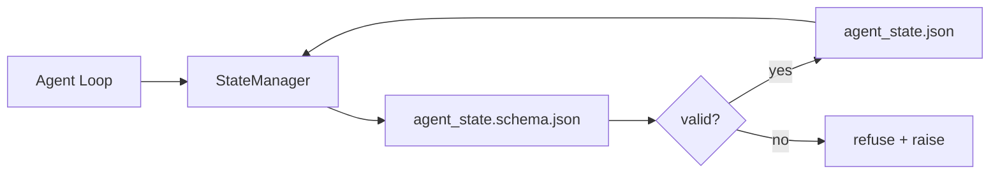

# 레포 메모리 및 내구성 상태

> 채팅 역사는 변동적입니다. 레포는 내구성이 있습니다. 작업 테이블 스토어 에이전트는 버전 파일에서 표시되어 있습니다. 따라서 다음 세션, 다음 에이전트, 다음 리뷰어는 모두 같은 진실의 출처에서 읽습니다.

**Type:** Build
**Languages:** Python (stdlib + `jsonschema` optional)
**Prerequisites:** Phase 14 · 32 (Minimal Workbench)
**Time:** ~60 minutes

## 학습 목표

- 레포 메모리에 무엇이 있고 채팅 역사에 무엇이 있는지 정의하십시오.
- 저자 JSON 스키마 `agent_state.json`그리고`task_board.json`- 그래
- 국가 관리자를 만들어서 정권을 원자적으로 로드하고 검증하고 돌연변이를 하고 유지합니다.
- 셰마를 사용하여 워크뱅크를 손상시키지 전에 나쁜 글쓰기를 거부하십시오.

## 문제

에이전트는 세션을 끝내고 채팅이 종료됩니다. 다음 세션이 열리고 어디서 시작해야 하는지 묻습니다. 모델은 "파일을 확인해 보도록 해"라고 말합니다. 노후한 메모를 읽고 이미 완료된 작업을 다시 합니다. 또는 더 나쁜 것은 아무도 파일을 완료했다고 말하지 않았기 때문에 완성된 파일을 다시 작성합니다.

작업 벤치 수정은 레포 메모리입니다. 레포에 있는 JSON 파일에서 상태가 생기고, 스케마에 의해 작성되어, 원자적으로 지속되고, 코드 검토에서 차별화 친화적입니다. 채팅은 일시적인 피드입니다. 레포는 기록 시스템입니다.

## 개념



### 레포 메모리에 있는 것이

| Belongs | Does not belong |
|---------|-----------------|
| Active task id | Raw chat transcripts |
| Touched files this session | Token-level reasoning traces |
| Assumptions the agent made | "The user seemed frustrated" |
| Open blockers | Sampled completions |
| Next action | Vendor-specific model ids |

테스트는 내구성입니다. 이 테스트는 3개월 후 CI 재개에서 유용할까요?

### 제1차 국가

JSON 스키마는 계약입니다. 그 없이는 모든 에이전트가 새로운 필드를 발명하고, 모든 리뷰어는 새로운 형태를 배우고, 모든 CI 스크립트는 이전 버전을 특별 케이스로 해야 합니다.

이 스케마는 다음과 같은 내용을 포함합니다.

- 필요한 열쇠
- 허용됩니다`status`가치관
- 금지된 값 (예를 들어 `null`배열에 대한
- 패턴 제한 (사업 ID가 일치합니다 `T-\d{3,}`)
- 마이그레이션 버전 필드

### 아토미크는

국가 기록은 부분적 실패를 극복해야 합니다. 임시 파일, fsync, 목표 상의 이름을 변경합니다. 국가 파일은 진실의 원천입니다. 반 작성 된 파일은 전혀 파일보다 더 나쁘습니다.

### 이주

스키마 변경되면 스키마 붐 옆에 마이그레이션 스크립트를 전송합니다. 상태 파일에는 `schema_version`필드; 관리자는 마이그레이션할 수 없는 버전에서 파일을 로드하는 것을 거부합니다.

```figure
wb-state-persist
```

## 건설 해

`code/main.py`이 도구는

- `agent_state.schema.json`그리고`task_board.schema.json`- 그래
- stdlib만 유효성 검증기 (JSON 스케마의 하위 집합: 요구, 타입, enum, 패턴, 항목)
- `StateManager.load``StateManager.update``StateManager.commit`원자력 템프 앤 리니메이션으로 쓰여진
- 변신 상태, 지속, 재충전, 그리고 반여행 증명하는 데

실행하세요:

```
python3 code/main.py
```

시나리오가 이렇게 써요`workdir/agent_state.json`그리고`workdir/task_board.json`, 두 차례 돌고 돌고, 각 단계에 검증된 상태를 인쇄합니다.

## 야생에서의 생산 패턴

네 가지 패턴은 수업의 최소량을 다중 요원 모노레포가 생존할 수 있는 것으로 만듭니다.

**Atomic temp-and-rename is not optional.**2026년 3월 Hive 프로젝트 버그 보고서는 실패 모드를 깨끗하게 기록합니다.`state.json``write_text()`이 모든 문제들은 모두 해결되고 있습니다.`tempfile.mkstemp`목표와 같은 디렉토리에,`fsync``os.replace`(포시크스와 윈도우에서 원자적 명칭 변경) 이 수업은`atomic_write`바로 그렇게 하는 거죠.

**Idempotency keys on every non-idempotent tool call.**도구 호출 후 에이전트가 충돌하지만 결과를 체크포인트하기 전에 복구 작업은 도구 호출을 다시 시도합니다. 읽기 안전; 이메일, DB 삽입, 파일 업로드에 위험합니다. 패턴: 실행 전에 모든 도구 호출 ID를 로그`pending_calls.jsonl`. 재시험 시 ID를 확인하고, 만약 존재한다면, 호출을 건너뛰고 캐시된 결과를 사용하십시오. 앤트로픽과 랭체인은 모두 2026 지침에서 이것을 호출합니다. 랭그그래프의 체크포인터는 같은 이유로 기록을 기다리고 있습니다.

**Separate large artifacts from state.**CSV, 긴 기록, 또는 생성된 파일을 저장하지 마십시오.`agent_state.json`. 유물을 별도의 파일로 저장 (또는 객체 저장소에 업로드) 하고, 경로를만 상태에서 유지하십시오. 체크포인트는 작고 빠르게 유지됩니다. 유물은 독립적으로 성장합니다.

**Event sourcing for audit, snapshots for resume.**이벤트 로그에 첨부 (`state.events.jsonl`) 각 돌연변이에 대한 주기적으로`state.json`. 재개는 스냅샷을 읽고, 스냅샷의 시간표 이후의 모든 이벤트를 재생합니다. 이것은 더 많은 디스크가 소요되지만 WAL에서 사용하는 동일한 모양입니다.

**Schema migrations or refuse to load.**`schema_version`정수값은 계약입니다. 관리자가 알려지지 않은 버전으로 파일을 로드하면 읽기를 거부합니다. 스키마 붐 옆에 마이그레이션 스크립트를 보내십시오.`tools/migrate_state.py`모든 스타트업에서 무력하게 실행됩니다.

## 사용 하 고

생산:

- **LangGraph checkpointers.**같은 아이디어, 다른 저장. 체크포인터는 SQLite, Postgres 또는 사용자 지정 백엔드에 그래프 상태를 유지합니다. 이 수업에서 가르치는 스케마는 체크포인터가 죽으면 도달하는 것이므로 상태를 손으로 읽어야합니다.
- **Letta memory blocks.**구조화된 계획 (단계 14 · 08) 을 가진 지속적인 블록.
- **OpenAI Agents SDK session store.**플러그 할 수 있는 백엔드, 스키마 인식이 가능 이 수업의 상태 파일은 로컬 파일 백엔드입니다

## 선박

`outputs/skill-state-schema.md`프로젝트 특수한 JSON 스키마 쌍 (국립 + 게시판) 을 생성합니다.`StateManager`원자력 글과 마이그레이션 스카프도 연결해서 다음 스케마 붐이 작업 테이블을 깨지 않도록

## 운동

1. `last_human_touch`인간 편집 후 5초 이내에 기사를 거부합니다.
2. 확정기를 지원하도록 확장합니다 `oneOf`따라서 작업은 다른 필드와 함께 구성 작업 또는 검토 작업이 될 수 있습니다.
3. `schema_version`필드 및 v1에서 v2로 이동을 작성 (신명 `blockers` `risks`)
4. 로컬 파일에서 SQLite로 저장 백엔드를 이동합니다.`StateManager`API가 동일합니다.
5. 50mms의 기록 경력을 가지고 같은 주파수에 대해 두 명의 에이전트를 실행하세요.

## 주요 용어

| Term | What people say | What it actually means |
|------|----------------|------------------------|
| Repo memory | "Notes file" | State stored in tracked files in the repo, under schema |
| Schema-first | "Validate inputs" | Define the contract before the writer, refuse drift |
| Atomic write | "Just rename" | Write to temp, fsync, rename, so partial failures cannot corrupt |
| Migration | "Schema bump" | A script that turns vN state into v(N+1) state |
| System of record | "Source of truth" | The artifact the workbench treats as authoritative |

## 더 많은 읽기

- [JSON Schema specification](https://json-schema.org/specification.html)
- [LangGraph checkpointers](https://langchain-ai.github.io/langgraph/concepts/persistence/)
- [Letta memory blocks](https://docs.letta.com/v1-sdk/memory/memory-blocks)
- [Fast.io, AI Agent State Checkpointing: A Practical Guide](https://fast.io/resources/ai-agent-state-checkpointing/) 무력으로 스케마-첫 번째 체크포인팅
- [Fast.io, AI Agent Workflow State Persistence: Best Practices 2026](https://fast.io/resources/ai-agent-workflow-state-persistence/) 동시 제어, TTL, 이벤트 소싱
- [Hive Issue #6263 — non-atomic state.json writes silently ignored](https://github.com/aden-hive/hive/issues/6263) 실제 프로젝트에서 실패 모드
- [eunomia, Checkpoint/Restore Systems: Evolution, Techniques, Applications](https://eunomia.dev/blog/2025/05/11/checkpointrestore-systems-evolution-techniques-and-applications-in-ai-agents/) 대리인에 적용된 OS 역사에서 CR 원시물
- [Indium, 7 State Persistence Strategies for Long-Running AI Agents in 2026](https://www.indium.tech/blog/7-state-persistence-strategies-ai-agents-2026/)
- [Microsoft Agent Framework, Compaction](https://learn.microsoft.com/en-us/agent-framework/agents/conversations/compaction) 판매자 체크포인트 관리자
- 단계 14 · 08  메모리 블록 및 잠 시간 계산
- 단계 14 · 32  이 수업은 세 파일 최소의 스케마를
- 단계 14 · 40  같은 스케마에서 읽은 전달 패키지
