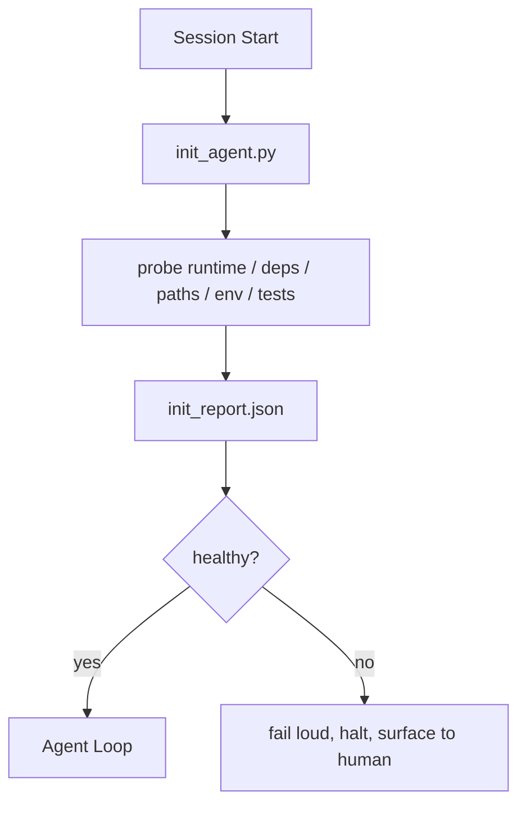

# 에이전트들을 위한 초기화 스크립트

> 냉각으로 시작하는 모든 세션은 세금을 지불합니다. 에이전트는 동일한 파일을 읽고, 동일한 탐사선을 다시 시도하고, 동일한 경로를 다시 발견합니다. init 스크립트는 세금을 한 번 지불하고, 답을 국가로 작성합니다.

**Type:** Build
**Languages:** Python (stdlib)
**Prerequisites:** Phase 14 · 32 (Minimal Workbench), Phase 14 · 34 (Repo Memory)
**Time:** ~45 minutes

## 학습 목표

- 에이전트가 한 세션에 한 번도 해야 할 일이 없도록 확인해 주세요.
- 실행시간, 의존성 및 repo 건강을 탐구하는 결정적 init 스크립트를 구축하십시오.
- 탐사 결과를 계속해 주시기 바랍니다. 그래서 에이전트가 다시 검사하는 대신 읽습니다.
- 고소하고 빠르게 실패하고 초기화가 실패할 때 한 곳을 찾아보세요.

## 문제

세션을 열기. 에이전트는 파이썬 버전을 추측합니다. 테스트 명령을 추측합니다. 입점점을 찾기 위해 레포 루트를 5 번 나열합니다. 설치되지 않은 패키지를 수입하려고합니다. 사용자에게 구성 파일의 주거지를 묻습니다. 실제 편집을 할 때, 10천 개의 토큰이 단일 스크립트로 작동해야 할 세팅 작업에 갔습니다.

수정 방법은 에이전트가 다른 일을 하기 전에 실행되는 초기화 스크립트입니다`init_report.json`에이전트가 시작 시에 읽습니다.

## 개념



### init 스크립트가 무엇을 탐구하는지

| Probe | Why it matters |
|-------|----------------|
| Runtime versions | Wrong Python or Node version means silent wrong-version bugs |
| Dependency availability | A missing package later costs ten times the cost of catching it now |
| Test command | The agent must know how to verify; if the command is missing the workbench is broken |
| Repo paths | Hard-coded paths drift; resolve them once and pin |
| Environment variables | Missing `OPENAI_API_KEY` is a failure surface, not a runtime mystery |
| State + board freshness | Stale state from a crashed session is a footgun |
| Last-known-good commit | Anchor for the handoff diff at the end of the session |

### 고소로 실패하고 빨리 실패하고 한 곳에서 실패

탐사선 실패는 인간에게 멈춰서 표면을 돌리는 것을 의미합니다. "공사원이 알아낼 것"은 아닙니다.

### 무력

2회 연속 실행하세요. 두 번째 실행은 새로운 시간표를 제외하고는 무작위 작업이어야 합니다. 이더멘토니스는 스크립트를 CI, 해크 또는 작업 전 슬래시 명령으로 연결할 수 있게 해줍니다.

### 초기 및 시작 규칙

규칙 (단계 14 · 33) 은 행동 하기 위해 무엇이 진실해야 하는지를 설명한다. 이니트는 그 규칙들을 확인할 수 있다는 것을 확립하는 스크립트이다. 이니트 없는 규칙은 "주의하라". 이니트 없는 규칙은 가벼운 실패가 된다.

```figure
wb-init-probes
```

## 건설 해

`code/main.py`실행 `init_agent.py`이 부분의 본문은

- 다섯 개의 탐사: 파이썬 버전, `importlib.util.find_spec`, 테스트 명령 해결성, 필요한 환경, 상태 파일 신선함
- 모든 탐사선이 돌아옵니다`(name, status, detail)`- 그래
- 시나리오가 이렇게 써요`init_report.json`전체 탐사선 설정되어 있고 블록 중성 탐사선 실패하면 0이 아닌 출력입니다.

실행하세요:

```
python3 code/main.py
```

스크립트는 탐사 테이블을 인쇄하고,`init_report.json`, 그리고 행복 경로에서 0을 떠나거나 실패한 탐사선 목록으로 0을 넘어서게 됩니다.

## 야생에서의 생산 패턴

유용한 init 스크립트를 세 패턴으로 구분하고 의식과 구분합니다.

**Last-known-good commit anchoring.**현재 에 대한 의`LKG`마지막 성공적인 합병에 기록된 파일. 만약 그 차이가 예산을 초과한다면 (전설 50 파일) 시작을 거부하고 새로운 기본선을 승인하도록 요구하십시오. 클라우드플레어의 AI 코드 리뷰는 검토자 에이전트를 범위를 위해 사용하는 것입니다. 모든 검토 세션은 동일한 마지막 알려진 좋은 것에 대해 앵커하고 결코 융합이 세션 간 이동하지 않습니다.

**Lock files with TTL.**글씨를 써`prereqs.lock`첫 번째 성공적인 탐사선 통과 후. 다음 실행은 N 시간 (24h 기본) 동안 잠금을 신뢰하고 비싼 탐사선을 건너뛰습니다. init 스크립트는 잠금을 먼저 읽습니다. 신선하고 의존성 매니스텔 해시와 일치하면 단축 회로입니다. 이것은 Docker이 계층 캐시에 사용하는 것과 같습니다. idempotent probe + content hash = skip.

**No network, no LLM, no surprises in the hot path.**인트 탐사선은 결정적 인 수도원입니다. 실패를 분류하기 위해 LLM를 호출하거나 라이선스를 확인하기 위해 외부 서비스를 타는 탐사선은 탐사선이 아닙니다. 그것은 작업 흐름입니다. 건조 실행에서 탐사선이 3 초 이상 걸리면, 작업 테이블 냄새로 간주하고 init에서 이동하거나 결과를 캐시하십시오.

## 사용 하 고

생산:

- **Claude Code hooks.** `pre-task`은 init 스크립트를 호출하고 실패하면 에이전트를 발사하지 않죠.
- **GitHub Actions.**A`setup-agent`직무는 init 스크립트를 실행하고, 에이전트 직무는 그것에 달려 있습니다.
- **Docker entrypoint.**에이전트 컨테이너는 에이전트 실행 시간을 실행하기 전에 init 스크립트를 실행합니다. 실패에 대한 로그 표면.

init 스크립트는 특정 프레임워크에 호출을 하지 않기 때문에 휴대할 수 있습니다. Bash, Make, 또는 작업 파일 모두 그것을 포장 할 수 있습니다.

## 선박

`outputs/skill-init-script.md`프로젝트 를 인터뷰 하고, 설치 작업 을 탐사 에 분류 하고, 프로젝트 특수한 자료 를 발급 합니다 `init_agent.py`그리고 어떤 요원 단계가 되기 전에 실행되는 CI 작업 흐름이 있습니다.

## 운동

1. 현재 컴백을 마지막 알려진 좋은 컴백과 구별하는 탐사선을 추가하고 50 개 이상의 파일 변경되면 시작을 거부합니다.
2. 스크립트를  문자 `prereqs.lock`파일 및 잠금 기간이 7일 이상이면 시작하지 않음
3. `--fix`버그는 자동으로 부족한 개발 의존성을 설치하지만 승인 없이 실행 시간 의존성을 변경하지 않습니다.
4. 코드된 기능에서 YAML 레지스트리로 탐사선을 이동시켜
5. 탐사선마다 시간 예산을 추가해 보세요. 3초 이상 지속되는 탐사선은 작업 테이블 냄새입니다.

## 주요 용어

| Term | What people say | What it actually means |
|------|----------------|------------------------|
| Probe | "A check" | A deterministic function returning `(name, status, detail)` |
| Init report | "Setup output" | JSON written next to state with the probe results |
| Idempotent | "Safe to re-run" | Two runs in a row produce identical reports modulo timestamp |
| Fail loud | "Don't swallow" | Halt and surface to the human; no silent fallback |
| Setup tax | "Bootstrap cost" | The tokens the agent spends per session rediscovering the obvious |

## 더 많은 읽기

- [Anthropic, Effective harnesses for long-running agents](https://www.anthropic.com/engineering/effective-harnesses-for-long-running-agents)
- [GitHub Actions, composite actions for setup](https://docs.github.com/en/actions/sharing-automations/creating-actions/creating-a-composite-action)
- [microservices.io, GenAI dev platform: guardrails](https://microservices.io/post/architecture/2026/03/09/genai-development-platform-part-1-development-guardrails.html) 사전 약속 + CI 확인
- [Augment Code, How to Build Your AGENTS.md (2026)](https://www.augmentcode.com/guides/how-to-build-agents-md) 초기 기대
- [Codex Blog, Codex CLI Context Compaction](https://codex.danielvaughan.com/2026/03/31/codex-cli-context-compaction-architecture/) 세션 시작은 압축에 대한 인식 init
- 단계 14 · 33  이 스크립트에서 설정된 규칙이 가능하게 합니다
- 단계 14 · 34  이 스크립트 씨앗의 상태 파일
- 단계 14 · 38  확인 게이트 init 스크립트 공급
- 단계 14 · 40  init 보고서의 마지막 알려진 좋은 것을 소비하는 전달
