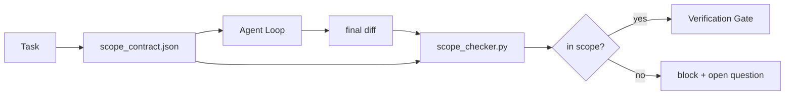

# 계약 범위 및 업무 제한

> 모델은 작업이 어디에 끝나는지 모른다. 범위 계약은 작업이 어디에서 시작되고, 어디서 끝나는지, 그리고 파묻으면 어떻게 돌아가는지를 알려주는 각 작업 파일이다. 계약은 "포지 범위에서 유지하라"라는 소원을 체크로 전환합니다.

**Type:** Build
**Languages:** Python (stdlib)
**Prerequisites:** Phase 14 · 32 (Minimal Workbench), Phase 14 · 33 (Rules as Constraints)
**Time:** ~50 minutes

## 학습 목표

- 작업 시작과 작업 종료에 검증자가 읽은 범위 계약을 작성하십시오.
- 허용된 파일, 금지된 파일, 수용 기준, 반전 계획 및 승인 경계를 지정하십시오.
- 계약에 대한 차이점을 비교하고 위반을 표시하는 범위 검사를 실시합니다.
- 이 보이는, 자동적이고 검토 가능한 범위를 만들어 보세요.

## 문제

에이전트들이 속삭인다. 작업은 " 로그인 버그를 수정 "입니다. 이 디프레스는 로그인 라이트, 이메일 도움말, 데이터베이스 드라이버, README 및 발매 스크립트를 만집니다. 각각의 터치는 현재에 대한 합리적인 이유가 있습니다. 함께 검토 된 것과는 다른 변경입니다.

스카프 크리프는 에이전트 작업에서 가장 잘 감시되지 않는 실패 모드입니다. 에이전트가 모든 단계를 선실하게 설명하기 때문입니다. 수정은 더 엄격한 요청이 아닙니다. 수정은 디스크에 약속된 것을 말하는 계약이며 약속을 비교하는 체크입니다.

## 개념



### 계약의 범위는

| Field | Purpose |
|-------|---------|
| `task_id` | Links to the task on the board |
| `goal` | One sentence the reviewer can verify |
| `allowed_files` | Globs the agent may write |
| `forbidden_files` | Globs the agent must not touch even by accident |
| `acceptance_criteria` | Test commands or assertion lines that prove done |
| `rollback_plan` | One paragraph the operator can execute if a halt is required |
| `approvals_required` | Actions outside scope that need explicit human sign-off |

계약 없이`forbidden_files`음의 공간은 계약의 절반입니다.

### 풍선, 비 원료 경로

실제 리포가 파일을 이동합니다.`app/**/*.py``tests/test_signup*.py`) 즉, 세션 간 재조정으로 계약이 무효가 되지 않습니다.

### 롤백은 범위에 속한다

계약서 작성자 는 어떻게 되돌릴 수 있는지 나열 하는 것 은 계약 작성자 는 어떤 일이 잘못 될 수 있는지 생각 하도록 강요 합니다.

### 범위 검사는 차이 검증입니다

에이전트는 디프리스를 작성합니다. 체크러는 디프리스를 읽고 허용된 골, 금지된 골, 실행된 모든 수용 명령어의 목록을 읽습니다. 각 위반은 검증 게이트가 거부할 수 있는 태그입니다.

### 두 가지 범위 높이는: 특징 목록과 작업 계약

범주 계약은 하나의 작업을 제한합니다. 그것은 프로젝트를 제한하지 않습니다. 에이전트는 로그인 수정 계약을 완벽하게 유지 할 수 있으며, 다음 차례에 프로젝트 또한 설정 페이지, 암흑 모드 전환 및 라우터의 재편이 필요하다고 결정할 수 있습니다. 계약은 프로젝트에 적용되는 작업이 무엇인지 묻지 않았습니다. 작업의 범위에 해당하는 파일만 결정했습니다.

그 두 번째 고도가 자신의 원시적인 것을 필요로 합니다.`feature_list.json`에겐트는 세션 시작에 읽습니다. 그것은 기계적으로 읽을 수 있는 주문된 파일로 프로젝트 백록입니다. 에겐트는 정확히 한 가지 기능을 선택합니다.`status` `todo`, 그의 글을 쓴다`id`"시행 한 기능"은 에이전트가 과거를 합리화 할 수있는 프롬프트에서 선이 되는 것을 중단하고 디스크에서 읽은 값이 되고 게이트가 시행하는 체크입니다.

```json
{
  "project": "knowledge-base",
  "active": "import-pdf",
  "features": [
    { "id": "import-pdf",   "status": "in_progress", "goal": "import a PDF into the library",        "done_when": "pytest tests/test_import.py && a sample PDF appears in the library view" },
    { "id": "full-text-search", "status": "todo",     "goal": "search document text and rank hits",   "done_when": "query returns ranked results with snippets" },
    { "id": "cite-answers", "status": "todo",         "goal": "answers carry source citations",        "done_when": "every answer renders at least one clickable citation" }
  ]
}
```

| Field | Purpose |
|-------|---------|
| `active` | The single feature the current session may touch; empty means pick one and set it |
| `features[].id` | Stable slug the scope contract's `task_id` points at |
| `features[].status` | `todo`, `in_progress`, `done`, `blocked`; only one `in_progress` at a time |
| `features[].goal` | One sentence the reviewer can verify |
| `features[].done_when` | The acceptance line that flips `in_progress` to `done` |

두 가지 규칙으로 목록은 장식적인 것이 아니라 부담을 내세워줍니다. 첫째, 변수 "대부분 1`in_progress`"는 자체적으로 시작 확인 (단계 14 · 33) 이다: 목록에서 두 개의 표시가 있다면, 세션은 인간이 해결하기 전까지는 시작하기를 거부합니다. 둘째, 기능 목록은 채팅 메시지가 아닌 파일입니다. 채팅은 맥락에서 스크롤되며 파일은 세션과 에이전트들 사이에서 지속됩니다. 핸드오프 (단계 14 · 40) 는 완료된 기능의 상태를 다시 에 기록합니다.`done`그래서 다음 세션은 남은 것을 다시 추출하는 대신 정확한 게시판으로 열립니다.

계약과 목록은 최소한의 특권으로 구성되며, 아래와 같이 설명된 동일한 합병입니다.`allowed_files`활성 성분이 닿는 모든 곳에 앉아 있어야 합니다.

```figure
wb-scope-bounce
```

## 건설 해

`code/main.py`이 도구는

- `scope_contract.json`스키마 (JSON 스키마의 하위 집합, glob arrays).
-                                            `RunSummary`- 그래
- A`scope_check`그 결과`(violations, in_scope, off_scope)`계약에 반해
- 두 개의 데모 실행: 한 번은 범위에서 유지되고, 한 번은 경색합니다. 검사는 정확한 파일과 이유를 가지고 경련을 표시합니다.

실행하세요:

```
python3 code/main.py
```

출력: 계약, 두 번의 경주, 한 번의 경주 판결, 그리고 1번의 경주`scope_report.json`- 그래

## 야생에서의 생산 패턴

"스펙스마크싱" (원인을 호출하기 전에 YAML에서 범위를 계약) 을 실행하는 실무자는 원인을 변경하지 않고 3 주 동안 토끼 구멍 비율이 52%에서 21%로 떨어졌다고 보고합니다. 계약은 모델을 수행하지 않았습니다. 세 가지 패턴은 이득을 유지합니다.

**Violation budgets, not binary failures.** `agent-guardrails`(클로드 코드, 커서, 윈드 서프, 코덱스, MCP를 통해 사용되는 OSS 융합 게이트)`violationBudget`과제: 예산 내의 작은 범위 슬라이프가 경고로 표시됩니다. 예산이 초과되면만 통합 게이트가 거부합니다.`violationSeverity: "error" | "warning"`예산은 선박하는 게이트와 그것을 싫어하는 팀에 의해 비활성화되는 게이트의 차이입니다.

**Severity asymmetry by path family.**오프스코프에 글을 쓰다`docs/**`보통은`warn`; 오프 스코프에 글을 쓰다`scripts/**``migrations/**``config/prod/**`항상`block`이 비대칭은 프로젝트 특이해서 작업에 따라 변화하기 때문에 실행시간이 아니라 계약에 따라 살아야 합니다.

**Time and network budgets next to file budgets.**A`time_budget_minutes`이 시계는 벽 시계를 제한하고, 실행 시간은 다시 승인 없이 그 시선을 지나갈 것을 거부합니다.`network_egress`호스트 이름에 있는 allowlist는 에이전트가 작업의 일부 되지 않은 외부 API를 조용히 타격하는 것을 막습니다.

**Multi-contract merge semantics (least privilege).**두 개의 범위 계약이 적용될 때 (예를 들어, 프로젝트 전체 계약과 작업에 대한 계약) 합병은 다음과 같습니다. **intersect** `allowed_files`(제2차 계약은 길을 허용해야 한다)**union** `forbidden_files`(예예할 수도 있습니다)`time_budget_minutes`가장 제한적인 (min)`approvals_required`축적됩니다.`network_egress` `None`집행이 없도록`[]`모든 것을 부정하는 자`[...]`합병 중인`None`다른 쪽으로 이동하면 두 개의 리스트가 교차하고, 모든 것을 부정하는 것은 모든 것을 부정하는 것입니다. 계약 계획에 이것을 명시하여 합병은 기계적이고 검토 할 수 있습니다.

## 사용 하 고

생산 패턴:

- **Claude Code slash commands.**A`/scope`명령은 계약서를 작성하고 세션 컨텍스트로 니다.
- **GitHub PRs.**PR 기관에서 JSON 파일 또는 체크인 된 유물으로 계약을 밀어 넣습니다. CI는 융합 차이에 대한 범위 검사를 실행합니다.
- **LangGraph interrupts.**범위를 위반하면 중단이 발생하고, 관리자는 계약이 성장해야하는지 아니면 에이전트가 물러나야하는지 인간에게 묻습니다.

계약은 작업과 함께 이동합니다. 작업이 종료되면 계약은 아래에서 보관됩니다 `outputs/scope/closed/`- 그래

## 선박

`outputs/skill-scope-contract.md`작업 설명에 대한 범위를 계약하고 모든 대원 차이에 대한 CI에서 실행되는 전 세계 인식 검증기를 생성합니다.

## 운동

1. `network_egress`외부 호스트를 허용한 필드 목록. 다른 호스트에 닿는 실행을 거부합니다.
2.                                                                                                                                                                                                                                                                                                                                                                                                                                                                                                                              `docs/**`그리고 단단히 `scripts/**`비대칭을 정당화해
3. 계약의 파생`allowed_files``goal`정적 규칙 집합을 사용하는 필드 (LLM가 없습니다). 첫 번째 가장자리에 무슨 문제가 있습니까?
4. `time_budget_minutes`벽속이 지나면 계속하지 않죠.
5. 동일한 차이에 대해 두 개의 계약을 실행하십시오. 두 가지가 적용되는 경우 올바른 합성 의미론은 무엇입니까?

## 주요 용어

| Term | What people say | What it actually means |
|------|----------------|------------------------|
| Scope contract | "The task brief" | Per-task JSON listing allowed/forbidden files, acceptance, rollback |
| Scope creep | "It also touched..." | Files outside the contract changed in the same task |
| Rollback plan | "We can revert" | The one-paragraph operator runbook for halting |
| Approval boundary | "Needs sign-off" | An action listed in the contract as requiring explicit human approval |
| Diff check | "Path audit" | Comparing touched files against the contract globs |

## 더 많은 읽기

- [LangGraph human-in-the-loop interrupts](https://langchain-ai.github.io/langgraph/concepts/human_in_the_loop/)
- [OpenAI Agents SDK tool approval policies](https://platform.openai.com/docs/guides/agents-sdk)
- [logi-cmd/agent-guardrails — merge gates and scope validation](https://github.com/logi-cmd/agent-guardrails) 위반 예산, 심각성 수준
- [Dev|Journal, Preventing AI Agent Configuration Drift with Agent Contract Testing](https://earezki.com/ai-news/2026-05-05-i-built-a-tiny-ci-tool-to-keep-ai-agent-configs-from-drifting-in-my-repo/)`--strict`외부 디스플레이 없이 모드
- [Agentic Coding Is Not a Trap (production logs)](https://dev.to/jtorchia/agentic-coding-is-not-a-trap-i-answered-the-viral-hn-post-with-my-own-production-logs-33d9) 스펙 매스킹 영수: 52% → 21%
- [OpenCode permission globs](https://opencode.ai/docs/agents/) 정밀밀지자 면허의 범위
- [Knostic, AI Coding Agent Security: Threat Models and Protection Strategies](https://www.knostic.ai/blog/ai-coding-agent-security) 최저 특권의 일부로 적용 범위
- [Augment Code, AI Spec Template](https://www.augmentcode.com/guides/ai-spec-template) 3단계 경계 시스템 (무엇/무엇)
- 단계 14 · 27   스피드                
- 14단계 · 33  이 계약에 명시된 규칙은 각 작업에 특화된
- 단계 14 · 38  검증 게이트 검사자가 보고를
