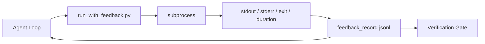

# 실행 시간 피드백 루프

> 실제 명령 출력 추측을 보지 않는 에이전트. 피드백 러너는 stdout, stderr, 출력 코드 및 타이밍을 구조화된 기록으로 캡처합니다. 다음 회전에서 읽을 수 있습니다. 그러면 에이전트는 자신의 사실 예측 대신 사실에 반응합니다.

**Type:** Build
**Languages:** Python (stdlib)
**Prerequisites:** Phase 14 · 32 (Minimal Workbench), Phase 14 · 35 (Init Script)
**Time:** ~50 minutes

## 학습 목표

- 실행 시간 피드백과 관찰 가능한 텔레메트리를 구별한다.
- 셸 명령어를 괄호하고 구조화된 기록을 유지시키는 피드백 런어를 구축하십시오.
- 큰 출력을 결정적으로 줄여서 ループ은 토큰 예산 내에서 유지됩니다.
- 피드백이 없는 경우 루프를 진행하지 않기를 거부합니다.

## 문제

"지금 테스트를 실행한다". 다음 메시지는 "모든 테스트가 통과된다". "실실은 테스트가 실행되지 않았다는 것입니다. 에이전트는 출력을 상상하거나 명령어를 실행하고 결과를 읽지 않거나 결과를 읽으며 침묵으로 실패선을 단축했습니다.

피드백 러너는 그 격차를 제거합니다. 모든 명령은 러너를 통과합니다. 모든 기록은 명령, 캡처 된 stdout 및 stderr, 출력 코드, 벽 시계 기간, 그리고 일 줄의 에이전트 메모를 포함합니다. 에이전트는 다음 회전에서 기록을 읽습니다. 검증 게이트는 작업의 끝에서 기록을 읽습니다.

## 개념



### 피드백 기록에 무엇이 들어있는지

| Field | Why it matters |
|-------|----------------|
| `command` | Exact argv, no shell expansion surprises |
| `stdout_tail` | Last N lines, deterministic truncation |
| `stderr_tail` | Last N lines, separate from stdout |
| `exit_code` | The unambiguous success signal |
| `duration_ms` | Surfaces slow probes and runaway processes |
| `started_at` | Timestamp for replay |
| `agent_note` | One line the agent writes about what it expected |

### 단절은 결정적

50 MB 로그로 루프가 파괴되고, 랜서는 을 고 을 고`...truncated N lines...`표본은 없습니다. 에이전트가 볼 필요가 있는 부품 (최후 오류, 최종 요약) 은 꼬리에서 생깁니다.

### 피드백과 텔레메트리

텔레메트리 (단계 14 · 23, OTel GenAI 협약) 은 인간 운영자들로 하여금 시간 간 실행을 검토하도록 한다. 피드백은 이 실행의 다음 회전이다. 그들은 필드를 공유하지만, 저장 방식이 다른 파일에서 살고 있다.

### 피드백 없이 진출을 거부

만약 경주자가 출구 촬영을 하기 전에 오류를 범한다면, 기록은 `exit_code: null`그리고`error: <reason>`. 에이전트 루프는 성공 주장을 거부해야 합니다`null`출구도 없고 진전이 없습니다.

```figure
wb-feedback-loop
```

## 건설 해

`code/main.py`이 도구는

- `run_with_feedback(command, agent_note)`그 은`subprocess.run`,는 stdout/stderr/exit/duration를 캡처하고, 결정적으로 줄이고, `feedback_record.jsonl`- 그래
- JSONL를 파이썬 목록에 스트리밍하는 작은 로더
- 3개의 명령어를 실행하는 데모 (성공, 실패, 느린) 를 통해 명령에 따라 마지막 기록을 인쇄합니다.

실행하세요:

```
python3 code/main.py
```

출력: 3개의 피드백 기록이 첨부되어 있습니다 `feedback_record.jsonl`, 각 인쇄된 인라인에서 마지막을 어 파일을 다시 실행하여 루프의 축적을 볼 수 있습니다.

## 야생에서의 생산 패턴

세 가지 패턴은 경주를 배로 내기 위해 충분히 단단하게 만듭니다.

**Redact at write, not at read.**스도우트 또는 스더러에 닿는 모든 기록은 비밀을 누출할 수 있습니다. 경주자는 JSONL 부록 전에 편집 패스를 전송합니다.`^Bearer ``password=``api[_-]?key=``AKIA[0-9A-Z]{16}`(AWS),`xox[baprs]-`(Slack) 읽기 시간에 편집은 발기기입니다. 디스크에 있는 파일은 공격자가 도달하는 것입니다. 생산 실행 시간에 관찰 된 비밀 형식에 대한 편집 패턴을 분기적으로 감사합니다.

**Rotation policy, not a single file.**캡 `feedback_record.jsonl`1 MB/파일로, 과잉으로 회전하면`.1``.2`, 떨어뜨려`.5`. 에이전트의 루프는 현재 파일을만 읽습니다. 그래서 실행 시간 비용은 제한됩니다. CI 유물 저장소는 전체 회전 세트를 얻습니다. 회전 없이는 파일은 모든 로더 호출의 병목이됩니다.

**Parent-command id for retry chains.**모든 기록이`command_id`; 재발전 시도`parent_command_id`이전 시도를 지적하는 것. 검토자 "실패 시도" 목록 (단계 14 · 40) 과 검증 게이트의 감사 모두 연쇄를 따르고 있습니다. 이 연결이 없으면 재 시도는 독립적인 성공처럼 보이며 감사는 실패 역사를 숨깁니다.

## 사용 하 고

생산 패턴:

- **Claude Code Bash tool.**도구는 이미 stdout, stderr, exit, 및 기간을 캡처합니다. 이 수업의 런어는 모든 에이전트 제품에서 프레임워크-아고스틱 동등입니다.
- **LangGraph nodes.**롤에 있는 모든 셸 노드를 롤해 그 기록은 그래프 상태에서 벗어나 유지될 수 있도록
- **CI logs.**JSONL를 CI 유물 저장소에 연결하여 검토자는 세션 재 실행 없이 모든 명령을 재생할 수 있습니다.

달리는 얇은 껍데기인데, 그 껍데기는 기록의 모양을 가지고 있기 때문에 모든 프레임워크 마이그레이션을 살아남습니다.

## 선박

`outputs/skill-feedback-runner.md`프로젝트 특성을 생성합니다 `run_with_feedback.py`적절한 단축 예산과 함께 JSONL 작가가 작업 테이블에 연결되고, 그리고 에이전트가 각 턴에서 읽을 수 있는 로더가 있습니다.

## 운동

1. `cwd`각 레코드마다 필드, 따라서 다른 디렉토리에서 같은 명령어를 실행하면 구별됩니다.
2. `redaction`    `^Bearer `또는`password=`- 고착기록에 대한 테스트
3. 총상`feedback_record.jsonl`크기는 1 MB로 로 회전하여`.1``.2`로테이션 정책을 옹호하세요
4. `parent_command_id`그래서 재시험 체인들이 눈에 띄게 됩니다. 어떤 명령이 다음 명령이 소비하는 입력을 생성하는 것이지요.
5. JSONL를 작은 TUI에 연결하여 최신 비 0 출구를 강조합니다. TUI가 검토에서 유용하게 보여줄 수 있는 8가지 주요 특징입니다.

## 주요 용어

| Term | What people say | What it actually means |
|------|----------------|------------------------|
| Feedback record | "Run log" | Structured JSONL entry with command, output, exit, duration |
| Tail truncation | "Trim the log" | Deterministic head+tail capture so records fit in token budget |
| Refuse-on-null | "Block on missing data" | The loop must not advance when `exit_code` is null |
| Agent note | "Expectation tag" | The one-line prediction the agent writes before reading the result |
| Telemetry split | "Two log files" | Feedback for the next turn, telemetry for the operator |

## 더 많은 읽기

- [OpenTelemetry GenAI semantic conventions](https://opentelemetry.io/docs/specs/semconv/gen-ai/)
- [Anthropic, Effective harnesses for long-running agents](https://www.anthropic.com/engineering/effective-harnesses-for-long-running-agents)
- [Guardrails AI x MLflow — deterministic safety, PII, quality validators](https://guardrailsai.com/blog/guardrails-mlflow) 회귀 테스트로 편집 패턴
- [Aport.io, Best AI Agent Guardrails 2026: Pre-Action Authorization Compared](https://aport.io/blog/best-ai-agent-guardrails-2026-pre-action-authorization-compared/) 도구 전/후 포착
- [Andrii Furmanets, AI Agents in 2026: Practical Architecture for Tools, Memory, Evals, Guardrails](https://andriifurmanets.com/blogs/ai-agents-2026-practical-architecture-tools-memory-evals-guardrails) 관찰 가능 표면
- 14단계 · 23  텔레메트리 분야에 대한 OTel GenAI 협약
- 단계 14 · 24  요원 관찰 플랫폼 (랑푸스, 피닉스, 오픽)
- 14단계 · 33  완료 선언 전에 피드백을 요구하는 규칙
- 단계 14 · 38  JSONL를 읽는 확인 게이트
