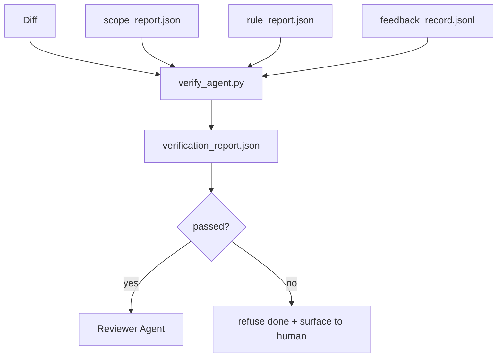

# 검증 게이트

> 에이전트는 자신의 작업을 완료된 것으로 표시하지 못한다. 검증 게이트는 범위 계약, 피드백 로그, 규칙 보고 및 디프를 읽고, 이 작업이 실제로 완료되었는가? 게이트가 거절하면 채팅이 무슨 말인지 상관없이 작업이 완료되지 않습니다.

**Type:** Build
**Languages:** Python (stdlib)
**Prerequisites:** Phase 14 · 33 (Rules), Phase 14 · 36 (Scope), Phase 14 · 37 (Feedback)
**Time:** ~55 minutes

## 학습 목표

- 작업 테이블 유물들에 대한 결정적 함수로서 검증 게이트를 정의하십시오.
- 규칙 보고, 범위 보고, 피드백 기록, 그리고 확장을 하나의 판결로 결합합니다.
-  `verification_report.json`심사위원과 정보통신자는 모두 읽을 수 있습니다.
- 예외 없이 블록 중성 실패에 대한 작업을 진행하는 것을 거부합니다.

## 문제

에이전트는 성공을 너무 쉽게 선언합니다.

- "좋아 보이네요". 모델은 자신의 차이를 읽고 옳다고 판단했습니다.
- "시험이 통과되었습니다". 자신감 있게 말했습니다. 실제로 테스트가 진행된 기록은 없습니다.
- "응용 기준이 충족되었습니다". "행위와 비슷하게 된 모든 것"을 의미하기 위해 충분히 느슨하게 해석되었습니다.

작업 테이블 수정은 에이전트가 이미 생성한 유물을 읽고 전화를 하는 단일 검증 게이트입니다. 게이트는 결정적입니다. 게이트는 버전 제어에 있습니다. 게이트는 CI에 연결됩니다. 에이전트가 뇌물을 낼 수 없습니다.

## 개념



### 게이트가 무엇을 확인하는지

| Check | Source artifact | Severity |
|-------|-----------------|----------|
| All acceptance commands ran | `feedback_record.jsonl` | block |
| All acceptance commands exited zero | `feedback_record.jsonl` | block |
| Scope check has no forbidden writes | `scope_report.json` | block |
| Scope check has no off-scope writes | `scope_report.json` | block or warn |
| All block-severity rules pass | `rule_report.json` | block |
| No `null` exit codes in feedback | `feedback_record.jsonl` | block |
| Touched files match `scope.allowed_files` | both | warn |

A`warn`판례에 대한 해설을 찾아내기`block`발견하는 것을 막는`passed: true`- 그래

### 결정론적, 확률론적이 아닌

게이트는 같은 유물 세트 에 대해 항상 같은 판결을 내야 합니다. LLM 판사는 없습니다. LLM 판사는 평가자 편에 속합니다 (단계 14 · 39)

### 한 보고서, 한 경로

문이 하나 `verification_report.json`각 작업의 클로즈 아웃, 아래로 작성`outputs/verification/<task_id>.json`CI는 같은 길을 소비합니다. 여러 개의 게이트가 다른 길을 따라 진실의 원천을 습니다.

### 예외 없이 거절

블록 중성성 연구 결과는 에이전트가 타버할 수 없습니다.`override_reason`그리고`overridden_by`사용자 아이디. 오버라이드는 서명된 변경사항이고, 에이전트 결정이 아닙니다.

```figure
wb-gate-sequence
```

## 건설 해

`code/main.py`이 도구는

- 각 입력된 유물에 대한 로더가 있습니다. 모두 현지에서 꽂혀있어서 수업은 자립합니다.
- A`verify(task_id, artifacts) -> VerdictReport`순수 기능
- 체크 결과와 최종 합격/실패를 보여주는 프린터
- 3가지 작업 시나리오를 보여주는 데모: 클린 패스, 스코프 크리프, 결실 수용.

실행하세요:

```
python3 code/main.py
```

출력: 각 각본과 함께 저장된 3개의 판결 보고서

## 야생에서의 생산 패턴

네 가지 패턴은 "다른  lint 작업"에서 "결정적인 가장자리로" 문을 높여줍니다.

**Defense-in-depth, not single gate.**사전 공약 할크 → CI 상태 확인 → 사전 도구 authz 할크 → 사전 합병 게이트. 각 계층은 결정적하므로 한 계층의 실패는 다음 계층에 의해 잡힌다. microservices.io의 2026년 3월 플레이북은 명시적으로 설명합니다. 사전 공약 할크는 모델 측면 기술과 달리, 명령에 따라하는 에이전트에 의존하지 않기 때문에 통과할 수 없습니다. 검증 게이트는 CI / 사전 합병 계층에 위치합니다.

**Defense by deterministic check, model-judge only for nuance.**인트로피의 2026 하이브리드 표준 조립: 검증 가능한 보상 (단체 테스트, 스키마 검사, 출력 코드) "코드가 문제를 해결했습니까?"

**Signed override log, not Slack threads.**모든 오버라이드는 라인을 `outputs/verification/overrides.jsonl`이 경우, 시점표, 코드 검색, 이유, 서명 사용자, 현재 HEAD 컴백. 실행 시간은 서명이 없는 모든 오버라이드를 거부하고, 감사 트레일은 git-tracked입니다. 이것은 오버라이드 정책과 오버라이드 극장 사이의 경계가.

**Coverage floor as a first-class check.**A`coverage_report.json``coverage_floor`(전립 80%) 검증. 측정 된 커버리지가 바닥 아래나 이전 합병의 바닥 아래로 1 퍼센트 이상의 점으로 떨어지면 게이트가 실패합니다. 이 검증 없이는 에이전트는 조용히 실패한 테스트를 삭제하고 검증 보고서는 녹색으로 남아 있습니다.

**`--strict` mode promotes warns to blocks.**방출 지점, 선박 차단 PR 또는 사고 후 분류`--strict`모든 경고는 실패로 이어집니다. 깃발은 지분별 선택입니다. 전 세계 기본이 아닙니다. 왜냐하면 모든 것에 엄격한 것은 일상적인 흐름을 손상시킵니다.

## 사용 하 고

생산 패턴:

- **CI step.**A`verify_agent`이브가 대리인의 최종 유물을 향해 게이트를 달리고 있습니다.`passed: true`- 그래
- **Pre-handoff hook.**랜타임 에이전트는 게이트를 호출하고, 출동 서류를 생성하기 전에
- **Manual triage.**운영자는 에이전트가 성공했다고 주장하고 인간이 의심할 때 보고서를 읽습니다.

문은 작업 테이블의 흐름의 결정적인 가장자리입니다. 다른 모든 표면은 그 위로 흐릅니다.

## 선박

`outputs/skill-verification-gate.md`어떤 수용 명령어들이 그것을 공급하고, 어떤 규칙들이 블록 강도가 있는지, 어떤 범위를 벗어난 글들이 용납되고, 오버라이드 감사 로그가 어떻게 저장되는지

## 운동

1. `coverage_floor`검증: 시험 명령은 적어도 80%의 커버링 보고서를 작성해야 합니다. 바닥을 운반하는 유물들을 결정합니다.
2. 지원`--strict`모든 것을 촉진하는`warn` `block`엄격한 모드가 올바른 기본 방식이 되는 경우를 문서화하십시오.
3. 게이트가 JSON에 추가로 Markdown 요약을 생성하도록 합니다. 요약에 어떤 필드가 속하는지 방어합니다.
4. `time_since_last_human_touch`확인: 인간 키스트로 60초 이내에 편집된 모든 파일은 범위를 벗어난 플래그에서 제외됩니다.
5. 실제 대리인이 다른 제품에서 게이트를 실행하세요. 얼마나 많은 발견이 실제이고 얼마나 많은 소리가 있나요? 게이트는 어디에 성장해야 할까요?

## 주요 용어

| Term | What people say | What it actually means |
|------|----------------|------------------------|
| Verification gate | "The check that stops things" | Deterministic function over workbench artifacts producing a pass/fail verdict |
| Block severity | "Hard fail" | A finding that prevents `passed: true` and requires a signed override |
| Override log | "Why we let it through" | Signed entries with reason and user id, audited by review |
| Acceptance command | "The proof" | A shell command whose zero exit is what `done` means |
| One report path | "Source of truth" | `outputs/verification/<task_id>.json`, consumed by CI and humans alike |

## 더 많은 읽기

- [Anthropic, Harness design for long-running application development](https://www.anthropic.com/engineering/harness-design-long-running-apps)
- [OpenAI Agents SDK guardrails](https://openai.github.io/openai-agents-python/guardrails/)
- [microservices.io, GenAI dev platform: guardrails](https://microservices.io/post/architecture/2026/03/09/genai-development-platform-part-1-development-guardrails.html) 전담과 CI 사이의 깊이 있는 방어
- [ICMD, The 2026 Playbook for Agentic AI Ops](https://icmd.app/article/the-2026-playbook-for-agentic-ai-ops-guardrails-costs-and-reliability-at-scale-1776661990431) 승인을 위한 문 계단 (예안 → 승인을 위한 문턱 이하의 자동차)
- [Type-Checked Compliance: Deterministic Guardrails (arXiv 2604.01483)](https://arxiv.org/pdf/2604.01483) 결정적인 게팅의 상위 경계로 Lean 4
- [logi-cmd/agent-guardrails — merge gate spec](https://github.com/logi-cmd/agent-guardrails) 범위를 + 돌연변이를 테스트하는 게이트
- [Guardrails AI x MLflow](https://guardrailsai.com/blog/guardrails-mlflow) CI 점수를 주는 결정적 검증자
- 단계 14 · 27  신속한 주입 방어 (가이트의 적대 쌍)
- 단계 14 · 36  이 게이트가 시행하는 계약의 범위
- 단계 14 · 37  피드백 로그 이 게이트 점수를
- 단계 14 · 39  검토자 대리인 게이트를
