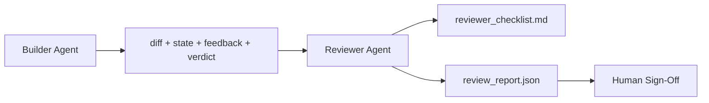

# 리뷰어 에이전트: 마크커에서 별도의 빌더

> 코드를 작성한 에이전트는 그 코드를 평가할 수 없습니다. 리뷰어는 다른 시스템 명령어, 다른 목표, 그리고 빌더가 만든 모든 것에 독서만 액세스하는 두 번째 루프입니다. 빌더와 리뷰어 사이의 격차는 가장 신뢰성이있는 곳입니다.

**Type:** Build
**Languages:** Python (stdlib)
**Prerequisites:** Phase 14 · 38 (Verification Gate)
**Time:** ~55 minutes

## 학습 목표

- 왜 같은 요원이 자신만의 일을 신뢰성 있게 검토할 수 없는지 설명해 주십시오.
- 건설자 유물을 소비하고 구조화된 검토 보고서를 발행하는 리뷰어 에이전트 루프를 구축하십시오.
- 비브가 아닌 특정 차원을 평가하는 리뷰어 라벨을 작성합니다.
- 심사위원을 책상에 올려놓으면 인간 심사 단계가 실제 유물에서 시작됩니다.

## 문제

에이젠트는 버그를 수정하도록 요청합니다. 그것은 네 개의 파일을 편집하고 테스트를 실행하고 보고서를 수행합니다. 검증 게이트 (단계 14 · 38) 는 승인 실행 및 범위 유지되는 것을 확인합니다. 게이트는 말합니다.`passed: true`2일 후에, 수정이 버그의 잘못된 반을 해결했다고 알게 됩니다.

수용은 필요하지만 충분하지 않습니다. 평론자는 수용이 제기할 수 없는 질문을 합니다. 이것은 올바른 문제를 해결했는가?

## 개념



### 검토자 라브리

5개 차원, 각 점수는 0에서 2입니다.

| Dimension | Question |
|-----------|----------|
| Problem fit | Did the change solve the task as stated, not a nearby task? |
| Scope discipline | Were edits confined to the contract or was the contract grown deliberately? |
| Assumptions | Are all hidden assumptions written down somewhere reviewable? |
| Verification quality | Does the acceptance command actually prove the goal, or did it prove a weaker version? |
| Handoff readiness | Could the next session pick up cleanly from the current state? |

10번의 전체는 7번 이하의 경기가 부드러운 경기가 되고 5번 이하의 경기는 어려운 경기가 된다.

### 평론자는 별도의 역할이고, 별도의 모델이 아닙니다.

리뷰어를 빌더와 같은 모델로 실행할 수 있습니다. 학문은 역할 분리입니다. 다른 시스템 프롬프트, 다른 입력, 디프에 대한 기록 액세스 없습니다. 자세의 변화는 신호의 변화입니다.

### 리뷰어는 디프리프를 편집할 수 없습니다

평가는 이 차이점, 상태, 피드백, 판결을 읽습니다. 보고서를 작성합니다. 이 차이점을 수정하지 않습니다. 보고서는 "이 문제를 해결하십시오".라고 말하면 다음 건설자 회전에서 수정합니다. 평가는 다시 검토합니다. 역할이 혼합되면 격차가 사라집니다.

### 검토자 라브리크와 검증 게이트

게이트 (단계 14 · 38) 는 결정적 인 사실 을 확인 한다: 수용 여부, 규칙 의 통과 여부, 범위 여부. 검토자 는 질적 인 판단 을 한다: 이 작품 은 올바른 작품 인가, 문서 를 작성 여부, 전달 이 사용 가능 여부. 둘 다 요구된다.

```figure
wb-builder-marker
```

## 건설 해

`code/main.py`이 도구는

- A`ReviewerInputs`데이터 클래스는 리뷰어가 읽은 유물을 묶어주는 것입니다.
- 각 함수는 수업에 대한 결정적이고 톱급입니다. 실제 구현은 LLM라고 부를 것입니다.
- A`review_report.json`5점, 총점, 그리고 판결을 가진 작가 (`pass``soft_fail``hard_fail`)
- 두 개의 디모 케이스: 깨끗한 변화와 "옳은 테스트, 잘못된 문제"의 변화.

실행하세요:

```
python3 code/main.py
```

출력: 디스크에 작성된 두 개의 검토 보고서와 차원 점수를 나타내는 콘솔 테이블.

## 야생에서의 생산 패턴

영수: 클라우드플레어의 2026년 4월 AI 코드 리뷰 시스템은 30일 동안 5169개의 리포에 48 095개의 융합 요청에서 131,246개의 리뷰 실행을 했습니다. 중간 검토는 3분 39초에 완료되었습니다. 최대 7명의 전문 검토자 (안전, 성능, 코드 품질, 문서, 출시 관리, 컴플라이언스, 엔지니어링 코덱스) 는 연구 결과를 배제하고 심각성을 판단하는 검토 조정자의 직속으로 평행했습니다. 최고 수준의 모델은 코디네이터에만 예약되어 있고, 전문가는 더 저렴한 레벨에서 실행했습니다.

네 가지 패턴이 이 작업을 확장시킵니다.

**Specialist pool, not one big reviewer.**5 차원 룰링을 가진 한 리뷰어는 솔로 리포를 위해 작동합니다. 코드베이스가 보안-비평, 성능-비평, 문서 표면을 가지고 나면, 작은 명령어를 가진 전문가로 나눌 수 있습니다. 조정자는 분배를 수행합니다. 전문가들은 절대 전체 룰링을 실행하지 않습니다. 모델 계층 분리이 떨어집니다. 저렴한 전문인, 비싼 조정자.

**Bias mitigation as design requirement, not optimization.**LLM 판사는 네 가지 신뢰할 수 있는 편향을 보여줍니다 (Adnan Masood, 2026년 4월): 위치 편향 (GPT-4 ~40% A, B vs (B, A) 순서에 불합), 말성 편향 (~15% 더 긴 출력으로 인한 인플레이션 점수), 자기 선호 (판사는 같은 모델 가족에서 출력을 선호), 권위 (판사는 알려진 저자에 대한 초등률 참조를 판단합니다). 완화: 두 순서를 모두 평가하고 일관된 승을 계산하는 것; 간결성을 명시적으로 보상하는 1-4 척도를 사용; 모델 가족들 간의 판사를 돌리는 것; 점수를 받기 전에 작가 이름을 벗겨내는 것.

**Calibration set, not vibes.**10-20 작업 역사 집합은 알려진 올바른 판단을 가지고 있습니다. 모든 즉각적인 변경에 대해 리뷰어를 실행하십시오. 역사 기록과 합의가 80% 이하로 떨어지면, 리뷰어 배가 전에 라브릭이 수정되어야합니다. 이것은 모든 팀이 결국 다시 발견하는 것입니다. 더 나은 시작.

**Hybrid norm with the gate.**검증 게이트 (단계 14 · 38) 는 결정적 검사를 처리한다 (안락 실행, 테스트 통과, 범위 유지). 리뷰어는 의미적 검사를 처리한다 (이것이 올바른 작업이었는지, 가설이 문서화되어 있는지, 사용가능하다). 이 분할에 대한 인트로피의 2026 지침은 명시적입니다. 리뷰어는 게이트가 이미 증명하는 것을 재해달라고 요청하지 마십시오.

## 사용 하 고

생산 패턴:

- **Claude Code subagents.**비평가 부하가 건설자가 작업을 종료한 후 실행하고, 로브릭 점수를 가진 PR에 대한 댓글을 올립니다.
- **OpenAI Agents SDK handoffs.**건설자 는 작업 을 완료 할 때 비평가 에게 맡겨야 합니다. 비평가 는 발견 목록 을 하거나 사람 을 까지 전달 할 수 있습니다.
- **Two-model pairing.**빌더는 더 빠른 값싼 모델을 사용합니다. 리뷰어는 판단에 초점을 맞춘 더 작은 맥락을 가진 더 강력한 모델을 사용합니다.

평가는 인간이 스스로 모든 평가를 할 수 없을 때 작업 테이블이 성장하는 두 번째 눈입니다.

## 선박

`outputs/skill-reviewer-agent.md`프로젝트 특수한 리뷰어 라브리, 제작자의 유물에 연결된 리뷰어 에이전트 스탭, 검증 게이트와 통합을 생성하여 인적 리뷰는 빈 페이지 대신 작성된 보고서에서 시작됩니다.

## 운동

1. 제품 영역에 특화된 여섯 번째 차원을 추가하고, 기존 다섯 가지에 흡수되지 않는 이유를 설명합니다.
2. 2가지 시스템 명령어 (terse, verbose) 를 통해 리뷰어를 실행하세요. 어떤 보고서는 사람이 더 쉽게 읽을 수 있을까요?
3. `confidence`가장 낮은 차원의 신뢰도가 0.6 이하인 경우 보고서를 전송하는 것을 거부합니다.
4. 10개의 역사적인 작업 close-out 과 같은 정답을 만들어서, 그 결과를 검토자에게 전달해 주세요.
5. "더 많은 증거를 요청"의 요건을 추가하십시오. 평가는 점수를 받기 전에 건설자에게 특정 테스트 실행을 요청할 수 있습니다.

## 주요 용어

| Term | What people say | What it actually means |
|------|----------------|------------------------|
| Reviewer rubric | "Checklist" | Five-dimension 0-2 scoring with a written question per dimension |
| Soft fail | "Needs revisions" | Total below 7; builder gets findings to address |
| Hard fail | "Reject" | Total below 5 or any dimension at 0; halt and surface to human |
| Role separation | "Different prompt" | Same model can be both roles; the discipline is inputs and posture |
| Confidence floor | "Don't ship low-signal reports" | Refuse to emit a verdict when the rubric is uncertain |

## 더 많은 읽기

- [OpenAI Agents SDK handoffs](https://openai.github.io/openai-agents-python/handoffs/)
- [Anthropic Claude Code subagents](https://code.claude.com/docs/en/sub-agents)
- [Cloudflare, Orchestrating AI Code Review at Scale](https://blog.cloudflare.com/ai-code-review/)7명의 전문인력 + 조정자 건축, 131만 건의 실행 / 30일
- [Agent-as-a-Judge: Evaluating Agents with Agents (OpenReview / ICLR)](https://openreview.net/forum?id=DeVm3YUnpj) DevAI 기준, 366 계층적 솔루션 요구 사항
- [Adnan Masood, Rubric-Based Evaluations and LLM-as-a-Judge: Methodologies, Biases, Empirical Validation](https://medium.com/@adnanmasood/rubric-based-evals-llm-as-a-judge-methodologies-and-empirical-validation-in-domain-context-71936b989e80) 4가지 편견과 완화
- [MLflow, LLM-as-a-Judge Evaluation](https://mlflow.org/llm-as-a-judge) 분리된 건설자/평가자 생산 도구
- [LangChain, How to Calibrate LLM-as-a-Judge with Human Corrections](https://www.langchain.com/articles/llm-as-a-judge) 캘리버링 설정 작업 흐름
- [Evidently AI, LLM-as-a-judge: a complete guide](https://www.evidentlyai.com/llm-guide/llm-as-a-judge)
- [Arize, LLM as a Judge — Primer and Pre-Built Evaluators](https://arize.com/llm-as-a-judge/)
- 14단계 · 05  자기정결과 비판 (일체 요인 자기정책 기준)
- 14단계 · 30  Eval-driven agent 개발 (계급 세트 생성기)
- 14단계 · 38  검증 게이트는 검토자가 읽는다
- 14단계 · 40  검토자 보고서에서 제공되는 전달 패키지
