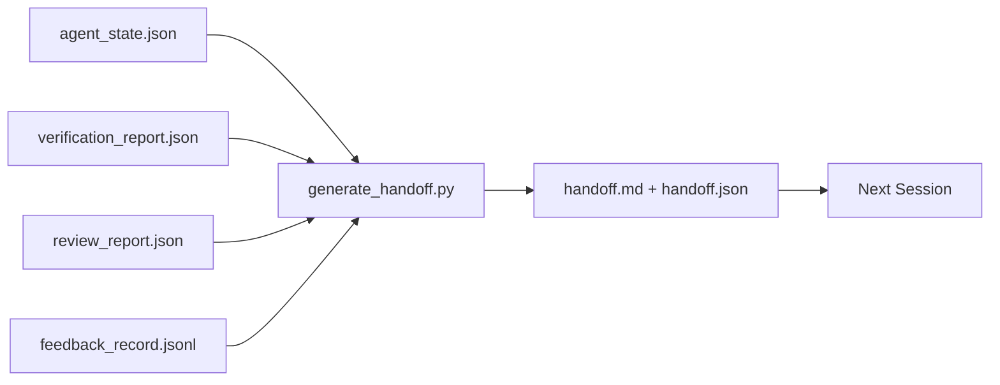

# 여러 세션 간 교류

> 세션이 끝나고 있습니다. 작업은 끝나지 않습니다. 전달 패키지는 "대리인이 한 시간 동안 일했습니다"를 "다음 세션은 첫 번째 순간에 생산적입니다".

**Type:** Build
**Languages:** Python (stdlib)
**Prerequisites:** Phase 14 · 34 (Repo Memory), Phase 14 · 38 (Verification), Phase 14 · 39 (Reviewer)
**Time:** ~50 minutes

## 학습 목표

- 각 송신 패키지가 필요로 하는 7개의 필드를 확인하세요.
- 손으로 쓴 시가 없는 작업 테이블의 유물들을 통해 전달을 만들어내세요.
- 큰 피드백 로그를 손잡이 크기의 요약으로 줄여서
- 다음 세션의 첫 번째 행동을 결정적으로 만들어 보세요.

## 문제

세션이 끝납니다. 에이전트는 "아름다운데, 우리는 진전을 이루었습니다". 다음 세션이 시작됩니다. 다음 에이전트는 "우리는 어디서 끝냈습니까?"라고 묻습니다. 첫 번째 에이전트의 대답은 사라집니다. 다음 에이전트는 다시 발견하고 같은 명령을 다시 실행하고, 인간에게 동일한 질문을 다시 묻습니다. 그리고 이전 세션의 마지막 30 초를 복구하는 데 30 분을 태운 것입니다.

잘못된 전달의 비용은 작업의 수명을 위해 모든 세션에 지불됩니다. 수정은 세션 끝에서 자동으로 생성되는 패키지입니다. 무엇이 변경되었는지, 왜, 무엇을 시도했는지, 무엇이 실패했는지, 무엇이 남아있는지, 다음 번에 먼저 무엇을해야하는지.

## 개념



### 7개의 필드, 모든 랜딩이 가져옵니다.

| Field | Question it answers |
|-------|---------------------|
| `summary` | One paragraph of what was done |
| `changed_files` | The diff at a glance |
| `commands_run` | What was actually executed |
| `failed_attempts` | What was tried and why it did not work |
| `open_risks` | What could bite next session, with severity |
| `next_action` | The first concrete step next session takes |
| `verdict_pointer` | Path to the verification + review reports |

`next_action`은 은 은 은 은 은 은 은 은 은 은 은 은 은 은 은 은 은 은 은 은 은 은 은 은 은 은 은 은 은 은 은 은 은 은 은 은 은 은 은 은 은 은 은 은 은 은 은 은 은 은 은 은 은 은 은 은 은 은 은 은 은 은 은 은 은 은 은 은 은 은 은 은 은 은 은 은 은 은 은 은 은 은 은 은 은`next_action`이 자료는 상태 보고서이고, 전달이 아닙니다.

### 전달은 작성된 것이 아니라 생성됩니다.

손으로 작성한 전달은 힘든 날에서 건너뛰는 전달입니다. 생성기는 작업 테이블의 유물을 읽고 패키지를 발송합니다. 에이전트의 임무는 작업 테이블을 생성자가 요약 할 수있는 상태로 남겨두고 요약을 작성하는 것이 아닙니다.

### 두 가지 형태: 인간과 기계가 읽을 수 있는 형태

`handoff.md`이것은 인간이 읽은 책입니다.`handoff.json`다음 에이전트가 로드하는 것은 같은 소스 유물에서 나온 것입니다. 만약 그들이 분할한다면 JSON는 승리합니다.

### 피드백 로그 단축

전체`feedback_record.jsonl`수 백 개의 항목이 있을 수 있습니다. 전달은 마지막 K를 더하여 0이 아닌 출구로 모든 항목을 가지고 있습니다. 다음 세션은 필요한 경우 전체 로그를 로드합니다. 그러나 패키지는 작습니다.

### 깨끗한 상태를 남겨두세요

수업은 작업을 설명합니다. 깨끗한 상태는 작업을 재개할 수 있습니다. 그들은 같은 것이 아닙니다. 완벽한`handoff.md`다음 세션이 반 적용된 디프로, 에이전트가 잊은 임시 파일, 방황하는 지부로 열리면 가치가 없습니다. 그리고 그 오류가 실행되기 전에 테스트합니다. 다음 에이전트는 마지막을 청소하는 대신 첫 10 분 동안 사용하며, 작업의 생애 동안 모든 세션에 비용을 합치합니다.

그래서 세션은 기능이 작동할 때 끝나지 않습니다. 작업 테이블이 생성자가 요약할 수 있고 다음 세션이 신뢰할 수 있는 상태가 될 때 끝납니다. 청소는 자신의 단계이고, 전달 전에 실행됩니다. 그것은 검사이고 습관이 아닙니다. 왜냐하면 습관은 힘든 날에 빠지는 것입니다.

| Check | Clean means | Dirty blocks because |
|-------|-------------|----------------------|
| Working tree | Every change committed or explicitly stashed with a note | A half-applied diff looks like intentional work to the next agent |
| Temp artifacts | No `*.tmp`, scratch dirs, debug prints, or commented-out blocks left behind | Stray files pollute the diff and the next agent's mental model |
| Tests | Green, or red with the failure named in `open_risks` | A silent red test is a trap the next session steps in |
| Feature board | `feature_list.json` status reflects reality (Phase 14 · 36) | A stale board sends the next session to work that is already done |
| Branch | On the expected branch, no detached HEAD, no orphan branches | Wrong branch means the next session's first commit lands in the wrong place |

청소 단계에서는`clean_state.json`빈 목록은 패킷을 작성하기 전에 전달 생성자가 주장하는 전제 조건입니다. 더러운 나무에 만들어진 전달은 전달이 아닙니다. 그것은 전달 된 혼란입니다. 두 유물 쌍: 청소는 작업 테이블이 떠날 수있는 안전하다는 것을 증명합니다. 전달은 다음 세션이 어디에서 시작해야하는지 알고 있음을 증명합니다.

```figure
wb-handoff-packet
```

## 건설 해

`code/main.py`이 도구는

- 상태, 판결, 검토, 피드백을 하나의 형태로 수집하는 로더`WorkbenchSnapshot`- 그래
- A`generate_handoff(snapshot) -> (markdown, payload)`기능
- 마지막 K 피드백 입력과 모든 비 0 출구들을 선택하는 필터
- 이 이 이 이`handoff.md`그리고`handoff.json`시나리오 옆에

실행하세요:

```
python3 code/main.py
```

출력: 인쇄된 배포체, 그리고 디스크에 있는 두 파일 모두

## 야생에서의 생산 패턴

코데스 CLI, 클로드 코드, 오픈코드는 각각 다른 압축 스토리를 배포하고 있으며 구조화된 전달 패키지는 세 가지 위에 위치하고 있습니다.

**Compaction strategies vary; the packet schema does not.**코덱스 CLI의 POST /v1/responses/compact은 서버 측의 불투명한 AES 블럽 (OpenAI 모델의 빠른 경로) 이다.`_summary`클로드 코드는 컨텍스트의 95%에서 5단계 프로그레시브 컴팩션을 실행합니다. 오픈 코드는 타임스테임 기반 메시지 숨기기 및 5개의 제목의 LLM 요약을 수행합니다. 세 가지 다른 메커니즘, 동일한 필요성: 압축을 살아남은 것을 휴대용 유물으로 serialize 합니다. 패키지는 그 유물입니다.

**Fresh-session handoff is not compaction.**컴팩션은 한 세션의 연장입니다. 손바닥은 한 세션을 깨끗하게 닫고 다음을 시작합니다. 헤르메스 에스 #20372 프레임 (2026년 4월) 은 옳습니다. 현장 압축이 감소하기 시작하면 에이전트는 콤팩트 한드오프를 작성하고 세션을 종료하고 신선한 맥락에서 재개해야 합니다. 이 전환은 싸게 만드는 것은 패키지입니다. 잘못은 품질이 떨어질 때까지 계속 압축하는 것입니다. 해결은 일찍, 깨끗한 전달을 위해 예산입니다.

**One active handoff per branch and topic.**다중 에이전트 조정은 나쁜 모델 출력보다 오래된 전달에 더 많이 붕괴됩니다. 항상 포함합니다`branch``last_known_good_commit`, 그리고`status``active | superseded | archived`. 고정된 전달은 보관됩니다. 오직 활성 한 쪽만이 다음 세션을 진행합니다. 이것은 메모로 전달하는 것과 상태로 전달하는 사이의 차이입니다.

**Wrap up before 50-75% context, not at the wall.**손으로 작성된 패턴 플레이북 (CLAUDE.md + HANDOVER.md) 은 세션이 95% 대신 50-75%의 컨텍스트 예산으로 종료되면 가장 좋은 결과를보고합니다. 압축 유물들이 소스 상태를 오염하기 전에 패킷 생성기는 깨끗하게 실행됩니다. 컨텍스트가 온전한 상태에서 작성하는 데 저렴합니다. 모델이 이미 위치를 잃는 경우 비용이 많이 든다.

## 사용 하 고

생산 패턴:

- **Session-end hook.**실행시간은 사용자가 채팅을 종료하면 생성기를 작동시킵니다.`outputs/handoff/<session_id>/`- 그래
- **PR template.**그네이터의 은 지표도 PR 기관입니다. 리뷰어는 다른 5개의 파일을 열지 않고도 읽습니다.
- **Cross-agent handoff.**한 제품 (Claude Code) 를 사용하여 제작하고 다른 제품 (Codex) 을 사용하여 계속하십시오.

작은 패키지, 규칙적이고, 생산 비용이 저렴합니다. 매 세션에 비용 절감이 증가합니다.

## 선박

`outputs/skill-handoff-generator.md`프로젝트의 유물 경로에 맞춰진 생성기를 생성하고, 세션 종료 할크를 실행하고,`handoff.json`다음 에이전트가 시작 시에 칩을 읽습니다.

## 운동

1.  추가`assumptions_to_validate`모든 가정에서 나타난 필드, 건설자가 기록했지만 검토자가 1보다 높은 점수를 얻지 못했습니다.
2. 실패한 경주와 통과하는 경주에서 피드백 요약을 다르게 할 수 있습니다. 비대칭을 옹호하십시오.
3. "인간 의 질문" 목록 을 포함 하십시오. 질문 을 포켓 에 넣는 데 그 어느 정도 의 임대점 이 있습니까?
4. 발전기를 무력하게 만들 수 있습니다. 두 번 실행하면 동일한 패킷을 생성합니다.
5. 다음 세션에서 동작하기 전에 다음 세션에서 로드해야 할 유물을 정확하게 나열하는 "다음 세션 전제" 섹션을 추가합니다.

## 주요 용어

| Term | What people say | What it actually means |
|------|----------------|------------------------|
| Handoff packet | "Session summary" | Generated artifact carrying the seven fields, both markdown and JSON |
| Next action | "What to do first" | The one concrete step that starts the next session |
| Feedback trim | "Log summary" | Last K records plus every non-zero exit |
| Status report | "What we did" | A document missing `next_action`; useful, but not a handoff |
| Verdict pointer | "Receipt" | Path to the verification + review reports for traceability |

## 더 많은 읽기

- [Anthropic, Effective harnesses for long-running agents](https://www.anthropic.com/engineering/effective-harnesses-for-long-running-agents)
- [OpenAI Agents SDK handoffs](https://openai.github.io/openai-agents-python/handoffs/)
- [Codex Blog, Codex CLI Context Compaction: Architecture, Configuration, Managing Long Sessions](https://codex.danielvaughan.com/2026/03/31/codex-cli-context-compaction-architecture/) POST /v1/ 응답/상품 및 지역 역전
- [Justin3go, Shedding Heavy Memories: Context Compaction in Codex, Claude Code, OpenCode](https://justin3go.com/en/posts/2026/04/09-context-compaction-in-codex-claude-code-and-opencode) 세 공급자 압축 비교
- [JD Hodges, Claude Handoff Prompt: How to Keep Context Across Sessions (2026)](https://www.jdhodges.com/blog/ai-session-handoffs-keep-context-across-conversations/) CLAUDE.md + HANDOVER.md, 50~75%의 컨텍스트 예산
- [Mervin Praison, Managing Handoffs in Multi-Agent Coding Sessions: Fresh Context Without Losing Continuity](https://mer.vin/2026/04/managing-handoffs-in-multi-agent-coding-sessions-fresh-context-without-losing-continuity/) 분산 시스템 프레임
- [Hermes Issue #20372 — automatic fresh-session handoff when compression becomes risky](https://github.com/NousResearch/hermes-agent/issues/20372)
- [Hermes Issue #499 — Context Compaction Quality Overhaul](https://github.com/NousResearch/hermes-agent/issues/499) 코덱스 CLI에서 전달을 위한 명령어
- [Microsoft Agent Framework, Compaction](https://learn.microsoft.com/en-us/agent-framework/agents/conversations/compaction)
- [OpenCode, Context Management and Compaction](https://deepwiki.com/sst/opencode/2.4-context-management-and-compaction)
- [LangChain, Context Engineering for Agents](https://www.langchain.com/blog/context-engineering-for-agents)
- 단계 14 · 34  생성기가 읽는 상태 파일
- 14단계 · 38  검증 판결
- 단계 14 · 39  재검토자 보고서가 패키지에 묶여 있습니다
