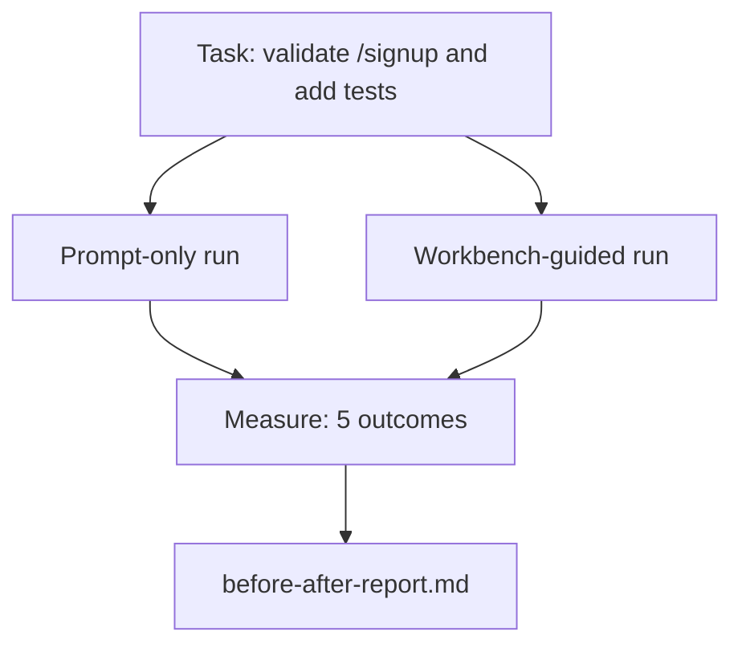

# 실제 리포에서 작업 테이블

> 표면 11개의 수업은 실제 코드베이스와의 접촉을 살아남지 못한다면 아무런 가치가 없습니다. 이 수업은 작은 샘플 앱에서 두 번 동일한 작업을 수행합니다.

**Type:** Build
**Languages:** Python (stdlib)
**Prerequisites:** Phases 14 · 32 to 14 · 40
**Time:** ~60 minutes

## 학습 목표

- 작은 응용 프로그램에서 일곱 개의 작업 테이블 표면을 하나로 묶어 보세요.
- 같은 작업을 두 번 수행 (단순으로 수행하고 작업 테이블에서 안내) 하고 다섯 가지 결과를 측정하십시오.
- 전/후 보고서를 읽어보고 어떤 표면이 가장 많은 영향력을 미쳤는지 결정하십시오.
- "하지만 내 모델은 충분히 좋은 것"의 반발에 대해 작업 테이블을 방어하십시오.

## 문제

장난감 작업에 대한 데모는 아무도 설득하지 않습니다. 실제 느낌의 레포 작업이 더 적은 실패와 더 적은 반전과 다음 세션에 사용할 수있는 패키지로 생산에 도착하면 작업 테이블의 경우 발생합니다.

이 수업은 실제적인 리포를 선보이고 두 파이프라인에서 동일한 작업을 수행합니다. 결과는 회의적인 사람에게 전달할 수있는 전 / 후 보고서입니다.

## 개념



### 샘플 앱

최소 FastAPI 스타일의 핸들러`sample_app/`이 부분의 본문은

- `app.py``/signup`( 아직 확인되지 않았습니다.)
- `test_app.py`한 번 행복의 길을 시험해 보세요.
- `README.md`그리고`scripts/release.sh`금지 구역에서 먹이를 먹기 위해서

### 과제

> 입력 인증을 추가합니다`/signup`8자 이하의 비밀번호를 거부하고 422번을 입력 오류 봉투로 반환하고 새로운 행동을 증명하는 테스트를 추가합니다.

### 두 파이프라인

단숨에만

1. README를 읽어보세요.
2. 읽으세요`app.py`- 그래
3. 파일 편집
4. 주장이 완료

작업 테이블에서 안내:

1. init 스크립트를 실행하세요 (목록 35).
2. 계약 범위 (목록 36).
3. 읽기 상태 (강좌 34).
4. 파일만 편집할 수 있습니다.
5. 피드백 러너를 통해 수용 명령어를 실행하세요 (목록 37).
6. 검증 게이트를 실행하세요 (목록 38).
7. 실행 리뷰어 (강좌 39).
8. 교류를 만들어내기 (강좌 40).

### 측정된 5가지 결과

| Outcome | Why it matters |
|---------|----------------|
| `tests_actually_run` | Most "tests passed" claims are unverifiable |
| `acceptance_met` | The test that proves the goal must be the test that ran |
| `files_outside_scope` | Scope creep is the dominant silent failure |
| `handoff_quality` | The next session pays for or benefits from this |
| `reviewer_total` | Qualitative judgment on top of the gate |

```figure
wb-ab-runs
```

## 건설 해

`code/main.py`두 파이프 라인은 동일한 샘플 앱 고정에 맞춰 조정됩니다. 두 파이프 라인은 스크립트 (클럽에서 LLM가 없습니다) 그래서 측정은 재생 가능합니다. 스크립트는 비교를 에 작성합니다.`before-after-report.md`그리고`comparison.json`- 그래

실행하세요:

```
python3 code/main.py
```

출력: 파이프라인별 결과의 콘솔 테이블, 스크립트 옆에 저장된 마크다운 보고서, 그리고 그것을 차트링하려는 모든 사람에게 JSON.

## 야생에서의 생산 패턴

회의주의자의 질문은 "실제 작업 테이블이 얼마나 도움이 되는가?" 2026 숫자는 설명보다 훨씬 더 많은 것을 말합니다.

**Terminal Bench Top-30 to Top-5 on the same model.**랭체인* 에이전트 하네스의 아나토미 ( LangChain's *Anatomy of an Agent Harness*) (2026년 4월): 코딩 에이전트는 하네스를 변경함으로써 30위 밖에에서 5위를 차지했다. 동일한 모델. 다른 표면. 25위 델타.

**Vercel 80% to 100% by deleting tools.**베르셀은 에이전트의 도구의 80%를 삭제한 것으로 보고되어 성공률이 80%에서 100%로 이동했습니다. 도구 표면이 작고, 범위가 날카롭게, 실패하는 방법이 적습니다. 부정적인 공간이 승리합니다.

**Harvey 2x accuracy via harness alone.**법무대리원들은 을 최적화해서 정확성을 두 배 이상 높였는데 모델 변경은 없었다

**88% of enterprise AI agent projects fail to reach production.**preprints.org *Harness Engineering for Language Agents* 논문 (2026년 3월) 은 실패를 추론하는 것이 아니라 실행 시간으로 추적합니다.

**Long-context collapse.**웹 에이전트 기본 기준은 장기적인 상황에서는 40%-50%의 성공이 10% 이하로 떨어집니다. 대부분 무한 loop 및 목표 손실로 인해.

**False negatives still exist.**단 단계 사실적 과제, 한 줄 리인트, 포맷터 실행, 모델이 문자 그대로 기억한 모든 것  이 모든 과제는 더 빨리 실행됩니다. 벤치마크는 정직하게 목록으로 작성되어야 합니다. 따라서 작업 테이블은 과잉으로 틀어지지 않습니다.

"은 영원히 승리한다"는 게 아니라, 모델들은 시간이 지남에 따라 속임수를 흡수합니다.

## 사용 하 고

이 교훈은 당신이 인용한 사건 파일입니다.

- 왜 모든 PR가`agent-rules.md`그리고 계약 범위.
- 팀원들은 검증 게이트를 "이번 스프린트"에 비해서 내려놓을 겁니다.
- 새로운 에이전트 제품 출시되고 실제로 시간을 절약하는지 여부를 위한 휴대용 기준이 필요합니다.

숫자는 설명보다 더 멀리 간다.

## 선박

`outputs/skill-workbench-benchmark.md`이 프로그램은 모든 에이전트 제품을 두 파이프라인에서 프로젝트의 본 샘플 앱에 적용하여 5가지 결과를 보고하는 휴대용 평가 띠입니다.

## 운동

1. 여섯 번째 결과: 시간부터 첫 번째 의미 있는 편집. 어떻게 깨끗하게 측정합니까?
2. 코드베이스에서 실제 2일 작업에 대한 비교를 실행하세요.
3. "거짓 부정적" 패스를 추가: 단 단정일 뿐이 더 빨라지고 작업 테이블의 오버하스트가 실제 비용으로 이루어지는 작업. 어쨌든 작업 테이블을 유지하는 것을 방어하십시오.
4. 스크립트된 "아지트"를 실제 LLM 전화로 교체해
5. 비공학자를 대상으로 한 한 페이지의 요약의 저자.

## 주요 용어

| Term | What people say | What it actually means |
|------|----------------|------------------------|
| Sample app | "Toy repo" | Small but realistic enough to exercise all seven surfaces |
| Pipeline | "Workflow" | Ordered sequence of surface reads/writes the agent follows |
| Before/after report | "The receipts" | The artifact you hand to a skeptic |
| False negative | "Workbench overkill" | Tasks where prompt-only is faster; useful to enumerate honestly |
| Workbench benchmark | "Reliability score" | Portable harness that runs the comparison on your codebase |

## 더 많은 읽기

- [LangChain, The Anatomy of an Agent Harness](https://blog.langchain.com/the-anatomy-of-an-agent-harness/) 터미널 벤치 톱-30에서 톱-5까지의 영수증
- [MongoDB, The Agent Harness: Why the LLM Is the Smallest Part of Your Agent System](https://www.mongodb.com/company/blog/technical/agent-harness-why-llm-is-smallest-part-of-your-agent-system) 베르셀 + 하비 숫자
- [preprints.org, Harness Engineering for Language Agents](https://www.preprints.org/manuscript/202603.1756) 88%의 기업 실패율, 실행 시간 근본 원인은
- [HN: Improving 15 LLMs at Coding in One Afternoon. Only the Harness Changed](https://news.ycombinator.com/item?id=46988596) 15개의 모델에서 복제
- [Cloudflare, Orchestrating AI Code Review at Scale](https://blog.cloudflare.com/ai-code-review/) 131k 개회전 / 생산 30일
- [Anthropic, Building Effective Agents](https://www.anthropic.com/research/building-effective-agents)
- 단계 14 · 32 ~ 14 · 40  이 강의에서 끝에서 끝까지 연습하는 표면
- 단계 14 · 19  SWE- 벤치, GAIA, AgentBench 이 수업이 추가되는 매크로 벤치마크로
- 단계 14 · 30  평가-운동 대원 개발 같은 배너스 플러그
