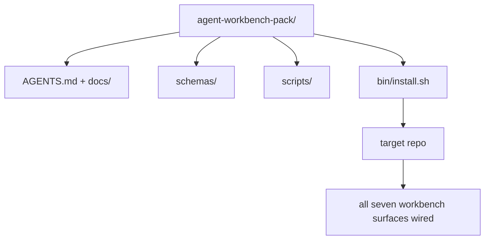

# 캡스톤: 재사용 가능한 에이전트 워크 벤치 패키지를 배포

> 미니 트랙은 어떤 repo에도 떨어뜨리는 패키지로 끝납니다.`cp -r`다음 날 아침에는 믿을만한 에이전트를 고용하고 있습니다.

**Type:** Build
**Languages:** Python (stdlib)
**Prerequisites:** Phases 14 · 31 to 14 · 41
**Time:** ~75 minutes

## 학습 목표

- 7개의 작업 테이블 표면을 하나의 drop-in 디렉토리로 포장합니다.
- 스케마, 스크립트, 템플릿을 꽂아두면 새로운 레포가 잘 알려진 기본 라인을 얻습니다.
- 패킷을 무력하게 내려놓는 단일 설치 스크립트를 추가하십시오.
- 팩에 무엇이 남아 있는지, 팩에서 무엇이 남아 있는지 결정하고, 각각의 부위를 방어합니다.
- 재검토자가 재현할 수 있는 증거로 에이전트 지원된 저장소 변경을 증명한다.

## 문제

구글 문서, 채팅 역사, 그리고 세 개의 반 기억된 스크립트에서 저장된 작업 테이블은 분기마다 재건되는 작업 테이블입니다. 치료법은 버전 패키지입니다.

이 수업을 끝낼게요`outputs/agent-workbench-pack/`디스크에 배포되어`bin/install.sh`그 결과, 모든 목표물에 떨어지게 됩니다.

## 개념



### 패키지 레이아웃

```
outputs/agent-workbench-pack/
├── AGENTS.md
├── docs/
│   ├── agent-rules.md
│   ├── reliability-policy.md
│   ├── handoff-protocol.md
│   └── reviewer-rubric.md
├── schemas/
│   ├── agent_state.schema.json
│   ├── task_board.schema.json
│   └── scope_contract.schema.json
├── scripts/
│   ├── init_agent.py
│   ├── run_with_feedback.py
│   ├── verify_agent.py
│   └── generate_handoff.py
├── bin/
│   └── install.sh
└── README.md
```

### 무엇이 들어간건, 무엇이 빠져나간건

이 부분에서:

- 표면 스케임, 계약입니다.
- 위의 네 개의 스크립트, 그것은 실행 시간입니다.
- 네 개의 문서가 규칙과 규칙입니다.

밖으로:

- 프로젝트 특수한 작업, 작업은 목표 repo의 게시판에 속합니다.
- 판매자 SDK 전화, 패킷은 프레임워크 아гности학입니다.
- 팩은 팀의 기존 랩에 옆에 살고 있고, 안에 있는 게 아닙니다.

### 설치자

짧은`bin/install.sh`(또는`bin/install.py`):

1. 기존 패키지에 설치하지 않고 설치하지 않습니다`--force`- 그래
2. 팩을 칩에 복사합니다.
3.              `.github/workflows/`존재합니다.
4. 다음 단계를 인쇄합니다. 게시판을 채우고, 수용 명령을 설정하고, init 스크립트를 실행합니다.

### 버전

팩은 `VERSION`파일. 스케마 bumps 및 마이그레이션이 필요한 스크립트 변경은 메이저 bumps. Doc-만 변경은 패치를 bumps. 목표 repo의`agent_state.json`어떤 팩 버전에 대해 초기화되었는지 기록합니다.

```figure
wb-pack-install
```

## 건설 해

`code/main.py``outputs/agent-workbench-pack/`이 미니 트랙의 이전 수업과 이미 작성한 문서의 스케마와 스크립트를 배워 놓은 수업 옆에

실행하세요:

```
python3 code/main.py
```

스크립트는 표면을 복사하고 핑을 하고 README를 작성하고, 팩 트리를 인쇄하고, 0을 빠져나갑니다. 재 실행은 무력합니다.

## 야생에서의 생산 패턴

팩은 가, 업데이트, 그리고 불친절한 하류 상류에서 살아남으면만 가치 있는 것 입니다.

**`VERSION` is the contract, not the marketing.**주요 부딪치는 상태 마이그레이션이 필요합니다. 작은 부딪치는 체크를 다시 실행해야합니다. 패치 부딪치는 문서에만 있습니다. 설치자는 말합니다.`.workbench-version`각 설치에 대한 목표 repo에 `lint_pack.py`목표물의 잠금이 패키지와 일치하지 않는 경우 배포를 거부합니다`VERSION`- 이렇게 해`npm``Cargo`그리고`pyproject.toml`10년 동안의 체린을 살아남아, 에이전트들에 대한 것은 규칙이 바뀌지 않습니다.

**Single source for cross-tool distribution.**1호선`nx ai-setup`그 이유는`AGENTS.md``CLAUDE.md``.cursor/rules/``.github/copilot-instructions.md`, 그리고 하나의 구성에서 MCP 서버를 사용한다.`ln -s AGENTS.md CLAUDE.md`) 그래서 모든 코딩 에이전트에 하나의 진실의 원천이 퍼져나갑니다.

**`uninstall.sh` that refuses on non-trivial state.**패키지를 제거하면 사용자의 팩을 삭제할 수 없습니다.`agent_state.json``task_board.json`또는`outputs/`. 디스플레이터로 스케마, 스크립트, 도커를 제거하고`AGENTS.md`(와 함께)`--keep-agents-md`(Opt-out) 및 국가 파일에는 어떠한 약속되지 않은 변경 사항이 있는 경우 진행을 거부합니다. 국가는 사용자에게 속합니다.

**Skill-as-publishable. SkillKit-style distribution.**스킬킷 기술로 팩을 배포합니다.`skillkit install agent-workbench-pack`한 소스에서 32개의 인공지능 에이전트를 통해 정의합니다. 패킷 레포는 진실의 원천입니다. 스킬킷은 유통 채널입니다. 벤더 로크-인 붕괴; 일곱 표면은 동일합니다.

## 사용 하 고

3개의 장소로 배가 이동합니다.

- **As a directory you drop into a repo.** `cp -r outputs/agent-workbench-pack /path/to/repo`- 그래
- **As a public template repo.**과 맞춤형`VERSION`유도 조절
- **As a SkillKit skill.**당신의 에이전트 제품으로 연결되어 있어 하나의 명령으로 설정됩니다.

패키지는 레시피이고, 모든 설치는 한 분량입니다.

## 선박

`outputs/skill-workbench-pack.md`프로젝트 조정 된 패키지를 생성합니다. 팀의 역사에 대한 규칙, 레포에 맞춘 범위를, 한 영역 특정 항목으로 확장 된 라부릭 크기는.

## 운동

1. 5번째 문서가 신성단으로 승진할 자격이 있는 선택지를 결정하고
2. 설치 프로그램을 Python로 다시 작성하여 `--dry-run`에르고노믹과 바쉬를 비교해 보세요.
3. `bin/uninstall.sh`이 자료는 안전하게 패킷을 제거하고, 주파수들이 비 비약적인 역사를 가지고 있다면 거부합니다.
4. `lint_pack.py` 팩이 튀어나오면 실패하는`VERSION`- 팩의 리포를 위해 CI에 연결해
5. 이 팩에 있는 핸드 롤드 워크 벤치에서 마이그레이션 런브 북의 저자.

## 직업 연습: 한 가지 저장소 변경을 증명하십시오

패키지 데모는 어셈블러가 파일을 실행하고 생성한다는 것을 증명합니다. 그것은 당신의 에이전트가 새로운 작업을 완료할 수 있다는 것을 증명하지 않습니다. 생성된 체크는 그 작업을 증명하거나 배치 된 시스템이 작동한다는 것을 증명하지 않습니다. 이러한 주장을 분리하십시오.

여러분 소유의 저장소에서 작은 실제 작업을 선택하거나 변경할 권한이 있습니다. 이미 액세스 할 수 있는 코딩 에이전트를 사용하세요. 버그 수정, 제한 기능 또는 운영 개선은 충분합니다. 여러 에이전트를 설치하는 것은 연습의 일부 아닙니다.

포장 연구소 이외의 별도의 작업 세션의 예산. 아래 링크된 증거 템플릿을 본 문서에 복사합니다.`learning-artifacts/`디렉토리: 체크인된 템플릿을 참고 자료로 보관하고 포장합니다.

### 1. 작업의 틀을 설정하고 자율성을 선택

43 수업에서 작업 프레임과 44 수업에서 증거 계획을 사용하십시오. 초기 개정, 관찰 가능한 목표, 목표가 아닌, 허용 된 경로 및 수용 증거를 기록하십시오. 행동을 필요로 하는 실제 사용자 또는 운영자를 식별하십시오.

가이드 스테이프, 체크포인트 실행 또는 제한된 자율 실행을 하는 작업 모드를 선택 하십시오. 불확실성, 결과 및 역전성 때문 에 왜 그렇게 하는지를 설명 하십시오. 작은 지역 리팩터 는 접근 제어 장치 에 대한 변경 보다 더 적은 체크포인트 를 필요로 할 수 있습니다.

에겐트가 하나 를 노출 하는 경우 벽 시간 예산 과 토큰 또는 비용 제한 을 설정 하십시오. 가용되지 않는 측정 을 정직 하게 기록 하십시오. 반복적 실패, 새로운 권한, 예산 부족 또는 해결 되지 않은 계약 결정 에 대한 정지 조건 을 정의 하십시오. 누가 해결할 수 있는지 명명 하십시오.

### 2. 가장 작은 유용한 환경을 준비하십시오

관련 구현, 호출자, 테스트 및 로컬 명령어를 검색합니다. 각 소스가 맥락에 속하는 이유 및 기존 메모를 대체하는 현존 증거를 기록합니다. 기본적으로 전체 저장소를 로드하지 마십시오.

각 관련 확장 프로그램에서 한 가지 명시적인 선택을 수행하십시오. 기술은 반복 가능한 절차를 제공합니다. MCP 도구는 액세스 권한을 제공합니다. 은 결정적 검사를 실행합니다. 플러그인이 기능을 패키지합니다. 작업이 필요할 때만 확장 프로그램을 유지하십시오.

제안된 추가 내용의 컨텍스트나 유지 보수 비용을 기록하세요. 고장된 메모리나 명령어를 다시 확인하고, 그 결정에 근거가 있는 증거가 있을 때 학습자 소유의 설정에서 철회하거나 교체하세요. 제거가 필요한 제약을 잃지 않았다는 것을 확인하기 위해 영향을 받은 체크를 다시 실행하세요.

### 3. 기본 라인을 캡처하고 구현

편집하기 전에 가장 가까운 현존 확인을 실행하고 요청된 행동의 현재 상태를 표시하십시오. 명령, 수정, 결과 및 증거 위치를 유지하십시오. 아직 존재하지 않는 기능은 여전히 기본 라인을 가지고 있습니다. 관찰 된 응답 또는 지원되지 않은 동작을 기록하십시오.

계약 내부에서 임원이 실행하도록 하십시오. 각 수정, 권한 변경 또는 계획 개정 이유와 함께 개입 기록을 보관하십시오. 위임은 선택 사항입니다. 유용하다면 다른 근로자를 추가하기 전에 45 수업의 소유권 및 통합 계약을 적용하십시오.

### 4. 증거에 도전

변경된 표면을 관찰하는 증명을 선택하십시오. UI를 위해, 해당 너비에서 서비스 된 여행을 재구성하고 검사하십시오. API를 위해, 요청과 일련화된 응답을 검사하십시오. CLI를 위해, 구축 된 명령을 실행하고 출력 코드와 출력을 확인하십시오. 작업에 필요한 체크를 선택하고 그 한계를 설명하십시오.

작업 계약에서 예상된 결과를 에이전트의 구현에 독립적으로 작성하십시오. 일회용 복사본에 유효하지 않은 값을 받아들이거나 요구되는 응답 필드를 떨어뜨리는 것과 같은 특정 잘못된 결과를 입력하십시오. 동일한 수용 검사를 실행하십시오.

만약 녹색으로 남아 있다면, 그것을 신뢰하기 전에 주장이나 관찰을 강화하십시오. 올바른 구현을 복원하고 성공적으로 다시 실행하십시오. 양쪽 영수증을 보관하십시오. 문법 오류 또는 깨진 테스트 설정은 회귀를 감지하는 것으로 간주되지 않습니다.

변경된 테스트를 포함하여 최종 차이점을 원래 목표와 허용 된 경로에 대한 검토하십시오. 실행을 편집하지 않고 가장 약한 증거를 도전하도록 동료 또는 별도의 검토 세션에 요청하십시오. 당신은 여전히 최종 판단을 소유하고 있습니다. 다른 에이전트의 동의는 실행 증거가 아닙니다.

### 5. 재습 작업 및 복구

변경된 유물을 일회용 지역 또는 스테이지 환경으로 실행하세요. 모든 관찰을 표시하세요.`local``staging`또는`live`지역 연습은 지역 주장을 뒷받침하고 이 연습에 생산 배치가 필요하지 않습니다.

작업, 임상, 관찰 창 및 소유자 관련 한 가지 실패 신호를 선택 하십시오. 그 임상 경계를 넘으면 응답을 설명하십시오. 연습에서 신호를 안전하게 활성화하고 관찰 된 로그, 메트릭 또는 응답을 유지하십시오.

알려진 좋은 유물으로 다시 돌아가는 연습을 수행하고 이전 동작이 복원되었는지 확인합니다. 적용될 경우 지속적인 데이터를 고려하십시오. 바이너리를 교체하는 것만으로 데이터 변경을 되돌릴 수 없습니다. 확인하지 못한 복구 단계를 기록하십시오.

### 6. 다음 경주를 개선하고 넘겨주

이 결과 를 지난 시간, 사용 데이터 및 인간 개입 등 기본 기준 과 비교 해 보십시오. 한 작업 은 그 작업 에 무슨 일 이 있었는지 알려 줍니다. 그 작업 은 일반적으로 요원 이 더 빠르고 더 신뢰할 수 있는 것 을 증명 하지 않습니다.

테스트, 작은 권한 제한, 자동화 또는 더 명확한 예제를 사용하여 수업 46을 사용하여 관찰된 한 개 수정을 촉진하십시오. 영향을 받은 검사를 다시 실행하십시오. 일시적인 돌연변이를 제거하고 최종 분부를 떠나, 파일을 변경하고, 위험을 열고 다음 세션을 위해 다음 행동을 명시적으로 수행하십시오.

### 수동 검토 라벨

심사위원 이 증거 파일 을 검사 하고 적어도 가장 약한 인수 검사를 재현 하도록 한다.`demonstrated``needs revision`또는`unverified`각 줄에 대한 증거 표시와 이유와 함께 작성된 필드와 통과되는 포장 스크립트는 이러한 관찰을 대체하지 않습니다.

| Dimension | Evidence the reviewer should challenge |
|---|---|
| Task and autonomy | Starting behavior, bounded goal, justified permissions, budget, and a usable stop rule |
| Context and environment | Relevant sources, justified tool access, and a rechecked retirement decision |
| Verification | Actual before/after behavior and a deliberate incorrect result that the same check rejects |
| Review and operation | Inspected diff, independent challenge, labeled runtime observation, and rehearsed recovery |
| Iteration and handoff | One verified improvement, honest limits, clean final state, and a reproducible next action |

해결하라`needs revision`작업이 완료된다고 주장하기 전에 발견한 결과.`unverified`포트폴리오는 제한된 작업에 대한 엔지니어링 판단을 증명합니다. 그것은 고용 또는 배포 보증이 아닙니다.

## 배송된 유물

재사용 가능한 패키지와 작성된 복사본을 보관하십시오.[career-agent-evidence.md](https://github.com/rohitg00/ai-engineering-from-scratch/blob/main/phases/14-agent-engineering/42-agent-workbench-capstone/outputs/career-agent-evidence.md). 템플릿은 작업 프레임, 실행 계획, 실행 시간 인수, 검토, 복구 연습 및 전달을 하나의 검토 가능한 사례 연구로 연결합니다.

## 주요 용어

| Term | What people say | What it actually means |
|------|----------------|------------------------|
| Workbench pack | "The starter kit" | A versioned directory carrying all seven surfaces |
| Installer | "Setup script" | `bin/install.sh` that lays the pack down idempotently |
| Pack version | "VERSION" | Major bumps for schema/script changes, patch for doc-only |
| Drop-in pack | "cp -r and go" | Pack works without per-repo customization on day one |
| Forkable template | "GitHub template" | Public repo that GitHub's "Use this template" can clone from |

## 더 많은 읽기

- 14 · 31 ~ 14 · 41  이 패키지 뭉치의 모든 표면
- [SkillKit](https://github.com/rohitg00/skillkit) 32개의 인공지능 에이전트에 이 기술을 설치합니다
- [Nx Blog, Teach Your AI Agent How to Work in a Monorepo](https://nx.dev/blog/nx-ai-agent-skills) 6개의 도구에 걸쳐 단일 소스 생성기
- [agents.md — the open spec](https://agents.md/) 당신의 패킷의 라우터가 구현해야 하는
- [HKUDS/OpenHarness](https://github.com/HKUDS/OpenHarness) 패키지 대등급의 참조 구현
- [Augment Code, A good AGENTS.md is a model upgrade](https://www.augmentcode.com/blog/how-to-write-good-agents-dot-md-files) 포장 문서 품질 바
- [Anthropic, Effective harnesses for long-running agents](https://www.anthropic.com/engineering/effective-harnesses-for-long-running-agents)
- [Anthropic, Harness design for long-running application development](https://www.anthropic.com/engineering/harness-design-long-running-apps)
- 단계 14 · 30  패키지의 검증 게이트를 소비하는 평가 중심의 에이전트 개발
- 단계 14 · 41  이 패키지 이전/후 기준이
