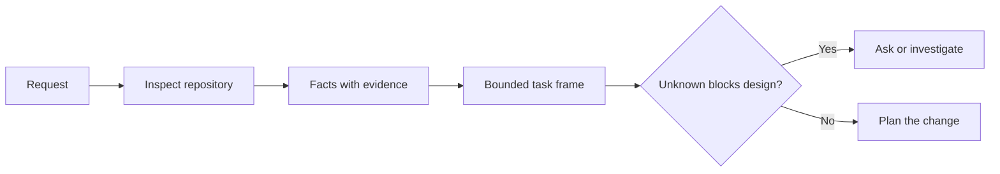

# 에이전트가 코드를 작성하기 전에 작업에 프레임

> 코딩 에이전트는 명확한 작업을 빠르게 실행할 수 있습니다. 명확하지 않은 작업을 빠르게 실행할 수 있습니다. 속도와 같지만 비용이 다르죠.

**Type:** Learn + Build
**Languages:** Python (stdlib)
**Prerequisites:** Phase 14 lessons 31 and 36
**Time:** ~60 minutes

## 학습 목표

- 편집하기 전에 요청을 제한된 작업 프레임으로 변환하십시오.
- 가설과 공개된 질문에서 저장소 사실들을 분리한다.
- 허용된 길, 금지된 길, 그리고 수용 증거를 정의하십시오.
- 탐사가 언제부터 시작될지 결정하세요.

## 값비싼 실패

중복 이메일 보호이 특정해 보인다. 그렇지 않다. 고유성은 API, 도메인 서비스 또는 데이터베이스에 속하는가? 비교 사례에 민감합니까? 이미 공개된 오류 형태는 무엇입니까? 마이그레이션이 허용되는가? 어떤 테스트가 행동을 증명합니까?

능력 있는 에이전트는 그러한 빈틈을 합리적인 선택으로 채우게 될 것입니다. 이것은 위험한 경우입니다. 왜냐하면 구현이 깨끗하고 테스트되고 여전히 시스템과 호환되지 않기 때문입니다.

따라서 코딩 에이전트 작업의 첫 번째 단위는 편집이 아니라 저장소 증거에 의해 뒷받침되는 작업 프레임입니다.

## 임무 프레임

유용한 프레임에는 6개의 필드가 있습니다.

| Field | Question |
|---|---|
| Goal | What observable behavior must change? |
| Repository facts | What did you verify in code, tests, config, or history? |
| Allowed paths | Where may the change land? |
| Forbidden paths | What must remain untouched? |
| Acceptance evidence | Which commands or observations prove the goal? |
| Unknowns | Which decisions still need evidence or human judgment? |

사실들은 수신자료가 필요합니다. API는 409을 복제용으로 사용합니다. 기존 테스트나 핸들러를 가리키기 전까지는 사실은 아닙니다. 파일 경로와 라인은 충분합니다. 행동이 중요할 때 명령 결과가 좋습니다.



## 인식 은 제한 을 찾는 일 이다

전체 저장소를 읽지 마십시오. 변경을 제한하는 표면을 검색하십시오:

1. 현재 행동과 그 호출자
2. 가장 가까운 시험입니다.
3. 공적 계약 또는 일련형 형태
4. 경로를 지향하는 프로젝트 지침
5. 구축 및 검증 명령어
6. 비슷한 완성된 변경 사항이 지역 패턴을 드러냅니다.

계획 된 모든 결정은 증거에 의해 뒷받침되거나 명시적으로 위임되거나 알려지지 않은 것으로 나열되면 멈추십시오. 그 점 이후 더 많은 읽기 는 종종 피하는 것입니다.

## 알려지지 않은 것 은 실패 이 아니다

미지의 것은 통제된 격차이고, 가정은 그 격차에 대한 통제되지 않은 답입니다.

알 수 없는 각 항목을 분류한다.

- **Discoverable:**저장소 또는 실행 시스템은 답을 줄 수 있습니다.
- **Decidable:**임무 계약은 대리인에게 선택권을 부여합니다.
- **Human:**선택은 제품 행동, 비용, 위험 또는 공공 호환성을 변화시킵니다.
- **Deferred:**선택은 이 조각 밖에 있고, 목표가 아닌 곳에 속합니다.

에이전트는 발견가능하고 위임된 미지의 것들을 계속하고, 선택이 코드 속에 묻기 전에 인간의 미지의 것들을 멈추어야 합니다.

## 실행 하기 전 에 받아들여질 것

패치 전에 증명서를 작성하세요. 증명은 다음과 같습니다.

- 집중된 단위 또는 통합 테스트 명령어
- 이름 붙여진 뷰포트와 예상 상태가 있는 브라우저 여행
- 전신 요청과 정확한 응답 계약
- 임계값을 가진 성능 측정
- 관련 없는 파일의 변경이 확인된 범위를 확인하는

 테스트 통과는 증명 계획이 아닙니다. 인증된 테스트와 그 주장을 명명하십시오.

## 건설 해

실험실에서는`TaskFrame`, 그 경계와 증거를 확인하고, 그리고`outputs/task-frame.md`- 그래

이 수업 디렉토리에서 실행하세요:

```bash
python3 code/main.py
python3 -m unittest discover code/tests -v
```

예를 4가지 방법으로 해부합니다. 목표 제거, 사실 접수 제거, 허용된 길과 금지된 경로를 초고하고, 수용 명령어를 제거합니다. 검증자는 다른 이유로 각 프레임을 거부해야합니다.

## 실제 저장소 에서 사용 하십시오

에이전트를 편집하도록 요청하기 전에

1. 목표를 행동으로 써라, 파일 변경이 아니라
2. 두 세 가지 사실을 기록하고 정확한 증거로 기록하세요.
3. 가장 작은 허용된 경로 세트를 지정해 주세요.
4. 음의 공간을 명시적으로 명명하세요.
5. 작업의 종료에 관한 명령이나 관찰을 작성하십시오.
6. 아직 못 받은 결정들을 적어라.

프레임은 하나의 화면에 맞게 되어 있어야 합니다. 그렇지 않으면 작업에는 독립적으로 확인할 수 있는 여러 변경 사항이 포함될 수 있습니다.

## 운동

1. 해결책이 제시되지 않고 저장소에서 실제 버그를 어요.
2. 프레임에 있는 하나의 주장을 찾아서 실제로는 가정이 되고 증거를 가지고 대체해
3. 공익계약에 대한 답변이 달라질 수 있는 미지의 사람을 추가해 주세요.
4. 가장 작은 안전 세트에 넓은 길을 나눕니다.
5. 수용 증명서에 범위를 확인하는 영수증을 추가합니다.

## 더 많은 읽기

- [Nuseibeh and Easterbrook, Requirements Engineering: A Roadmap](https://www.cs.toronto.edu/~sme/papers/2000/ICSE2000.pdf), 현실 세계 목표와 변화하는 제약에 대한 구현을 고정하기 위해.
- [Yang et al., SWE-agent: Agent-Computer Interfaces Enable Automated Software Engineering](https://arxiv.org/abs/2405.15793), 코딩 에이전트를 둘러싼 인터페이스가 그 효과를 변화시킨다는 증거로

## 당신 은 무엇 을 보관 합니까?

계속`outputs/task-frame.md`. 다음 수업에 대한 입력입니다. 그 때 프레임은 증거에 근거한 실행 계획으로 변합니다.
