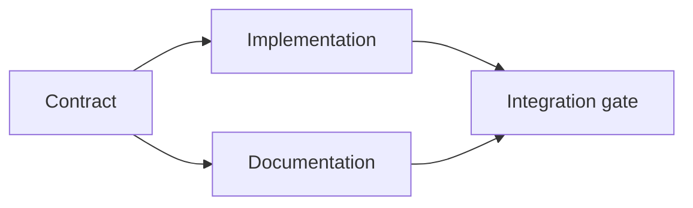

# 증거 를 뒷받침 하는 집행 계획 을 세우십시오

> 계획은 더 아름다운 작업 목록이 아니라 모든 변경 사항이 이유가 있고 모든 단말 노드가 증거가 있는 의존 그래프입니다.

**Type:** Learn + Build
**Languages:** Python (stdlib)
**Prerequisites:** Phase 14 lesson 43
**Time:** ~65 minutes

## 학습 목표

- 과제 프레임을 증거와 증거로 작업 항목으로 변환하십시오.
- 모형 순서로는 시가 순서 대신 의존성으로
- 편집하기 전에 실종된 사실, 알려지지 않은 의존성 및 순환을 탐지합니다.
- 함께 실행할 수 있는 단계와 기다려야 하는 단계의 분리된 단계

## 왜 에이전트 계획 이 실패 하는 이유

약한 계획은 미래에 요청을 반복합니다.

1. API를 업데이트하세요.
2. 테스트를 추가해
3. 문서 업데이트

그 목록에는 어떤 것이 발견되었는지, 왜 그 파일들이 올바르고, 어떤 계약이 먼저 변경되었는지, 또는 동시에 일어날 수 있는 일들에 대한 내용이 없습니다. 에이전트는 모든 단계를 따라가면서 여전히 재작업을 만들 수 있습니다.

강력한 계획은 각 작업 항목에 대해 다섯 가지 의무를 다합니다.

| Commitment | Purpose |
|---|---|
| Identifier | Stable reference for dependencies and handoff |
| Change | The smallest behavior or contract change |
| Evidence | Repository facts that justify the change |
| Dependencies | Work that must be true first |
| Proof | The exact check that closes the item |

## 계약 을 이행 하기 전 에 계획 하십시오

여러 표면이 동일한 행동에 의존할 때, 먼저 행동을 정의하십시오. 테스트, 구현, 문서화 및 통합은 네 가지 버전을 발명하는 대신 하나의 계약을 공유 할 수 있습니다.



그래프는 안전한 동시성을 드러냅니다. 계약이 확정된 후 구현과 문서화는 함께 진행될 수 있습니다. 통합은 둘 다 기다리고 있습니다.

## 증거 는 계획 을 바꾸어 놓는다

저장소 증거는 장식품이 아닙니다. 그것은 작품을 바꿀 수 있어야 합니다.

- 기존의 보조자가 계획된 새로운 추상화를 제거합니다.
- 호환성 테스트는 마이그레이션 단계를 강요합니다.
- 배포 제한은 스케마 변경을 다른 작업으로 옮긴다.
- 공공 대응 유형은 구현과 문서화 순서를 변경합니다.

증거가 계획을 바꿀 수 없다면, 그것은 그 결정에 대한 증거가 아닐 것입니다.

## 장애를 위한 설계

코딩 에이전트 세션은 예기치 않게 끝납니다. 재개할 수 있는 계획에는 다른 세션이 결정할 수 있을 만큼 작은 작업 항목이 있습니다.

- 어떤 항목이 완료되었는지;
- 어떤 증거가 나왔는지
- 어떤 유물이 변경되었는지
- 현재 어떤 의존성들이 차단되지 않은지
- 다음 안전품은 무엇일까요?

채팅의 내부의 체크 박스에서만 상태를 암호화하지 말고, 작업 옆에 계획을 저장하십시오.

## 계획 검증

실행 전에 계획을 거부하면:

- 식별자가 복제되어 있습니다.
- 작업 항목에는 증거가 없습니다.
- 작업 항목에 증거가 없습니다.
- 의존성이란 알려지지 않은 항목을 명칭하는 것이다.
- 그래프는 순환을 포함하고 있습니다.
- 첫 번째 돌이킬 수 없는 행위는 관련 불확실성이 해결되기 전에 이루어진다.

첫 번째 5개의 검사는 기계적이고 마지막은 판단을 필요로 하며 명시적으로 호출되어야 합니다.

## 건설 해

`code/main.py`작업 항목을 모델링하고, 그 수신을 검증하고, 토폴로직 분류로 실행파를 계산하고, 그리고 작성합니다 `outputs/evidence-plan.json`- 그래

실행:

```bash
python3 code/main.py
python3 -m unittest discover code/tests -v
```

예를 들어 세 개의 파도를 생성합니다. 계약 정의가 먼저 실행됩니다. 구현과 문서가 함께 실행됩니다. 통합 게이트는 마지막으로 실행됩니다.

## 코딩 에이전트 를 사용

파일 변경 전에 에이전트를 계획서를 작성하도록 요청하세요.

1. 모든 경로와 행동 주장은 저장소 인증을 가지고 있습니다.
2. 모든 항목은 명확한 완성 증거가 있습니다.
3. 그래프는 비용이 많이 드는 또는 돌이킬 수 없는 작업을 늦추는 데 그 의존하는 불확실성이 해결되기까지 미치지 않습니다.

계획에 동의해 주세요. 조심해야 한다는 약속은 아닙니다.

## 운동

1. 명시적으로 인적 승인을 필요로 하는 마이그레이션 항목을 추가합니다.
2. 순환을 만들어서 그 뒤에 숨겨진 제품 불일치에 대해 설명해 주세요.
3. 두 개의 증명 명령어를 가진 한 항목을 나눌 수 있습니다.
4. 두 번째 파동에서 실행될 수 있는 작업 항목을 추가하여 기존의 지부를 만지지 않고 실행할 수 있습니다.
5. 계획의 표본을 표시하고 JSON를 진실의 원천으로 유지하십시오.

## 더 많은 읽기

- [Nuseibeh and Easterbrook, Requirements Engineering: A Roadmap](https://www.cs.toronto.edu/~sme/papers/2000/ICSE2000.pdf), 목표, 사양, 합의, 진화 사이의 반복적 관계를 위해.
- [Barry Boehm, A Spiral Model of Software Development and Enhancement](https://dl.acm.org/doi/10.1145/12944.12948), 고정된 선형 순서보다는 위험 해소와 관련된 개발을 순서대로 하기 위해서다.

## 당신 은 무엇 을 보관 합니까?

계속`outputs/evidence-plan.json`다음 수업에서 위임 계약이 될 겁니다.
