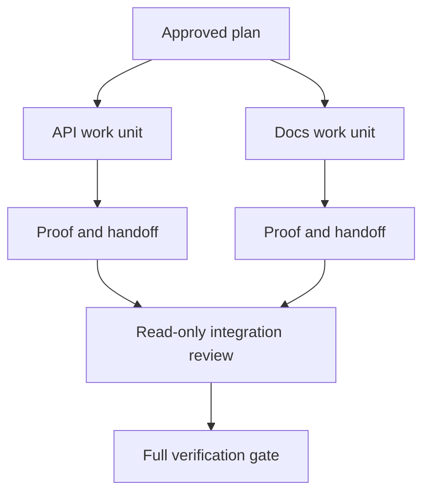

# 위임 대리인은 분리 및 합병 계약에 협력합니다

> 평행 요원은 작업이 독립적이면만 벽 시간을 절약합니다. 그렇지 않으면 명확한 작업을 더 빠른 실패율로 조정 문제로 변환합니다.

**Type:** Learn + Build
**Languages:** Python (stdlib)
**Prerequisites:** Phase 14 lessons 39 and 44
**Time:** ~70 minutes

## 학습 목표

- 위임이 실제 독립으로 정당화되는지 결정한다.
- 모든 노동자에게 전용 파일 소유권과 명시적인 증거를 제공하십시오.
- 의존성에서 계산 실행 파동
- 에이전트 업무의 안전성을 위해 합병 계약을 설계하세요.

## 평행성 시험

더 많은 에이전트가 있기 때문에 위임하지 마십시오. 적어도 이 중 하나라도 사실이라면 위임하세요:

- 두 개의 조사에서 서로 다른 알려지지 않은 질문에 독립적으로 대답할 수 있습니다.
- 두 개의 실시가 서로 분리된 파일과 계약이 있습니다.
- 재검사는 완성된 유물을 변경하지 않고 검사할 수 있다.
- 지역 작업이 계속되는 동안 느린 외부 검사가 실행될 수 있습니다.

에이전트가 동일한 파일, 동일한 해결되지 않은 결정 또는 동일한 변화 가능한 환경이 필요할 때 일련의 작업을 유지하십시오.

## 일 단위 는 계약

각 위임된 부대는 다음을 필요로 한다.

| Field | Meaning |
|---|---|
| Goal | One observable result |
| Owner | One accountable worker |
| Paths | Exclusive write ownership |
| Dependencies | Completed units required before starting |
| Proof | Exact evidence returned to the integrator |
| Handoff | Files changed, decisions made, remaining risk |

백엔드를 처리하는 것은 작업 단위 아닙니다. 중복 체크를 실행하세요 `app/accounts.py`그리고 집중된 계좌 테스트를 통해 증명합니다.

## 격리 는 세 층 이 있다

1. **Filesystem isolation:**별도의 작업나무나 모래 상자는 우연한 공유 편집을 방지합니다.
2. **Ownership isolation:**계약은 두 명의 노동자가 의도적으로 같은 길을 편집하는 것을 막습니다.
3. **State isolation:**별도의 로그와 출력으로 한 근로자가 다른 근로자의 증거를 과장하는 것을 방지합니다.

파일 시스템 격리 는 소유권 을 해결 하지 않습니다. 두 개의 깨끗한 작업 나무 는 여전히 모순적인 디자인을 생성 할 수 있습니다. 합병 계약 은 작업 시작 하기 전에 공유 인터페이스를 해결 해야 합니다.



## 통합자 는 그 일 을 다시 세우지 않는다

통합자는 다음을 해야 한다:

1. 각 송신이 주어진 범위에 해당하는 것을 확인합니다.
2. 근로자의 요약뿐만 아니라 증명 결과를 읽으십시오.
3. 의존 순서에서의 변화를 결합하는 것
4. 전체 크로스 유닛 게이트를 실행하십시오.
5. 숨겨진 범위 확장을 거부합니다.
6. 새로운 결정으로 갈등을 기록하고, 침묵으로 수정하는 것이 아닙니다.

통합이 노동자의 결과의 대부분을 다시 작성해야 한다면, 원래의 분해는 잘못되었다.

## 인간 과 대리자 역할

위임은 인간의 판단을 제거하지는 않습니다. 인간은 여전히 공공의 행동, 위험, 권위 또는 돌이킬 수 없는 비용을 변화시키는 선택의 소유자입니다. 에이전트는 제한된 조사, 구현, 검증 및 검토를 소유 할 수 있습니다.

이것은 평형 자율성입니다. 시스템은 증거와 반발이 강한 곳에서는 자유를 부여하고, 결과가 높은 곳에서는 체크포인트가 필요합니다.

## 건설 해

연구소는 경로 중복을 확인하고, 의존성을 검증하고, 안전한 실행파를 계산하고, 그리고 작성합니다.`outputs/delegation-plan.json`- 그래

실행:

```bash
python3 code/main.py
python3 -m unittest discover code/tests -v
```

이 문서의 부위를 소유자로 변경합니다`app/`이 계획은 차단되어야 합니다. 왜냐하면 그 원자 경로가 API 단위와 겹치는 것이기 때문입니다.

## 운동

1. 실제 변화를 독립적인 작업 단위 2개와 통합 단위로 분해한다.
2. 독립적으로만 보이는 제안된 병렬 분리를 찾아서 공유 결정을 명시하십시오.
3. 읽기 전용 연구원 출력으로 사실 표를 추가합니다.
4. 마지막 변경된 파일 세트를 모든 유닛 계약에 대한 확인하는 merge gate를 추가합니다.
5. 의존도가 무효되는 근로자에게 취소 규칙을 정의하십시오.

## 더 많은 읽기

- [Reid Smith, The Contract Net Protocol](https://doi.org/10.1109/TC.1980.1675516), 분산 과제 분배 및 결과 보고에 대한 초기 공식적인 처리를 위해.
- [Eric Horvitz, Principles of Mixed-Initiative User Interfaces](https://dl.acm.org/doi/10.1145/302979.303030)자동화가 언제 작동해야 하는지, 언제 사람이 통제를 받아야 하는지 결정하기 위해서

## 당신 은 무엇 을 보관 합니까?

계속`outputs/delegation-plan.json`왜 분열이 안전하고, 각 경로가 누구의 소유자이며, 통합이 어떤 증거를 받아야 하는지 기록합니다.
