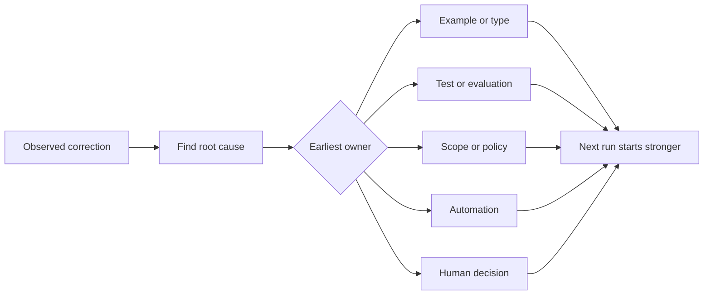

# 모든 에이전트 교정 을 시스템 개선 으로 바꾸어

> 채팅에서만 실행되는 수정은 한 번을 수정합니다. 테스트, 경계, 예제 또는 도구로 프로모션된 수정은 후속 실행마다 개선됩니다.

**Type:** Learn + Build
**Languages:** Python (stdlib)
**Prerequisites:** Phase 14 lessons 37 to 41
**Time:** ~65 minutes

## 학습 목표

- 대리인 수정을 내구성 제어로 변환합니다.
- 재발을 방지할 수 있는 가장 초기 층에 각 컨트롤을 배치하십시오.
- 안정적인 지문으로 반복된 수업을 복제합니다.
- 실제 위험을 보호하지 않는 제어기를 은퇴하십시오.

## 교정 은 증거

에이전트에게  파일을 편집하지 말라고 하면,  범위 경계가 실행되지 않는다는 것을 알게 됩니다. 이 출력 형태가 잘못되었다고 하면,  예를 또는 테스트가 빠졌다는 것을 알게 됩니다. 다시 설정이 실패하면, 환경 지식은 자동화에 속한다는 것을 알게 됩니다.

수정은 업무 시스템 에 대한 관찰 으로 간주 하십시오.

## 가장 이른 효과적 인 층 으로 발전

다음 순서를 사용하세요:

| Recurring failure | Durable destination |
|---|---|
| Wrong result or regression | Test or evaluation |
| Off-scope or unsafe action | Scope or permission policy |
| Repeated setup or command mistake | Automation or tool |
| Repeated output-format mistake | Canonical example plus validator |
| Ambiguous local convention | Instruction with a scenario check |
| Product disagreement | Human decision record |

이전 통제는 더 저렴합니다. 유효하지 않은 상태를 방지하는 타입은 나중에 잡는 리뷰 댓글보다 강합니다. 집중된 테스트는 에이전트를 기억하도록 요청하는 문장보다 강합니다.



## 라체트 기록

포착:

- 증상
- 근본적인 원인
- 그 결과
- 재발수수
- 선택된 제어
- 통제를 위한 검증
- 소유자
- 재검토 또는 퇴직일

모든 일회적 선호를 촉진하지 말고 반복이나 결과로 영구적인 복잡성을 정당화할 때 수정을 촉진하십시오.

## 증상과 원인은 분리되어 있습니다.

README을 편집한 대사는 증상입니다.

- 작업은 저장소 루트를 허용했다;
- 도크는 암묵적으로 안전하다고 간주되었습니다.
- 계획의 집합적인 실행 및 문서화
- 두 명의 노동자가 서로 상복된 소유권을 가지고 있었습니다.

각각의 원인은 다른 통제에 속합니다. 증상을 반복하는 규칙은 다음 약간 다른 경우에 실패합니다.

## 통제도 쇠퇴

오래된 컨트롤은 충돌, 맥락을 부풀어 넣고 더 이상 존재하지 않는 시스템을 암호화 할 수 있습니다. 각 추진 규칙은 퇴직 검사가 필요합니다. 다음의 경우 제거하거나 다시 작성하십시오:

- 기본 구조가 변경되었으니
- 더 강력한 실행 가능한 제어 장치가 대체되었습니다.
- 그 실패는 의미 있는 창을 통해 반복되지 않았으며
- 통제는 위험보다 더 많은 마찰을 만들어 냅니다.

목표 는 가장 긴 명령 파일 이 아니라 어렵게 얻은 판단 을 보존 하는 가장 작은 시스템 입니다.

## 건설 해

실험실에서는 수정 사항을 분류하고, 통제로 촉진하고, 지문 복제하고, 그리고 작성합니다.`outputs/feedback-ratchet.json`- 그래

실행:

```bash
python3 code/main.py
python3 -m unittest discover code/tests -v
```

같은 원인을 가진 두 가지 다른 문법의 수정들을 추가하고, 서로 연관되지 않은 실패가 붕괴되지 않고 하나의 제어 장치로 붕괴될 때까지 정상화를 개선하십시오.

## 운동

1. 최근 코딩 세션에서 5가지 수정사항을 가져와서 실제 소유자를 분류해 보세요.
2. 한 가지 시사 규칙을 실행 가능한 시험으로 대체하십시오.
3. 심각한 첫 번째 발생을 즉시 촉진하기 위해 결과 중량을 추가하십시오.
4. 연구소 출력으로 소유자 및 퇴직 날짜를 추가하십시오.
5. 기존의 에이전트 명령어를 검토하고 강력한 통제가 존재한다는 것을 증명한 후에 삭제합니다.

## 더 많은 읽기

- [Basili, Caldiera, and Rombach, The Goal Question Metric Approach](https://www.cs.toronto.edu/~sme/CSC444F/handouts/GQM-paper.pdf), 목표가 질문과 운영 측정으로 전환될 수 있도록
- [Shinn et al., Reflexion](https://arxiv.org/abs/2303.11366), 모형 무게를 변경하지 않고 나중에 결정을 개선하기 위해 피드백 흔적을 사용하기 위해.
- [Madaan et al., Self-Refine](https://arxiv.org/abs/2303.17651), 작업 루프 내부에서 반복적인 피드백과 수정

## 당신 은 무엇 을 보관 합니까?

계속`outputs/feedback-ratchet.json`. 그것은 에이전트 지원 엔지니어링 경로의 지속가능한 끝이며 미래의 작업 테이블 변경에 대한 입력입니다.
