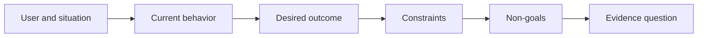

# 결과 를 선택 하기 전 에 그 결과 를 정의 하십시오

> 빠른 실행은 잘못된 문제를 선택한 것에 대한 처벌을 증가시킵니다. 먼저 결과를 형성하여 올바른 방향으로 속도를 시점합니다.

**Type:** Learn + Build
**Languages:** Python (stdlib)
**Prerequisites:** None
**Time:** ~60 minutes

## 학습 목표

- 해결책에 이름을 붙이지 않고 결과 프레임을 작성하세요.
- 사용자, 상황, 현재 행동 및 원하는 변화를 식별하십시오.
- 제한과 목표가 아닌 것을 명시적으로 설명하십시오.
- 용액이 용도로 굳어지기 전에 용액의 누출을 감지합니다.

## 결과 는 결과 로 되지 않는다

사실 보조를 구축하세요 출력 이름을 지정합니다. 누가 그것을 필요로 하는지, 무엇이 더 좋아지고 있는지, 무엇이 안전해야하는지 말하지 않습니다.

결과 프레임에는 이렇게 되어 있습니다.

> 생산 알림이 도착하면, 전화기 엔지니어는 2 분 이내에 실패 서비스와 안전한 다음 조치를 식별하고, 진단은 읽기 전용으로 유지되고 감사 할 수 있습니다.

이 문장은 소프트웨어, 런북, 데이터 수리, 또는 작은 인터페이스 변경으로 만족시킬 수 있습니다. 그것은 팀이 상상한 첫 번째 유물보다는 결과에 붙어있는 것을 유지합니다.

## 여섯 부분 의 프레임

| Part | Question |
|---|---|
| User | Who experiences the problem directly? |
| Situation | When and where does it occur? |
| Current behavior | What happens today, including workarounds? |
| Desired outcome | What observable state should improve? |
| Constraints | Which safety, policy, cost, or compatibility limits are fixed? |
| Non-goals | What tempting adjacent work is excluded? |



## 해법 유출 을 찾아

결과표는 증거로 얻은 제품 형태, 인터페이스, 모델 선택, 프레임워크 또는 아키텍처를 포함하면 솔루션이 누출됩니다.

-  사용자는 주간 AI 요약을 받습니다 요약과 순서로 유출됩니다.
- 이용자들은 승인을 받기 전에 계좌 변경을 이해합니다 결과를 명시합니다.
- 벡터 데이터베이스를 배포 인프라 누출
- 검사 과정에서 관련 정책 증거가 사용가능하다는 지표가 있습니다.

제한은 기술이 실제로 호환성이 될 때 기술 이름을 지정할 수 있습니다. 왜 그것이 고쳐졌는지 기록하십시오.

## 제한 이 결과 를 보호 한다

제약은 구현 세부 사항이 아닙니다. 그들은 실제 세계 목표의 일부입니다.

- 진단 중에 생산이 기록되지 않습니다.
- 사건 시간 예산 내에서 대응
- 기존의 감사 이벤트는 여전히 권위 있는 것으로 남아 있습니다.
- 새로운 실행 시간 의존성이 없어야 합니다.
- 접근성 행동은 그대로 유지됩니다.

한 가지 제약을 위반하여 결과를 달성하는 건물은 결과를 달성하지 못했습니다.

## 목표 가 없는 것 은 한계 를 만들어 낸다

비목표는 유용한 조각이 플랫폼으로 변하는 것을 막습니다. 좋은 비목표는 작업을 거부할 정도로 구체적입니다.

- 자동적인 고치는 없습니다.
- 새로운 경보 라우팅 시스템이 없습니다.
- 사고 지휘관의 교체가 없도록
- 이 부분에는 역사적인 분석이 없습니다.

## 건설 해

실험실에서는 검증`OutcomeFrame`그리고 글을 쓰고 있습니다.`outputs/outcome-frame.json`- 그래

```bash
python3 code/main.py
python3 -m unittest discover code/tests -v
```

원하는 결과를 사실 보조기를 사용해서 교체하십시오. 검증기는 제안된 출력이 결과로 유출되었다는 것을 표시해야 합니다.

## 운동

1. 결과 프레임으로 백록에서 기능 요청을 다시 작성하십시오.
2. 어떤 해결책이 여전히 가능하는지 변경하는 한 가지 제한을 추가하십시오.
3. 첫 번째 조각을 작게 유지하는 두 개의 목표가 아닌 것을 추가하십시오.
4. 원하는 결과를 부정하는 가장 초기 관찰을 식별하십시오.
5. 같은 결과를 만족시킬 수 있는 세 가지 다른 결과물을 적어 보세요.

## 더 많은 읽기

- [Nuseibeh and Easterbrook, Requirements Engineering: A Roadmap](https://www.cs.toronto.edu/~sme/papers/2000/ICSE2000.pdf), 소프트웨어 작업의 앵커로서 실제 세계 목표를 취급하기 위해
- [Dardenne, van Lamsweerde, and Fickas, Goal-Directed Requirements Acquisition](https://doi.org/10.1016/0167-6423(93)90021-G), 고급 목표들을 제한과 운영 요구사항으로 정비하기 위한

## 당신 은 무엇 을 보관 합니까?

계속`outputs/outcome-frame.json`다음 수업은 사람들이 실제로 수행하는 작업 흐름에 대해 테스트합니다.
