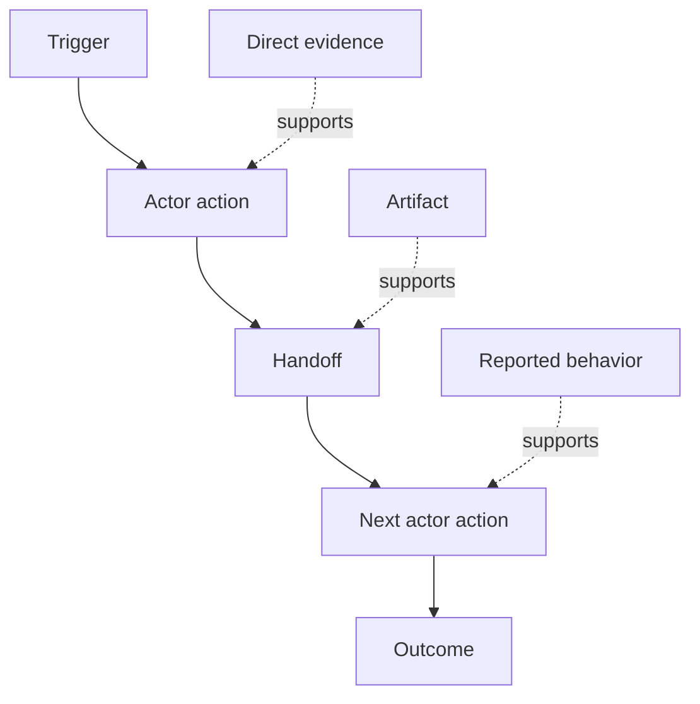

# 실제 사람 들 이 어떻게 일 하는가를 알아보십시오

> 요구 사항은 회의에서 수집될 때까지 기다리지 않고 행동, 해결 방법, 기록 및 의견 차이에 흩어져 있습니다.

**Type:** Learn + Build
**Languages:** Python (stdlib)
**Prerequisites:** Phase 14 lesson 47
**Time:** ~70 minutes

## 학습 목표

- 현재 작업 흐름을 증거로 순서대로 모델링합니다.
- 보고된 또는 추론된 행동으로부터 직접 관찰을 분리한다.
- 마찰, 양도, 권위, 숨겨진 상태를 찾아보세요.
- 불확실한 주장을 요구사항으로 바꾸지 않고 눈에 띄게 유지하십시오.

## 현재 시스템 을 시작 하십시오

사람들이 원하는 특징을 묻기 보다는 지금 일어나는 일들을 재구성하는 것부터 시작하세요.

각 단계에 대해 기록하세요:

| Field | Example |
|---|---|
| Actor | On-call engineer |
| Trigger | Production alert arrives |
| Action | Opens alert, then searches dashboards |
| Input | Alert payload and deployment record |
| Output | Candidate service and owner |
| Friction | Context switching across three tools |
| Authority | Incident commander approves a write |
| Evidence | Screen recording, incident log, runbook |

작업 흐름은 화면보다 크며, 대기, 복사, 부근 채널, 승인, 오류 복구, 그리고 사람들이 알아차리지 않는 단계들을 포함합니다.

## 증거 는 강력 하다

간단한 증거 계단을 사용하세요:

1. **Direct behavior:**관찰, 추적, 기록 또는 시스템 사건
2. **Artifact:**티켓, 런북, 로그, 양식 또는 완료된 출력
3. **Reported behavior:**한 사람이 하는 일을 설명합니다.
4. **Inference:**팀에서 무슨 일이 일어날지 결론을 내립니다.

네 가지 모두 유용할 수 있습니다. 첫 번째 두 가지만이 현재의 행동을 직접 증명합니다. 나머지 부분을 표시하여 신뢰가 조용히 부풀어지지 않도록합니다.



## 네 가지 것 을 찾아

- **Friction:**반복된 노력, 지연, 재입국 또는 회복.
- **Hidden state:**기억, 채팅 또는 개인 메모에 기록된 사실
- **Authority:**그 결과적인 변화를 일으키는 사람이나 시스템이 허용된 것이다.
- **Exceptions:**정상적인 작업 흐름이 정상적이지 않게 되는 경우

인공지능 기능은 종종 제공과 예외에서 실패합니다. 왜냐하면 행복한 길은 형성된 유일한 길이기 때문입니다.

## 의견 이 분별 된 경우 를 중점 으로 생각 하지 말아라

두 사용자가 다른 워크플로우를 수행할 수 있는 좋은 이유 있다.

- 다양한 역할
- 위험 수준이 다른
- 기존과 현재 과정
- 전문 지식의 차이
- 진정한 정책적 불일치입니다.

평균적인 작업 흐름은 아무도 설명할 수 없습니다.

## 건설 해

연구소는 작업 흐름의 모든 단계에 대한 증거를 저장하고, 순서와 신뢰를 검증하고, 직접 증거 비율을 계산하고, 그리고 작성합니다.`outputs/workflow-evidence.json`- 그래

```bash
python3 code/main.py
python3 -m unittest discover code/tests -v
```

배포 기록이 없어진 예외 경로를 추가하고, 주요 순서를 그대로 유지하고, 분할 시작 위치를 기록하십시오.

## 운동

1. 누구와도 인터뷰하지 않고 일록에서 하나의 작업 흐름을 재구성하세요.
2. 사용자와 인터뷰하고 아직 직접적인 증거가 없는 모든 주장을 표시하십시오.
3. 한 권위 경계를 추가하고 1 번의 실패 복구 단계를 추가합니다.
4. 작업 흐름의 양식을 합치지 않고 두 가지 모델로
5. 눈에 보이는 단계를 제거하지만 숨겨진 작업에 영향을 미치지 않는 제안된 특징을 식별하십시오.

## 더 많은 읽기

- [Nuseibeh and Easterbrook, Requirements Engineering: A Roadmap](https://www.cs.toronto.edu/~sme/papers/2000/ICSE2000.pdf), 특히 발현을 단순한 포착보다는 해석, 모델링 및 검증으로 취급합니다.
- [Gotel and Finkelstein, An Analysis of the Requirements Traceability Problem](https://doi.org/10.1109/ICRE.1994.292398), 요구 사항과 그 원천 사이의 관계를 보존하는 데 있어서 어려운 문제로

## 당신 은 무엇 을 보관 합니까?

계속`outputs/workflow-evidence.json`관찰된 마찰과 불확실성을 다음 수업에서 가정 지도로 변환합니다.
