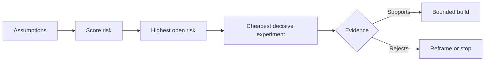

# 지도 가정 을 작성 하고 가장 위험 한 가정 을 먼저 해결 하십시오

> 로드맵은 특징들 안의 불확실성을 숨기고, 가정 지도는 그 특징들이 존재할 자격이 있기 전에 무엇이 진실해야 하는지 드러낸다.

**Type:** Learn + Build
**Languages:** Python (stdlib)
**Prerequisites:** Phase 14 lesson 48
**Time:** ~65 minutes

## 학습 목표

- 제안된 작업을 명시적인 가정으로 변환합니다.
- 점수 효과, 불확실성, 돌이킬 수 없는성
- 다음 실험을 열정을 기준으로 선택하지 말고 위험을 기준으로 선택하세요.
- 시험된 가정들을 증거와 결정으로 대체한다.

## 모든 건물 에는 도박 이 있다

사건 도구는 이 모든 것이 사실인 것을 의존할 수 있습니다:

- 경보 맥락은 서비스를 식별할 수 있는 충분한 정보를 포함하고 있습니다.
- 엔지니어들은 스스로 얻은 추천을 신뢰하지 않습니다.
- 원하는 응답 시간은 운영적으로 중요하며
- 필요한 데이터는 안전하지 않은 권한 없이 액세스 할 수 있습니다.
- 작업 흐름은 유지보수를 정당화하기 위해 충분히 자주 발생합니다.

이 작업은 구현 작업이 아니라, 건축이 가치 있고, 사용 가능하며, 실행 가능하며, 안전할 수 있는 조건입니다.

## 가정 클래스

| Class | Question |
|---|---|
| Value | Will the outcome matter enough? |
| Usability | Can the user understand and act on it? |
| Feasibility | Can the system produce it with available data and constraints? |
| Viability | Can the organization sustain cost, ownership, and operation? |
| Safety | Can it fail without unacceptable consequence? |

가설을 거짓된 진술으로 작성하십시오. 이 기능은 유용하다 테스트할 수 없습니다. 10명 중 8명의 전화 엔지니어는 읽기 전용 결과로 올바른 서비스를 더 빨리 식별합니다.

## 위험 은 한 숫자 이 아니다

실험실에서는 1에서 5까지 3차원

- **Impact:**가설이 틀린 경우 손해
- **Uncertainty:**현재 증거의 약점
- **Irreversibility:**배움 후 배움 비용

예를 들어, 스코어 (Score) 는 영향과 불확실성을 곱하고, 돌이킬 수 없는 것을 추가합니다. 공식은 보편적이지 않습니다. 그 목적은 팀이 왜 다른 미지의 문제를 다른 것보다 먼저 해결해야 하는지 설명하도록 강요하는 것입니다.



## 확정 의식 이 아니라 실험 을 설계 하십시오

유용한 테스트는 다음과 같습니다.

- 거짓일 수 있는 주장
- 인구 또는 현실적인 샘플
- 관찰 가능한 결과
- 결과 이전에 결정된 임계수준
- 다음 결정은 통과, 실패, 그리고 모호한 증거에 대한 것입니다.

팀원들이 아이디어를 만들 수 있다는 것을 보여주는 테스트를 피하십시오.

## 반전성 은 순서 를 변화 시킨다

고결과, 돌이킬 수 없는 선택은 더 일찍 증거가 필요합니다. 읽기 전용 재생은 생산 통합을 앞당길 수 있습니다. 일시적 어댑터는 데이터 마이그레이션을 앞당길 수 있습니다. 인간 승인 된 권고는 자동 동작을 앞당길 수 있습니다.

건물의 형태는 불확실성의 형태를 따라야 합니다.

## 건설 해

실험실은 가정들을 순위화하고, 테스트된 주장과 공개된 주장을 구분하고, 가장 높은 공개된 위험을 선택하고,`outputs/assumption-map.json`- 그래

```bash
python3 code/main.py
python3 -m unittest discover code/tests -v
```

가장 위험한 가정에 대한 증거를 바꾸고 다음 실험의 변화를 관찰하십시오.

## 운동

1. 여러분이 만들고 싶은 기능에 대해 다섯 가지 가정을 적어 보세요.
2. 당신의 기능 목록에서 생략한 안전 가정 하나를 추가하십시오.
3. 건설을 중단시킬 수 있는 임대점을 정의하세요.
4. 한 대의 실험을 더 저렴한 결정적인 실험으로 대체해 보세요.
5. 위험 순위를 로드맵 우선순위와 비교하고 불합의를 설명하십시오.

## 더 많은 읽기

- [Barry Boehm, A Spiral Model of Software Development and Enhancement](https://dl.acm.org/doi/10.1145/12944.12948), 위험 중심의 개발 주기를 위해 더 깊은 의지를 하기 전에 불확실성을 해결합니다.
- [Dardenne, van Lamsweerde, and Fickas, Goal-Directed Requirements Acquisition](https://doi.org/10.1016/0167-6423(93)90021-G), 장애물 및 제약을 표면에 내세워 목표를 정비하기 위해.

## 당신 은 무엇 을 보관 합니까?

계속`outputs/assumption-map.json`다음 수업에서는 결정적인 증거를 제시할 수 있는 가장 작은 조각을 선택합니다.
