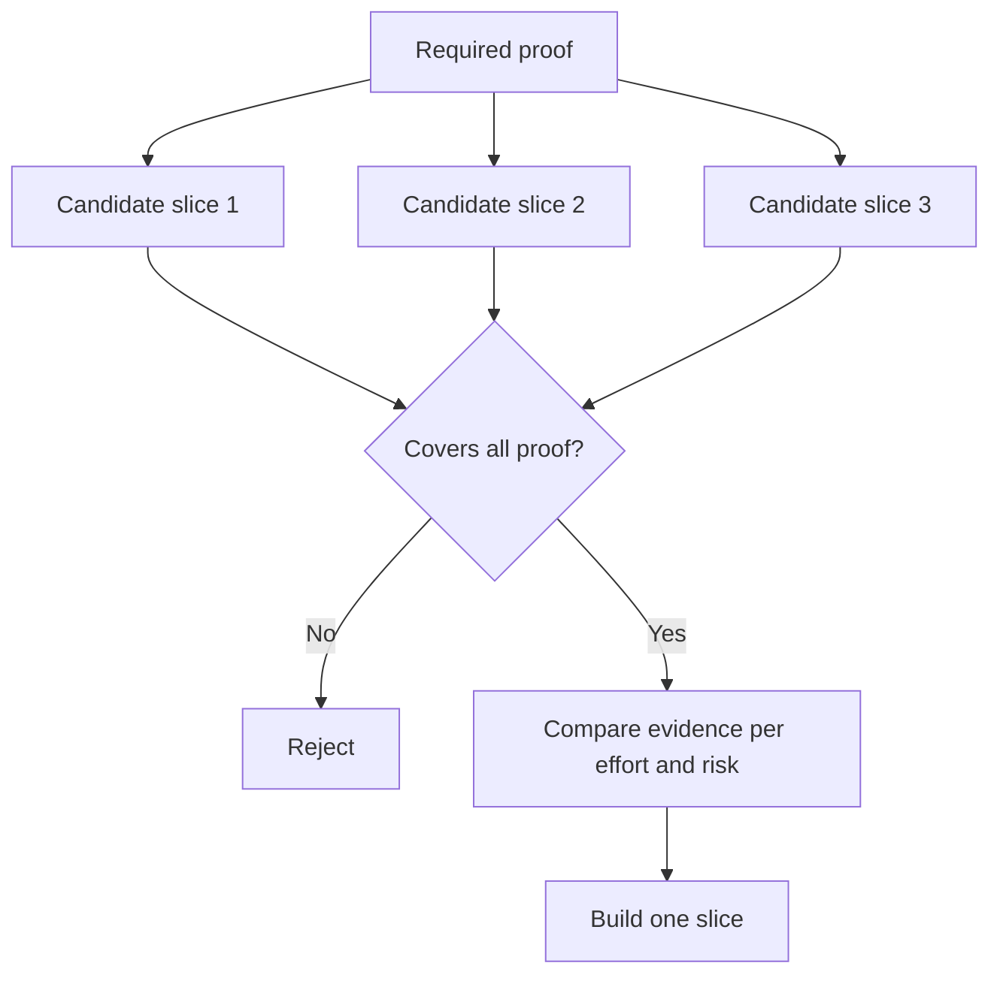

# 결정 을 변화 시킬 수 있는 가장 작은 조각 을 선택 하십시오

> 작은 것은 중요한 것을 증명할 때만 유용합니다. 다음 결정을 바꿀 수 없는 작은 건물은 단지 불완전합니다.

**Type:** Learn + Build
**Languages:** Python (stdlib)
**Prerequisites:** Phase 14 lesson 49
**Time:** ~65 minutes

## 학습 목표

- 그 가설에 따라 조각을 정의해 보세요.
- 결과값, 불확실성 감소, 노력, 그리고 결과를 균형 잡힌다.
- 조기 생산에 대한 약속보다 반전 가능한 증거가 더 좋습니다.
- 작업 흐름의 위험 부분을 생략하는 슬라이드를 거부하십시오.

## 수직적 의미 증거 끝 끝

유용한 조각은 결과를 관찰하기 위해 필요한 최소한의 실제 작업 흐름을 넘어서게 됩니다. 그것은 사용자, 데이터, 기간, 능력에 제한될 수 있습니다. 테스트해야 할 정확한 불확실성을 제거함으로써 좁혀서는 안 됩니다.

예를 들어:

- 10개의 실제 사건들을 통해 읽기 전용 재생으로 서비스 식별과 운영자의 신뢰를 테스트합니다.
- 합성 데이터에 있는 래시보드 (polished dashboard) 는 이해도를 테스트하지만 데이터의 실현 가능성을 테스트하지 않을 수 있습니다.
- 생산자동차 치료제에서 모든 것을 동시에 테스트하고

## 먼저 필요한 증거 를 정해 보십시오

가장 높은 위험성 있는 공개 가정들을 가지고 필요한 증명 집합으로 변환해 보세요. 후보 조각은 그 집합을 포함한다면만 지원할 수 있습니다.

다음으로, 합격 가능한 슬라이드를 비교합니다.

| Dimension | Direction |
|---|---|
| Outcome value | More is better |
| Uncertainty reduced | More is better |
| Effort | Less is better |
| Consequence | Less is better |
| Reversibility | More is better |

실험실 점수는 의도적으로 간단합니다. 자격 문은 수학적 것보다 더 중요합니다.



## 흔히 볼 수 있는 거짓 최소한

- **The UI-only minimum:**데이터 및 운영 불확실성을 제거합니다.
- **The infrastructure-only minimum:**사용자 가치 없이 기술적인 가능성을 증명합니다.
- **The happy-path minimum:**가장 큰 위험을 초래하는 예외를 생략합니다.
- **The demo minimum:**설득력 있는 유물을 생산하지만 반복 가능한 측정이 없습니다.
- **The platform minimum:**1개의 작업 흐름이 그것을 얻는 전에 재사용 가능한 기계를 만듭니다.

## 정지 규칙 을 추가

구현하기 전에 슬라이드가 실패하면 어떻게 되는지를 적어 주세요:

- 그 결과를 포기하고
- 대상 사용자 또는 상황을 변경
- 다른 메커니즘을 시험해 보며
- 더 나은 증거를 수집하는 것
- 더 좁은 권위를 가진다.

모든 결과가  Keep building로 이어지면,  슬라이드는 실험이 아닙니다.

## 건설 해

실험실은 지원자를 필요한 증거에 따라 필터링하고, 합격한 조각을 점수를 받고, 그리고 작성합니다.`outputs/slice-decision.json`- 그래

```bash
python3 code/main.py
python3 -m unittest discover code/tests -v
```

값이 저렴 한 후보 를 추가 하여 한 가지만 필요한 가정을 증명 하는 것 이 있습니다. 그 후보 가 높은 수치 점수를 얻더라도 그 후보 는 자격 이 없는 상태 에서 유지 해야 합니다.

## 운동

1. 다른 결과 수준에서 같은 결과를 위해 세 조각을 설계하십시오.
2. 점수를 받기 전에 필요한 증명서를 적어 주십시오.
3. 결정적인 증거를 보존하면서 한 가지 능력을 제거하십시오.
4. 실패한 조종사에게 정지 규칙을 추가해 주세요.
5. 썰매가 끝나기 전까지 기다려야 할 재사용 가능한 플랫폼 구성 요소를 식별하십시오.

## 더 많은 읽기

- [Barry Boehm, A Spiral Model of Software Development and Enhancement](https://dl.acm.org/doi/10.1145/12944.12948), 각 개발 주기를 해결해야 하는 위험과 일치시키기 위해
- [Lenarduzzi and Taibi, MVP Explained: A Systematic Mapping Study on the Definitions of Minimal Viable Product](https://arxiv.org/abs/1609.07592), 소프트웨어 제품 실무에서  최소 및  실행가능에 대한 모호함.

## 당신 은 무엇 을 보관 합니까?

계속`outputs/slice-decision.json`이 조각이 결정에 영향을 줄 수 있는 가장 작은 조각이 되는 이유를 기록합니다.
