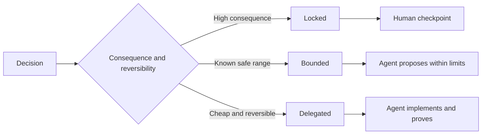

# 판단 을 유지 하는 구체적 내용 을 작성 하십시오

> 유용한 사양은 변수와 증거를 수정하고, 역전 가능한 구현 옵션을 열어두고 있습니다. 그것은 결정의 한계이며 시나리오가 아닙니다.

**Type:** Learn + Build
**Languages:** Python (stdlib)
**Prerequisites:** Phase 14 lesson 50
**Time:** ~75 minutes

## 학습 목표

- 별도의 결과, 변함없는 경우, 예제, 목표가 아닌 경우, 증명
- 결정은 봉쇄되거나 제한되거나 위임된 것으로 표시하십시오.
- 선택이 저렴하고 되돌릴 수 있는 곳에서는 대리인의 판단을 유지하세요.
- 인간 검열소를 요구합니다. 그 결과나 공공 행동의 변화가 있는 곳이죠.

## 두 가지 극심 한 악성

미분명 과제는 에이전트를 시스템 추측을 요청하고 과분명 과제는 이미 잘못된 디자인을 복사하도록 요청합니다.

유용한 중간에 실행 가능한 계약이 있습니다.

| Surface | Purpose |
|---|---|
| Outcome | The observable result |
| Invariants | Conditions that must always remain true |
| Examples | Concrete cases that reveal intent |
| Non-goals | Adjacent behavior intentionally excluded |
| Decision policy | Which choices are locked, bounded, or delegated |
| Proof | Evidence required before completion |

## 결정 방법 이 세 가지

- **Locked:**대리인은 선택하지 않습니다. 공공의 호환성, 권위, 안전, 돌이킬 수 없는 비용 또는 제품 의 약속에 사용.
- **Bounded:**에이전트는 명시적인 한계 내에서 선택할 수 있습니다. 검색 예산, 재시 count, 허용된 의존성, 또는 알려진 인터페이스 가족에 사용
- **Delegated:**대리인은 선택의 소유자이며 그것을 설명해야 합니다. 지역 구조, 이름, 역전성 리팩토어 및 구현 세부 사항에 사용하십시오.



## 예 를 통해 행동 을 구체화 하라

예제 는 명사 보다 더 잘 의도를 압축 한다.  도움 이 되는, 강하고 생산 준비 된은 실행 불가능 하다. 작은 정상, 가장자리, 실패, 금지 된 예제 는 건설자 와 검증자 모두에게 구체적 인 것을 준다.

예를 들어, 변함없는 요소가 대체되지 않습니다. 한 개의 통과 사례는 보편적인 안전 규칙을 증명할 수 없습니다.

## 증거 는 주장 과 일치 해야 한다

- 단위 테스트는 지역 기능 계약을 증명합니다.
- 철도 테스트는 일련화와 운송 행동을 증명합니다.
- 브라우저 여행은 인터페이스 경로를 증명합니다.
- 재연 집합은 대표적인 사례에 대한 행동을 증명합니다.
- 감사 기록은 권위 경계가 유지되었음을 증명합니다.

더 낮은 층을 더 높은 층의 주장의 증거로 받아들이지 마십시오.

## 의도 로 알려지지 않은 것 을 보존 하라

구체적인 내용은 집행은 시간 예산 내에 반환되는 읽기 전용 소스를 선택할 수 있다. 이것은 모호한 것이 아니라 제한과 증명을 가진 의도적으로 위임된 결정이다.

증거가 변할 때 사양이 진화해야 합니다. 잠금하고 제한된 선택의 이유를 보존해 두십시오. 그래서 나중에 연구팀은 고고학 없이 수정할 수 있습니다.

## 건설 해

실험실은 모든 계약 표면을 검증하고 결정 모드를 확인하고`outputs/executable-specification.json`- 그래

```bash
python3 code/main.py
python3 -m unittest discover code/tests -v
```

생산-작품 결정은 잠금된 것에서 위임된 것으로 이동합니다. 스키마는 값을 받아들이는 것이 아니라 제품 위험은 왜 받아들이지 않는지 설명합니다.

## 운동

1. 6개의 사양 표면에 백록 티켓을 변환합니다.
2. 3개의 구현 지침을 1개의 변수와 2개의 예로 교체한다.
3. 모든 결정을 기록하고 모든 선택의 제한을 정당화하십시오.
4. 모든 변수값에 대한 증명 인증을 추가합니다.
5. 증거나 위험성 근거가 없는 한 제한을 제거하십시오.

## 더 많은 읽기

- [Nuseibeh and Easterbrook, Requirements Engineering: A Roadmap](https://www.cs.toronto.edu/~sme/papers/2000/ICSE2000.pdf), 목표, 정확한 사양, 검증, 합의, 진화 사이의 관계를
- [Zave and Jackson, Four Dark Corners of Requirements Engineering](https://doi.org/10.1145/237432.237434), 환경 가정, 요구 사항 및 사양을 분리하기 위해.
- [Gotel and Finkelstein, An Analysis of the Requirements Traceability Problem](https://doi.org/10.1109/ICRE.1994.292398), 요구사항이 존재하는 이유와 그 원천을 보존하기 위해서

## 당신 은 무엇 을 보관 합니까?

계속`outputs/executable-specification.json`코딩 에이전트와 인간 검토자가 공유하는 계약이 됩니다.
