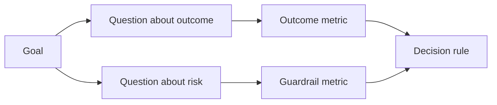

# 결과물이 나오기 전 에 성공 측정 을 설계

> 측정은 결정에 대한 답을 제공해야 합니다. 다시보드를 장식하는 것이 아니라 목표에서 시작해서 질문을 하다가 그 답을 제공하는 가장 작은 측정값을 선택해야 합니다.

**Type:** Learn + Build
**Languages:** Python (stdlib)
**Prerequisites:** Phase 14 lessons 47 and 51
**Time:** ~70 minutes

## 학습 목표

- 결과 목표에서 질문과 측정값을 추출합니다.
- 결과를 관찰하기 전에 임계, 창, 출처 및 방향을 정의하십시오.
- 결과 측정값과 경비 및 반 측정값을 결합합니다.
- 평가 증거는 빌드 지원해야 하는 결정과 일치합니다.

## 목표, 질문, 측정

목표로 시작하세요.

> 위험성 있는 행동을 증가시키지 않고 영향을 받은 서비스를 식별하는 시간을 줄여라.

질문:

- 올바른 서비스 를 얼마나 빨리 파악 할 수 있습니까?
- 얼마나 자주 확인된 서비스는 정확합니까?
- 진단은 읽기만 가능할까요?
- 작업 흐름은 경고 해제 또는 운영자의 작업 부하를 증가시키는가?

그 다음, 그 질문을 실행하는 메트릭을 선택하세요.



## 메트릭 은 계약 을 필요로 한다

모든 측정값이 필요해요

| Field | Example |
|---|---|
| Name | `median_identification_seconds` |
| Direction | at most |
| Threshold | 120 |
| Window | ten incident replays |
| Source | replay event log |
| Population | on-call engineers in the pilot |
| Kind | outcome or guardrail |

출처와 창이 없으면 숫자를 복제할 수 없습니다. 문턱이 없으면 결정을 이끌어 낼 수 없습니다.

## 결과, 경비선, 반 측정

- **Outcome metric:**원하는 상태가 개선되었나요?
- **Guardrail:**한 가지 고정된 제약이 여전히 사실이었는가?
- **Counter-metric:**지역 개선이 다른 곳에서 비용이나 피해를 입었습니까?

사고 작업 흐름에 있어서 속도만으로는 충분하지 않습니다. 정확성, 생산 기록, 운영자 작업량, 놓친 경고는 빠른 하지만 안전하지 않은 결과로부터 보호합니다.

## 온라인 과 온라인 의 증거

오프라인 재생은 반복성과 가장자리 커버리지를 위해 유용합니다. 한정 파일럿은 실제 행동, 신뢰 및 작업 흐름 효과에 유용합니다. 둘 다 다른 것을 대체하지 않습니다.

현재 결정에 대한 답을 줄 수 있는 가장 저렴한 증거를 사용하세요. 실제 사용자를 공개하지 마십시오.

## 측정 하기 전 에 결정 하십시오

결과를 보기 전에 패스, 실패, 모호한 경로를 적어라 그렇지 않으면 팀이 문턱을 이동시켜 빌드를 보호할 것입니다.

예를 들어:

- 통과: 정확한 서비스 속도 최소 0.9초, 평균 시간은 최대 120초
- 실패: 0.75 이하의 생산 적립 또는 정정률
- 모호한: 큰 차이는 있는 작은 개선, 더 큰 재연합 세트가 필요

## 건설 해

실험실은 측정 계획을 검증하고, 포함된 임계값을 평가하고, 실종된 값을 기록하고, 작성합니다.`outputs/measurement-report.json`- 그래

```bash
python3 code/main.py
python3 -m unittest discover code/tests -v
```

경비 라일 매트릭을 제거하고 결과 매트릭이 남아있는 경우에도 계획이 무효되는 이유를 관찰하십시오.

## 운동

1. 하나의 결과 목표에서 세 가지 질문을 얻으십시오.
2. 다른 역할로 옮겨진 비용을 포착하는 반 측정값을 추가합니다.
3. 매 매트릭의 출처, 인구, 창을 정의하십시오.
4. 값이 생성되기 전에 통과, 실패, 그리고 모호한 결정을 작성하십시오.
5. 수집하기 쉬운 메트릭을 찾아내지만 결정을 바꿀 수 없는 메트릭을 제거하십시오.

## 더 많은 읽기

- [Basili, Software Modeling and Measurement: The Goal/Question/Metric Paradigm](https://drum.lib.umd.edu/items/8119803a-362b-42ec-b6ce-2311713e7236), 명시된 목표로부터 운영 측정을 도출하기 위해
- [Basili, Caldiera, and Rombach, The Goal Question Metric Approach](https://www.cs.toronto.edu/~sme/CSC444F/handouts/GQM-paper.pdf), 피드백 및 개선 시스템으로 방법을 적용하기 위해

## 당신 은 무엇 을 보관 합니까?

계속`outputs/measurement-report.json`. 그것은 프로토타입, 파일럿 또는 생산 단계의 증거 게이트를 정의합니다.
