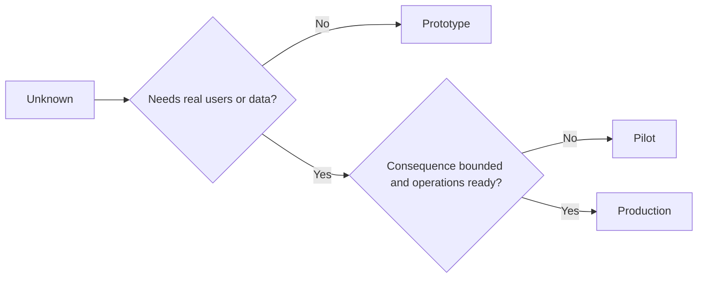

# 본체, 조종자, 생산자 를 고의 로 선택

> 이것은 다른 학습 환경이고, 화 수준이 아닙니다. 현재 알려지지 않은 것에 최소한의 불필요한 결과를 가진 단계를 선택하십시오.

**Type:** Learn + Build
**Languages:** Python (stdlib)
**Prerequisites:** Phase 14 lessons 50 to 52
**Time:** ~70 minutes

## 학습 목표

- 알려지지 않은 것, 관객, 데이터, 결과, 준비 중의 구축 단계를 선택하십시오.
- 단계별 통제와 출국 기준을 정의한다.
- 프로토타입이 생산 시스템으로 변하지 않도록 방지합니다.
- 실제 권위를 증거와 연산이 이를 정당화할 때까지 지연한다.

## 세 가지 다른 질문

| Stage | Primary question |
|---|---|
| Prototype | Can this mechanism produce the evidence at all? |
| Pilot | Does it work safely with a bounded real audience and real conditions? |
| Production | Can we own it continuously at the promised reliability and risk level? |

프로토타입은 기술적으로 완성되어도 일회용이 될 수 있습니다. 파일럿은 관객과 권위에 제한되어 있는 동안 생산 데이터를 사용할 수 있습니다. 조직이 지속적인 책임을 받아들이면 생산이 시작됩니다.

## 프로토타입

알 수 없는 것이 실제 사용자나 실제 데이터를 필요로 하지 않는 경우 프로토타입을 사용하세요.

- 분해할 수 있는
- 고립된
- 행동의 좁은 면이
- 학습문제에 대해 명시적으로 설명하고
- 거짓 운영 보증 없이

메커니즘이 또 다른 단계가 되기 전에 건축을 최적화하지 마십시오.

## 조종사

알려지지 않은 것이 실제 행동, 현실적인 데이터, 또는 실제 작업 흐름이 필요한 경우 파일럿을 사용하지만, 결과는 또는 준비가 아직 광범위한 공개와 호환되지 않습니다.

조종사는 다음을 필요로 합니다.

- 명명된 청중
- 인간 소유자
- 제한된 기간과 권한
- 감사 및 반발
- 출력 및 경비선 문턱
- 확장, 수정 또는 중단에 대한 출국 기준

## 생산

생산은 배포 이상의 필요성:

- 서비스 수준 목표
- 전화 및 사고 소유권
- 보안 및 개인정보 보호 검토
- 비용 및 용량 통제
- 반전 및 회복
- 지속적인 모니터링
- 은퇴 경로



## 단계 추락

프로토타입 코드는 소유권을 취득하지 않고 사용자, 데이터 또는 권한을 획득할 때 위험해집니다. 프로토타입 및 파일럿 경계를 구성, 액세스 제어, 텔레메트리 및 문서에 표시합니다. 경고 배너는 충분하지 않습니다.

이 단계는 시스템 자체에서 관찰될 수 있어야 합니다.

## 건설 해

실험실은 의사 결정 컨텍스트에서 단계를 선택하고 필요한 컨트롤을 반환하고 작성합니다.`outputs/stage-decisions.json`- 그래

```bash
python3 code/main.py
python3 -m unittest discover code/tests -v
```

시범 사례를 운영 준비에 따라 낮은 결과로 변경하고 생산을 정당화할 추가적인 증거는 무엇인지를 설명하십시오.

## 운동

1. 현재 진행 중인 3개의 프로젝트를 배움 단계에 따라 분류하고, 배포 상태가 아닌
2. 정지 결정을 포함하는 파일럿 출국 기준을 작성하십시오.
3. 프로토타입이 생산 데이터에 도달하지 못하게 하는 기술적 제어 장치를 추가합니다.
4. 건설 생산을 만드는 첫 번째 운영 책임을 식별하십시오.
5. 제한된 조종사에게 롤백 인증을 설계하세요.

## 더 많은 읽기

- [Barry Boehm, A Spiral Model of Software Development and Enhancement](https://dl.acm.org/doi/10.1145/12944.12948), 각 반복의 약속이 해결된 위험과 일치하기 위해.
- [Fagerholm et al., Building Blocks for Continuous Experimentation](https://doi.org/10.1145/2601248.2601276), 실험을 지속적으로 수행하기 위해 필요한 조직 및 기술 조건에 대해

## 당신 은 무엇 을 보관 합니까?

계속`outputs/stage-decisions.json`각 단계가 왜 정당화되고 다음 단계보다 먼저 어떤 통제가 있어야 하는지 기록합니다.
