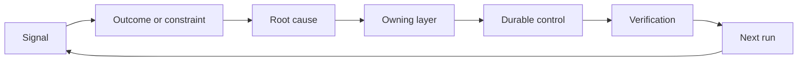

# 소유와 은퇴를 통해 피드백 래시트를 구축하십시오

> 배포는 하나의 구축 루프를 닫고 학습 루프를 열고 증거는 시스템을 바꾸어야 합니다. 아니면 아무도 소유하지 않는 텔레메트리가 될 것입니다.

**Type:** Learn + Build
**Languages:** Python (stdlib)
**Prerequisites:** Phase 14 lessons 46 and 53
**Time:** ~75 minutes

## 학습 목표

- 사건, 평가, 사용자 행동, 수정 등이 소유한 행동으로 전환됩니다.
- 각 신호를 컨텍스트, 평가, 정책, 실행 시간 또는 백록으로 로우트하십시오.
- 재발은 심각성과 빈도에 따라 우선순위를 부여하십시오.
- 모든 통제자에게 퇴직 조건이 주어지
- 증거, 타협 및 책임 있는 소유자와 함께 배달 결정을 전달하십시오.

## 피드백은 인프라

팀들은 추적, 평가, 지원 티켓, 사건 로그를 수집할 수 있습니다. 그 중 어느 하나에서도 학습하지 않고. 부족한 메커니즘은 프로모션입니다. 관찰에서 소유자와 증명으로 지속적인 변화로 정의 된 경로.

루프는 다음과 같습니다.

1. 구체적인 신호를 관찰하는 것
2. 그 결과, 제약 또는 가정에 연결하는 것
3. 원인으로 인한 가장 초기 시스템 계층을 식별하는 것
4. 제한된 변화를 만들어내기
5. 재발 가능성이 낮다는 것을 확인하는 것
6. 통제가 계속되어야 하는지 검토합니다.

## 소유층 으로 가는 길

| Signal | Destination |
|---|---|
| False positive, regression, wrong result | Evaluation or test |
| Missing context, duplicate work, stale fact | Context source or retrieval route |
| Unsafe action or authority gap | Policy or permission boundary |
| Timeout, retry storm, unavailable dependency | Runtime control |
| New product need or unresolved tradeoff | Shaped backlog item |

가장 이른 효과적 층에서 원인을 수정 하십시오. 시험 또는 허가로 인해 실패가 불가능 할 경우 또 다른 즉시 문장을 추가하지 마십시오.



## 소유권 은 통제 의 일부

모든 래시트 액션은

- 한 명의 소유자
- 결과와 재발에 기초한 우선 순위가
- 변경할 유물은
- 변경 사항을 증명하는 검증
- 재검토 또는 만료시 window;
- 은퇴 조건

더 나은 형식을 가진 관찰은 소유되지 않은 개선입니다.

## 정지 제어

피드백 시스템은 정책들을 축적합니다. 그 정책은 모순적이고 비용이 많이 들 수 있습니다.

- 건축이나 작업 흐름의 변경
- 낮은 수준의 비변수가 높은 수준의 명령어를 대체한다.
- 보호된 장애가 선택된 창에서 나타나지 않았습니다.
- 통제는 피해를 방지하는 것보다 합법적인 일을 더 자주 차단합니다.

은퇴 또한 증거가 필요합니다. 통제를 삭제하지 마십시오.

## 연결 구축 및 코딩 에이전트 피드백

같은 래시트는 두 트랙을 모두 운용합니다.

- 제품 증거는 결과 프레임, 가정, 조각 또는 측정 계획을 변경합니다.
- 코딩 에이전트 수정은 테스트, 컨텍스트, 범위, 자동화 또는 전달을 변경합니다.
- 사건은 제품 경계와 에이전트 작업 테이블을 모두 바꿀 수 있습니다.

그래서 빌드 형성은 코딩 전에 끝나는 단계가 아니라 모든 받아들여진 변화로 계속됩니다.

## 건설 해

실험실은 신호를 분류하고, 자체적인 래시치 동작을 만들고, 우선순위를 정하고, 그리고 작성합니다.`outputs/feedback-backlog.json`- 그래

```bash
python3 code/main.py
python3 -m unittest discover code/tests -v
```

실행 시간 시간 종료 신호를 추가하고, 그것은 일반적인 백록보다는 실행 시간으로 이동하는지 확인합니다.

## 연습 실험실: 역경 후 의 결정 을 내세우

경력 경로 프로젝트에서 하나의 작업 흐름을 선택하고, 한 가지 결정, 작은 실험, 검토를 통해 수행하십시오. 증거를[career delivery template](https://github.com/rohitg00/ai-engineering-from-scratch/blob/main/phases/14-agent-engineering/54-build-the-feedback-ratchet/outputs/career-delivery-evidence.md)- 그래

파이썬 연구소는 예를 들어 백록 동작을 생성합니다. 사용자가 관찰하거나 개입을 측정하거나 경력 준비 여부를 증명하지 않습니다. 실행을 완료하는 것은 이 운동에 대한 준비입니다.

### 1. 무슨 일이 일어났는지 확인 하십시오

사용자, 작업, 현재 작업 흐름 및 개선하고자 하는 결과를 기록하세요. 동의한 관찰, 편집된 지원 기록 또는 재생 가능한 작업 추적을 연결하세요. 누군가 보고한 것과 결론을 내린 것과는 관찰한 것을 분리하세요.

실패 를 찾아내십시오. 실패 한 가정, 사용 이 불가능 한 결과, 예상치 못한 비용, 또는 지연 된 전달. 어떤 증거가 당신 의 이해 를 바꾸었는지 설명 하십시오. 실패 는 성공적 인 이야기 를 기록 하는 것 이 아니라, 반응 과 결정 을 필요로 합니다.

사용자 들 과 함께 일 할 수 없다면, 동료 또는 명시 된 시나리오 를 통해 명확 히 표시 된 시뮬레이션을 실행 하십시오. 실제 사용자 증거 로부터 시뮬레이션 관찰 을 분리 하십시오. 인터뷰, 승인, 채택 또는 비즈니스 영향 을 발명 하지 마십시오.

### 2. 당신 의 권위 에 따라 발전 하십시오

가장 큰 문제 를 해결 할 수 있는 가장 저렴한 돌이킬 수 있는 조치를 선택 하고, 어떤 결정 을 내릴 수 있으며, 어떤 합의 에 의해 제한 되어 있으며, 어떤 합의 를 실행 하기 전 에 승인 해야 하는 것 을 알려 주십시오.

예를 들어, 고객 데이터를 사용 할 수 있는 허락을 기다리는 동안 편집된 오프라인 재생을 준비할 수 있습니다. 주도적인 것은 허가된 작업을 진행하고 차단된 결정을 명확하게 하는 것을 의미합니다.

### 3. 선택 을 비교 하고 결정 을 하는 사람 에게 설명

실행 세부 사항 을 필요로 하지 않는 사람 에게 짧은 의사 결정 서술 을 작성 하십시오. 다음 과 같이 포함 하십시오.

- 사용자 문제와 계획을 변경한 증거
- 적어도 두 가지 옵션, 더 저렴한 수동 또는 믿을 수 있는 경우 제작하지 않는 옵션이 포함됩니다.
- 품질, 상호작용 설계, 노력, 운영 비용 및 위험 교류
- 귀하의 추천, 불확실성 및 필요한 결정
- 결정 소유자, 영향을 받은 이해관계자 및 결정이 필요한 날짜.

동료에게 영향을 받은 이해관계자를 대표하도록 요청하고 한 타협을 도전하십시오. 반대와 그것이 어떻게 변화하거나 변경되지 않는지를 기록하십시오. 역할 플레이 피드백을 시뮬레이션으로 표시하십시오. 그것은 실제 이해관계자의 합의에 대립할 수 없습니다.

### 4. 한정 한 실험 을 수행 하십시오

답변 해야 하는 질문 에 따라 프로토타입, 파일럿, 제작 작업 을 선택 하십시오. 결과를 수집 하기 전 에 청중, 데이터, 권한, 기간, 반전 및 계속, 변경 또는 중단 할 수 있는 조건 을 정의 하십시오.

사용자 본점부터 완료된 작업까지 상호작용을 통해 이동하세요. 잘못된 출력 또는 실종 데이터 케이스를 포함하세요. 사용자가 오류를 감지하고 수정하고, 당신으로부터 숨겨진 도움 없이 복구할 수 있는지 관찰하세요.

작업 흐름의 일환으로 인간 검토 및 수정 시간을 계산하십시오. 더 빠른 모델 응답은 여전히 전체 작업을 느리게 하거나 신뢰하기 어렵게 만들 수 있습니다.

### 5. 결과 와 경제 를 비교 해 보십시오

동일한 메트릭 정의, 작업 인구, 수집 방법 및 비교 가능한 관찰 창을 사용하여 기본 라인 및 후속을 기록하십시오. 샘플 카운트, 배제 및 증거 링크를 숫자에 따라 보관하십시오. 이러한 조건이 변경되면 비교가 제한되는 이유를 설명하십시오.

한 사용자 결과, 한 품질 또는 안전 보호 선 및 전체 인적 검토 노력이 포함됩니다. 목표가 놓친 경우에도 결과를 기록하십시오. 작은 또는 시뮬레이션 샘플은 제한된 학습 주장을 뒷받침합니다. 입증 된 비즈니스 영향의 주장이 아닙니다.

모델 호출, 재실험, 지원 서비스 및 인적 검토를 사용하여 성공적으로 완료된 작업에 대한 비용을 추정하십시오. 노동률 가정과 측정된 사용량을 추정에서 분리하십시오. 그 비용을 수동 대안 또는 프로젝트 뒤에 있는 가치 가정과 비교하십시오.

기존의 [FinOps for LLMs lesson](https://aiengineeringfromscratch.com/lesson?path=phases/17-infrastructure-and-production/27-finops-llms)모델 변경은 하나의 가능한 반응일 뿐이고, 작업 흐름을 좁히거나 수동 단계 유지는 더 나은 제품 결정일 수 있습니다.

### 6. 을 닫아

미리 선언 된 기준을 사용하여 계속, 변경 또는 중단을 권장하십시오. 증거가 결정적이지 않으면, 부족한 관찰과 다음 제한된 테스트를 명명하십시오. 책임있는 의사 결정 소유자의 응답을 기록하고, 결정이 이루어지지 않은 경우 그것을 기다립니다.

배달 프로세스 자체에 대한 한 가지 개선 사항: 보다 명확한 작업 프레임, 이전 사용자 워크, 더 나은 검토 체크리스트, 더 작은 에이전트 전달 또는 더 엄격한 평가 케이스. 소유자와 검토 날짜를 지정하십시오.

검토 시, 그 개선 을 유지 하거나 수정 하거나 퇴직 하는 것 을 결정 한다. 그 선택 을 위한 증거 를 기록 한다. 목표 실패 를 막지 않고 더 많은 일 을 창출 하는 새로운 체크리스트는 영구적 인 것 을 얻지 못했다.

## 배송된 유물

복사[career-delivery-evidence.md](https://github.com/rohitg00/ai-engineering-from-scratch/blob/main/phases/14-agent-engineering/54-build-the-feedback-ratchet/outputs/career-delivery-evidence.md)본 프로젝트에 들어가서 증거 링크를 통해 완료하세요. 체크인된 템플릿을 재사용할 수 있도록 하십시오. 의사 결정 브릿, 상호 작용 통행, 측정 비교, 그리고 자신의 경력 포트폴리오 유물과 관련된 추적을 포함하세요.

## 확인 해 보

이 수동 인수 항목을 동료와 함께 사용하세요. 각 줄을 표시하세요 **met****needs work**또는**not observed**, 그리고 증거 링크를 제공하거나 특정 실종 관찰을. 채우면 판단이 옳다는 증거가 아닙니다.

| Check | Evidence that meets it |
|---|---|
| Workflow grounded | A traceable observation supports the problem; reported claims, inference, and simulation are labeled. |
| Authority respected | Reversible next work is clear, and any restricted action waits for its actual decision owner. |
| Tradeoffs communicated | Credible alternatives, a stakeholder objection, a recommendation, and an explicit decision request are recorded. |
| Interaction tested | The walkthrough covers success, failure, recovery, and human review effort. |
| Outcome compared | Baseline and follow-up definitions align; samples, guardrails, costs, and comparison limits are visible. |
| Setback owned | The evidence changes a continue/change/stop decision and an accountable next action. |
| Process improved | One workflow improvement has an owner, review date, and an evidence-based keep/revise/retire decision. |

실제 사용자들의 관찰되지 않은 행동은 시뮬레이션 단계가 지나면에도 격차가 남아 있습니다. 포트폴리오 청구서에서 그 경계를 유지하고 그것을 닫기 위해 필요한 다음 관찰을 식별하십시오.

## 운동

1. 한 사건과 한 사용자 불만을 돌로 바꾸어 놓으세요.
2. 모든 재발을 막을 수 있는 가장 초기 층을 명명하세요.
3. 실험실 출력에 검증 명령어 또는 관찰을 추가합니다.
4. 정책 규칙에 대한 퇴직 조건을 정의하십시오.
5. 1번의 트레이스 1번의 픽업은 다음 작업 프레임으로 다시 받아들여집니다.

## 더 많은 읽기

- [Basili, Caldiera, and Rombach, The Goal Question Metric Approach](https://www.cs.toronto.edu/~sme/CSC444F/handouts/GQM-paper.pdf), 목표 지향적인 측정을 통해 조직 학습을 위해.
- [Fagerholm et al., Building Blocks for Continuous Experimentation](https://doi.org/10.1145/2601248.2601276), 증거와 지속적인 제품 개발을 연결하는 기술 및 조직적 루프에 대해.
- [Nuseibeh and Easterbrook, Requirements Engineering: A Roadmap](https://www.cs.toronto.edu/~sme/papers/2000/ICSE2000.pdf), 시스템 생활주기를 통해 진화하는 요구 사항을 처리하기 위해.

## 당신 은 무엇 을 보관 합니까?

계속`outputs/feedback-backlog.json`로우팅 예제와 자신의 결정의 기록으로 완성된 경력 전달 증거로 제품 판단 및 배달 경로를 닫고 다음 결과 프레임을 알립니다.
