# 통신 프로토콜

> 같은 언어를 못 쓰는 요원들은 팀이 아니라, 공허함을 외치는 낯선 사람들입니다.

**Type:** Build
**Languages:** TypeScript
**Prerequisites:** Phase 14 (Agent Engineering), Lesson 16.01 (Why Multi-Agent)
**Time:** ~120 minutes

## 학습 목표

- 외부 서버에 의해 노출된 도구를 사용하도록 MCP 도구 발견 및 호출을 구현
- A2A 에이전트 카드 및 작업 엔드포인트를 구축하여 하나의 에이전트가 HTTP를 통해 다른 사람에게 작업을 할당할 수 있습니다
- MCP (툴 액세스), A2A ( 에이전트에서 에이전트), ACP (기업 감사) 및 ANP (분권화된 신뢰) 를 비교하고 어떤 프로토콜이 어떤 문제를 해결하는지 설명하십시오.
- 여러 프로토콜을 하나의 시스템으로 연결하여 에이전트가 MCP를 통해 도구를 발견하고 A2A를 통해 작업을 위임할 수 있습니다.

## 문제

여러분은 시스템을 여러 에이전트로 나눕니다. 연구자, 코더, 평론가. 그들은 각 직업에서 훌륭합니다. 하지만 이제 여러분은 실제로 서로 이야기 할 필요가 있습니다.

첫 번째 시도는 명백합니다. 문자열을 전달합니다. 연구자는 텍스트의 분포를 반환하고, 코더는 그것을 할 수있는 방식으로 분석합니다. 코더가 연구 요약을 잘못 해석하거나 두 명의 에이전트가 서로 기다리고있는 정지경이 될 때까지 작동합니다. 또는 서로 다른 팀이 협력하기 위해 만든 에이전트가 필요합니다. 갑자기 "정지 문자열"이 무너집니다.

통신 프로토콜 문제입니다. 에이전트가 정보를 교환하는 방식에 대한 공유 계약이 없으면, 멀티 에이전트 시스템은 취약하고,

인공지능 생태계는 네 개의 프로토콜을 통해 대응했습니다. 각각의 프로토콜은 문제의 다른 부분을 해결했습니다.

- **MCP**도구 접근
- **A2A**대리인 간 협업
- **ACP**기업 감사 가능성에 관한 사항
- **ANP**분산된 정체성과 신뢰를 위한

이 수업은 깊이 있습니다. 각 스펙에서 실제 문자 형식을 읽고, 작동하는 구현을 만들고, 네 가지 모두 통일된 시스템으로 연결할 것입니다.

## 개념

### 프로토콜 풍경

이 네 개의 프로토콜을 계층으로 생각해 보세요. 각 계층은 다른 질문을 다루고 있습니다.

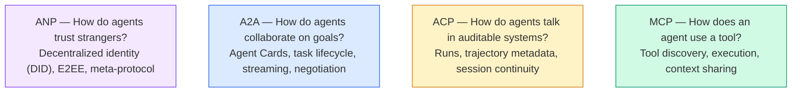

경쟁자가 아니라 다양한 수준에서 다양한 문제를 해결합니다.

### MCP (재정)

MCP는 단계 13에서 깊이 다루어집니다. 빠른 재결합: MCP는 LLM가 외부 도구와 데이터 소스에 연결되는 방식을 표준화합니다.**client-server**에이전트 (클라이언트) 가 서버에 의해 노출된 도구를 발견하고 호출하는 프로토콜

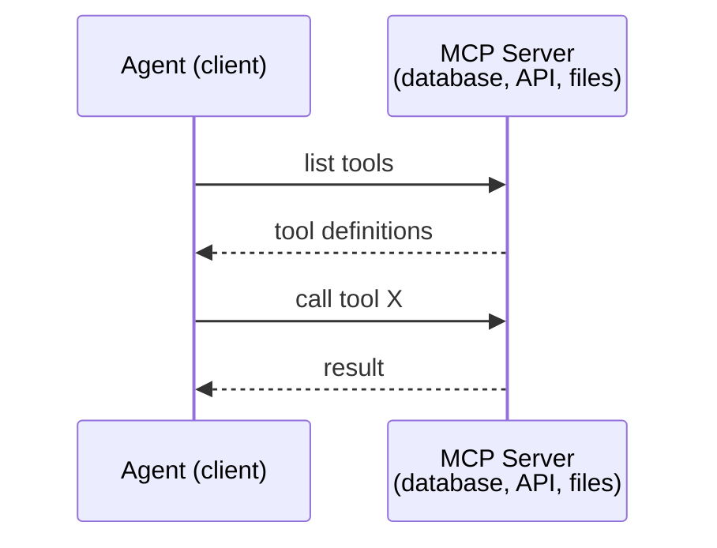

MCP는**agent-to-tool**통신은 에이전트가 서로 대화하는 데 도움이 되지 않습니다.

### A2A (Agent2Agent 프로토콜)

**Created by:**구글 (지금은 리눅스 재단법인`lf.a2a.v1`)
**Spec version:**1.0.1
**Problem:**자율적인 요원들은 어떻게 협력하고 협상하고 서로 업무를 위임하는가?

A2A는**peer-to-peer agent collaboration**.MCP가 에이전트를 도구에 연결하는 경우, A2A는 에이전트를 다른 에이전트들과 연결합니다. 각 에이전트는**Agent Card**잘 알려진 URL에 접속하여 다른 에이전트가 발견하고 협상하고 그 사람에게 업무를 위임합니다.

#### A2A의 작동 방식

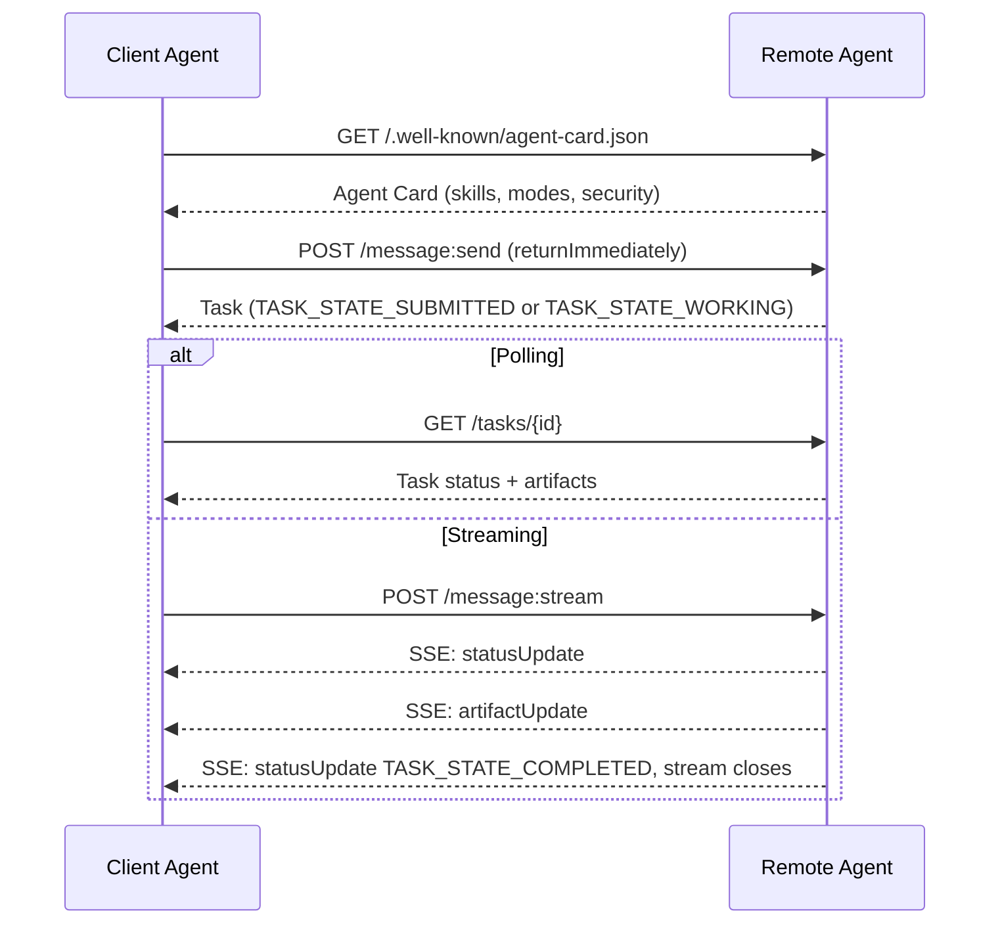

#### 진짜 에이전트 카드

A2A 에이전트 카드의 모습은 이렇습니다.`GET /.well-known/agent-card.json`이 부분의 본문은

```json
{
  "name": "Research Agent",
  "description": "Searches documentation and summarizes findings",
  "version": "1.0.0",
  "supportedInterfaces": [
    {
      "url": "https://research-agent.example.com/a2a/v1",
      "protocolBinding": "JSONRPC",
      "protocolVersion": "1.0"
    },
    {
      "url": "https://research-agent.example.com/a2a/rest",
      "protocolBinding": "HTTP+JSON",
      "protocolVersion": "1.0"
    }
  ],
  "provider": {
    "organization": "Your Company",
    "url": "https://example.com"
  },
  "capabilities": {
    "streaming": true,
    "pushNotifications": false
  },
  "defaultInputModes": ["text/plain", "application/json"],
  "defaultOutputModes": ["text/plain", "application/json"],
  "skills": [
    {
      "id": "web-research",
      "name": "Web Research",
      "description": "Searches the web and synthesizes findings",
      "tags": ["research", "search", "summarization"],
      "examples": ["Research the latest changes in React 19"]
    },
    {
      "id": "doc-analysis",
      "name": "Documentation Analysis",
      "description": "Reads and analyzes technical documentation",
      "tags": ["docs", "analysis"],
      "inputModes": ["text/plain", "application/pdf"],
      "outputModes": ["application/json"]
    }
  ],
  "securitySchemes": {
    "bearer": {
      "httpAuthSecurityScheme": {
        "scheme": "Bearer",
        "bearerFormat": "JWT"
      }
    }
  },
  "securityRequirements": [{ "schemes": { "bearer": { "list": [] } } }]
}
```

주목할 만한 주요 사항:
- **Skills**이 모든 것은 에이전트가 할 수 있는 것입니다. 각각의 아이디, 태그, 그리고 지원된 입력/출력 MIME 유형이 있습니다. 클라이언트 에이전트가 이 원격 에이전트가 요청을 처리할 수 있는지 여부를 결정하는 방법입니다.
- **supportedInterfaces**여러 프로토콜 결합을 목록으로 합니다. 단일 에이전트는 JSON-RPC, REST, gRPC를 동시에 말할 수 있습니다.
- **Security**카드에 내장되어 있습니다: `securitySchemes`각 계획의 명칭과`securityRequirements`어떤 저작물이 적용되는지 알 수 있습니다.

#### 임무 생명주기

작업은 A2A의 핵심 작업 단위입니다. 그들은 정의된 상태를 거쳐 이동합니다 (사진은                 )`TASK_STATE_`각 주가 전선을 가지고 있는 사전자):

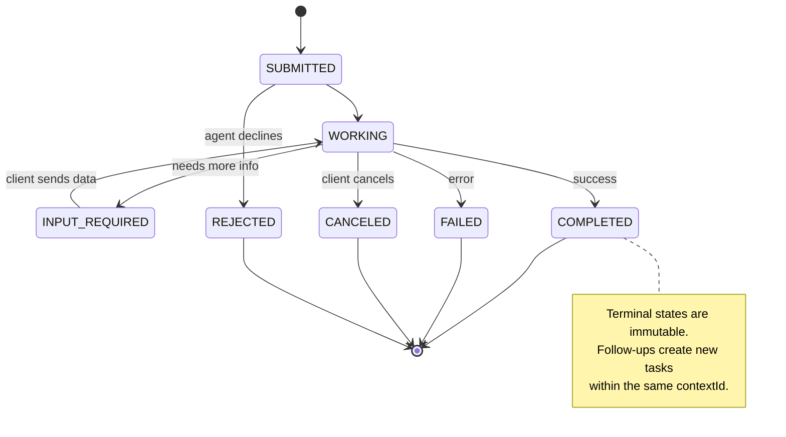

8개국 모두 (특정상 또한 정의합니다)`UNSPECIFIED`경비자로서, 여기서 생략):

| State | Terminal? | Meaning |
|---|---|---|
| `TASK_STATE_SUBMITTED` | No | Acknowledged, not yet processing |
| `TASK_STATE_WORKING` | No | Actively being processed |
| `TASK_STATE_INPUT_REQUIRED` | No | Agent needs more info from client |
| `TASK_STATE_AUTH_REQUIRED` | No | Authentication needed |
| `TASK_STATE_COMPLETED` | Yes | Finished successfully |
| `TASK_STATE_FAILED` | Yes | Finished with error |
| `TASK_STATE_CANCELED` | Yes | Canceled before completion |
| `TASK_STATE_REJECTED` | Yes | Agent declined the task |

작업이 터미널 상태로 도달하면 변경되지 않습니다. 더 이상의 메시지가 없습니다. 추적은 동일한 작업 내에서 새로운 작업을 만듭니다.`contextId`- 그래

#### 와이어 형식

A2A는 JSON-RPC 2.0를 사용합니다. 실제 메시지 교환이 어떻게 생겼는지 다음과 같습니다.

**Client sends a message:**
```json
{
  "jsonrpc": "2.0",
  "id": 1,
  "method": "SendMessage",
  "params": {
    "message": {
      "messageId": "msg-001",
      "role": "ROLE_USER",
      "parts": [{ "text": "Research React 19 compiler features" }]
    },
    "configuration": {
      "acceptedOutputModes": ["text/plain", "application/json"],
      "historyLength": 10
    }
  }
}
```

**Agent responds with a task:**
```json
{
  "jsonrpc": "2.0",
  "id": 1,
  "result": {
    "task": {
      "id": "task-abc-123",
      "contextId": "ctx-xyz-789",
      "status": {
        "state": "TASK_STATE_COMPLETED",
        "timestamp": "2026-03-27T10:30:00Z"
      },
      "artifacts": [
        {
          "artifactId": "art-001",
          "name": "research-results",
          "parts": [{
            "data": {
              "findings": [
                "React 19 compiler auto-memoizes components",
                "No more manual useMemo/useCallback needed",
                "Compiler runs at build time, not runtime"
              ]
            },
            "mediaType": "application/json"
          }]
        }
      ]
    }
  }
}
```

**Streaming via SSE:**
```text
POST /message:stream HTTP/1.1
Content-Type: application/a2a+json
A2A-Version: 1.0

data: {"task":{"id":"task-123","contextId":"ctx-123","status":{"state":"TASK_STATE_WORKING"}}}

data: {"statusUpdate":{"taskId":"task-123","contextId":"ctx-123","status":{"state":"TASK_STATE_WORKING","message":{"messageId":"msg-002","role":"ROLE_AGENT","parts":[{"text":"Searching documentation..."}]}}}}

data: {"artifactUpdate":{"taskId":"task-123","contextId":"ctx-123","artifact":{"artifactId":"art-1","parts":[{"text":"partial findings..."}]},"append":true,"lastChunk":false}}

data: {"statusUpdate":{"taskId":"task-123","contextId":"ctx-123","status":{"state":"TASK_STATE_COMPLETED"}}}
```

### ACP (기자 통신 프로토콜)

**Created by:**IBM / BeeAI
**Spec version:**0.2.0 (OpenAPI 3.1.1)
**Status:**리눅스 재단 하에 A2A에 통합
**Problem:**어떻게 에이전트가 완전한 감사성, 세션 연속성, 궤도를 추적하는 방식으로 통신하는 걸까요?

ACP는**enterprise protocol**많은 요약에서 주장하는 것과 달리 ACP는**not**JSON-LD를 사용합니다. 이것은 OpenAPI를 통해 정의된 간단한 REST/JSON API입니다.**TrajectoryMetadata**: 각 에이전트 응답은 그 결과를 가져온 논리 단계와 도구 호출에 대한 상세한 기록을 가지고 있을 수 있습니다.

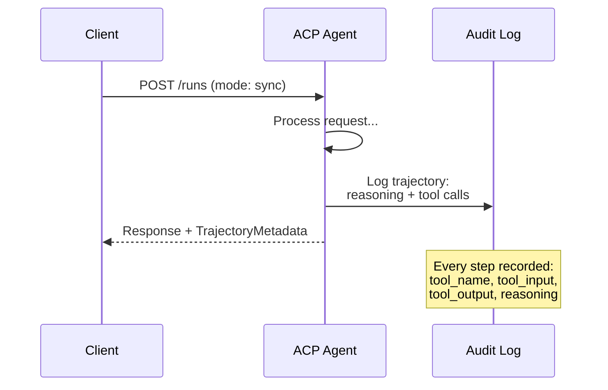

#### ACP에서 디스커버리 요원

ACP는 네 가지 발견 방법을 정의합니다.

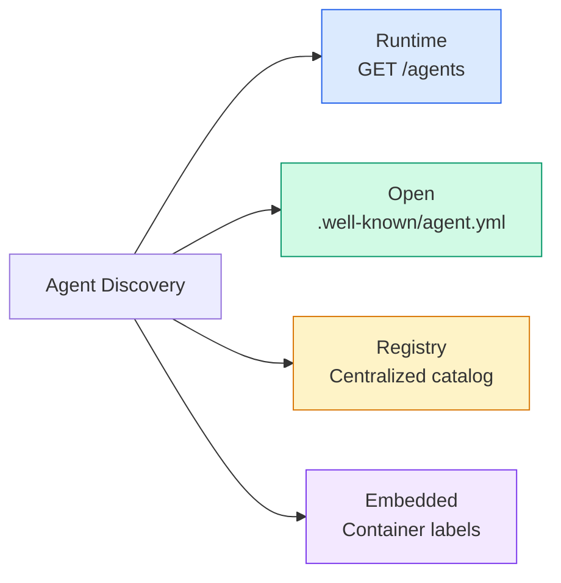

**AgentManifest**A2A의 에이전트 카드보다 간단합니다.

```json
{
  "name": "summarizer",
  "description": "Summarizes documents with source citations",
  "input_content_types": ["text/plain", "application/pdf"],
  "output_content_types": ["text/plain", "application/json"],
  "metadata": {
    "tags": ["summarization", "RAG"],
    "framework": "BeeAI",
    "capabilities": [
      {
        "name": "Document Summarization",
        "description": "Condenses long documents into key points"
      }
    ],
    "recommended_models": ["llama3.3:70b-instruct-fp16"],
    "license": "Apache-2.0",
    "programming_language": "Python"
  }
}
```

#### 생명주기를 실행

ACP는 "tasks" 대신 "run"를 사용합니다. run는 세 가지 모드를 가진 에이전트 실행입니다.

| Mode | Behavior |
|---|---|
| `sync` | Blocking. Response contains the complete result. |
| `async` | Returns 202 immediately. Poll `GET /runs/{id}` for status. |
| `stream` | SSE stream. Events fire as the agent works. |

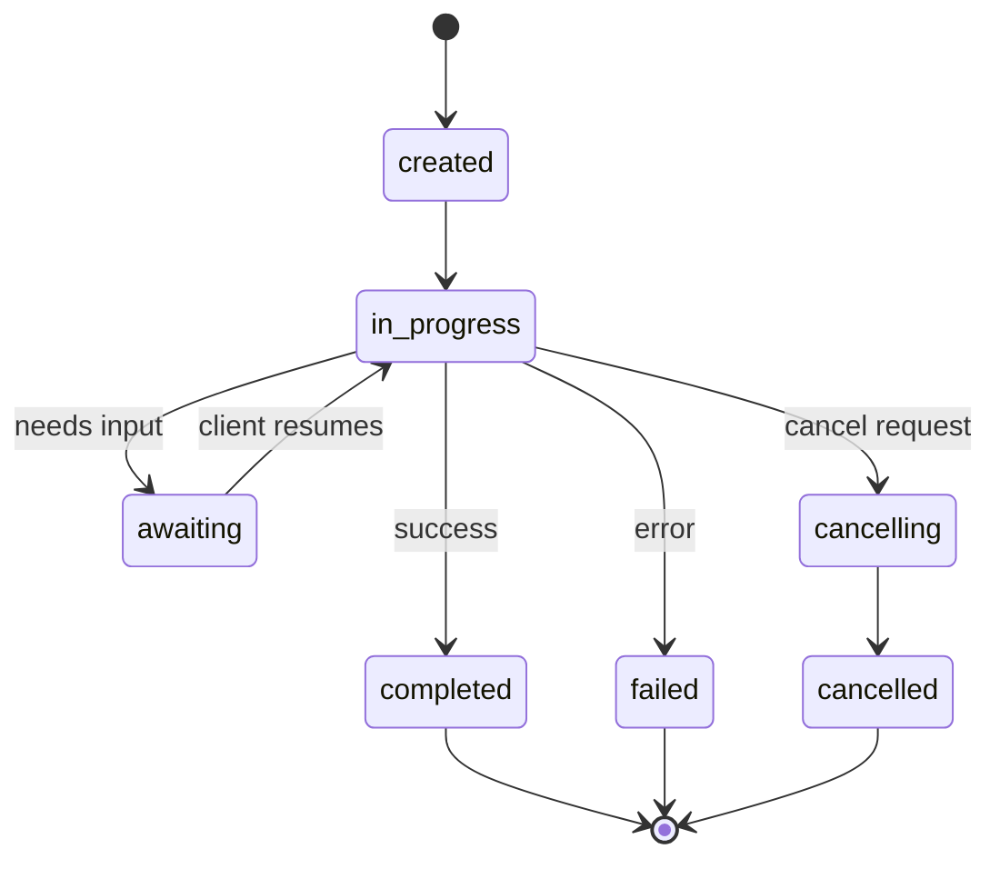

#### 궤도 메타데이터 (감사 경로)

이것은 ACP의 핵심 차별입니다. 모든 메시지 부분에는 에이전트가 정확히 무엇을 했는지 보여주는 메타데이터가 포함될 수 있습니다.

```json
{
  "role": "agent/researcher",
  "parts": [
    {
      "content_type": "text/plain",
      "content": "The weather in San Francisco is 72F and sunny.",
      "metadata": {
        "kind": "trajectory",
        "message": "I need to check the weather for this location",
        "tool_name": "weather_api",
        "tool_input": { "location": "San Francisco, CA" },
        "tool_output": { "temperature": 72, "condition": "sunny" }
      }
    }
  ]
}
```

규제 산업에 있어서 이것은 금입니다. 모든 답은 증명 가능한 논리 체인과 함께 있습니다. 어떤 도구가 호출되었는지, 어떤 입력가 사용되었는지, 어떤 출력들이 수신되었는지. 블랙박스 없습니다.

ACP는 또한 지원합니다**CitationMetadata**소스 배정:

```json
{
  "kind": "citation",
  "start_index": 0,
  "end_index": 47,
  "url": "https://weather.gov/sf",
  "title": "NWS San Francisco Forecast"
}
```

### ANP (원 네트워크 프로토콜)

**Created by:**오픈소스 커뮤니티 (가오웨이 가 설립)
**Repo:** [github.com/agent-network-protocol/AgentNetworkProtocol](https://github.com/agent-network-protocol/AgentNetworkProtocol)
**Problem:**어떻게 다른 조직의 에이전트가 중앙 권위를 받지 않고 서로 신뢰할 수 있을까요?

ANP는 **decentralized identity protocol**. W3C 분산 식별자 (DID) 및 엔드-투-엔드 암호화 (End-to-End Encryption) 를 사용하여 신뢰를 구축합니다. A2A와 달리 A2A는 알려진 엔드포인트를 통해 에이전트를 발견합니다.

ANP는 세 층으로 구성되어 있습니다.

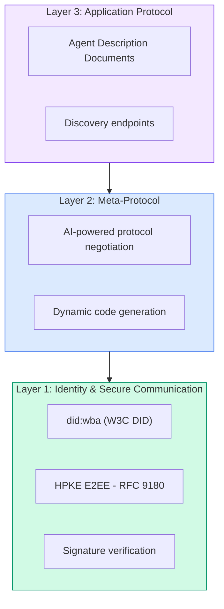

#### DID 문서 (실적 구조)

ANP는 사용자 지정 DID 방법을 사용합니다.`did:wba`(웹 기반 에이전트)`did:wba:example.com:user:alice``https://example.com/user/alice/did.json`이 부분의 본문은

```json
{
  "@context": [
    "https://www.w3.org/ns/did/v1",
    "https://w3id.org/security/suites/jws-2020/v1",
    "https://w3id.org/security/suites/secp256k1-2019/v1"
  ],
  "id": "did:wba:example.com:user:alice",
  "verificationMethod": [
    {
      "id": "did:wba:example.com:user:alice#key-1",
      "type": "EcdsaSecp256k1VerificationKey2019",
      "controller": "did:wba:example.com:user:alice",
      "publicKeyJwk": {
        "crv": "secp256k1",
        "x": "NtngWpJUr-rlNNbs0u-Aa8e16OwSJu6UiFf0Rdo1oJ4",
        "y": "qN1jKupJlFsPFc1UkWinqljv4YE0mq_Ickwnjgasvmo",
        "kty": "EC"
      }
    },
    {
      "id": "did:wba:example.com:user:alice#key-x25519-1",
      "type": "X25519KeyAgreementKey2019",
      "controller": "did:wba:example.com:user:alice",
      "publicKeyMultibase": "z9hFgmPVfmBZwRvFEyniQDBkz9LmV7gDEqytWyGZLmDXE"
    }
  ],
  "authentication": [
    "did:wba:example.com:user:alice#key-1"
  ],
  "keyAgreement": [
    "did:wba:example.com:user:alice#key-x25519-1"
  ],
  "humanAuthorization": [
    "did:wba:example.com:user:alice#key-1"
  ],
  "service": [
    {
      "id": "did:wba:example.com:user:alice#agent-description",
      "type": "AgentDescription",
      "serviceEndpoint": "https://example.com/agents/alice/ad.json"
    }
  ]
}
```

주목할 만한 주요 사항:
- **Key separation**서명 키 (secp256k1) 는 암호화 키 (X25519) 에서 분리된다.
- **`humanAuthorization`**이 키는 사용 전에 명시적인 인적 승인 (바이오메트릭, 비밀번호, HSM) 를 필요로 한다.
- **`keyAgreement`**HPKE 엔드-투-엔드 암호화 (RFC 9180) 에 필요한 키가 사용된다.
- **service**섹션에서는 에이전트 설명 문서에 대한 링크가 있습니다.

#### ANP 에서 신뢰가 어떻게 작용 하는 것 입니까?

ANP가**not**신뢰의 웹 또는 승인 그래프를 사용하십시오. 신뢰는 양방면이며 상호 작용에 따라 검증됩니다:

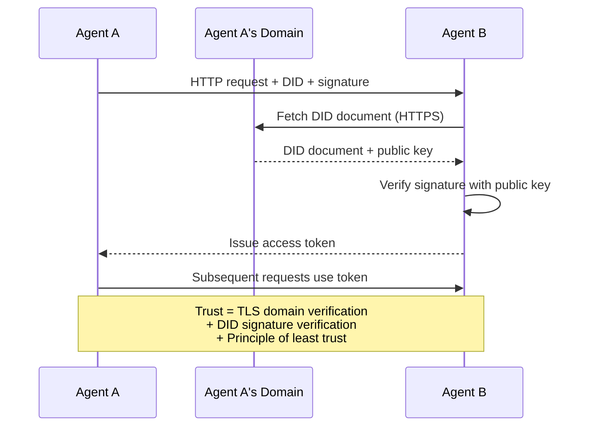

신뢰는 세 가지 원천에서 나온다.
1. **Domain-level TLS**DID 문서 호스트를 확인합니다
2. **DID cryptographic signatures**대리인의 신원을 확인
3. **Principle of least trust**최소한의 권한만 부여합니다

거론에 기반한 신뢰 증식이나 페이지랭크 점수를 받지 않습니다. 당신은 각 에이전트를 직접 DID를 통해 확인합니다.

#### 메타 프로토콜 협상

이것은 ANP의 가장 새로운 특징입니다. 서로 다른 생태계에서 온 두 명의 에이전트가 만나면, 미리 합의된 데이터 형식이 필요하지 않습니다. 그들은 자연어로 협상을 합니다.

```json
{
  "action": "protocolNegotiation",
  "sequenceId": 0,
  "candidateProtocols": "I can communicate using:\n1. JSON-RPC with hotel booking schema\n2. REST with OpenAPI 3.1 spec\n3. Natural language over HTTP",
  "modificationSummary": "Initial proposal",
  "status": "negotiating"
}
```

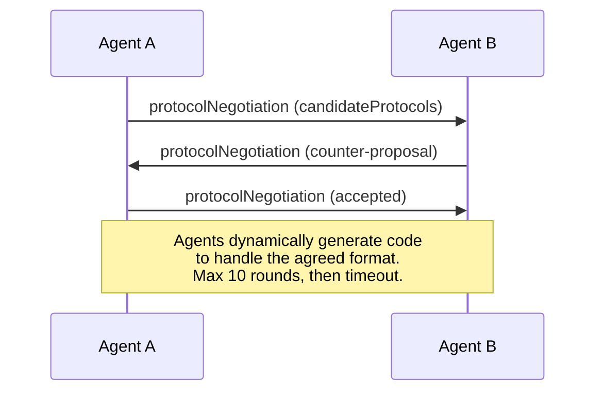

에이전트는 포맷에 합의하기 전까지 앞뒤로 이동합니다.`negotiating``rejected``accepted``timeout`- 그래

이것은 이전에 서로 본 적이 없는 두 명의 에이전트가 공유된 스키마를 미리 정의하지 않고 통신하는 방법을 알아낼 수 있다는 것을 의미합니다.

### 비교 (정정부)

| | MCP | A2A | ACP | ANP |
|---|---|---|---|---|
| **Created by** | Anthropic | Google / Linux Foundation | IBM / BeeAI | Community |
| **Spec format** | JSON-RPC | JSON-RPC / REST / gRPC | OpenAPI 3.1 (REST) | JSON-RPC |
| **Primary use** | Agent to Tool | Agent to Agent | Agent to Agent | Agent to Agent |
| **Discovery** | Tool listing | `/.well-known/agent-card.json` | `GET /agents`, `/.well-known/agent.yml` | `/.well-known/agent-descriptions`, DID service endpoints |
| **Identity** | Implicit (local) | Security schemes (OAuth, mTLS) | Server-level | W3C DID (`did:wba`) with E2EE |
| **Audit trail** | N/A | Basic (task history) | TrajectoryMetadata (tool calls, reasoning) | Not formally specified |
| **State machine** | N/A | 9 task states | 7 run states | N/A |
| **Streaming** | N/A | SSE | SSE | Transport-agnostic |
| **Unique feature** | Tool schemas | Agent Cards + Skills | Trajectory audit trail | Meta-protocol negotiation |
| **Best for** | Tools & data | Dynamic collaboration | Regulated industries | Cross-org trust |
| **Status** | Stable | Stable (v1.0) | Merging into A2A | Active development |

### 어떻게 함께 일 하는가

이 프로토콜들은 상호 배제적이지 않습니다. 현실적인 기업 시스템은 여러 가지 방법을 사용합니다.

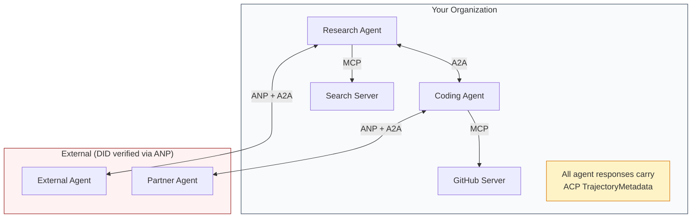

- **MCP**각 에이전트를 도구에 연결합니다
- **A2A**대리인 (내외 및 외부) 간의 협력을 처리합니다
- **ACP**수감가능성을 위해 궤도 메타데이터로 응답을 포장합니다
- **ANP**당신이 통제하지 않는 에이전트들을 위한 신분 확인을 제공합니다.

```figure
swarm-message-bus
```

## 건설 해

### 단계 1: 핵심 메시지 유형

모든 멀티 에이전트 시스템은 메시지 형식으로 시작됩니다. 우리는 실제 프로토콜이 사용하는 것과 지도를 나타내는 유형을 정의합니다.

```typescript
import crypto from "node:crypto";

type MessageRole = "ROLE_USER" | "ROLE_AGENT";

type MessagePart =
  | { text: string }
  | { data: unknown; mediaType: string }
  | { url: string; filename: string; mediaType: string };

type TrajectoryEntry = {
  reasoning: string;
  toolName?: string;
  toolInput?: unknown;
  toolOutput?: unknown;
  timestamp: number;
};

type AgentMessage = {
  id: string;
  role: MessageRole;
  parts: MessagePart[];
  trajectory?: TrajectoryEntry[];
  replyTo?: string;
  timestamp: number;
};

function createMessage(
  role: MessageRole,
  parts: MessagePart[],
  replyTo?: string
): AgentMessage {
  return {
    id: crypto.randomUUID(),
    role,
    parts,
    replyTo,
    timestamp: Date.now(),
  };
}

function textMessage(role: MessageRole, text: string): AgentMessage {
  return createMessage(role, [{ text }]);
}
```

참고:`MessagePart`A2A 및 ACP의 실제 스펙과 마찬가지로 다중형 ( 텍스트, 구조화된 데이터, 파일) 이다.`text``data`또는`url`) 이 부분은 무엇인지를 알려줍니다.`kind`태그`TrajectoryEntry`ACP의 트레이젝토리 메타데이터와 일치하는 추론 체인을 캡처합니다.

### 단계 2: A2A 에이전트 카드 및 레지스트리

실제 A2A 스펙과 일치하는 에이전트 발견을 구축합니다.

```typescript
type Skill = {
  id: string;
  name: string;
  description: string;
  tags: string[];
  inputModes: string[];
  outputModes: string[];
};

type AgentInterface = {
  url: string;
  protocolBinding: string;
  protocolVersion: string;
};

type AgentCard = {
  name: string;
  description: string;
  version: string;
  supportedInterfaces: AgentInterface[];
  capabilities: {
    streaming: boolean;
    pushNotifications: boolean;
  };
  defaultInputModes: string[];
  defaultOutputModes: string[];
  skills: Skill[];
};

class AgentRegistry {
  private cards: Map<string, AgentCard> = new Map();

  register(card: AgentCard) {
    this.cards.set(card.name, card);
  }

  discoverBySkillTag(tag: string): AgentCard[] {
    return [...this.cards.values()].filter((card) =>
      card.skills.some((skill) => skill.tags.includes(tag))
    );
  }

  discoverByInputMode(mimeType: string): AgentCard[] {
    return [...this.cards.values()].filter(
      (card) =>
        card.defaultInputModes.includes(mimeType) ||
        card.skills.some((skill) => skill.inputModes.includes(mimeType))
    );
  }

  resolve(name: string): AgentCard | undefined {
    return this.cards.get(name);
  }

  listAll(): AgentCard[] {
    return [...this.cards.values()];
  }
}
```

이것은 단순한 이름에서 능력 지도보다 훨씬 풍부합니다. 실제 A2A 스펙이 지원하는 것처럼 기술 태그, 입력 MIME 유형 또는 이름에 의해 에이전트를 발견할 수 있습니다.

### 단계 3: A2A 작업 생활주기

전체 작업 상태 기계를 구축:

```typescript
type TaskState =
  | "TASK_STATE_SUBMITTED"
  | "TASK_STATE_WORKING"
  | "TASK_STATE_INPUT_REQUIRED"
  | "TASK_STATE_AUTH_REQUIRED"
  | "TASK_STATE_COMPLETED"
  | "TASK_STATE_FAILED"
  | "TASK_STATE_CANCELED"
  | "TASK_STATE_REJECTED";

const TERMINAL_STATES: TaskState[] = [
  "TASK_STATE_COMPLETED",
  "TASK_STATE_FAILED",
  "TASK_STATE_CANCELED",
  "TASK_STATE_REJECTED",
];

type TaskStatus = {
  state: TaskState;
  message?: AgentMessage;
  timestamp: number;
};

type Artifact = {
  id: string;
  name: string;
  parts: MessagePart[];
};

type Task = {
  id: string;
  contextId: string;
  status: TaskStatus;
  artifacts: Artifact[];
  history: AgentMessage[];
};

type TaskEvent =
  | { statusUpdate: { taskId: string; status: TaskStatus } }
  | {
      artifactUpdate: {
        taskId: string;
        artifact: Artifact;
        append: boolean;
        lastChunk: boolean;
      };
    };

type TaskHandler = (
  task: Task,
  message: AgentMessage
) => AsyncGenerator<TaskEvent>;

class TaskManager {
  private tasks: Map<string, Task> = new Map();
  private handlers: Map<string, TaskHandler> = new Map();
  private listeners: Map<string, ((event: TaskEvent) => void)[]> = new Map();

  registerHandler(agentName: string, handler: TaskHandler) {
    this.handlers.set(agentName, handler);
  }

  subscribe(taskId: string, listener: (event: TaskEvent) => void) {
    const existing = this.listeners.get(taskId) ?? [];
    existing.push(listener);
    this.listeners.set(taskId, existing);
  }

  async sendMessage(
    agentName: string,
    message: AgentMessage,
    contextId?: string
  ): Promise<Task> {
    const handler = this.handlers.get(agentName);
    if (!handler) {
      const task = this.createTask(contextId);
      task.status = {
        state: "TASK_STATE_REJECTED",
        timestamp: Date.now(),
        message: textMessage("ROLE_AGENT", `No handler for ${agentName}`),
      };
      return task;
    }

    const task = this.createTask(contextId);
    task.history.push(message);
    task.status = { state: "TASK_STATE_SUBMITTED", timestamp: Date.now() };

    this.processTask(task, handler, message).catch((err) => {
      task.status = {
        state: "TASK_STATE_FAILED",
        timestamp: Date.now(),
        message: textMessage("ROLE_AGENT", String(err)),
      };
    });
    return task;
  }

  getTask(taskId: string): Task | undefined {
    return this.tasks.get(taskId);
  }

  cancelTask(taskId: string): boolean {
    const task = this.tasks.get(taskId);
    if (!task || TERMINAL_STATES.includes(task.status.state)) return false;
    task.status = { state: "TASK_STATE_CANCELED", timestamp: Date.now() };
    this.emit(taskId, {
      statusUpdate: { taskId, status: task.status },
    });
    return true;
  }

  private createTask(contextId?: string): Task {
    const task: Task = {
      id: crypto.randomUUID(),
      contextId: contextId ?? crypto.randomUUID(),
      status: { state: "TASK_STATE_SUBMITTED", timestamp: Date.now() },
      artifacts: [],
      history: [],
    };
    this.tasks.set(task.id, task);
    return task;
  }

  private async processTask(
    task: Task,
    handler: TaskHandler,
    message: AgentMessage
  ) {
    task.status = { state: "TASK_STATE_WORKING", timestamp: Date.now() };
    this.emit(task.id, {
      statusUpdate: { taskId: task.id, status: task.status },
    });

    try {
      for await (const event of handler(task, message)) {
        if (TERMINAL_STATES.includes(task.status.state)) break;

        if ("statusUpdate" in event) {
          task.status = event.statusUpdate.status;
        }
        if ("artifactUpdate" in event) {
          const update = event.artifactUpdate;
          const existing = task.artifacts.find(
            (a) => a.id === update.artifact.id
          );
          if (existing && update.append) {
            existing.parts.push(...update.artifact.parts);
          } else {
            task.artifacts.push(update.artifact);
          }
        }
        this.emit(task.id, event);
      }
    } catch (err) {
      task.status = {
        state: "TASK_STATE_FAILED",
        timestamp: Date.now(),
        message: textMessage("ROLE_AGENT", String(err)),
      };
      this.emit(task.id, {
        statusUpdate: { taskId: task.id, status: task.status },
      });
    }
  }

  private emit(taskId: string, event: TaskEvent) {
    for (const listener of this.listeners.get(taskId) ?? []) {
      listener(event);
    }
  }
}
```

이것은 실제 A2A 작업 라이프사이클을 구현합니다: `TASK_STATE_SUBMITTED``TASK_STATE_WORKING``TASK_STATE_INPUT_REQUIRED`처리기는 비시크 생성기가`statusUpdate`그리고`artifactUpdate`사건은 SSE 스트림이 가지고 있는 동일한 포장입니다.

### 단계 4: ACP 스타일의 감사 경로

궤도 추적을 통해 통신을 종합:

```typescript
type AuditEntry = {
  runId: string;
  agentName: string;
  input: AgentMessage[];
  output: AgentMessage[];
  trajectory: TrajectoryEntry[];
  status: "created" | "in-progress" | "completed" | "failed" | "awaiting";
  startedAt: number;
  completedAt?: number;
  sessionId?: string;
};

class AuditableRunner {
  private log: AuditEntry[] = [];
  private handlers: Map<
    string,
    (input: AgentMessage[]) => Promise<{
      output: AgentMessage[];
      trajectory: TrajectoryEntry[];
    }>
  > = new Map();

  registerAgent(
    name: string,
    handler: (input: AgentMessage[]) => Promise<{
      output: AgentMessage[];
      trajectory: TrajectoryEntry[];
    }>
  ) {
    this.handlers.set(name, handler);
  }

  async run(
    agentName: string,
    input: AgentMessage[],
    sessionId?: string
  ): Promise<AuditEntry> {
    const entry: AuditEntry = {
      runId: crypto.randomUUID(),
      agentName,
      input: structuredClone(input),
      output: [],
      trajectory: [],
      status: "created",
      startedAt: Date.now(),
      sessionId,
    };
    this.log.push(entry);

    const handler = this.handlers.get(agentName);
    if (!handler) {
      entry.status = "failed";
      return entry;
    }

    entry.status = "in-progress";
    try {
      const result = await handler(input);
      entry.output = structuredClone(result.output);
      entry.trajectory = structuredClone(result.trajectory);
      entry.status = "completed";
      entry.completedAt = Date.now();
    } catch (err) {
      entry.status = "failed";
      entry.trajectory.push({
        reasoning: `Error: ${String(err)}`,
        timestamp: Date.now(),
      });
      entry.completedAt = Date.now();
    }
    return entry;
  }

  getFullAuditLog(): AuditEntry[] {
    return structuredClone(this.log);
  }

  getAuditLogForAgent(agentName: string): AuditEntry[] {
    return structuredClone(
      this.log.filter((e) => e.agentName === agentName)
    );
  }

  getAuditLogForSession(sessionId: string): AuditEntry[] {
    return structuredClone(
      this.log.filter((e) => e.sessionId === sessionId)
    );
  }

  getTrajectoryForRun(runId: string): TrajectoryEntry[] {
    const entry = this.log.find((e) => e.runId === runId);
    return entry ? structuredClone(entry.trajectory) : [];
  }
}
```

모든 에이전트 실행은 전체 감사 항목을 생성합니다. 입력된 것, 출력된 것, 그리고 도구 호출과 그 사이의 추론 단계의 전체 궤적. 당신은 에이전트, 세션, 또는 개별 실행에 의해 질의를 할 수 있습니다.

### 단계 5: ANP 스타일 인격 확인

DID 기반의 정체성과 검증을 구축:

```typescript
type VerificationMethod = {
  id: string;
  type: string;
  controller: string;
  publicKeyDer: string;
};

type DIDDocument = {
  id: string;
  verificationMethod: VerificationMethod[];
  authentication: string[];
  keyAgreement: string[];
  humanAuthorization: string[];
  service: { id: string; type: string; serviceEndpoint: string }[];
};

type AgentIdentity = {
  did: string;
  document: DIDDocument;
  privateKey: crypto.KeyObject;
  publicKey: crypto.KeyObject;
};

class IdentityRegistry {
  private documents: Map<string, DIDDocument> = new Map();

  publish(doc: DIDDocument) {
    this.documents.set(doc.id, doc);
  }

  resolve(did: string): DIDDocument | undefined {
    return this.documents.get(did);
  }

  verify(did: string, signature: string, payload: string): boolean {
    const doc = this.documents.get(did);
    if (!doc) return false;

    const authKeyIds = doc.authentication;
    const authKeys = doc.verificationMethod.filter((vm) =>
      authKeyIds.includes(vm.id)
    );

    for (const key of authKeys) {
      const publicKey = crypto.createPublicKey({
        key: Buffer.from(key.publicKeyDer, "base64"),
        format: "der",
        type: "spki",
      });
      const isValid = crypto.verify(
        null,
        Buffer.from(payload),
        publicKey,
        Buffer.from(signature, "hex")
      );
      if (isValid) return true;
    }
    return false;
  }

  requiresHumanAuth(did: string, operationKeyId: string): boolean {
    const doc = this.documents.get(did);
    if (!doc) return false;
    return doc.humanAuthorization.includes(operationKeyId);
  }
}

function createIdentity(domain: string, agentName: string): AgentIdentity {
  const did = `did:wba:${domain}:agent:${agentName}`;
  const { publicKey, privateKey } = crypto.generateKeyPairSync("ed25519");

  const publicKeyDer = publicKey
    .export({ format: "der", type: "spki" })
    .toString("base64");

  const keyId = `${did}#key-1`;
  const encKeyId = `${did}#key-x25519-1`;

  const document: DIDDocument = {
    id: did,
    verificationMethod: [
      {
        id: keyId,
        type: "Ed25519VerificationKey2020",
        controller: did,
        publicKeyDer,
      },
      {
        id: encKeyId,
        type: "X25519KeyAgreementKey2019",
        controller: did,
        publicKeyDer,
      },
    ],
    authentication: [keyId],
    keyAgreement: [encKeyId],
    humanAuthorization: [],
    service: [
      {
        id: `${did}#agent-description`,
        type: "AgentDescription",
        serviceEndpoint: `https://${domain}/agents/${agentName}/ad.json`,
      },
    ],
  };

  return { did, document, privateKey, publicKey };
}

function signPayload(identity: AgentIdentity, payload: string): string {
  return crypto
    .sign(null, Buffer.from(payload), identity.privateKey)
    .toString("hex");
}
```

이것은 실제 ANP 정체성 모델을 반영합니다. 에이전트는 별도의 인증, 키 합의 및 인적 승인 키를 가진 DID 문서를 가지고 있습니다.`IdentityRegistry`DID 해상도를 시뮬레이션합니다 (생산에서 이것은 에이전트의 도메인에 HTTP 추출이 될 것입니다).

### 단계 6: 프로토콜 게이트웨이

네 개의 프로토콜을 통합 시스템으로 연결합니다.

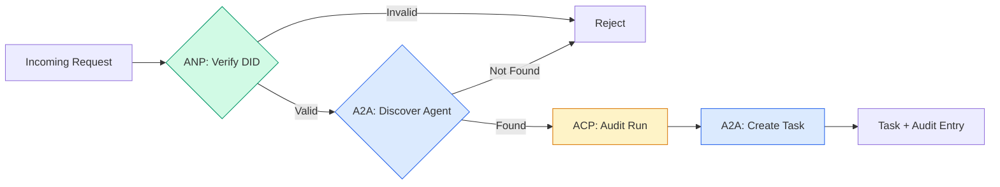

```typescript
class ProtocolGateway {
  private registry: AgentRegistry;
  private taskManager: TaskManager;
  private auditRunner: AuditableRunner;
  private identityRegistry: IdentityRegistry;

  constructor(
    registry: AgentRegistry,
    taskManager: TaskManager,
    auditRunner: AuditableRunner,
    identityRegistry: IdentityRegistry
  ) {
    this.registry = registry;
    this.taskManager = taskManager;
    this.auditRunner = auditRunner;
    this.identityRegistry = identityRegistry;
  }

  async delegateTask(
    fromDid: string,
    signature: string,
    targetAgent: string,
    message: AgentMessage,
    sessionId?: string
  ): Promise<{ task: Task; audit: AuditEntry } | { error: string }> {
    if (!this.identityRegistry.verify(fromDid, signature, message.id)) {
      return { error: "Identity verification failed" };
    }

    const card = this.registry.resolve(targetAgent);
    if (!card) {
      return { error: `Agent ${targetAgent} not found in registry` };
    }

    const audit = await this.auditRunner.run(
      targetAgent,
      [message],
      sessionId
    );
    const task = await this.taskManager.sendMessage(targetAgent, message);

    return { task, audit };
  }

  discoverAndDelegate(
    fromDid: string,
    signature: string,
    skillTag: string,
    message: AgentMessage
  ): Promise<{ task: Task; audit: AuditEntry } | { error: string }> {
    const candidates = this.registry.discoverBySkillTag(skillTag);
    if (candidates.length === 0) {
      return Promise.resolve({
        error: `No agents found with skill tag: ${skillTag}`,
      });
    }
    return this.delegateTask(
      fromDid,
      signature,
      candidates[0].name,
      message
    );
  }
}
```

게이트웨이는 한 번의 통화로 네 가지 일을 합니다.
1. **ANP**: DID 서명으로 호출자의 신원을 확인합니다
2. **A2A**: 대상 요원을 발견하고 능력을 확인합니다
3. **ACP**: 실행을 궤도를 가진 감사 트랙에 묶는다
4. **A2A**: 전체 생명주기 추적을 위한 작업을 생성합니다

### 7단계: 모두 함께 연결 하십시오

```typescript
async function protocolDemo() {
  const registry = new AgentRegistry();
  registry.register({
    name: "researcher",
    description: "Searches and summarizes findings",
    version: "1.0.0",
    supportedInterfaces: [
      {
        url: "https://researcher.local/a2a/v1",
        protocolBinding: "JSONRPC",
        protocolVersion: "1.0",
      },
    ],
    capabilities: { streaming: true, pushNotifications: false },
    defaultInputModes: ["text/plain"],
    defaultOutputModes: ["text/plain", "application/json"],
    skills: [
      {
        id: "web-research",
        name: "Web Research",
        description: "Searches the web",
        tags: ["research", "search", "summarization"],
        inputModes: ["text/plain"],
        outputModes: ["application/json"],
      },
    ],
  });
  registry.register({
    name: "coder",
    description: "Writes code from specs",
    version: "1.0.0",
    supportedInterfaces: [
      {
        url: "https://coder.local/a2a/v1",
        protocolBinding: "JSONRPC",
        protocolVersion: "1.0",
      },
    ],
    capabilities: { streaming: false, pushNotifications: false },
    defaultInputModes: ["text/plain", "application/json"],
    defaultOutputModes: ["text/plain"],
    skills: [
      {
        id: "code-gen",
        name: "Code Generation",
        description: "Generates code",
        tags: ["coding", "generation"],
        inputModes: ["text/plain", "application/json"],
        outputModes: ["text/plain"],
      },
    ],
  });

  const taskManager = new TaskManager();
  const auditRunner = new AuditableRunner();

  const researchTrajectory: TrajectoryEntry[] = [];

  taskManager.registerHandler(
    "researcher",
    async function* (task, message) {
      yield {
        statusUpdate: {
          taskId: task.id,
          status: {
            state: "TASK_STATE_WORKING" as const,
            timestamp: Date.now(),
          },
        },
      };

      researchTrajectory.push({
        reasoning: "Searching for React 19 documentation",
        toolName: "web_search",
        toolInput: { query: "React 19 compiler features" },
        toolOutput: {
          results: ["react.dev/blog/react-19", "github.com/react/react"],
        },
        timestamp: Date.now(),
      });

      researchTrajectory.push({
        reasoning: "Extracting key findings from search results",
        toolName: "doc_analysis",
        toolInput: { url: "react.dev/blog/react-19" },
        toolOutput: {
          summary:
            "React 19 compiler auto-memoizes, no manual useMemo needed",
        },
        timestamp: Date.now(),
      });

      yield {
        artifactUpdate: {
          taskId: task.id,
          artifact: {
            id: crypto.randomUUID(),
            name: "research-results",
            parts: [
              {
                data: {
                  findings: [
                    "React 19 compiler auto-memoizes components",
                    "No more manual useMemo/useCallback needed",
                    "Compiler runs at build time, not runtime",
                  ],
                  sources: ["react.dev/blog/react-19"],
                },
                mediaType: "application/json",
              },
            ],
          },
          append: false,
          lastChunk: true,
        },
      };

      yield {
        statusUpdate: {
          taskId: task.id,
          status: {
            state: "TASK_STATE_COMPLETED" as const,
            timestamp: Date.now(),
          },
        },
      };
    }
  );

  auditRunner.registerAgent("researcher", async () => ({
    output: [
      textMessage("ROLE_AGENT", "React 19 compiler auto-memoizes components"),
    ],
    trajectory: researchTrajectory,
  }));

  const identityRegistry = new IdentityRegistry();

  const coderIdentity = createIdentity("coder.local", "coder");
  const researcherIdentity = createIdentity("researcher.local", "researcher");

  identityRegistry.publish(coderIdentity.document);
  identityRegistry.publish(researcherIdentity.document);

  const gateway = new ProtocolGateway(
    registry,
    taskManager,
    auditRunner,
    identityRegistry
  );

  console.log("=== Protocol Demo ===\n");

  console.log("1. Agent Discovery (A2A)");
  const researchAgents = registry.discoverBySkillTag("research");
  console.log(
    `   Found ${researchAgents.length} agent(s):`,
    researchAgents.map((a) => a.name)
  );

  console.log("\n2. Identity Verification (ANP)");
  const message = textMessage("ROLE_USER", "Research React 19 compiler features");
  const signature = signPayload(coderIdentity, message.id);
  const verified = identityRegistry.verify(
    coderIdentity.did,
    signature,
    message.id
  );
  console.log(`   Coder DID: ${coderIdentity.did}`);
  console.log(`   Signature verified: ${verified}`);

  console.log("\n3. Task Delegation (A2A + ACP + ANP)");
  const result = await gateway.delegateTask(
    coderIdentity.did,
    signature,
    "researcher",
    message,
    "session-001"
  );

  if ("error" in result) {
    console.log(`   Error: ${result.error}`);
    return;
  }

  console.log(`   Task ID: ${result.task.id}`);
  console.log(`   Task state: ${result.task.status.state}`);
  console.log(`   Artifacts: ${result.task.artifacts.length}`);

  console.log("\n4. Audit Trail (ACP)");
  console.log(`   Run ID: ${result.audit.runId}`);
  console.log(`   Status: ${result.audit.status}`);
  console.log(`   Trajectory steps: ${result.audit.trajectory.length}`);
  for (const step of result.audit.trajectory) {
    console.log(`     - ${step.reasoning}`);
    if (step.toolName) {
      console.log(`       Tool: ${step.toolName}`);
    }
  }

  console.log("\n5. Full Audit Log");
  const fullLog = auditRunner.getFullAuditLog();
  console.log(`   Total runs: ${fullLog.length}`);
  for (const entry of fullLog) {
    const duration = entry.completedAt
      ? `${entry.completedAt - entry.startedAt}ms`
      : "in-progress";
    console.log(`   ${entry.agentName}: ${entry.status} (${duration})`);
  }
}

protocolDemo().catch((err) => {
  console.error("Protocol demo failed:", err);
  process.exitCode = 1;
});
```

## 무슨 일이 잘못 되었습니까?

프로토콜은 행복한 길을 해결합니다.

**Schema drift.**에이전트 A는 에이전트 카드 광고를 발표합니다`application/json`출력. 그러나 JSON 스키마는 버전마다 변경됩니다. 에이전트 B는 오래된 형식을 분석하고 쓰레기를 얻습니다. 수정: 버전 기술 및 출력 스키마. A2A 스펙은 지원합니다`version`그 이유 때문에 카드 에이전트를

**State machine violations.**대리인이 처리하는 것은`TASK_STATE_COMPLETED`상태 업데이트, 더 많은 유물을 생성하려고 시도합니다. 작업은 변경되지 않습니다.`TaskManager`위와 같이 `break`터미널 상태가 끝나면

**Trust resolution failures.**에이전트 A는 에이전트 B의 DID를 확인하려고 하지만, 에이전트 B의 도메인이 다운되어 있습니다. DID 문서는 가져오지 않습니다. 당신은 열 (확인되지 않은 에이전트들을 받아들이지 않거나 닫지 않나요) (모든 것을 거부) 에 실패합니까? ANP는 최소한의 신뢰 원칙을 준수하여 닫지 않기를 권장합니다.

**Trajectory bloat.**ACP 궤도 기록은 강력하지만 비용이 많이 들습니다. 실행당 200 개의 도구 호출을 하는 복잡한 에이전트는 대규모 감사 항목을 생성합니다. 수정: 구성 가능한 말 그대로 수준에서의 로그 궤도. 준수에 대한 도구 이름 및 IO를 기록하고, 규제되지 않은 작업 부하에 대한 추론 단계를 건너뛰십시오.

**Discovery thundering herd.**50명의 에이전트 모두 질문`GET /agents`동시에 시작. 수정: TTL를 가진 캐시 에이전트 카드, 겹치는 발견 간격, 또는 투표 대신 푸시 기반 등록을 사용.

## 사용 하 고

### 실제 시행

**A2A**가장 성숙한 것입니다. 구글의[official spec](https://github.com/google/A2A)리눅스 재단에서 오픈소스 버전입니다. 파이썬과 타이프스크립트 SDK. 만약 에이전트가 동적 발견과 협력을 필요로 한다면, 여기서 시작하세요.

**ACP**A2A로 통합되고 있습니다. IBM의[BeeAI project](https://github.com/i-am-bee/acp)REST의 대안으로 ACP를 만들어 냈지만, 궤도 메타데이터 개념은 A2A 생태계에 흡수되고 있습니다.

**ANP**가장 실험적인 방법입니다.[community repo](https://github.com/agent-network-protocol/AgentNetworkProtocol)파이썬 SDK (AgentConnect) 를 가지고 있습니다. 메타 프로토콜 협상 개념은 진정으로 새로운 것입니다. 조직 간 에이전트 배포를 위해 관찰 가치가 있습니다.

**MCP**이미 13단계에서 다루고 있습니다. 만약 당신이 에이전트가 도구를 사용하기를 원한다면, MCP는 표준입니다.

### 올바른 프로토콜 을 선택 하는 것

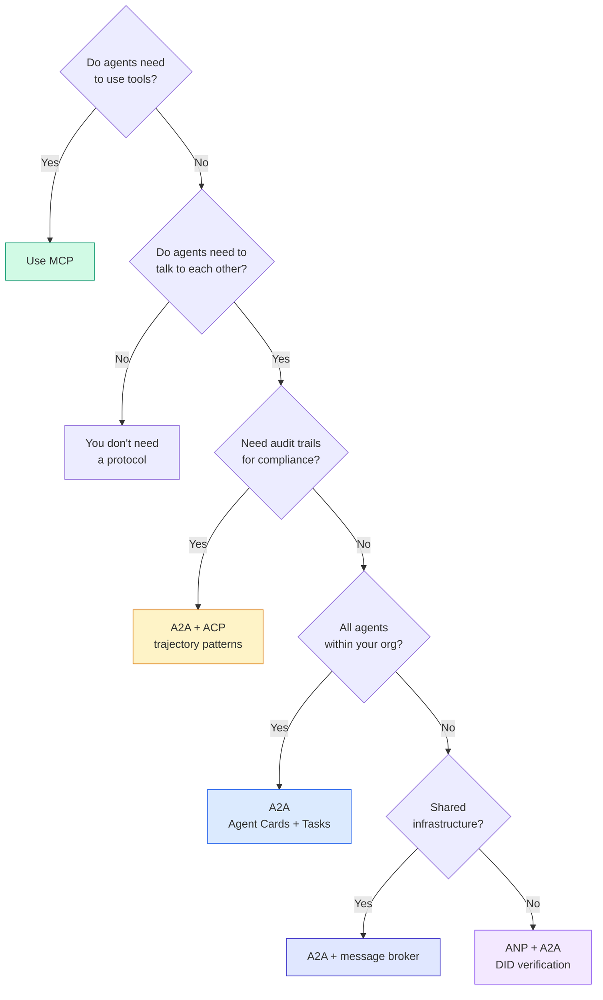

## 선박

이 교훈은 다음과 같은 결과를 낳습니다.
- `code/main.ts`-- 네 개의 프로토콜 패턴 모두 완전하게 구현
- `outputs/prompt-protocol-selector.md`-- 시스템으로의 프로토콜을 선택할 수 있도록 도와주는

## 운동

1. **Multi-hop task delegation.**`TaskManager`그래서 에이전트 핸들러는 다른 에이전트에게 하위 작업을 할당할 수 있습니다. 연구자는 작업을 받고, 두 전문 에이전트에게 하위 작업을 "찾아보고" "결과"하고, 둘 다 완료되는 것을 기다립니다. 그 다음 결과를 자신의 유물으로 통합합니다.

2. **Streaming audit trail.** 변경`AuditableRunner`스트리밍 모드를 지원하기 위해`AuditEntry`트래젝토리 항목이 추가됨에 따라 실시간 업데이트를 합니다. 감사 스냅샷을 생성하는 아싱크 생성기를 사용하세요.

3. **DID rotation.** 키 로테이션을 추가`IdentityRegistry`. 에이전트는 업데이트 된 키를 가진 새로운 DID 문서를 공개할 수 있어야 하며`previousDid`참고: 검증자는 현재와 이전 키의 서명들을 수혜 기간 동안 받아들여야 합니다.

4. **Protocol negotiation.**ANP의 메타 프로토콜 개념을 구현합니다.`protocolNegotiation`후보 형식 (예를 들어, "나는 JSON-RPC를 말할 수 있다"와 "나는 REST을 선호한다") 를 가진 메시지. 최대 3 라운드 후에, 그들은 형식 또는 타임아웃에 동의합니다. 합의된 형식은 어느 것을 결정합니다 `TaskManager`또는`AuditableRunner`그들은 사용한다.

5. **Rate-limited discovery.**`RateLimitedRegistry`설정 가능한 TTL로 에이전트 카드 검색을 캐쉬하고, 에이전트당 초당 탐구 요청을 제한하는 랩퍼. 시작 시 100 명의 에이전트들이 서로를 발견하는 거시 무리를 시뮬레이션하고 차이를 측정합니다.

## 주요 용어

| Term | What people say | What it actually means |
|------|----------------|----------------------|
| MCP | "The protocol for AI tools" | A client-server protocol for agents to discover and use tools. Agent-to-tool, not agent-to-agent. |
| A2A | "Google's agent protocol" | A peer-to-peer protocol for agent collaboration under the Linux Foundation. Discovery via Agent Cards, 9-state task lifecycle, streaming via SSE. Supports JSON-RPC, REST, and gRPC bindings. |
| ACP | "Enterprise agent messaging" | IBM/BeeAI's REST API for agent runs with TrajectoryMetadata: every response carries the full chain of reasoning and tool calls. Merging into A2A. |
| ANP | "Decentralized agent identity" | A community protocol using `did:wba` (DID) for cryptographic identity, HPKE for E2EE, and AI-powered meta-protocol negotiation for agents that have never seen each other. |
| Agent Card | "An agent's business card" | A JSON document at `/.well-known/agent-card.json` describing skills, supported MIME types, security schemes, and protocol bindings. |
| DID | "Decentralized ID" | W3C standard for cryptographically verifiable identities hosted on the agent's own domain. ANP uses `did:wba` method. |
| TrajectoryMetadata | "The audit receipt" | ACP's mechanism for attaching reasoning steps, tool calls, and their inputs/outputs to every agent response. |
| Meta-protocol | "Agents negotiating how to talk" | ANP's approach where agents use natural language to dynamically agree on data formats, then generate code to handle them. |
| Task | "A unit of work" | A2A's stateful object tracking work from submission through completion. Immutable once terminal. |

## 더 많은 읽기

- [Google A2A specification](https://github.com/google/A2A)-- 공식적인 스펙과 SDK (v1.0.1, 리눅스 재단)
- [IBM/BeeAI ACP specification](https://github.com/i-am-bee/acp)-- 대원 실행 및 궤도 메타데이터에 대한 OpenAPI 3.1 스펙
- [Agent Network Protocol](https://github.com/agent-network-protocol/AgentNetworkProtocol)-- DID 기반의 정체성, E2EE, 메타 프로토콜 협상
- [Model Context Protocol docs](https://modelcontextprotocol.io/)-- 앤트로피크의 MCP 사양 (단계 13에 포함된)
- [W3C Decentralized Identifiers](https://www.w3.org/TR/did-core/)-- ANP를 뒷받침하는 정체성 표준
- [RFC 9180 (HPKE)](https://www.rfc-editor.org/rfc/rfc9180)-- ANP가 E2EE에 사용하는 암호화 체계
- [FIPA Agent Communication Language](http://www.fipa.org/specs/fipa00061/SC00061G.html)-- 현대적인 에이전트 프로토콜의 학술적 선구자
