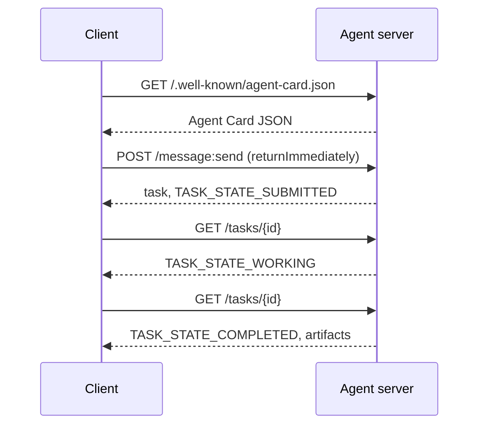

# A2A  대리인 간 프로토콜

> 구글은 2025년 4월 A2A를 발표했고, 2026년 4월에는https://a2a-protocol.org/latest/specification/150여개 기관이 지원합니다. A2A는 MCP의 수평적 보충제 (강좌 13): MCP가 수직 (원  도구) 이 있는 A2A는 피어-투-피어 (원  에이전트) 이다. 그것은 에이전트 카드 (발견), 유물 ( 텍스트, 구조화된 데이터, 비디오), 불투명한 작업 라이프사이클 및 auth) 과 관련된 작업을 정의합니다. 생산 시스템은 점점 더 MCP와 A2A를 결합합니다. 구글 클라우드는 2025~2026년 동안 A2A 지원을 Vertex AI 에이전트 빌더로 도입했습니다.

**Type:** Learn + Build
**Languages:** Python (stdlib, `http.server`, `json`)
**Prerequisites:** Phase 16 · 04 (Primitive Model)
**Time:** ~75 minutes

## 문제

다른 시스템에서 다른 에이전트를 호출해야 합니다. 어떻게요? HTTP 엔드포인트를 노출하고 맞춤형 JSON 스키마를 정의하고 다른 쪽이 그것을 말할 수 있기를 바랍니다. 모든 에이전트 쌍은 사용자 지정 통합이됩니다.

A2A는 그 호출의 보편적인 통신 프로토콜입니다. 표준 발견, 표준 작업 모델, 표준 운송, 표준 유물. HTTP+REST처럼 하지만 1급 시민으로서의 에이전트에게는.

## 개념

### 네 가지 요소

**Agent Card.**JSON 문서를 `/.well-known/agent-card.json`에이전트를 설명하는 것: 이름, 능력,`supportedInterfaces`(말점 URL, 프로토콜 결합, 프로토콜 버전), 기본 입력 및 출력 미디어 유형 및 auth 요구 사항 (`securitySchemes`더하기`securityRequirements`카드를 읽으면서 발견이 가능합니다.

```http
GET /.well-known/agent-card.json HTTP/1.1
Host: agent.example.com
```

```json
{
  "name": "code-review-agent",
  "description": "Reviews Python and TypeScript code.",
  "version": "1.0.0",
  "supportedInterfaces": [
    {
      "url": "https://agent.example.com",
      "protocolBinding": "HTTP+JSON",
      "protocolVersion": "1.0"
    }
  ],
  "capabilities": {"streaming": false, "pushNotifications": false},
  "securitySchemes": {
    "bearer": {"httpAuthSecurityScheme": {"scheme": "Bearer"}}
  },
  "securityRequirements": [{"schemes": {"bearer": {"list": []}}}],
  "defaultInputModes": ["text/plain", "application/json"],
  "defaultOutputModes": ["application/json"],
  "skills": [
    {
      "id": "review-python",
      "name": "Review Python",
      "description": "Reviews Python code.",
      "tags": ["code-review", "python"]
    },
    {
      "id": "review-typescript",
      "name": "Review TypeScript",
      "description": "Reviews TypeScript code.",
      "tags": ["code-review", "typescript"]
    }
  ]
}
```

**Task.**일체의 단위, 생체 주기로 무작정, 상태가 많은 물체:`TASK_STATE_SUBMITTED`→`TASK_STATE_WORKING`→`TASK_STATE_COMPLETED`- `TASK_STATE_FAILED`- `TASK_STATE_CANCELED`클라이언트가 메시지를 보내서 서버가 작업을 만들고 클라이언트는 여론조사를 하거나 업데이트를 가입합니다.

**Artifact.**작업에서 생성되는 결과 유형: 텍스트, 구조화된 JSON, 이미지, 비디오, 오디오. 유물 유형: 각 부분은 1개의 `text``raw``url`또는`data`그리고 그 이름을 `mediaType`그래서 다른 모다리얼은 최고급입니다.

**Opaque lifecycle.**A2A는 원격 에이전트가 작업을 어떻게 해결하는지 규정하지 않습니다. 클라이언트는 상태 전환 및 유물을 볼 수 있습니다. 구현은 어떤 프레임워크를 사용할 수 있습니다.

### MCP/A2A 분할

- **MCP**(강좌 13): 에이전트  도구. 에이전트는 JSON-RPC를 통해 도구 서버에 읽고/쓰습니다. 기본적으로 국정 없는 상태입니다.
- **A2A**: 에이전트  에이전트. 피어 프로토콜; 양쪽 모두 자신의 추론을 가진 에이전트입니다.

생산 멀티 에이전트 시스템은 둘 다 사용한다. A2A 동료는 MCP 도구를 옆으로 호출한다. 분할은 두 가지 문제를 깨끗하게 유지한다.

### 발견 흐름



이 HTTP+JSON 결합 경로는 모든 요청에 `A2A-Version: 1.0`. 기본적으로`SendMessage`작업이 터미널 또는 중단된 상태로 도달하기 전까지 차단합니다. 그래서 설문 클라이언트가 설정합니다.`configuration.returnImmediately`바로 그 일을 되찾으라고

또는 스트리밍으로:`POST /message:stream`서버 전송된 이벤트를 반환합니다 (a `task`먼저, 그 다음`statusUpdate`그리고`artifactUpdate`사건) 과`/tasks/{id}:subscribe`실행 작업에 다시 연결됩니다. 작업이 터미널 상태에 도달하면 스트림이 닫습니다.`final`깃발

### 저작자

A2A는 세 가지 일반적인 패턴을 지원합니다.

- **Bearer token**: OAuth2 또는 불투명 (`httpAuthSecurityScheme`또는`oauth2SecurityScheme`)
- **mTLS**: 상호 TLS; 조직은 서로 정체성을 증명한다 (`mtlsSecurityScheme`)
- **API key**: 헤더, 쿼리 매개 변수 또는 쿠키의 키 (`apiKeySecurityScheme`)

에이전트 카드에 출력자 선언:`securitySchemes`각 계획의 명칭과`securityRequirements`고객이 만족해야 하는 조건들을 알려줍니다.

### 2026년 4월까지 150개 이상의 조직

엔터프라이즈 채택은 A2A 규모를 주도했습니다. 제목: A2A는 엔터프라이즈 에이전트 시스템들이 신뢰 경계를 넘기게 된 방법입니다. 구글 클라우드는 Vertex AI 에이전트 빌더 A2A 지원을 배포했습니다. 마이크로소프트 에이전트 프레임워크는 지원합니다. 대부분의 주요 프레임워크 (랑그라프, 크루아이, 오토겐) 는 A2A 어댑터를 배포합니다.

### A2A가 승리하는 곳

- **Cross-organization calls.**A 회사의 에이전트는 B 회사의 에이전트로 전화합니다. A2A가 없으면 모든 쌍은 맞춤형 계약입니다.
- **Heterogeneous frameworks.**랭그그래프 에이전트가 크루아이 에이전트를 호출하고, 사용자 지정 파이썬 에이전트를 호출하고, A2A가 정상화됩니다.
- **Typed artifacts.**비디오 결과, 구조화된 JSON, 오디오
- **Long-running tasks.**불투명한 생명주기+조사결과는 시간동안 수행되는 작업을 쉽게 합니다.

### A2A가 어려움을 겪는 곳

- **Latency-sensitive micro-calls.**A2A의 생명주기는 비시크입니다. 미리초 초내의 에이전트에서 에이전트에 적합하지 않습니다. 직접 RPC를 사용하십시오.
- **Tight-coupled in-process agents.**만약 두 에이전트가 같은 파이썬 프로세스를 실행한다면 A2A의 HTTP 회전 여행은 과장됩니다.
- **Small teams.**스펙 오버헤드는 실제입니다. 내부에 있는 에이전트들만 공식적인 절차가 필요하지 않을 수도 있습니다.

### A2A 대 ACP, ANP, NLIP

2024~2026년에 여러 가지 관련 사양이 등장했다.

- **ACP**(IBM/Linux Foundation)  A2A의 전신, 좁은 범위.
- **ANP**(Agent Network Protocol)  동료 발견이 심하고, 분산된 것
- **NLIP**(Ecma 자연어 상호작용 프로토콜, 표준화 된 2025년 12월)

A2A는 2026년 4월 현재 가장 많이 채택된 피어 프로토콜이다. 비교를 위해 arXiv:2505.02279 (Liu et al., "A Survey of Agent Interoperability Protocols") 를 참조하십시오.

```figure
sw-agent-card-discovery
```

## 건설 해

`code/main.py`A2A 최소 서버와 클라이언트를 구현하여 `http.server`그리고 JSON, HTTP+JSON 결합 1.0에. 서버:

- 노출`/.well-known/agent-card.json`
- 받아들이는`POST /message:send`
- 작업 상태를 관리하고,
- `GET /tasks/{id}`- 그래

클라이언트:

- 에이전트 카드를 가져와
- `returnImmediately`
- 투표가 완료될 때까지
- 유물을 읽습니다.

실행:

```
python3 code/main.py
```

스크립트는 서버를 배경 스레드에서 시작하고 클라이언트를 그 반대로 실행합니다. 전체 흐름을 볼 수 있습니다. 발견, 제출, 설문조사, 유물.

## 사용 하 고

`outputs/skill-a2a-integrator.md`A2A 통합을 설계합니다: 에이전트 카드 콘텐츠, 작업 계획, 저작자 선택, 스트리밍 vs 투표.

## 선박

체크리스트:

- **Pin the spec version.**A2A는 여전히 발전하고 있습니다.`supportedInterfaces`입문으로 그 `protocolVersion`, 그리고 고객들이 보내`A2A-Version: 1.0`- 그래
- **Idempotent task creation.**복제 제출 (네트워크 재시험) 은 하나의 작업을 만들어야 합니다.`messageId`- 그래
- **Artifact schemas.**에이전트가 반환하는 형태를 선언하고 소비자가 확인해야 합니다.
- **Rate limits + auth.**A2A는 공개적으로 운영되고 있으며 표준 웹 보안을 적용합니다.
- **Dead-letter for failed tasks.**반복되는 실패 유형을 위해 시간이 지남에 따라 패턴을 검사하십시오.

## 운동

1. 달아`code/main.py`클라이언트가 서버를 발견하고 올바른 유물을 수신한 것을 확인합니다.
2. 서버에 두 번째 기술을 추가하십시오 (예를 들어 "summarize"). 에이전트 카드를 업데이트하십시오. 작업 유형에 따라 기술을 선택하는 클라이언트를 작성하십시오. 1.0 요청에는 기술 필드가 없습니다. 따라서 서버는 메시지 부분으로 로우트를 수행합니다.
3. 시행`POST /message:stream`: 서버 전송 이벤트 (a `task`먼저, 그 다음`statusUpdate`이 경우, 클라이언트가 다른 방법으로 무엇을 해야 합니까?
4. A2A 스펙을 읽어보세요 (https://a2a-protocol.org/latest/specification/) 이 시범법에서 시행되지 않는 세 가지 사항을 확인합니다.
5. A2A (Agent Card Discover) 과 MCP (서버 측 기능 목록) 을 비교합니다.`listTools`) 자기 설명 요원들과 능력 검사를 하는 요원들 사이에는 어떤 타협이 있습니까?

## 주요 용어

| Term | What people say | What it actually means |
|------|----------------|------------------------|
| A2A | "Agent-to-agent" | Peer protocol for agents to call other agents across systems. Google 2025. |
| Agent Card | "The agent's business card" | JSON at `/.well-known/agent-card.json` describing skills, `supportedInterfaces`, auth. |
| Task | "The unit of work" | Async stateful object with a lifecycle; artifacts produced on completion. |
| Artifact | "The result" | Typed output: text, structured JSON, image, video, audio. First-class media. |
| Opaque lifecycle | "How it's solved is the agent's business" | Client sees state transitions; server is free to choose framework/tools. |
| Discovery | "Finding the agent" | `GET /.well-known/agent-card.json` returns the card. |
| MCP vs A2A | "Tools vs peers" | MCP: vertical agent ↔ tool. A2A: horizontal agent ↔ agent. |
| ACP / ANP / NLIP | "Sibling protocols" | Adjacent specs; A2A is the most-adopted 2026. |

## 더 많은 읽기

- [A2A specification](https://a2a-protocol.org/latest/specification/) 가톨릭 규격
- [A2A v1.0.1 release](https://github.com/a2aproject/A2A/tree/v1.0.1): 표기 `docs/specification.md`그리고`specification/a2a.proto`이 교훈은
- [Google Developers Blog — A2A announcement](https://developers.googleblog.com/en/a2a-a-new-era-of-agent-interoperability/) 2025년 4월 발사 시점
- [A2A GitHub repo](https://github.com/a2aproject/A2A) 참조 구현 및 SDK
- [Liu et al. — A Survey of Agent Interoperability Protocols](https://arxiv.org/html/2505.02279v1) MCP, ACP, A2A, ANP 비교
