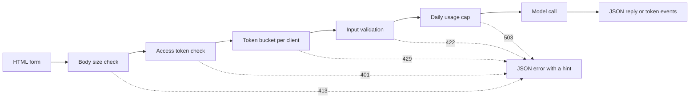

# 모델 데모 인터페이스  기능에서 공유 가능한 앱으로

> 모델 데모는 하나의 계약이 있습니다. 입력, 모델 호출, 출력. 링크를 공유하기 전에 각 부분에 한계를 설정합니다.

**Type:** Build
**Languages:** Python
**Prerequisites:** Phase 11 · 13 (Building a Production LLM Application), Phase 17 · 08 (Inference Metrics), Phase 17 · 19 (AI Gateways)
**Time:** ~90 minutes

## 학습 목표

- 데모의 입력, 모델 호출, 출력 계약을 각 부분에 한계를 적어라.
- 하나의 HTML 페이지, JSON 최종점 및 서버 전송 이벤트 최종점으로 표준 라이브러리 HTTP 앱을 구축하십시오.
- 비용 순서로 입력값을 확인하고, 다음 동작을 사용자에게 알려주는 JSON 오류를 반환합니다.
- 클라이언트당 토큰 버킷, 일일 사용 제한 및 선택적 액세스 토큰으로 공개된 데모를 보호하십시오.
- 입력 텍스트와 클라이언트 주소 없이 요청 로그를 작성하십시오.
- 표준 라이브러리 데모를 두 프레임워크 버전과 비교하고, 데모가 제품으로 변해야 한다는 신호를 명명하십시오.

## 문제

이제 리뷰어가 10개의 입력값을 시도하고 고객이 전화기에서 하나의 결과를 보고 싶어합니다. 둘 중 어느 누구도 메모장을 열지 않습니다.

노트북 셀에는 입력 제한이 없고 진행 표시도 없습니다. 오류는 당신이만 읽을 수 있는 스택 트레이스입니다. 또한 귀하의 신분증 및 예산과 함께 실행됩니다. 변경 없이 공개 URL 뒤에 셀을 넣으면 다음과 같은 오류를 예상할 수 있습니다.

- 사용자가 40,000개의 문자를 붙여넣고, 모델 호출은 1분 동안 실행되고,
- 한 스크립트는 한 분 동안 500개의 요청을 보내죠. 각각의 요청은 유료 모델 호출입니다.
- 페이지에서 8초 동안 아무것도 보이지 않으므로 사용자가 버튼을 4번 더 클릭합니다.
- 서버 로그는 고객 계정 번호를 포함해 모든 입력들을 보관합니다.

디모 인터페이스는 작은 양의 코드로 이러한 오류를 방지합니다. 이 수업은 파이썬 표준 라이브러리와 함께 하나를 구축하여 모든 부분을 볼 수 있습니다.

## 개념

### 데모는 계약입니다

모든 데모는 세 부분으로 구성되어 있습니다. 입력은 사용자가 보낼 수 있습니다. 모델 호출은 입력을 출력으로 변환합니다. 출력은 사용자가 보는 것입니다. 그리고 그것은 오류를 포함합니다.

페이지를 작성하기 전에 계약서를 적어 보세요.

| Part | Question to answer | Answer in this lesson |
|------|--------------------|-----------------------|
| Input | What type, what size, which characters? | A string of 1 to 500 characters, with no control characters |
| Model call | How long does one call take, and what does it cost? | A toy keyword model that runs in under a millisecond at no cost |
| Output | What does the user see on success and on failure? | A label, a score, and a reply, or a JSON error with a hint |

노트북은 세 부분 중 어느 하나에 제한이 없습니다. 데모는 각 부분에 한계를 설정하고 서버는 모든 클라이언트에 한계를 적용합니다.



체크는 비용 순서로 실행됩니다. 잘못된 요청은 실패한 첫 번째 체크에서 멈춰집니다. 그래서 서버에 거의 아무것도 비용이 들지 않습니다. 모델 호출은 마지막입니다. 왜냐하면 그것은 돈이 드는 유일한 단계이기 때문입니다.

### 모델 실행 전에 유효성

브라우저는 입력 내용을 전송하기 전에 확인 할 수 있습니다.`maxlength`그리고`required`텍스트 영역에 있는 속성은 네트워크 호출 없이 사용자에 피드백을 제공합니다. 이러한 체크는 정직한 사용자만 돕습니다. 모든 클라이언트는 페이지 없이 요청을 보낼 수 있으므로 서버는 모든 체크를 반복합니다.

서버 체크를 비용 순서로 배치:

1. 이 문서를 읽어보세요`Content-Length`헤더, 읽기 전에 한계를 넘어서서 몸을 거부하세요.
2. JSON 객체 아닌 객체를 거부합니다.
3. 필드를 확인하고 빈 텍스트, 제한 이상의 텍스트, 문자 컨트롤을 거부하십시오.
4. 모든 체크를 통과한 요청에 따라 모델 호출을 할 수 있습니다.

| Failed check | HTTP status | Error code |
|--------------|-------------|------------|
| Body over 4,096 bytes | 413 Content Too Large | `body_too_large` |
| Body stops before `Content-Length` bytes arrive | 408 Request Timeout | `request_timeout` |
| Content type is not JSON | 415 Unsupported Media Type | `unsupported_media_type` |
| Body is not a JSON object | 400 Bad Request | `bad_json` |
| Text is missing, empty, too long, or has control characters | 422 Unprocessable Content | `missing_text`, `empty_text`, `text_too_long`, `control_characters` |

RFC 9110는 이러한 상태 코드와 그 이름을 정의합니다.

예를 들어서 입력 디자인의 일부입니다. 예를 들어서 사용자가 좋은 입력이 어떤 모습인지 보여줍니다. 또한 리뷰어에게 한 번의 클릭으로 테스트를 제공합니다. 출력 클래스마다 하나의 예를 선택하십시오. 이 데모는 긍정적, 부정적인, 중립적인 예를 가지고 있습니다.

### 모델이 작동하는지 보여주십시오

모델 호출은 몇 초 정도 걸릴 수 있습니다. 피드백이 없으면 사용자가 느린 모델을 깨진 페이지에서 구별할 수 없습니다. 변경 사항을 보지 않는 사용자는 다시 클릭 할 수 있으며, 서버는 두 번째 지불 요청을 받게됩니다.

이 수업의 페이지에서는 네 가지 피드백을 제공합니다.

- 요청이 실행되는 동안 제출 버튼을 비활성화합니다.
- 시간이 지나면서 100밀리초마다 업데이트됩니다.
- 첫 번째 표본이 도착할 때 첫 번째 표본의 시간을 보여줍니다.
- 요청이 종료되는 전체 시간을 나타냅니다.

공부를 하면서[inference metrics](../../08-inference-metrics-goodput/), Time to First Token (TTFT) 는 서버 메트릭이다. 데모 페이지에서는 브라우저에서 측정된 사용자와 동일한 숫자를 보여줍니다.

### 출력을 스트림으로 전송

언어 모델은 응답을 한 번에 하나의 토큰으로 생성합니다. 서버가 마지막 토큰을 기다린다면 사용자는 전체 세대를 기다립니다. 서버가 준비되면 모든 토큰을 전송하면 사용자는 첫 번째 토큰을 읽고 시작합니다.

서버 전송 이벤트 (SSE) 는 이 프로그램의 표준 형식입니다. 응답은 내용 유형을 `text/event-stream`모든 이벤트는`event:`그리고`data:`WHATWG HTML 표준은 형식을 정의합니다.

```text
event: token
data: {"index":0,"text":"Label:"}

event: token
data: {"index":1,"text":" positive."}

event: done
data: {"label":"positive","score":1.0,"tokens":11}
```

브라우저에는 `EventSource`GET 요청은 URL에 입력된 입력값을 넣고 웹 서버와 프록시들은 URL를 액세스 로그에 입력합니다. 이 데모는 대신 JSON 체인으로 POST 요청을 전송합니다. 페이지는 응답을 읽습니다.`fetch()`그리고`response.body.getReader()`, 그리고 이벤트 형식을 분석합니다.

스트림은 하나의 JSON 응답이 없는 하나의 문제가 있습니다. 서버는 첫 번째 토큰 전에 200 상태를 전송합니다. 그 후에 모델이 실패하면 서버는 상태를 변경할 수 없습니다. 따라서 서버는 `error`스트림에서 이벤트를 표시하고 페이지에서 해당 이벤트를 오류로 표시합니다.

당신이 [production LLM application](../../../11-llm-engineering/13-production-app/)이 수업은 동일한 프로토콜을 손으로 작성하여 서버가 보내는 모든 라인을 볼 수 있습니다.

### 사용자가 행동할 수 있는 오류를 작성

오류 메시지는 두 가지 기능을 가지고 있습니다. 사용자가 무슨 일이 일어났는지, 그리고 다음에 무엇을 해야 하는지 사용자에게 알려줍니다. 스택 추적은 낯선 사람에게는 아무 것도 하지 않습니다.

이 데모의 모든 오류는 동일한 JSON 형태를 가지고 있습니다:

```json
{
  "error": {
    "code": "text_too_long",
    "message": "The text has 812 characters. The limit is 500.",
    "hint": "Shorten the text to 500 characters or fewer.",
    "request_id": "a8f3c2b435e3"
  }
}
```

- `code`클라이언트 코드와 테스트가 비교되는 안정적인 이름입니다.
- `message`사용자가 필요로 하는 숫자를 통해 사실을 나타냅니다.
- `hint`사용자에게 하나의 동작을 제공합니다.
- `request_id`사용자 보고서를 하나의 로그 기록으로 연결합니다.

RFC 9457는 HTTP API에 대한 표준 오류 형식을 정의합니다. 이 데모는 동일한 목적으로 작은 모양을 사용합니다. 다른 팀이 API를 호출할 때 RFC 9457을 사용합니다.

### 공개된 데모를 안전하게 공유하세요

공개 링크는 요청을 보낼 수 있는 사람이 변경됩니다. 각 위험에 대한 한 가지 통제를 계획하십시오.

| Risk | Control in this demo | Control for a larger audience |
|------|----------------------|-------------------------------|
| One client sends too many requests | A token bucket per client, with 429 and `Retry-After` | Per-user limits after sign-in |
| Strangers find the link | An optional access token in the `Authorization` header | Single sign-on with an identity provider |
| Total cost grows with no limit | A daily usage cap, with 503 and `Retry-After` | Spend limits and alerts at the model provider |
| Very large or unusual input | Body size limit, text length limit, control character check | Content moderation on input and output |
| Logs keep private input | Records with the input length and a keyed hash of the client | A retention period and access control on the logs |

토큰 버킷은 두 개의 숫자를 사용합니다. 용량은 한 클라이언트가 보낼 수있는 최대 폭발입니다. 재충전률은 장기 요청률입니다. 각 요청은 하나의 토큰을 취하고 버킷은 지속적으로 용량을 충전합니다.

```text
tokens = min(capacity, tokens + refill_rate * seconds_since_last_request)
accept the request if tokens >= 1, then subtract 1
```

이 비어있으면 서버가 응답합니다`429 Too Many Requests`RFC 6585는 상태 429를 정의하고 서버가 `Retry-After`이 데모는 항상 헤더를 추가하고 다음 토큰까지의 초의 수를 나타냅니다. 페이지가 헤더를 읽고 그 시간 동안 버튼을 비활성화합니다.

데모는 클라이언트 IP 주소를 버킷 키로 사용합니다. 역 프록시 뒤에 모든 요청은 프록시 주소를 통해 제공되며 모든 사용자가 하나의 버킷을 공유합니다. 그런 경우, 클라이언트 주소를 자신의 프록시 설정하는 헤더에서 읽으십시오. 다른 소스에서 해당 헤더를 신뢰하지 마십시오. 클라이언트가 어떤 값을 넣을 수 있기 때문에.

공부를 하면서[AI gateways](../../19-ai-gateways/), 게이트웨이 가 임대인에게 적용되는 요금 제한. 데모는 더 작은 규모에서 동일한 통제가 필요합니다. 요금 제한은 모든 클라이언트를 제어하지만 전체를 제어하지 않습니다. 한 개 체류하는 백 명의 클라이언트는 여전히 전체 예산을 사용할 수 있습니다. 사용 제한은 하나의 날에 모든 모델 호출을 계산하고 고정된 번호 후에 전화를 거부합니다.

로그는 입력과 같은 주의가 필요합니다.`http.server`핸들러는 클라이언트 IP 주소를 작성하고 요청 라인을 표준 오류로 작성합니다. 입력값이 URL에 있는 경우 입력값은 로그에 들어가게 됩니다. 이 데모는 로그 라인을 대체합니다. 각 요청은 라이트, 상태, 오류 코드, 지연시간, 입력 길이와 함께 한 기록을 작성합니다. 클라이언트 주소는 키가 있는 해시로 변하여, 주소를 저장하지 않고 클라이언트마다 요청을 셀 수 있습니다.

사용자가 무엇을 보관하는지 알려주세요. 데모 페이지에 서버가 텍스트의 길이를 저장하고 텍스트 자체는 결코 보관하지 않는다는 것이 있습니다.

### 데모가 상품이 될 때

데모는 하나의 프로세스에서 짧은 세션에서 유명 인물을 서비스합니다. 이 신호는 이제 데모가 제품이라고 알려줍니다.

- 팀 밖의 사람들은 매주 사용합니다.
- 누군가가 시동기 목표물을 요청하거나 정전 소식을 전합니다.
- 사용자는 로그인하거나 결과를 저장하거나 자신의 역사를 확인하도록 요청합니다.
- 주간 모델 비용은 예산의 한 줄입니다.
- 입력에는 계약이나 법률에 해당하는 데이터가 포함됩니다.

| Property | Demo | Product |
|----------|------|---------|
| Users | Known people, short sessions | Unknown people, daily use |
| State | None | Accounts, history, saved results |
| Availability | Best effort, one process | A written target, replicas, an on-call owner |
| Cost control | One daily usage cap | Per-user quotas and billing |
| Observability | One log record per request | Traces, metrics, and alerts |

이 신호를 볼 때, 생산 LLM 응용 수업에서 생산 스택에 데모를 이동하십시오. 그 스택은 사용자 દીઠ 실제 인증, 후퇴 모델, 추적 및 비용 추적을 추가합니다.

```figure
demo-token-bucket
```

## 건설 해

코드는 하나의 파일입니다.`code/main.py`, 표준 라이브러리 이외의 의존도 없이

```bash
python3 code/main.py
```

자율 테스트는 검증기, 토큰 버킷, 스트림 형식, 그리고 하나의 실제 HTTP 회전 이동을 확인합니다. 그것은 무료 포트에 서버를 시작하여 세 가지 요청을 보내, 서버를 중지하고 출동합니다. 브라우저를 위해 서버를 필요한 경우에만 시작하십시오.

```bash
python3 code/main.py --serve
```

열리세요`http://127.0.0.1:8000`브라우저에서 Ctrl+C를 누르면 서버를 중지합니다.

### 단계 1: 모델 호출

이 모델 은 장난감 키워드 카운터 이다. 텍스트 를 긍정적, 부정적, 중립적 으로 표시 한다. 또한 짧은 답변 을 생성 한다.

```python
def classify(text):
    words = WORD_RE.findall(text.lower())
    positive = sum(1 for word in words if word in POSITIVE)
    negative = sum(1 for word in words if word in NEGATIVE)
    score = (positive - negative) / max(1, positive + negative)
    if score > 0:
        label = "positive"
    elif score < 0:
        label = "negative"
    else:
        label = "neutral"
    return {"label": label, "score": round(score, 3), "positive_cues": positive,
            "negative_cues": negative, "words": len(words)}


def generate(text):
    result = classify(text)
    reply = (
        f"Label: {result['label']}. Positive cues: {result['positive_cues']}. "
        f"Negative cues: {result['negative_cues']}. Words read: {result['words']}."
    )
    parts = reply.split(" ")
    yield parts[0]
    for part in parts[1:]:
        yield " " + part
```

실제 모델이 대체할 수 있습니다`generate`API 호출이나 로컬 모델을 넣고 서명을 유지하세요. 문자열이 들어가서 토큰이 나오죠. 검증기, 제한 및 페이지가 동일합니다.

### 단계 2: 확인 및 오류 응답

하나의 예외 클래스는 모든 오류를 포함합니다. HTTP 상태, 안정적인 코드, 메시지, 팁 및 선택적 응답 헤더를 포함합니다.

```python
class DemoError(Exception):
    def __init__(self, status, code, message, hint, headers=None):
        super().__init__(message)
        self.status = status
        self.code = code
        self.message = message
        self.hint = hint
        self.headers = dict(headers or {})


def validate_text(payload, max_chars=MAX_CHARS):
    if "text" not in payload:
        raise DemoError(422, "missing_text", 'The field "text" is missing.', 'Add a "text" field with your input.')
    text = payload["text"]
    if not isinstance(text, str):
        raise DemoError(422, "text_not_string", 'The field "text" is not a string.', "Send the input as a string.")
    text = text.strip()
    if not text:
        raise DemoError(422, "empty_text", "The text is empty.", "Type a sentence or pick an example.")
    if len(text) > max_chars:
        raise DemoError(422, "text_too_long", f"The text has {len(text)} characters. The limit is {max_chars}.",
                        f"Shorten the text to {max_chars} characters or fewer.")
    if CONTROL_RE.search(text):
        raise DemoError(422, "control_characters", "The text contains control characters.",
                        "Remove the hidden characters, then send the text again.")
    return text
```

검증기는 앞쪽과 뒤에 있는 백색 공간을 먼저 제거합니다. 오직 공간만 있는 텍스트는 빈 상태로 실패하고, 암시하는 것은 사용자에게 무엇을 입력해야 하는지 알려줍니다. `check_body_size`그리고`parse_json_body`411, 413, 415 및 400 사례에 대해 동일한 패턴을 사용하십시오. `error_body`어떤 것도 `DemoError`개념 섹션에서 JSON 형태로

### 단계 3: 토큰 버킷

```python
class TokenBucket:
    def __init__(self, capacity, refill_per_second, now):
        if capacity < 1:
            raise ValueError("capacity must be at least 1")
        if refill_per_second <= 0:
            raise ValueError("refill_per_second must be positive")
        self.capacity = float(capacity)
        self.refill_per_second = float(refill_per_second)
        self.tokens = float(capacity)
        self.updated = now

    def take(self, now, cost=1.0):
        elapsed = max(0.0, now - self.updated)
        self.tokens = min(self.capacity, self.tokens + elapsed * self.refill_per_second)
        self.updated = now
        if self.tokens >= cost:
            self.tokens -= cost
            return 0.0
        return (cost - self.tokens) / self.refill_per_second
```

`take`요청이 받아들여지면 0.0을 반환합니다. 그렇지 않으면 버킷이 충분한 토큰을 가질 때까지 초를 반환합니다. 서버는 값을 높이고 전송합니다.`Retry-After`- 그래

`RateLimiter`한 고객당 한 桶씩 보관합니다`OrderedDict`잠금으로 사전을 보호할 수 있습니다.`ThreadingHTTPServer`각 요청에 대해 각자의 스레드에서 처리합니다.`max_clients`입력, 제한자에서 가장 오래된 요청으로 클라이언트를 제거합니다. 제거된 클라이언트는 다음 요청에 대해 전체 버킷을 얻습니다. 설정 `max_clients`여러분이 예상하는 활성 고객 수보다 더 많은 고객들이 있습니다.

제한자는 `clock`실험은 합격`FakeClock`그래서 테스트는 기다리지 않고 10초로 시간을 앞으로 나아갈 수 있습니다.`UsageCap`매일의 총에 동일한 시계 패턴을 사용합니다. 86,400 초의 고정 창에서 호출을 계산하고, 계산이 완료되면 다음 창까지의 초를 반환합니다.

### 4단계: 스트림

```python
def sse_event(event, data):
    payload = json.dumps(data, separators=(",", ":"), ensure_ascii=False)
    return f"event: {event}\ndata: {payload}\n\n".encode("utf-8")


def stream_events(text, generate_fn=generate, delay=0.0, sleep=time.sleep):
    count = 0
    try:
        for token in generate_fn(text):
            yield sse_event("token", {"index": count, "text": token})
            count += 1
            if delay:
                sleep(delay)
    except Exception:
        yield sse_event("error", MODEL_ERROR)
        return
    result = classify(text)
    yield sse_event("done", {"label": result["label"], "score": result["score"], "tokens": count})
```

`json.dumps`문자열 안에 새 줄을 두 문자로 쓰게 됩니다`\n`따라서 각각의 이벤트에는 원본 신선 없이 한 개의 데이터 라인이 있습니다. 데이터의 원본 신선으로 이벤트 형식이 깨질 것입니다.

생성기는 모델 오류를 감지하고`error`이 경우, 서버가 이미 상태 라인을 전송했기 때문입니다.`delay`그리고`sleep`이 논쟁은 브라우저의 흐름을 느려지게 하고 테스트를 빠르게 합니다.

### 단계 5: 요청 처리

`DemoHandler`확장`BaseHTTPRequestHandler`. POST 처리자는 개념 섹션에서 순서로 확인을 실행합니다:

```python
def do_POST(self):
    app = self.server.app
    request_id = uuid.uuid4().hex[:12]
    client_id = self.client_address[0]
    started = time.perf_counter()
    route = self.path if self.path in self.routes else "other"
    status, code, chars = 200, None, 0
    try:
        declared = self.headers.get("Content-Length")
        try:
            if route == "other":
                raise DemoError(404, "not_found", "This endpoint does not exist.",
                                "Send requests to /api/predict or /api/stream.")
            size = check_body_size(declared, app.config.max_body_bytes)
        except DemoError:
            self.drain(int(declared) if declared and declared.isdigit() else 0)
            raise
        try:
            body = self.rfile.read(size)
        except TimeoutError:
            self.close_connection = True
            raise DemoError(408, "request_timeout", "The request body did not arrive in time.",
                            "Send the request again with the full body.") from None
        app.admit(client_id, self.headers.get("Authorization"))
        text = app.read_text(self.headers.get("Content-Type"), body)
        chars = len(text)
        app.charge()
        if route == "/api/predict":
            self.send_json(200, predict(text), request_id)
        else:
            code = self.send_stream(text, request_id)
    except DemoError as err:
        status, code = err.status, err.code
        self.send_error_json(err, request_id)
    except TimeoutError:
        status, code = 408, "request_timeout"
        self.close_connection = True
    except Exception:
        status, code = 500, "internal_error"
        self.send_error_json(DemoError(500, "internal_error", "The server failed on this request.",
                                       "Try again. Quote the request id if you report the problem."), request_id)
    finally:
        latency_ms = (time.perf_counter() - started) * 1000
        app.log.record(request_id, route, client_id, status, chars, latency_ms, code)
```

`admit`접속 토큰과 토큰 버킷을 확인합니다.`charge`매일의 캡을 확인합니다. 그것은 마지막 실행, 그래서 유효한 요청만 캡에 계산됩니다. 모든 요청은 록에 한 로그 기록을 작성합니다.`finally`거절된 요청도 포함합니다. 기록은 유지됩니다.`route`, 결코 원자력 경로, 경로 사용자 텍스트와 질의 문자열을 수 있습니다

실패를 막는 네 가지 세부 사항은

- `timeout = 10`처리기 클래스에서는 클라이언트가 전송을 중단할 때 연결을 닫습니다. 이를 사용하지 않으면 100 바이트를 선언하고 10을 보내는 클라이언트는 서버 스레드를 영원히 유지합니다. 처리기에서는 요청 아이디와 함께 408 JSON 오류를 보내 연결을 닫습니다. 스트림이 시작되면 타임아웃은 연결을 닫습니다. 상태 라인이 이미 전송되어 있기 때문에.
- `log_message`출력 없이 반환됩니다. 이것은 클라이언트 주소와 요청 줄과 함께 기본 로그 라인을 제거합니다.
- `drain`RFC 1122는 호스트가 읽지 않은 데이터와 연결을 종료하면 TCP가 리셋을 전송한다고 말합니다. 클라이언트는 413 응답을 잃을 수 있습니다.
- `send_stream`잡기`BrokenPipeError`사용자가 탭을 닫으면 모델이 멈춰서 요청이 더 이상 비용이 들지 않습니다.

`BaseHTTPRequestHandler`HTTP/1.0를 기본으로 사용합니다. 스트리밍 된 몸의 끝은 서버가 연결을 닫는 순간입니다. HTTP/1.1을 사용하는 서버는 동일한 목적으로 조각된 전송 코딩으로 몸을 전송합니다.

### 단계 6: 페이지

`render_page`인라인 스타일과 인라인 스크립트를 가진 한 HTML 문서를 반환합니다. 페이지에는 외부 스크립트, 글꼴 또는 이미지가 없습니다. 스크립트는 스트림을 다음과 같이 읽습니다:

```javascript
const reader = response.body.getReader();
const decoder = new TextDecoder();
let buffer = "";
while (true) {
  const chunk = await reader.read();
  if (chunk.done) { break; }
  buffer += decoder.decode(chunk.value, { stream: true });
  let cut = buffer.indexOf("\n\n");
  while (cut >= 0) {
    const frame = parseFrame(buffer.slice(0, cut));
    buffer = buffer.slice(cut + 2);
    cut = buffer.indexOf("\n\n");
    if (frame.event === "token") { output.textContent += frame.data.text; }
  }
}
```

네트워크의 일부는 이벤트 중간에 끝낼 수 있습니다. 독자는 불완전한 부분을 저장합니다.`buffer`빈 선이 도착하기 전까지는

페이지에서  로 출력 모델이 작성됩니다.`textContent`그리고 절대`innerHTML`. 모델 출력은 신뢰할 수 없는 텍스트입니다. 페이지에서 HTML로 응답을 삽입하고 응답에는 `onerror`그 속성은 사용자의 브라우저에서 코드를 실행할 수 있습니다.

서버도 전송합니다`Content-Security-Policy``default-src 'none'`. 정책은 SHA-256 해시로 식별되는 한 인라인 스크립트와 한 인라인 스타일을 허용합니다. 브라우저는 공격자가 페이지에 주입하는 스크립트를 포함하여 다른 모든 스크립트를 거부합니다.

```python
def csp_hash(source):
    digest = hashlib.sha256(source.encode("utf-8")).digest()
    return "'sha256-" + base64.b64encode(digest).decode("ascii") + "'"
```

### 7단계: 실행하고 깨우려고 노력하세요

서버를 시작해서 사용하세요`curl`새로운 서버로 7개의 요청이 연속으로 전송됩니다. 버킷은 5개의 토큰을 보유하고 있으며 2초마다 새로운 토큰을 받습니다.

```bash
for i in 1 2 3 4 5 6 7; do
  curl -s -o /dev/null -w '%{http_code} ' -X POST http://127.0.0.1:8000/api/predict \
    -H 'Content-Type: application/json' -d '{"text": "ok"}'
done
```

```text
200 200 200 200 200 429 429
```

10초만 기다려서 빈 문자 보내세요

```bash
curl -s -X POST http://127.0.0.1:8000/api/predict \
  -H 'Content-Type: application/json' -d '{"text": ""}'
```

```json
{"error": {"code": "empty_text", "message": "The text is empty.", "hint": "Type a sentence or pick an example.", "request_id": "e3e3599feaea"}}
```

이벤트 스트림을 시청하세요`curl -N`, 출력 버퍼를 끄는

```bash
curl -N -X POST http://127.0.0.1:8000/api/stream \
  -H 'Content-Type: application/json' -d '{"text": "The screen is bright."}'
```

액세스 토큰을 요구하기 위해, 설정 `DEMO_ACCESS_TOKEN`서버를 시작하기 전에 페이지에 토큰의 필드가 표시됩니다.

```bash
export DEMO_ACCESS_TOKEN="$(python3 -c 'import secrets; print(secrets.token_urlsafe(24))')"
echo "$DEMO_ACCESS_TOKEN"
python3 code/main.py --serve
```

테스트를 실행:

```bash
python3 -m unittest discover -s code/tests -v
```

HTTP 테스트는 서버를 포트 0에서 시작하므로 운영 체제는 무료 포트를 선택합니다.`tearDown`서버를 중지하고 그 스레드가 종료되었는지 확인합니다.

## 사용 하 고

두 개의 파이썬 프레임워크는 더 적은 코드를 가지고 동일한 종류의 데모를 만듭니다. 그라디오와 스트림리트. 아래 두 예는 계약을 수입합니다.`main.py`, 그래서 검증기와 모델은 동일합니다. 실행하기 위해 두 프레임워크도 필요하지 않습니다.`main.py`또는 테스트를

### 하나의 함수를 중심으로 구성 요소

그라디오는 파이썬 함수 하나를 중심으로 웹 인터페이스를 배치합니다. 입력 및 출력 구성 요소는 계약을 설명하고 생성기 함수는 부분 출력을 전송합니다.

```python
import os

import gradio as gr

from main import EXAMPLES, MAX_CHARS, DemoError, classify, generate, validate_text


def label_text(text):
    try:
        clean = validate_text({"text": text})
    except DemoError as err:
        raise gr.Error(f"{err.message} {err.hint}")
    label = classify(clean)["label"]
    reply = ""
    for token in generate(clean):
        reply += token
        yield reply, label


demo = gr.Interface(
    fn=label_text,
    inputs=gr.Textbox(label="Text to label", lines=5, max_length=MAX_CHARS),
    outputs=[gr.Textbox(label="Reply"), gr.Textbox(label="Label")],
    examples=list(EXAMPLES),
    flagging_mode="never",
)

if __name__ == "__main__":
    demo.queue(max_size=20).launch(auth=("demo", os.environ["DEMO_PASSWORD"]))
```

각각`yield`전체 출력 값을 대체합니다. 함수는 따라서 각 단계에 지금까지의 전체 답변을 제공합니다.

세트 `flagging_mode`링크를 공유하기 전에 의도적으로 표시합니다. 기본 모드는 플래그 버튼을 표시합니다. 사용자가 그것을 누르면 Gradio는 CSV 파일에 입력 및 출력을 작성합니다.`"never"`버튼을 제거합니다.

`queue(max_size=20)`대기 요청 수를 제한합니다. 기본 동시 제한은 이벤트 દીઠ 하나의 실행 호출입니다. 느린 모델은 한 번에 한 사용자에게 서비스를 제공합니다. 제한을 올릴 때까지. 그라디오 또한 응용 프로그램이 시작되면 API 엔드포인트를 생성합니다. 그래서 스크립트는 페이지 없이 데모를 호출 할 수 있습니다. 귀하의 속도 제한은 해당 엔드포인트에도 적용되어야합니다.

### 각 입력에 반복되는 스크립트

스트림리트는 사용자가 위젯을 변경할 때마다 전체 스크립트를 위에서 아래로 실행합니다. 양식은 위젯 값을 수집하고 사용자가 제출 버튼을 누르면 한 배트로 전송합니다.

```python
import streamlit as st

from main import EXAMPLES, MAX_CHARS, DemoError, classify, generate, validate_text

st.title("Toy sentiment demo")
st.caption("Do not paste private data.")

example = st.selectbox("Start from an example", ["", *EXAMPLES])
with st.form("demo"):
    text = st.text_area("Text to label", value=example, max_chars=MAX_CHARS)
    submitted = st.form_submit_button("Run model")

if submitted:
    try:
        clean = validate_text({"text": text})
    except DemoError as err:
        st.error(f"{err.message} {err.hint}")
    else:
        st.write_stream(generate(clean))
        st.write(f"Label: {classify(clean)['label']}")
```

`st.write_stream`직접 발전기를 가져와서 도착할 때 각 조각을 기록합니다. 실제 모델을 로드하세요.`@st.cache_resource`각 초청에 시나리오가 다시 실행되기 때문에, 장식자는 모든 세션에 모델의 한 장을 보관합니다.

### 기본 옵션이 무엇을 하는지는

| Need | Standard library (this lesson) | Gradio | Streamlit |
|------|--------------------------------|--------|-----------|
| Form, examples, result area | You write the HTML | `Interface` builds them from components and `examples` | Widgets such as `st.text_area` and `st.selectbox` |
| Input length limit | `maxlength` on the page and a server check | `max_length` on `Textbox` | `max_chars` on `st.text_area` |
| Partial output | You write SSE and the stream reader | A generator function, where each `yield` replaces the output | `st.write_stream` with a generator of chunks |
| Progress display | You write the timer | A progress display on the output area, set by `show_progress` | `st.write_stream` shows each chunk when it arrives |
| Errors for the user | JSON with `code`, `message`, `hint`, `request_id` | `raise gr.Error(...)` shows the message | `st.error(...)` shows the message |
| Concurrency | One thread per request, no limit | A queue, with one running call per event by default | Each interaction runs the script again for that session |
| Public link | You run the server and the domain | `launch(share=True)` gives a link that expires after one week | You deploy the app to a server |
| Sign-in | A bearer token check | `launch(auth=...)` with user names and passwords | `st.login()` with an OpenID Connect provider |
| Rate limit and cost cap | Token bucket and daily cap | Your code, with the client address from the request | Your code |
| Input that the tool writes to disk | Only the input length, in the log | Flagged samples in a CSV file, unless `flagging_mode="never"` | Your code decides |

프레임워크는 페이지에서 가장 많은 작업을 절약합니다. 양식, 예제, 진행 표시 및 부분 출력. 공개 링크의 위험성에 대한 작업이 덜 절약됩니다. 세 가지 버전에서는 요금 제한, 비용 제한 및 로그 프라이버시가 귀하의 작업입니다. 표준 라이브러리 버전은 이러한 모든 부분을 보여줍니다. 그래서 프레임워크에서 무엇을 확인해야하는지 알고 있습니다.

## 선박

이 교훈은`outputs/skill-demo-interface-checklist.md`. 모델 데모 또는 코드 설명을 제공하세요. 계약, 피드백, 오류 및 공개 링크의 제어에 대한 통과 또는 실패 검토를 반환합니다. 각각의 실패는 한 수정과 함께 제공됩니다.

## 운동

1. 세트 `BUCKET_CAPACITY`2까지`REFILL_PER_SECOND`7 요청 루프의 출력을 예측하고 실행하고 비교하십시오.
2. `language`요청 기관에 해당하는 필드.`"en"`다른 값에 대한 단서를 넣고 422 오류를 반환하고 두 개의 테스트를 추가하십시오.
3. 장난감 모델 에서 잘못 표시 된 문장을 찾아 보십시오. 예를 들어 "스크린 은 좋지 않다".
4. 데모를 컴퓨터에 역임 대리인 뒤에 넣고`trust_proxy``X-Forwarded-For`프록시 주소를 통해서만
5. 대체`generate`도켓을 스트림으로 반환하는 모델 API에 호출하는 경우. 유효성 확인기, 제한 및 이벤트 형식을 유지하십시오. 페이지에서 첫 번째 도켓의 시간을 서버 로그에서 지연과 비교하십시오.

## 주요 용어

| Term | What people say | What it actually means |
|------|-----------------|------------------------|
| Demo contract | "The UI" | The input limits, the model call, and the output shape, including errors |
| Token bucket | "A rate limiter" | A per-client counter that refills at a fixed rate up to a capacity. Each request uses one token |
| Retry-After | "Try later" | A response header with the number of seconds, or a date, after which the client can try again |
| Server-Sent Events | "Streaming" | A `text/event-stream` response of `event:` and `data:` lines, with a blank line after each event |
| Time to first token | "Latency" | The time from the request to the first token on the user's screen |
| Usage cap | "The budget" | A limit on the total number of model calls in a time window, for all clients together |
| Keyed hash | "An anonymous ID" | An HMAC of the client address with a secret salt. It is a pseudonym: anyone with the salt can test a known address |
| Content Security Policy | "CSP" | A response header that tells the browser which scripts, styles, and connections the page can use |

## 더 많은 읽기

- [Python `http.server` documentation](https://docs.python.org/3/library/http.server.html): 서버 클래스, 기본 HTTP/1.0, 기본 로그 라인, 그리고 모듈이 생산에 적합하지 않다는 경고.
- [WHATWG HTML Standard, server-sent events](https://html.spec.whatwg.org/multipage/server-sent-events.html): 이벤트 스트림 형식 및 `EventSource`인터페이스
- [MDN, Using server-sent events](https://developer.mozilla.org/en-US/docs/Web/API/Server-sent_events/Using_server-sent_events): 이벤트 형식과 브라우저 API의 예제
- [MDN, Using readable streams](https://developer.mozilla.org/en-US/docs/Web/API/Streams_API/Using_readable_streams): 어떻게 읽어야 하는지`fetch()`몸의 반응은 조각으로 조각으로
- [MDN, Using the Fetch API](https://developer.mozilla.org/en-US/docs/Web/API/Fetch_API/Using_Fetch): JSON 체계를 가진 요청, 응답 처리.
- [MDN, 429 Too Many Requests](https://developer.mozilla.org/en-US/docs/Web/HTTP/Reference/Status/429)그리고[MDN, Retry-After](https://developer.mozilla.org/en-US/docs/Web/HTTP/Reference/Headers/Retry-After): 금전적 제한 상태와 그 제목.
- [MDN, Content Security Policy](https://developer.mozilla.org/en-US/docs/Web/HTTP/Guides/CSP): 인라인 스크립트 및 `default-src`이 지침은
- [RFC 6585](https://www.rfc-editor.org/rfc/rfc6585.html): 추가 HTTP 상태 코드, 429을 포함합니다.
- [RFC 9110](https://www.rfc-editor.org/rfc/rfc9110.html): HTTP 의미론, 413, 415 및 422를 포함합니다.
- [RFC 9457](https://www.rfc-editor.org/rfc/rfc9457.html): 문제 세부 사항, HTTP API에 대한 표준 JSON 오류 형식.
- [RFC 1122](https://www.rfc-editor.org/rfc/rfc1122.html): 호스트 요구 사항, TCP 재설정과 함께 읽지 않은 데이터에 대해 닫는 것 (부 4.2.2.13).
- [Gradio, Sharing your app](https://gradio.app/guides/sharing-your-app): 공유 링크, 인증, API 페이지, 및 비율 제한.
- [Gradio, Streaming outputs](https://gradio.app/guides/streaming-outputs): 생성기 기능은 부분 출력으로
- [Gradio, Interface](https://gradio.app/docs/gradio/interface)이 책:`examples``flagging_mode`그리고`concurrency_limit`- 그래
- [Gradio, Using flagging](https://gradio.app/guides/using-flagging): 표시된 샘플이 디스크에 올라갑니다.
- [Streamlit, Basic concepts](https://docs.streamlit.io/get-started/fundamentals/main-concepts): 재발전 데이터 흐름
- [Streamlit, st.write_stream](https://docs.streamlit.io/develop/api-reference/write-magic/st.write_stream)그리고[Streamlit, Caching](https://docs.streamlit.io/develop/concepts/architecture/caching): 부분 출력 및 한 번 로드되는 모델
- [Streamlit, st.login](https://docs.streamlit.io/develop/api-reference/user/st.login): OpenID Connect 제공업체에 로그인
