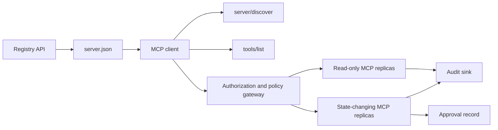

# 캡스톤 13: 등록 및 관리에 관한 국정 없는 MCP 서버

> 생산 MCP는 하나의 서버 프로세스가 아닙니다. 그것은 계약의 체인입니다. 출판 가능한 메타데이터, 실시간 발견, 무국가 요청 봉투, 허가, 정책, 감사 및 배포 증거.

**Type:** Capstone
**Languages:** Python and TypeScript reference models; any production language
**Prerequisites:** Phase 11, Phase 13, Phase 14, Phase 17, and Phase 18
**Required MCP deep dives:** [Lesson 28: Tool Contracts](../../../13-tools-and-protocols/28-mcp-tool-contracts-and-content/docs/en.md)[Lesson 29: Reliability](../../../13-tools-and-protocols/29-mcp-reliability-cancellation-and-flow-control/docs/en.md)[Lesson 30: Registry Supply Chain](../../../13-tools-and-protocols/30-mcp-registry-supply-chain-and-drift/docs/en.md)그리고[Lesson 31: Conformance Operations](../../../13-tools-and-protocols/31-mcp-conformance-versioning-and-operations/docs/en.md)
**Protocol target:**MCP `2026-07-28`
**Time:** ~25 hours

## 학습 목표

- 국가 없는 MCP 요청과 결과 봉투를 실행한다.
- 레지스트리 메타데이터를 라이브 프로토콜 발견에서 분리하십시오.
- 결정적인 캐시 인식 도구 발견을 구축합니다.
- 모든 도구 호출에 대해 발행자, 관객, 범위 및 승인 정책을 시행하십시오.
- 세션 친화 없이 스트리메이블 HTTP를 배포하십시오.
- 전화, 허가, 정책, 레지스트리, 감사 경계에 대한 행동을 증명하십시오.

## 요구되는 MCP 전제 경로

이 종결석을 생산 준비된 것으로 처리하기 전에 연결된 4개의 단계 13 수업을 순서대로 완료하십시오.

1. [Lesson 28](../../../13-tools-and-protocols/28-mcp-tool-contracts-and-content/docs/en.md)이 서버가 노출해야 하는 도구, 스케마, 콘텐츠, 페이지, 완료, 라우팅 및 오류 계약을 정의합니다.
2. [Lesson 29](../../../13-tools-and-protocols/29-mcp-reliability-cancellation-and-flow-control/docs/en.md)취소 경주, 임대, 무력, 압력, 재시험, 재결합 행동
3. [Lesson 30](../../../13-tools-and-protocols/30-mcp-registry-supply-chain-and-drift/docs/en.md)이름 공간, 출처, 입시 핀, 레지스트리 상태, 드리프, 리저 및 롤백 증거를 정의합니다.
4. [Lesson 31](../../../13-tools-and-protocols/31-mcp-conformance-versioning-and-operations/docs/en.md)황금 및 부정적인 변본, 엄격한 버전 시대, SDK 차원 확인, 프록시 증명, 편집, 건강 및 출시 게팅을 정의합니다.

이 큐브는 그 유물을 통합하고 있습니다. 한 번의 행복한 경로 SDK 테스트로 대체하지 않습니다.

## 문제

내부 플랫폼은 읽기 전용 데이터 도구와 작은 상태 변경 도구가 필요합니다. 개발자는 서버를 발견하고 연결하는 방법을 이해하고, 라이브 기능을 검사하고 사용 권한이 있는 동작에만 호출 할 수 있어야합니다.

어려운 부분은 함수를 등록하지 않고 6가지 다른 진실을 일치시키는 것입니다.

1. `server.json`서버를 설치하거나 접속할 수 있는 위치를 알려줍니다.
2. `server/discover`라이브 프로세스가 지금 지원하는 것을 말합니다.
3. 모든 요청은 어떤 프로토콜 개정과 클라이언트 기능을 사용하는지 알려줍니다.
4. 권한은 호출자를 올바른 발행자, 자원 및 범위에 묶습니다.
5. 정책은 이러한 구체적인 조치의 실행 여부를 결정합니다.
6. 감사 증거는 비밀이나 민감한 유무가 누출되지 않고 경계를 넘은 것을 기록합니다.

이러한 도파를 하나라도 발생하면 플랫폼은 접근할 수 없는 서버를 나열하거나, 호환되지 않는 클라이언트를 로우팅하거나, 다른 리소스를 위해 만든 토큰을 받아들이거나, 예상되는 검토 없이 파괴적인 행동을 노출할 수 있습니다.

## 두 가지 발견 층

레지스트리와 라이브 MCP 서버는 다른 질문에 답합니다.

| Layer | Contract | Question it answers |
|---|---|---|
| Publication | `server.json` and Registry API | What is this server, where is its package or remote endpoint, and how is it configured? |
| Runtime | `server/discover` | Which protocol versions, capabilities, extensions, and server identity does this process support? |

공식 등록소는 버전이 되어 있는`server.json`스키마. 원격 항목은 스트리메이블 HTTP URL를 지정할 수 있습니다.

```json
{
  "$schema": "https://static.modelcontextprotocol.io/schemas/2025-12-11/server.schema.json",
  "name": "com.example/internal-readonly",
  "title": "Internal Read-Only Tools",
  "description": "Read-only incident and data lookup tools.",
  "version": "1.0.0",
  "remotes": [
    {
      "type": "streamable-http",
      "url": "https://mcp.internal.example.com/readonly"
    }
  ]
}
```

레지스트리 스키마 버전과 MCP 프로토콜 개정 버전은 독립적입니다. 한 날짜를 다른 날짜와 일치하도록 다시 작성하지 마십시오. 각 문서를 자신의 계약에 따라 검증하십시오.

스케마 유효성은 네임스페이스 소유권을 증명하지 않습니다. 출판사가 확인한`example.com`역 DNS 이름 공간을 사용합니다`com.example/*`레지스트리 인증 흐름은 소유권을 증명합니다. 도메인 레이블은 일반적인 순서로 다른 이름 공간을 지정합니다.

STDlib 모델의`validate_registry_document`함수는 의도적으로 일부 원격 프로파일 검증기입니다.`name``description`그리고`version`필드: 선택형`title`; 발표된 이름과 길이가 제한된 것; 콘크리트 버전 모양; 그리고 각 `streamable-http`또는`sse`원격의 HTTP(S) URL 형태. 추가적으로 비공개 `remotes`이 톱스톤은 항상 리모컨을 생중계하기 때문입니다.`validate_publisher_namespace`확인된 출판사 도메인과 별도로 이름을 확인하고,`validate_runtime_alignment`출판 이름과 라이브 버전을 비교합니다 `serverInfo`. 공식 스키마는 패키지 전용 기록 및 더 원격 필드를 지원합니다. 출판 전에, 전체 문서를 정착 된 공식 JSON 스키마 또는 `mcp-publisher`; 의존도 없는 이 하위 집합을 전체 스케마 검증으로 제시하지 않는다.

서버가 구현해야 합니다`server/discover`; 클라이언트는 다른 방법보다 먼저 호출할 수 있습니다. 이 캡스톤 클라이언트는 최종 포인트를 해결한 후에 그렇게합니다. 그리고 현재 프로토콜 개정 및 실시간 기능을 수신합니다.

```json
{
  "resultType": "complete",
  "supportedVersions": ["2026-07-28"],
  "capabilities": {
    "tools": {
      "listChanged": false
    }
  },
  "_meta": {
    "io.modelcontextprotocol/serverInfo": {
      "name": "com.example/internal-readonly",
      "version": "1.0.0"
    }
  },
  "ttlMs": 3600000,
  "cacheScope": "public"
}
```

개인 카탈로그는 추가 소유권, 검토 또는 라이프사이클 데이터를 인덱스 할 수 있지만, MCP 와이어 필드 또는 루트로 그 데이터를 발명해서는 안 됩니다.`server.json`필드: 출판된 기록과 함께 조직정책을 저장합니다. 공개적인 사용자 지정 메타데이터가 필요할 때, 레지스트리의 `_meta.io.modelcontextprotocol.registry/publisher-provided`확장 및 4 KB 한계 내에서 유지

## 국적 없는 MCP 핵심

MCP 개정 `2026-07-28`프로토콜 세션 및`initialize`- `notifications/initialized`손잡이도 빼내죠`Mcp-Session-Id`- 그래

모든 요청은 프로토콜 맥락을 `params._meta`이 부분의 본문은

```json
{
  "io.modelcontextprotocol/protocolVersion": "2026-07-28",
  "io.modelcontextprotocol/clientCapabilities": {},
  "io.modelcontextprotocol/clientInfo": {
    "name": "internal-platform-client",
    "version": "1.0.0"
  }
}
```

버전과 기능은 연결 사실보다는 요청 사실입니다. 로드 배랜서는 다른 건강한 복사본에 연속적인 요청을 보낼 수 있습니다. 왜냐하면 복사본이 메시지 자체에서 요청을 검증할 수 있기 때문입니다.

일반적인 결과는 `resultType: "complete"`서버는 자신의 신원을 입력해야 합니다`_meta.io.modelcontextprotocol/serverInfo`실종되거나 문자열이 없는 프로토콜 버전은 무효의 파라미터입니다`-32602`오류`-32022`지원되지 않는 공급된 문자열에 대해서만, 정확히`{"supported": ["2026-07-28"], "requested": "..."}`그 자료로

### 캐시할 수 있는 발견

`tools/list`동일한 효과적인 도구 집합에 대한 결정적 인 결과를 가져야 합니다. 그 결과에는 다음과 같은 것들이 포함됩니다.

- `ttlMs`, 고객에게 신선함을 알려주는
- `cacheScope`, 또는`public`또는`private`
- 동일한 목록이 재사용할 수 있도록 안정적인 도구 순서;
- `resultType: "complete"`그리고 서버 아이덴티티 메타데이터

사용자 당 권한은 일반적으로 `cacheScope: "private"`공유된 공개 캐시 뒤에 사용자 특화된 도구 가시성을 두지 마십시오.

## 스트리밍 가능한 HTTP

네트워크 서버는 POST을 받아들이는 하나의 MCP 최종 지점을 노출합니다. 각 JSON-RPC 요청 또는 알림은 자체 POST을 얻습니다.

요청에 대해 서버는 요청에 대한 범위가 한 개의 JSON 객체 또는 SSE 스트림을 반환합니다.`subscriptions/listen`요청에는 선택된 변경 알림이 포함되어 있습니다. 독립된 GET 스트림, 세션 DELETE, 세션 헤더 또는 `Last-Event-ID`현재 운송 중 재생

각 요청은 다음을 포함한다:

- `MCP-Protocol-Version`, 신체 메타데이터와 일치하는
- `Mcp-Method`, JSON-RPC 방법과 일치하는
- `Mcp-Name``tools/call``resources/read`그리고`prompts/get`
- `Accept: application/json, text/event-stream`- 그래

지정된 `-32020`오류. 유효성`Origin`, 로컬 개발 서버를 루프백으로 연결하고, 원격 클라이언트를 인증하고, 닫힌 요청-스케이프 SSE 응답을 취소로 간주합니다.



```figure
cf-mcp-gate
```

## 허가 및 정책

교통 메타데이터는 허가사항이 아닙니다. 모든 통화에 허가사항을 확인하세요.

원격 서버:

1. 보호된 자원 메타데이터를 발견합니다.
2. 해당 리소스의 권한 서버를 선택하십시오.
3. 클라이언트 등록을 위해 클라이언트 ID 메타데이터 문서를 선호합니다. 동적 클라이언트 등록을 호환성 지원으로 간주하십시오.
4. 권한이 있는 동안 리소스 표시기를 보내십시오.
5. 반환된 것을 확인합니다`iss`흐름에 기록된 권한 서버에 대한 값
6. 발행자별 주요 고객 신분증. 발행자별 등록 데이터를 재사용하지 마십시오.
7. MCP 서버에서 토큰 발행자, 관객 또는 자원, 만료 및 범위를 검증합니다.
8. 구체적인 도구와 주장에 두 번째 정책 결정을 적용한다.

도구에 대한 해석은`readOnlyHint`그리고`destructiveHint`고객들이 위험을 제기하는 데 도움이 됩니다.

### 승인은 기록이 아니라 마법의 범위입니다

상태 변경 전화는 배우, 도구, 정상화 된 주장 또는 소화, 목표 환경, 만료 및 일회 또는 반복 사용 정책에 묶인 승인 기록이 필요합니다. 채팅 메시지는 그 자체로 승인 증명이 아닙니다.

파이썬 모델은 정렬된 키와 함께 가공된 JSON를 해시하고, 그 다음 토큰 주체, 도구 이름, 서버 URL 및 만료로 소화합니다. 한 개의 주장을 변경한 후에도 기록을 재생하는 것은 핸들러가 실행되기 전에 실패합니다. 승인은 별도의 증거이며 액세스 토큰에 추가된 범위가 아닙니다.

폭발 반경을 크게 줄일 때 고위험 도구들을 별도로 검토 할 수 있는 표면에 보관하십시오. 자격증, 정책, 배치 정체성 및 감사 통제도 별도로 분리될 경우에만 분리하는 것이 유용합니다.

## 건설 해

### 1. 출판 모델 메타데이터

스케마를 생성 및 유효성 확인`server.json`. 출판사에서 인증된 이름 공간에 안정적인 이름을 포함하고, 버전, 설명, 공식 `repository`또는`packages`메타데이터, 적용될 경우, 원격 또는 스튜디오 운송. 환경 변수 입력으로 비밀을 유지, 결코 문자적 값.

### 2. 실시간 발견을 구현

시행`server/discover`RPC 기능에 앞서 지원되는 프로토콜 버전, 기능, 확장 프로그램 및 서버 아이덴티티를 광고하십시오.`-32022`- 그래

### 3. 국적 없는 봉투를 시행

모든 요청에 프로토콜 버전과 클라이언트 기능을 요구합니다. 반환 `resultType`모든 결과에서 서버 아이덴티티를 제거합니다. 초기화 상태, 연결 스캔 기능 캐시 및 세션 식별자를 제거합니다.

### 4. 도구 표면을 구성

읽기 전용 도구와 상태 변경 도구로 시작하십시오. 각각의 JSON 스케마, 정확한 설명, 결정적 결과 모양 및 정직한 해설을 제공하십시오. 클라이언트가 구조화된 결과에 의존할 때 출력 스케마를 추가하십시오.

### 5. 캐시 인식 목록을 추가

 안정적인 순서로 `ttlMs`그리고`cacheScope`. 캐시 만료 및 목록 변경 알림 행동을 별도로 수행하십시오.

### 6. 권한 및 정책 추가

발행자, 관객, 만료 및 범위를 확인합니다. 모든 도구 호출에 대한 정책 결정을 실행합니다. 높은 위험의 정확한 행동에 승인을 묶습니다. 처리자를 실행하기 전에 실종하거나 오래된 승인을 거부합니다.

### 7. 별도의 레지스트리 및 런타임 검증

정적 인 검증`server.json`기록하고, 후 원격 엔드포인트를 탐색합니다`server/discover`. 공개된 원격, 정체성, 버전 또는 요구되는 기능이 라이브 프로세스와 일치하지 않는 경우 보고 파동.

### 8. 감사 증거 를 추가

행위자, 발행자, 자원, 도구, 정책 결정, 요청 식별자, 추적 맥락, 지연기 및 결과를 기록하십시오. 지속하기 전에 민감한 주장과 결과를 작성하거나 소화하십시오. 모델 가시적인 맥락에서 벗어나 감사 싱크를 유지하십시오.

### 9. 수평 스케일링을 연습한다

로드 배랜서 뒤에 두 개의 무국립 복사본을 배치하고, 적어도 100 개의 동시 요청을 보내십시오. 정확성이 친밀도에 의존하지 않는다는 것을 증명하십시오. 도구가 교차 호출 상태가 필요한 경우, 명시적으로 불투명한 손잡이를 세우고 공유 내구성 시스템에서 저장하십시오.

### 10. 진짜 케이블을 넘어서

실제 서버 바이너리에 대한 적합성 검사를 실행하십시오. SDK 객체뿐만 아니라 요청 헤더 및 JSON 인체를 캡처하십시오. 잘못된 버전, 헤더 부합, 부족한 범위, 잘못된 관객, 잘못된 정렬된 аргумент, 핸들러 실패, 취소 및 캐시 만료를 수행하십시오.

## 필요 한 증거자료

제출은 다섯 가지 증거급을 모두 포함하지 않는 한 불완전하다:

| Evidence | Minimum proof | Source lesson |
|---|---|---|
| Wire | Redacted raw headers and JSON-RPC bodies for golden and negative cases, including metadata type failure, header mismatch, unsupported version, missing or unknown `resultType`, notification no-response, and response ID matching | [Lesson 31](../../../13-tools-and-protocols/31-mcp-conformance-versioning-and-operations/docs/en.md) |
| Proxy | The same stable case run directly and through the deployed intermediary, with ingress, origin, and egress status and body digests; prove protocol errors are not collapsed into generic 500 responses and streaming is not buffered | [Lessons 29](../../../13-tools-and-protocols/29-mcp-reliability-cancellation-and-flow-control/docs/en.md) and [31](../../../13-tools-and-protocols/31-mcp-conformance-versioning-and-operations/docs/en.md) |
| Admission | Verified publisher namespace, immutable Registry record digest, artifact or remote provenance, live `server/discover` identity and capability observation, descriptor pin, current Registry status, and admission-ledger event | [Lesson 30](../../../13-tools-and-protocols/30-mcp-registry-supply-chain-and-drift/docs/en.md) |
| Retry | A cancellation-versus-completion race, explicit timeout, safe read retry, mutation idempotency key, reconnect refetch, and proof that request cancellation cannot silently become durable task cancellation | [Lesson 29](../../../13-tools-and-protocols/29-mcp-reliability-cancellation-and-flow-control/docs/en.md) |
| Rollback | Exact previous version, admission and artifact digests, descriptor pin, active Registry status, current health window, route restoration result, and redacted decision evidence | [Lessons 30](../../../13-tools-and-protocols/30-mcp-registry-supply-chain-and-drift/docs/en.md) and [31](../../../13-tools-and-protocols/31-mcp-conformance-versioning-and-operations/docs/en.md) |

편집된 패키지의 소화 를 발매와 함께 저장하십시오. 어떤 클래스가 빠진 경우, 발매를 유지하십시오. 프로세스 중 디스페셔에서 프록시 행동을 추론하지 마십시오. 레지스트리 출석에서 입수, 새로운 JSON-RPC 아이디에서 안전성 재시험 또는 이전 배포에서 돌기 준비.

## 지역 참조 모델

파이썬 모델은 레지스트리 메타데이터, 역 DNS 출판사 이름 공간 검증, 출판-시행 정체성 확인, 실시간 발견, 결정적 도구 목록, 요청에 따른 메타데이터, 신뢰할 수 있는 발행자, 관객, 만료 및 범위 검증, 행동 제한 승인, 문서화된 부분 레지스트리 검증, 정책 및 네트워크 소켓을 열지 않고 감사를 보여줍니다.

```bash
cd phases/19-capstone-projects/13-mcp-server-with-registry
python3 code/main.py
python3 -m unittest discover -s code/tests -v
```

TypeScript 프로젝트는 MCP SDK 없이 stdio에서 stateless JSON-RPC 형태를 노출합니다.`tools/call`경로는 `tools/list`; 알려진 도구에 대한 무효 주장은 `isError: true`집행자를 호출하지 않고:

```bash
cd phases/19-capstone-projects/13-mcp-server-with-registry/code/ts
npm install
npm run typecheck
npm test
npm run demo
```

이 모델들은 로컬 계약 논리를 증명한다. HTTP 헤더, OAuth 교환, 레지스트리 출판, OPA 통합, 로드 배정, 또는 수집자 수신을 증명하지 않는다.

## 철자 예제

```http
POST /mcp HTTP/1.1
Host: mcp.internal.example.com
Content-Type: application/json
Accept: application/json, text/event-stream
MCP-Protocol-Version: 2026-07-28
Mcp-Method: tools/call
Mcp-Name: postgres.readonly
Authorization: Bearer REDACTED

{
  "jsonrpc": "2.0",
  "id": 42,
  "method": "tools/call",
  "params": {
    "name": "postgres.readonly",
    "arguments": {"sql": "SELECT 1"},
    "_meta": {
      "io.modelcontextprotocol/protocolVersion": "2026-07-28",
      "io.modelcontextprotocol/clientCapabilities": {},
      "io.modelcontextprotocol/clientInfo": {
        "name": "internal-platform-client",
        "version": "1.0.0"
      }
    }
  }
}
```

## 선박

다음을 포함하는 저장소를 배포한다.

- 셰마 유효성`server.json`
- 읽기 전용 및 상태 변경 서버 표면
- `server/discover`, 결정적인`tools/list`, 그리고 정책에 의해`tools/call`
- 2개의 교환 가능한 복사본을 가진 스트리메이블 HTTP 배포
- 허가 및 승인을 통합
- 레지스트리 출판사 또는 개인 레지스트리 API 어댑터
- 정책 정의와 행동으로 묶인 승인을 기록
- 편집된 감사 결과와 추적 확산
- 전선 및 대리력 결함이 입증되는 증거
- 입학, 재시험, 건강증진 및 복귀증진

| Weight | Criterion | Evidence |
|---:|---|---|
| 25 | Protocol correctness | Stateless request metadata, discovery, results, headers, and negative cases |
| 20 | Authorization | Issuer, audience, expiry, scope, and action-bound approval cases |
| 15 | Registry integrity | Valid `server.json`, publication record, live discovery probe, and drift report |
| 15 | Policy and safety | Allow, deny, malformed, stale approval, and sensitive-data cases |
| 15 | Scale and reliability | Two replicas, no affinity dependency, cancellation, timeout, and recovery |
| 10 | Auditability | Redacted receiver-side audit and trace evidence |

## 운동

1. 라이브 서버를 변경하지 않고 게시된 원격 URL를 변경하십시오. 레지스트리 검증 보고서는 정확한 추동을하십시오.
2. 보내`tools/list`동일한 입력과 같은 두 번으로`ttlMs`그리고 신선한.
3. 다른 것으로 유효한 시체를 보내세요`MCP-Protocol-Version`헤더, 돌아와`-32020`정책이나 도구에 의존하지 마십시오.
4. 읽기 전용 서버에 대한 토큰을 만들어 상태 변경 서버에 제시합니다. 처리기가 실행되기 전에 시청자 검증이 실패합니다.
5. 승인서를 한 개의 정상화 된 논증 소화에 묶어, 한 개의 필드를 변경하여 승인서를 재생할 수 없다는 것을 증명하십시오.
6. 연속적인 호출을 번갈아 있는 복사본으로 로우트하십시오. 작업 흐름이 지속성이 필요한 곳마다 숨겨진 프로세스 메모리를 명시적 공유 핸들로 교체하십시오.
7. 요청에 의해 확장된 SSE 연결을 끊고 새로운 JSON-RPC 요청 ID를 다시 시도하십시오.`Last-Event-ID`복구 경로를 사용한다.

## 주요 용어

| Term | What people say | What it actually means |
|---|---|---|
| Stateless MCP | "No state anywhere" | No protocol session; cross-call state is explicit and server-managed |
| `server.json` | "The tool manifest" | Registry metadata for naming, packaging, configuration, and transports |
| `server/discover` | "The handshake" | A normal mandatory RPC for live versions and capabilities, not a session initializer |
| Cache scope | "Can I cache it?" | Whether a cacheable result is safe for shared or private reuse |
| Policy decision | "The token allows it" | A separate decision over actor, tool, target, arguments, and context |
| Approval record | "A human clicked yes" | Evidence bound to one actor and consequential action under an expiry policy |
| Explicit handle | "A session ID" | Ordinary application data for named server-managed state, not protocol connection state |

## 더 많은 읽기

- [MCP 2026-07-28 key changes](https://modelcontextprotocol.io/specification/2026-07-28/changelog)
- [Streamable HTTP](https://modelcontextprotocol.io/specification/2026-07-28/basic/transports/streamable-http)
- [Server discovery](https://modelcontextprotocol.io/specification/2026-07-28/server/discover)
- [MCP authorization](https://modelcontextprotocol.io/specification/2026-07-28/basic/authorization)
- [Official Registry server.json requirements](https://github.com/modelcontextprotocol/registry/blob/main/docs/reference/server-json/official-registry-requirements.md)
- [Official Registry OpenAPI contract](https://registry.modelcontextprotocol.io/openapi.yaml)
