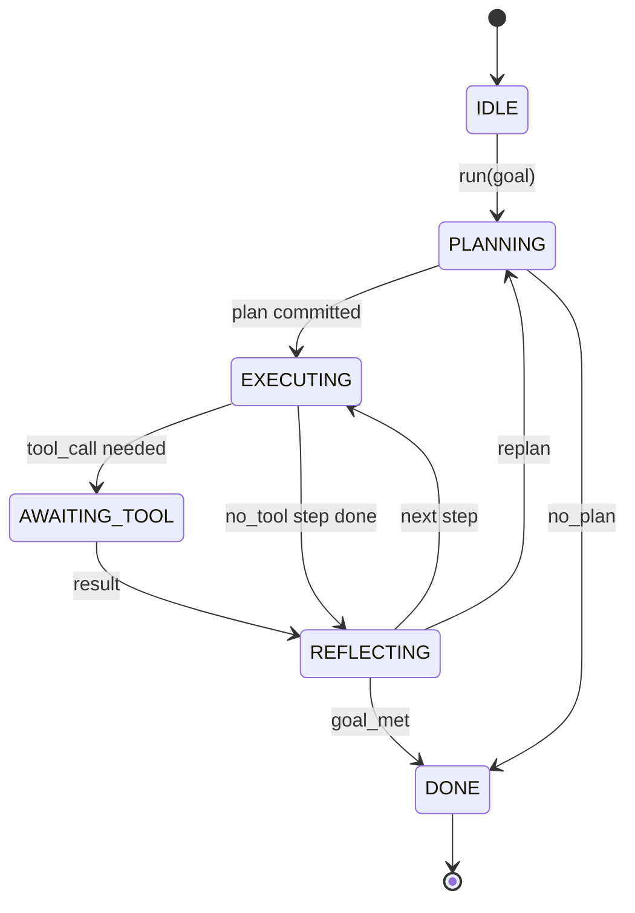

# 에이전트 하네스 루프 계약

> 이 수업은 어떤 모델을 연결할 수 있는 룰 계약을 얼어붙이죠.

**Type:** Build
**Languages:** Python
**Prerequisites:** Phase 13 lessons 01-07, Phase 14 lesson 01
**Time:** ~90 minutes

## 학습 목표
- 명시적인 전환을 가진 결정적인 상태 기계로 에이전트 하네스 루프를 지정한다.
- 운영자가 정책, 텔레메트리, 보호선을 적용하는 10가지 생명주기  주제를 구현합니다.
- 두 개의 끌점의 정의를 설정하여 루프는 호출자에게 제어기를 반환하고 새로운 입력으로 재개합니다.
- 세션당 예산 (전환, 도구 호출, 벽 시계) 을 과잉에 대해 부분적인 상태를 누출하지 않고 시행하십시오.
- 11개의 이벤트 유형으로 입력된 스트림을 발송하여 하류 UI와 추적자가 직접 루프를 검사하지 않고 가입할 수 있습니다.

```figure
cf-loop-contract
```

## 프레임

40회 동안 감시 없이 실행되는 코딩 에이전트는 채팅 루프가 아닙니다. 그것은 운영자가 노드를 가로채고 운영자가 가장자리를 감사 할 수 있는 상태 기계입니다. 계약을 작성하면 모델, 도구 또는 정책을 교환하는 것이 재조직자가 되는 것이 아닙니다. 그것은 등록 호출이됩니다.

이 수업은 그 계약을 구성합니다. 우리는 여섯 개의 주, 10 개의  주, 두 개의 견인점, 11 개의 이벤트 유형 및 예산 봉투를 지정합니다. 이 에 있는 모든 것 (툴 레지스트리, JSON-RPC 운송, 디스페처, 계획자) 이 이 모양으로 연결됩니다.

## 주

루프는 6개의 상태가 있고 5개의 상태가 활성화되어 있고 1개의 상태는 터미널입니다.



`IDLE`유일한 합법적인 입국 지점입니다.`DONE`유일한 합법적인 출구입니다.`AWAITING_TOOL`이 상태는 중력점을 갖는 유일한 상태입니다. 다른 모든 전환은 내부입니다.

상태 기계는 결정적입니다. 같은 이벤트 로그를 감안하면, 배지 같은 상태로 다시 들어가게 됩니다. 그 속성은 모델을 다시 호출하지 않고 디버깅을 위한 세션들을 재생할 수 있게 해줍니다.

##  주제는

해킹은 운영자의 주머니에 이 됩니다. 배지 10개의 주제를 발사합니다. 각 주제는 어떤 수의 가입자를 받아들이습니다. 가입자는 등록 순서로 발사합니다. 가입자는 유용한 부하를 변조하거나, 회전을 중단하기 위해 상승하거나 다음 단계를 건너뛰기 위해 경호를 반환할 수 있습니다.

```text
before_plan         after_plan
before_tool_call    after_tool_call
before_step         after_step
on_error
on_pause
on_budget_exceeded
on_complete
```

이 모양은 클로드 코드, 커서, 오픈코드가 2025년 중반에 합쳐진 것을 반영합니다.`rm -rf``before_tool_call`. 오픈텔레미트리 스포드를 전송하는 해킹은`after_step`은 은 은 은 은 은 은 은`on_pause`- 그래

## 끌어당기는 지점

루프에서 두 번 제어합니다.`AWAITING_TOOL`도구 결과 없이는 발전할 수 없는 경우입니다.`on_pause`예산이 다쳐나거나, 한 이 인간적인 검토를 명시적으로 요청할 때

 포인트는 예외가 아닙니다. 그것은 반환입니다. 호출자는  상태를 검사하고, 이 원하는 것을 가져와 전화합니다.`resume(payload)`.이 배너스는 멈춘 곳에서 다시 시작됩니다. 이것은 파이썬 생성기와 같은 모양입니다. 당기는 점에 대한 운송은 당신의 선택입니다. TUI에서 그것은 키프레스입니다. MCP에 대한 그것은`tools/call`- 큐를 넘어서서 취업조사를 하는 거죠

## 이벤트 스트림

루프는 계약의 특정 지점에서 입력된 스트림에 이벤트를 추가합니다. 스트림은 추가만되며 가입자는 모든 오프셋에서 재생할 수 있습니다. 구현된 이벤트 유형은 다음과 같습니다.

- `session.start`  `run(goal)`'이름'
- `plan.draft` 계획자가 계획을 작성한 초안을 반환할 때 발급되는
- `plan.commit` 적극적인 계획으로 공약된 후 발급
- `step.start` 각 실행 단계 시작에서 발급
- `step.end` 실행 단계마다 끝으로 발급
- `tool.call` 도구가 필요한 단계가 호출자에게 제어권을 부여할 때 발사됩니다.
- `tool.result` 도구 결과로 재개편에 의해 발행
- `tool.error` 실수로 또는  할크가 전화를 끊으면
- `budget.warn` 예산 한계점에 도달하면 발행
- `session.pause` 루프가 일시 중지 (부드젯 또는 할크) 에 출력되면
- `session.complete` 루프가 도달하면 한 번 방출됩니다`DONE`

이 사건들은 해크의 유용 부하를 복제하지 않는다. 해크는 필수적이다 (변화, 중단). 사건들은 관찰 (기록, 배) 이다. 그들을 정형으로 취급한다.

## 예산 봉투

세션에는 세 가지 제한이 있습니다. 회전 수, 도구 호출 수, 벽 시계 초. 각 회전 인차는 한 번씩 회전합니다. 각 도구 호출 인차는 도구 호출 한 번으로 회전합니다. 벽 시계 모든 상태 전환에 확인됩니다. 어느 한계도 도달하면 루프가 작동합니다.`on_budget_exceeded`, 발사`budget.warn`, 그리고 `IDLE`다음 타겟에서 예산이 넘어서기 때문에

예산은 'kill switch'이 아니라 ' yield'입니다. 전화자는 예산을 연장하고 재개하거나 세션을 종료할지 결정합니다.

## 이 교훈이 하지 않는 것

모델이 호출되지 않습니다. 실제 도구를 등록하지 않습니다. 운송을 구현하지 않습니다. 다음 네 가지 교훈입니다. 이 교훈은 계약에 손톱을 톱니에 넣어서 다음 네 가지는 다시 작성하지 않고 연결할 수 있습니다.

결정적인 계획자`main.py`이 방법은 3단계로 되어 있는 하드코딩된 계획을 반환합니다. 이중 2단계로 도구 결과를 필요로 합니다.

## 코드를 읽는 방법

`HarnessLoop`주류가 되는 곳이고, 주류를 유지하고, 을 타고, 행사를 방송한다.`Budget`경계를 추적합니다.`Event`류에 있는 입력된 봉투입니다.`HookRegistry`이 테이블은`_transition`상태가 변하는 유일한 함수이기 때문에 상태 기계의 변동자는 한 곳에 살고 있습니다.

읽으세요`main.py`위에서 아래로, 그리고 읽으십시오`code/tests/test_loop.py`테스트는 모든 전환과 각 이 발사 순서를 적어줍니다.

## 더 나아가

생산에 있는 가장 어려운 부분은 국가 기계가 아닙니다. 그것은 계약을 실행할 수 있게 해줍니다. 계약은 계획자의 뜨거운 재충전에서 살아남아야 합니다. 그것은 잘못된 JSON를 반환하는 도구를 살아남아야 합니다. 그것은 을 일으키는 을 살아남아야 합니다.`before_tool_call`40회 회로 시션을 통과하는 방법의 2/3를 이 수업의 테스트에서 시행하는 실패 모드입니다. 실행하세요.

다음 수업은 도구 레지스트리를 추가합니다. 그 다음에는 JSON-RPC 운송입니다. 그 다음에는 디스페이처입니다. 수업 24에 의해, 이 파일의 루프는 실제 예산이 적용되는 실제 도구에 대한 실제 계획을 실행합니다.
