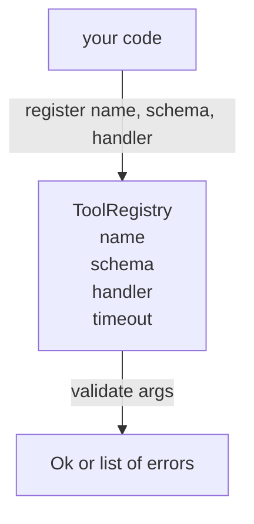

# 스케마 검증과 함께 도구 레지스트리

> 에이전트가 검증할 수 없는 도구는 에이전트가 호출할 수 없는 도구입니다. 도구를 만들기 전에 레지스트리와 스케마 체크어를 구축하십시오.

**Type:** Build
**Languages:** Python
**Prerequisites:** Phase 13 lessons 01-07, Phase 14 lesson 01
**Time:** ~90 minutes

## 학습 목표
- 디스퍼처가 한 번 물어볼 수 있는 도구 이름 → 스키마 → 핸들러의 입력된 레지스트리를 유지하고 그 후에 신뢰합니다.
- 도구 호출의 90%가 실제로 사용하는 키워드를 포함하는 JSON Schema 2020-12 하위집단을 구현하십시오.
- 정확한 json 포인터 모양의 오류 경로를 반환하여 모델이 한 번 돌아가는 데서 스스로 수정할 수 있습니다.
- 명백한 과장 없이 재등록을 거부하십시오. 왜냐하면 침묵적인 과장으로 생산 도구 카탈로그가 이동하는 방식이기 때문입니다.
- 검증기를 순수하게 유지하세요 (전/오프, 시간, 전원)

```figure
cf-registry-validate
```

## 왜 레지스트리는 도구보다 먼저

2026년 코딩 에이전트는 하나의 컨텍스트 창에 모델이 들어갈 수 있는 것보다 더 많은 등록된 도구를 가지고 있습니다. 비 비약적인 배너스는 200개의 도구를 기록하고 어떤 회전에서도 10~40개의 표면을 나타냅니다. 레지스트리는 "어떤 도구가 존재하는가?" "그들의 주장이 어떤 모양을 취하는가?" 그리고 "내가 어떤 핸들러를 부르는가?"에 대한 진실의 원천입니다.

우리가 피하는 실수 는 계획 없이 배포 하는 처리자, 또는 유효성 없이 배포 하는 처리자. 둘 다 일반적이다. 둘 다 다음 층 (학습 23의 배포자) 을 추측 게임으로 바꾸어 놓습니다. 유일한 실패 모드는 처리자로부터 스택 흔적이 됩니다.

## 도구 기록이 어떻게 생겼는지

```text
ToolRecord
  name        : str          (unique, lowercase alphanumeric and underscore segments separated by dots, e.g., snake_case.segment.case)
  description : str          (one line, shown to the model)
  schema      : dict         (JSON Schema 2020-12 subset)
  handler     : Callable     (async or sync, returns Any)
  idempotent  : bool         (dispatcher uses this for retry decisions)
  timeout_ms  : int          (override per-tool dispatcher default)
```

스키마는 유효성 검증자가 만지는 유일한 필드입니다. 핸들러는 그 분야에 불투명합니다. 우리는 의도적으로 분리합니다. 스키마는 데이터입니다. 핸들러는 코드입니다. 그것들을 혼합하면 우리가 막고 있는 버그인 핸들러 안에 유효성 검증 논리를 넣을 유혹을 수 있습니다.

## JSON 스키마 2020-12 하위 집합

2020-12의 전체 스펙은 종이입니다. 우리는 8개의 키워드가 필요합니다.

```text
type           string / number / integer / boolean / object / array / null
properties     map of property name -> schema
required       list of property names
enum           list of allowed primitive values
minLength      integer, applies to strings
maxLength      integer, applies to strings
pattern        ECMA-262-compatible regex, applies to strings
items          schema applied to every array element
```

이것은 도구 API가 실제로 필요로 하는 것을 다루기 위해 충분합니다. 우리가 추가하지 않는 키워드 (oneOf, anyOf, allOf, $ref, 조건) 는 생산 스키마에서 유효하지만 검증기를 주기로 트리 워커로 변환합니다. 우리는 레지스트리를 만들고 있습니다. JSON 스키마 엔진이 아닙니다.

## Json 포인터 오류 경로

검증 실패하면 검증기는 오류 목록을 반환합니다. 각 오류는 입력으로 json-pointer 경로를 가지고 있습니다. 포인터는 스라시-프레픽스 된 속도의 재산 이름 및 배열 지표입니다.

```text
{"a": {"b": [1, 2, "x"]}}
                    ^
                    /a/b/2
```

모델은 문장을 읽는 것보다 오류 경로를 더 잘 읽습니다. 스케마가 요구하면`args.user.email`그리고 모델이 정수수를 통과하면 오류가 됩니다`/user/email``expected_type: string`모델은 다음 통화에서 자연어 사용 없이 그것을 수정합니다.

## 등록 및 과장

`register(name, schema, handler, **opts)`다시 등록을 거부하는 경우 기본적으로 호출자가 통과해야 합니다`override=True`이 방법은 운영 위생입니다. 두 개의 코드베이스의 두 부분이 같은 도구 이름을 조용히 등록하는 것은 생산에서 발견하는 버그의 종류입니다.

레지스트리는 세 가지 읽기 방법을 밝히고 있습니다.`get(name)`기록을 반환하거나 상승합니다.`validate(name, args)``Ok`또는 오류 목록.`names()`등록 순서로 도구 이름을 반환합니다.

## 검증자가 무엇이며 그렇지 않은 것은

이것은 스케마 트리 위에 한 번 지나가며, 재발적입니다. 순수입니다.`"42"`숫자의 스케마를 통과하지 않습니다.

보안 경계가 아닙니다. 악성 관리자는 유효성 검증이 통과된 후에도 잘못된 행동을 할 수 있습니다. 수업 23의 디스페이셔는 타임아웃과 샌드박스 계층을 추가합니다. 레지스트리는 모양을 추가합니다.

## 형태



## 코드를 읽는 방법

`code/main.py`정의합니다`ToolRegistry``ToolRecord``ValidationError`, 그리고 8개의 검증기 기능이 있습니다.`schema["type"]`(또는 `enum`각 타입 검증기는 빈 목록 또는 의 목록을 반환합니다.`ValidationError`. 최고 레벨 워커는 오류를 연결하고 경로 세그먼트를 내려가면서 미리 연결합니다.

`code/tests/test_registry.py`등록, 오버라이드, 유효성 확인, 경로로 유효성 확인 실패 및 하위 집합의 모든 키워드를 포함한다.

## 더 나아가

이 수업이 끝나면 필요한 두 장이 있습니다`$ref`지역 정의 블록에 대한 결의`additionalProperties: false`두 가지 모두 작습니다. 도구 카탈로그가 50 개의 도구를 넘어서면서 두 가지 모두 추가됩니다. 우리는 파일을 한 읽기 아래 유지하기 위해 수업에서 그들을 남겨두고 있습니다.

다음 수업 (이십두) 은 이 레지스트리를 모델 클라이언트에 표시하는 JSON-RPC 스튜디오 운송을 구축합니다. 수업 후 (이십세) 는 타임아웃과 재실험으로 디스페셔를 뒤덮습니다.
