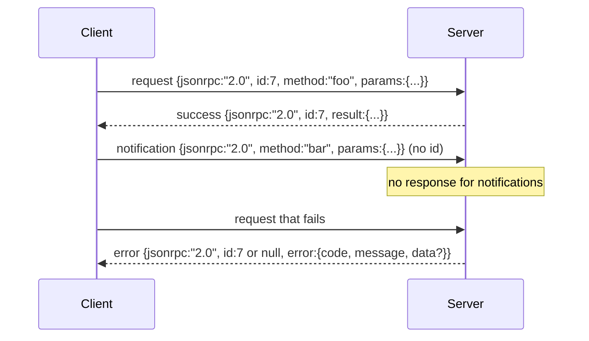

# JSON-RPC 2.0 Newline-Delimited Stdio를 넘어서

> 모델 클라이언트와 도구 서버 사이의 운송은 JSON-RPC입니다. 한 번 손으로 굴리면 모든 프레임 레이어가 지불하는 것을 알려줍니다.

**Type:** Build
**Languages:** Python
**Prerequisites:** Phase 13 lessons 01-07, Phase 14 lesson 01
**Time:** ~90 minutes

## 학습 목표
- JSON-RPC 2.0를 newline-delimited JSON로 프레임한 STDIN와 STDOUT에 대해 이야기하십시오.
- 다섯 개의 표준 오류 코드 (-32700, -32600, -32601, -32602, -32603) 를 지도하여 올바른 의미로 표면으로 표시하십시오.
- 새로운 봉투 키를 발명하지 않고 요청, 응답, 통지 및 배치를 구별한다.
- 하류의 나머지 부분을 독감하지 않고 한 라인당 1번의 분석 오류를 처리합니다.
- io.BytesIO를 사용하여 자율적으로 끝내는 데모를 만들면 수업이 자식 프로세스를 낳지 않고 실행됩니다.

```figure
cf-jsonrpc-frames
```

## 왜 JSON-RPC가 언어 그대로 남아있는가

2026년 코딩 에이전트는 한 세션에서 12개의 툴 서버와 대화합니다. 각 서버는 별도의 프로세스 또는 원격 엔드포인트입니다. 유선 형식은 2013년부터 동일하다. JSON-RPC 2.0는 2 페이지의 스펙입니다. 그것은 생존하기 때문에 대안 (gRPC, HTTP per call, custom binary) 모두 거래상태를 부과합니다 JSON-RPC는 그렇지 않습니다: 그들은 스트리밍 또는 배팅 또는 운송-접속을 선택합니다. JSON-RPC는 stdio, 소켓, 웹소켓, HTTP에서 대칭적이며 클라이언트는 두 가지 모두 스펙을 존중하면 본 적이 없는 서버를 구동할 수 있습니다.

이 수업은 stdio 변형을 만듭니다. Newline-delimited JSON. 각 요청은 한 줄입니다. 각 응답은 한 줄입니다. 운송 경계는 `\n`- 그래

## 철 모양

네 개의 봉투 모양이 있습니다. 2개의 형태는 클라이언트가 말하고 2개의 형태는 서버가 말하고 있습니다.



통지에는 없습니다`id`서버는 응답하지 않아야 합니다. 서버가 통지에 응답을 반환하면 클라이언트는 호출 사이트에 연결할 수 없습니다. 이 단일 규칙은 프레임 수학을 간단하게 유지합니다.

배치는 JSON 요청이나 알림의 배열입니다. 서버는 응답 배열을 사용하여 응답을 응답합니다. 어떤 순서로든, 알림 없는 항목에 대해 하나씩. 배치의 모든 항목이 알림이 있다면 서버는 아무것도 반환하지 않습니다.

## 5개의 오류 코드

```text
-32700  Parse error      JSON could not be parsed
-32600  Invalid Request  Envelope shape is wrong
-32601  Method not found
-32602  Invalid params
-32603  Internal error
```

-32000 및 -32099 사이의 코드는 서버 정의 오류에 대한 것입니다. 다른 모든 것은 응용 프로그램 정의입니다. 수업은 다섯 가지에 붙습니다. 핸들러를 올리면, 운송은 예외 클래스 이름을 포함하여 -32603로 포장합니다.`data.exception`- 그래

분석 오류는 특별한 규칙이 있습니다.`id`답은`null`, 요청은 인증을 추출할 만큼 충분히 분석되지 않았기 때문입니다.

## 뉴 라인 프레임링 및 BytesIO 데모

운송은 한 줄에 한 줄을 읽습니다. 한 줄은 바이트까지 포함됩니다.`\n`만약 선이 분석될 수 없다면, 운송은 -32700 응답을 작성합니다.`id: null`그리고 계속 이어집니다. 하천은 독이 없습니다. 다음 줄은 신선하게 분석됩니다.

수업을 끝으로`io.BytesIO`Stdin 및 stdout으로 결합합니다. 서버는 EOF까지 요청을 읽고, 각 응답을 작성하고 반환합니다. 클라이언트는 응답을 다시 읽습니다. 프로세스 스파인 없습니다. 타임아웃이 없습니다. 전송 행동은 실제 하위 프로세스 파이프와 동일합니다.`io`인터페이스가 동일한 것을 보여줍니다 `.readline()`그리고`.write()`계약

## 메소드 배포

이 운송은 어떤 방법이 있는지 알지 못하고, 전화기에게 넘겨주죠.`handler(method, params)`배너스가 공급하는 결과물이나 상승을 반환하는 핸들러.

```text
MethodNotFound -> -32601
InvalidParams  -> -32602
Anything else  -> -32603 with exception name in data
```

이 운송은 도구 레지스트리를 보지 않습니다. 레지스트리는 핸들러 뒤에 있습니다. 이것이 우리가 원하는 레이어링입니다. 이 운송은 JSON-RPC를 사용합니다. 레지스트리는 도구 모양을 사용합니다. 디스페셔터는 (강습 23) 이 그것들을 꿰매고 있습니다.

## 오류에 대한 스트림 행동

```text
client writes              server reads             server writes
---------------            -----------              -------------
{...valid request...}      parses ok                {...response, id matches...}
{...broken json...         parse fails              {id:null, error: -32700}
{...valid request...}      parses ok                {...response, id matches...}
{...missing method...}     invalid envelope         {id:X, error: -32600}
```

깨진 JSON 라인은 루프를 멈추지 않습니다.`method`이 경우, 이 동작은 EOF를 막지 않습니다.

## 통지 및 비대칭 흐름

알림은 화재 및 잊기입니다. 이 배너스는 진행 이벤트, 취소 신호 및 로그 라인 알림을 사용합니다. 알림은 오랜 기간 동안 실행된 도구가 각 하나에 대한 회전 없이 상태 업데이트를 스트리밍 할 수있는 방법입니다.

수업은 출력 통지 보조자를 구현합니다.`write_notification`. 서버는 요청이 비행 중에 진행을 전송하기 위해 사용한다. 데모는 패턴을 보여줍니다. 요청이 입력되고, 핸들러는 두 가지 진행 알림을 발송하고, 최종 응답을 작성합니다.

## 코드를 읽는 방법

`code/main.py`정의합니다`StdioTransport`, 분석 보조 (`parse_request`), 세 명의 서술자 (`write_response``write_error``write_notification`), 그리고 배송 루프`serve`. 오류 코드 상수들은 모듈 범위에서 작동합니다.

`code/tests/test_transport.py`다섯 개의 오류 코드, 알림 (쓰지 않은 응답), 배트 (열, 배열, 알림을 건너뛰는 알림), 깨진 JSON (분석 오류가 계속됩니다) 및 핸들러가 호출 중 알림을 작성하는 비대칭 흐름을 포함한다.

## 더 나아가

이 운송은 다음의 교훈에 충분합니다. 생산 운송은 세 가지 요소를 추가합니다.`id`이미 이겁니다. 하지만 메쉬에서는 외부 추적 아이디도 필요합니다. 취소 채널 (예:`$/cancelRequest`그리고 컨텐츠 타입 협상 수렴으로 같은 소켓이 JSON-RPC와 Streamable HTTP를 말할 수 있습니다. 이 중 어느 것도 케이블을 변경하지 않습니다. 그들은 메타 데이터를 추가합니다.
