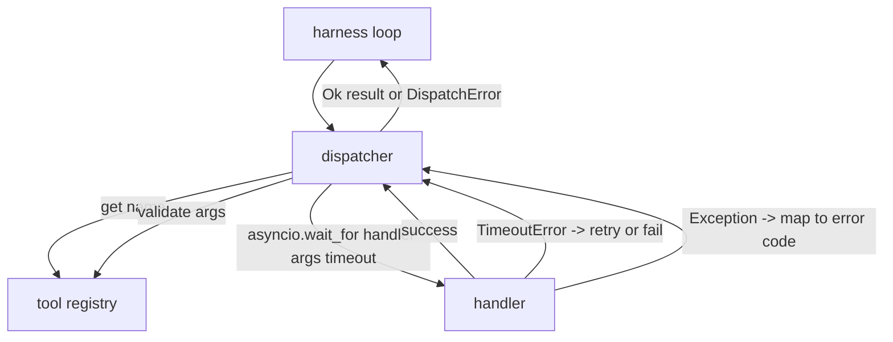
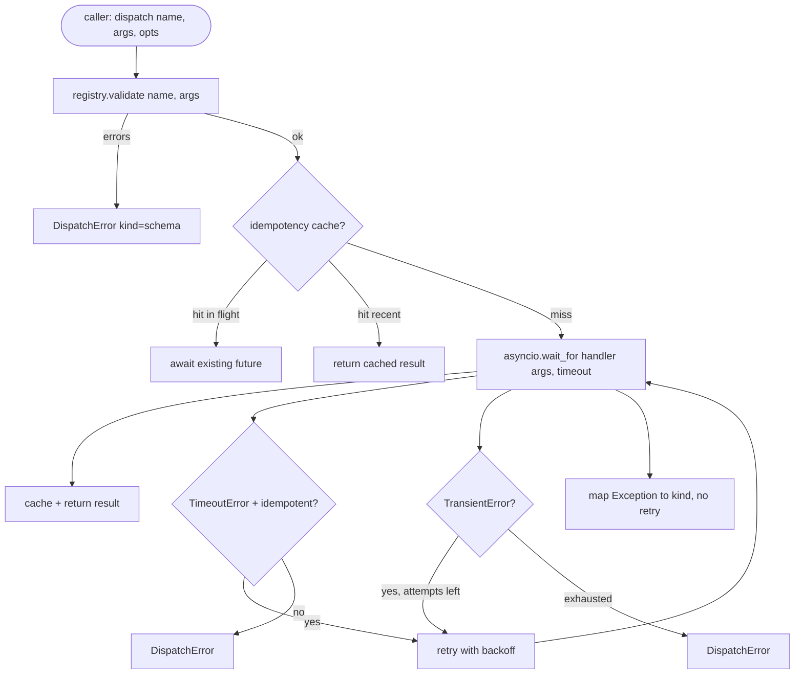

# 기능 호출 디스퍼

> 디스페셔는 배너스가 모든 약속에 대해 지불하는 곳입니다. 시간제, 재실험, 추출, 오류 지도, 모든 것은 한 바퀴에 있습니다.

**Type:** Build
**Languages:** Python
**Prerequisites:** Phase 13 lessons 01-07, Phase 14 lesson 01
**Time:** ~90 minutes

## 학습 목표
- 툴 핸들러를 호출 당 타임아웃으로 엮어 ループ을 매달아 놓기 보다는 입력 오류를 반환합니다.
- 기하급수적인 배코프 재실험을 jitter와 최대 시도 수를 적용하십시오.
- 이중중중중중중중중중중중중중중중중중중중중중중중중중중중중중중중중중중중중중중중중중중중중중중중중중중중중중중중중중중중중중중중중중중중중중중중중중중중중중중중중중중중중중중중중중중중중중중중중중중중중중중중중중중중중중중중중중중중중중중중중중중중중중중중중중중중중중중중중중중중중중중중중중중중중중중중중중중중중중중중중중중중중중중중중중중중중중중중중중중중중중중중중중중중중중중중중중중중중중중중중중중중중중중중중중중중중중중중중중중중중중중중중중중중중중중중중중중중중중중중중중중중중중중중중중중중중중중중중중중중중중중중중중중중중중중중중중중중중중중중중중중중중중중중중중중중중중중중중중중중중중중중중중중중중중중중중중중중중중중중중중중중중중중중중중중중중중중중중중중중중중중중중중중중중중중중중중중중중중중중중중중중중중중중중중중중중중중중중중중중중중중중중중중중중중중중중중중중중중중중중중중중중중중중중중중중중중중중중중중중중중중중중중중중중중중중중중중중중중중중중중중중중중중중중중중중중중중중중중중중중중중중중중중중중중중중중중중중중중중중중중중중중중중중중중중중중중중중중중중중중중중중중중중중중중
- 지도 처리자 예외 및 단일 오류에 대한 운송 오류는 이미 이해되는 배너스 루프에 포함됩니다.
- 동시 제한을 가진 병렬 전송을 묶어 40 개의 도구 호출의 팬-아웃이 이벤트 루프를 채우지 않도록합니다.

```figure
cf-dispatch-retry
```

## 디스페이셔가 앉아 있는 곳

리너스 루프 (강습 20), 툴 레지스트리 (강습 21), 트랜스포트 (강습 22), 루프 (loop) 를 공급한다. 루프는 디스페이처에게 툴 호출을 전달한다. 디스페이처는 레지스트리를 호출하고 핸들러를 실행하고 결과 또는 JSON-RPC 모양의 오류 봉투를 반환한다.



디스페처는 타이머, 리테어, 그리고 이데모텐시에 대해 아는 유일한 층입니다. 루프는 그렇지 않습니다. 레지스트리는 그렇지 않습니다. 핸들러는 그렇지 않습니다. 이 고립은 핵심입니다.

## 시간제

각 도구에는 기본 시간 제한이 있습니다. 레지스트리 기록은 `timeout_ms`- 디스퍼치는 전화 통보 통보 통보 통보 통보 통보 통보 통보 통보 통보 통보 통보 통보 통보 통보 통보 통보 통보 통보 통보 통보 통보 통보 통보 통보 통보 통보 통보 통보 통보 통보 통보 통보 통보 통보 통보 통보 통보 통보 통보 통보 통보 통보 통보 통보 통보 통보 통보 통보 통보 통보 통보 통보 통보 통보 통보 통보 통보 통보 통보 통보 통보 통보 통보 통보 통보 통보 통보 통보 통보 통보 통보 통보 통보 통보 통보 통보 통보 통보 통보 통보 통보 통보 통보 통보 통보 통보 통보 통보 통보 통보 통보 통보 통보 통보 통보 통보 통보 통보 통보 통보 통보 통보 통보 통보 통보 통보 통보 통보 통보 통보 통보 통보 통보 통보 통보 통보 통보 통보 통보 통보 통보 통보 통보 통보 통보 통보 통보 통보 통보 통보 통보 통보 통보 통보 통보 통보 통보 통보 통보 통보 통보 통보 통 통 통 통 통 통 통 통 통 통 통 통 통 통 통 통 통 통 통 통 통 통 통 통 통 통 통 통 통 통 통 통 통 통 통 통 통 통 통 통 통 통 통 통 통 통 통 통 통 통 통 통 통 통 통 통 통 통 통 통 통 통 통 통 통 통 통 통 통 통 통 통 통 통 통 통 통 통 통 통 통 통 통 통 통 통 통 통 통 통 통 통 통 통 통 통 통 통 통 통 통 통 통 통 통 통 통 통 통 통 통 통 통 통 통 통 통 통 통 통 통 통 통 통 통 통 통 통 통 통 통 통 통 통 통 통 통 통 통 통 통 통 통 통 통 통 통 통 통 통 통 통 통 통 통 통 통 통 통 통 통 통 통 통 통 통 통 통 통 통 통 통 통 통 통 통 통 통 통 통 통 통 통 통 통 통 통 통 통 통 통 통 통 통 통 통 통 통 통 통 통 통 통 통 통 통 통 통 통 통 통 통 통 통 통 통 통 통`asyncio.wait_for`시간 정지 시, 처리 작업이 취소되고 디스퍼가 돌아옵니다.`DispatchError(kind="timeout")`- 그래

타임아웃은 비이덴포텐트 도구의 기본으로 재발전 가능한 오류가 아닙니다.`db.write`시기를 정한 경우도 있고, 그렇지 않은 경우도 있습니다. 다시 시도하면 글이 복제됩니다.`idempotent`레지스트리 기록에서 표시된 플래그. 무력 도구는 다시 시도합니다. 무력 도구는 그렇지 않습니다.

## 기하급수적 배코프로 재시행

재시험 정책은 최대 3번이고, 배카프는 기동과 기하급수적입니다.

```text
attempt 1  -> delay 0
attempt 2  -> delay 0.1s * (1 + random[0..0.5])
attempt 3  -> delay 0.4s * (1 + random[0..0.5])
```

오직`timeout`그리고`transient`오류를 다시 시도합니다.`schema`오류, a`not_found`, 또는`internal`오류가 다시 시도되지 않습니다. 스케마 오류는 결정적입니다. 다시 시도는 결과를 바꾸지 않으며 예산을 태운다.

재실험 루프는 리너스의 예산을 존중합니다. 호출자의 예산이 도구 호출이 남아있는 경우, 디스퍼터는 첫 번째 시도에서 빠르게 실패하고 반환합니다.`kind="budget_exceeded"`- 그래

## 무력성 키 추출자

원래가 비행중인 동안 다시 시도하는 것은 실제 생산 오류입니다. 첫 번째 호출은 4 포인트 9 초 (시간 종료 직후) 에 달려 있습니다. 다시 시도는 5 초에 시작합니다. 이제 두 요청은 동일한 백엔드에 대항합니다. 도구가`payments.charge`두 번이나 충전했어

배포자는 선택적으로`idempotency_key`. 전화가 도착할 때 동일한 키가 비행 중에 있다면, 디스페이처는 비행 속의 미래를 기다리고 그 결과를 반환합니다. 캐시는 늦은 재발전 흡수하기 위해 완료 후 60 초 동안 키를 보관합니다.

열쇠는 전화자의 책임입니다.`f"{step_id}:{tool_name}:{hash(args)}"`. 디스퍼치는 키를 발명하지 않습니다. 왜냐하면 단지 논쟁에서 키를 추출하면 두 개의 의미적으로 다른 호출이 동일하게 보입니다.

## 오류 봉투

실패한 배송은 하나의 형태를 반환합니다.

```text
DispatchError
  kind        : "timeout" | "transient" | "schema" | "not_found" | "internal" | "budget_exceeded"
  message     : str
  attempts    : int
  jsonrpc_code: int   (one of -32601, -32602, -32603)
```

     `kind`다음 주로 이동합니다.`schema`그리고`not_found`가`on_error`그리고 재발전기를 시작하게`timeout`그리고`transient`가`on_error`시도에 따라 재개할 수도 있고, 재개할 수도 없습니다.`budget_exceeded`트리거`on_budget_exceeded`- 그래

## 펀드 아웃의 동화 제한

`gather(*calls)`모든 코로루틴을 동시에 실행합니다. 40 개의 도구 호출을 통해, 즉 40 개의 오픈 소켓 또는 40 개의 하위 프로세스 파이프입니다. 대부분의 백엔드는 한 클라이언트에서 40 개의 병렬 연결을 좋아하지 않습니다.

디스페이처가 포장합니다`gather`메마포어에서. 기본 동시 제한은 8입니다. 각 호출은 메마포어를 전송하기 전에 획득하고 완료되면 풀립니다. 호출자는 볼 니다`gather`-형 출력이지만 실제 스케줄은 제한되어 있습니다.

## 한 번의 통화로 흐르



## 코드를 읽는 방법

`code/main.py`정의합니다`Dispatcher``DispatchError`그리고`TransientError`- 디스페이셔는 건설에 대한 레지스트리를 가져갑니다.`dispatch(name, args, ...)`이 경우, 모든 시도에 대한 시간 제한이 직렬으로 적용됩니다.`_run_with_retries`사용 `asyncio.wait_for`-`gather_bounded(calls)`동시 제한을 가진 많은 배포를 실행합니다.

`code/tests/test_dispatcher.py`타임아웃 팅, 일시적인 경우 재시험, 스키마 오류에서 재시험이 불가능, idempotency dedupe (하나의 핸들러 호출에 동일한 키의 붕괴와 동시에 두 번의 호출) 및 동시 제한 (행동의 세마포어) 를 포함한다.

테스트는 사용 `asyncio.sleep(0)`그리고 결정적인`Counter`-기반 처리기 때문에 밀리초 안에 완성되며 벽 시계 시점에 의존하지 않습니다.

## 더 나아가

두 개의 확장 생산 디스페처가 추가됩니다. 첫째, 모든 전환에 구조화된 로깅 (loop의 이벤트 스트림이 이미 당신에게 제공하지만 디스페처도 발송해야합니다)`dispatch.attempt`그리고`dispatch.retry`둘째, 회로 차단기: 창에서 N가 실패한 후, 도구는 즉시 을 보내기 위해 냉각 기간을 얻습니다.`kind="circuit_open"`두 개는 계약 변경 없이 이 디스페셔에 맞습니다.

24강습은 디스페이처를 계획과 실행에 옮기는 요원으로 붙여서 네 조각 모두 움직임을 알 수 있습니다.
