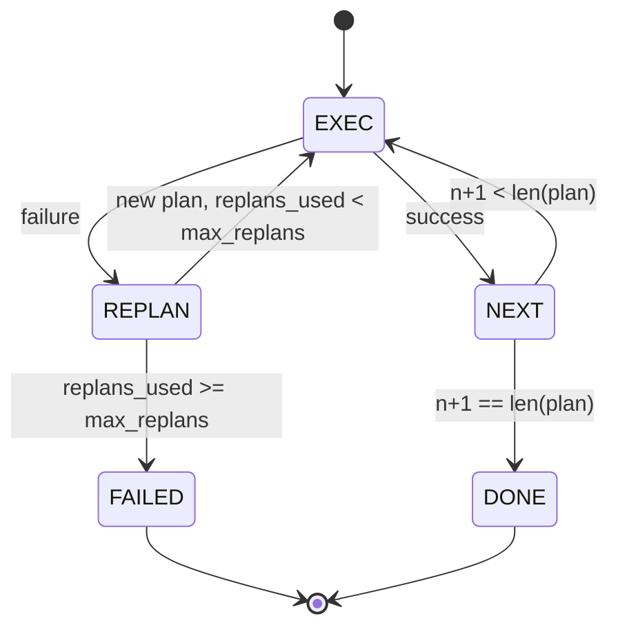

# 계획-행위 제어 흐름

> 실패를 극복할 수 없는 계획은 스크립트입니다. 재설계할 수 있는 스크립트는 에이전트입니다. 먼저 재설계자를 구축하세요.

**Type:** Build
**Languages:** Python
**Prerequisites:** Phase 13 lessons 01-07, Phase 14 lesson 01
**Time:** ~90 minutes

## 학습 목표
- 계획은 입력된 단계의 순서열로 표현하여 실행자가 진행과 결과에 대해 논의를 할 수 있습니다.
- 제어된 실패로 계획자에게 다시 전달되는 단계들을 순차적으로 실행하십시오.
- 현 커서에서 이전 오류를 다시 설정하여 다음 계획이 알려집니다.
- 각 개정에서 플랜 디프를 발급하여 하류 추적자 또는 UI가 플랜의 변경 이유를 보여줄 수 있습니다.
- 두 가지 예산을 적용하세요: 단단한 단계 천장과 단단한 재설계 천장.

```figure
cg-plan-replan
```

## 계획 하고 실행 하는 것, 사상 사슬이 아닌

생각 연쇄 에이전트는 토큰을 발급하고 ループ이 도구 호출이 끝나는 곳을 추측하도록 한다. 계획 및 실행 에이전트는 먼저 구조화된 계획을 발급하고, 다음 각 단계를 결정적으로 실행한다. 계획은 배운드가 내면적으로 볼 수 있는 데이터이다. 실행은 배운드가 디스페처를 통해 데이터를 실행한다.

2개의 조각. 계획을 만드는 기획자, 계획을 실행하는 실행자. 흥미로운 일은 실행자가 실패하면 어떻게 되는가. 3가지 옵션:

```text
1. Abort         (return failed, surface the error)
2. Skip          (mark step failed, continue with the rest)
3. Replan        (hand the error to the planner, get a new plan from the cursor)
```

리플란은 시나리오를 에이전트로 바꾸는 사람입니다

## 단계 모양

```text
Step
  id              : int           (monotonic within a plan revision)
  tool_name       : str
  args            : dict
  expected_outcome: str           (planner's stated success condition)
  result          : Any | None
  error           : str | None
```

`expected_outcome`계획자 (planner) 는 단계와 함께 발사하는 짧은 문장을 말합니다. 실행자가 시행하지 않습니다. 그것은 두 가지 이유로 있습니다. 계획 개정 시 재계획자가 그것을 읽습니다. 이벤트 스트림은 발사하여 추적자가 "이 단계가 X를 수행해야 했다"를 보여줄 수 있습니다.

## 계획자 모양

```python
def planner(goal: str, history: list[Step], last_error: str | None) -> list[Step]:
    ...
```

순수한 기능입니다.`goal`사용자 목표입니다.`history`이미 실행된 단계 (실점과 결과로 작성된 단계) 이다. `last_error`첫 번째 호출에서 아무 것도 없고, 다음 모든 호출에서 가장 최근의 오류 메시지가 없습니다. 계획자는 커서에서 시작하여 다음 계획을 반환합니다.

계획자는 실행자를 알지 못하며, 재시험을 알지 못하며, 시간제도도 알지 못하며, 계획을 만들어내야 합니다.

## 집행자

실행자는 작은 상태 기계입니다. 각 단계는 디스페이저를 통해 실행됩니다. 결과는 세 가지 중 하나입니다: 성공, 실패-재정, 실패-사망. 재발전 가능한 실패는 계획자에게 반환됩니다. 치명적인 실패 (예산 초과, 재발전 천장을 타는) 은 반환합니다.`FAILED`세션 결과



## 계획 개정에 대한 차이

계획자가 실패 후 새로운 계획을 반환하면 실행자는 `plan.diff`3개의 필드로 이루어진 이벤트

```text
removed: list of step ids that were in the old plan and are not in the new
added  : list of step ids in the new plan that were not in the old
revised: list of step ids whose tool_name or args changed
```

트래서 또는 UI는 제거 된 단계에 대한 타격과 추가 된 단계에 대한 하이라이트로 표시 할 수 있습니다. 문제는 다른 형식에서 아닙니다. 문제는 수정이 비추어 된 재쓰기 아닌 눈에 보이는 사건입니다.

## 두 가지 예산, 둘 다 힘들다

`max_steps`전체 세션 동안 재계획을 포함한 전체 단계 실행을 제한합니다. 기본값은 12입니다. 2 번 재계획하고 16 번의 실행에 3 단계를 추가하는 선형 5 단계 계획은 예산을 초과합니다. 실행자는 재계획을 거부하고 실패를 반환합니다.

`max_replans`첫 번째 계획 후 계획자가 호출되는 시간을 제한합니다. 기본은 5입니다. 이것은 더 중요한 제한입니다. 동일한 파손된 계획을 5 번 연속으로 반환하는 계획자는 단계 예산이 그것을 잡을 때까지 루프를 할 것입니다. 재계획을 제한하면 실패가 더 빨라지고 이유는 더 명확합니다.

## 이 수업의 결정적 계획자

이 수업에서는 모델을 부르지 않습니다. 수업은 결정적인 계획자를 선보이고`last_error`- 그래

```text
last_error is None    -> emit a four-step plan
last_error matches X  -> emit a three-step plan that routes around X
last_error matches Y  -> emit a two-step plan that gives up gracefully
otherwise             -> return [] (signals nothing to replan)
```

이 방법은 모든 전환 경로에서 실행자의 행동을 테스트하기에 충분합니다. 성공, 재계획 한 번, 재계획 두 번, 재계획-실거, 단계 예산실거.

## 결과 모양

```text
SessionResult
  status      : "completed" | "failed"
  reason      : str     ("goal_met" | "step_budget" | "replan_budget" | "no_plan")
  history     : list[Step]
  revisions   : list[PlanDiff]
  events      : list[Event]
```

20강의 배너스 루프는 이것을 직접 읽을 수 있습니다. 23강의 디스페이처는 각 단계를 실행하는 것입니다. 21강의 레지스트리는 각 단계의 args를 검증합니다. 22강의 전송은 JSON-RPC를 통해 전체 흐름을 모델 클라이언트에 표면합니다.

## 코드를 읽는 방법

`code/main.py`정의합니다`PlanExecuteAgent``Step``PlanDiff``SessionResult`, 그리고 결정적인 계획자.`run(goal)``SessionResult`. 계획의 차이점은 단계 ID와`(tool_name, args)`두꺼운

`code/tests/test_agent.py`선형적인 성공, 한 번 재계획하는 중간 계획 실패, 한 번 재계획하는 번갈아가 돌아오는`failed:replan_budget`, 단계적인 예산의 고갈과 계획의 차이 이벤트 형식

## 더 나아가

이 프로그램을 실제 모델에 연결하면 두 가지 확장 프로그램이 필요합니다. 첫째, 부분 계획 캐싱: 계획 중 여섯 단계 중 첫 번째 세 단계에 성공하고 실패하면 첫 번째 세 단계를 다시 실행하기를 원하지 않습니다. 실행자는 이미 역사를 보관하고, 계획자는 단지 그것을 읽어야합니다. 둘째, 병렬 분자: 현재 실행자는 엄격히 순서적입니다. 독립적인 분자를 발송하는 계획자 (`gather_step`대신`next_step`) 는 디스퍼처를 통해 동시에 두 개의 도구 호출을 실행할 수 있습니다.

이 두 가지 모두 실제 복잡성을 더합니다. 이 두 가지 모두 선형 실행자가 고정되면 더 쉽게 추가됩니다. 이 교훈은 그렇게합니다.
