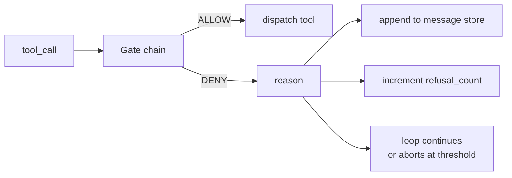
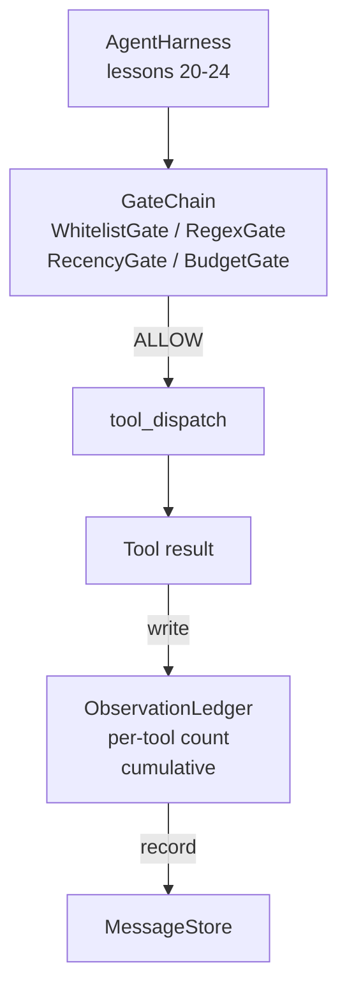

# 캡스톤 25강: 검증 게이트와 관찰 예산

> 검증층이 없는 에이전트 배너스는 트레이프 코트에 있는 욕망입니다. 이 수업은 도구 호출이 불 수 있는지 여부를 결정하는 결정적인 게이트 체인을 구축하고, 에이전트가 얼마나 많은 출력을 볼 수 있는지, 에이전트가 너무 많이 읽었기 때문에 루프는 언제 멈춰야하는지 결정합니다. 이 체인은 작은 이름있는 게이트와 함께 모델이 표시된 모든 토큰을 추적하는 관찰 리저의 함수입니다.

**Type:** Build
**Languages:** Python (stdlib)
**Prerequisites:** Phase 19 · 20-24 (Track A1: agent loop, tool registry, message store, prompt builder, model router), Phase 14 · 33 (instructions as constraints), Phase 14 · 36 (scope contracts), Phase 14 · 38 (verification gates)
**Time:** ~90 minutes

## 학습 목표

- `VerificationGate`결정적인 프로토콜`evaluate(call)`방법
- 예산, 최근, 백지, 그리고 레전스 게이트를 단순환 의미론으로 연결해 놓습니다.
- 모든 관찰을 추적합니다`ObservationLedger`도구로 키를 고 
- 누적 관찰 예산이 초과될 경우 도구 호출을 거부합니다.
- 구조화된 표면`GateDecision`하류 관찰성이 흡수할 수 있는 기록을 작성합니다.

## 문제

에이전트 하네스가 모델이 도구를 자유롭게 호출할 수 있게 하면 실제 사용 후 1시간 이내에 세 가지 유형의 버그가 나타납니다.

첫 번째는 무제한 관찰입니다. 200K 라인 레포를 가로지르는 포착은 다음 회로에 500만 개의 도큰을 내포합니다. 모델은 킬로바이트당 1 개의 일치를 볼 수 있으며 나머지 컨텍스트는 낭비됩니다. 도큰 청구서는 크고 에이전트는 이제 더 나쁘지 않습니다, 더 나은 작업입니다.

두 번째는 구제된 최근입니다. 오랜 작업은 50 개의 도구 호출을 축적합니다. 모델은 3 번째 회전에서 첫 번째 read_file를 생체 상태처럼 다시 읽습니다. 47 회전에서 만든 편집은 결코 나타나지 않습니다. 왜냐하면 프롬프트 빌더가 가장 초기 관찰을 먼저 순서대로 만들었습니다.

세 번째는 특권 경기가 있습니다. 연구 작업은 전화로 시작됩니다.`web_search`그리고 결국 도망쳐버리는 거죠`shell`모델이 도구 이름을 발명하고, 배지기는 기본으로 허용된 상태이기 때문에, 누가 추적을 읽으면, 쓰레기 파일은 /tmp에 앉아 있고, 커일은 개인 API에 달려 있습니다.

검증 게이트는 "아니오"라고 말하는 배너스 구성 요소입니다. 그것은 모델이 아닙니다. 그것은 판사도 아닙니다. 그것은 의 결정적 기능입니다.`(call, history, ledger)`그 이유는 기록되어 있습니다. 모델이 알려졌습니다. 루프는 계속됩니다. 또는 aborts.

## 개념



문은 문이 있는 모든 것`evaluate(call, ctx) -> GateDecision`방법. 체인은 순서열입니다. 평가 단축 회로 첫 번째 부정. 순서 문제는: 값싼 구조적인 게이트가 비싼 토큰 계산 게이트보다 먼저 실행됩니다.

이 교훈은 네 개의 문을 열어줍니다.

- `WhitelistGate`허용된 도구 이름은 명시적 집합입니다. 외부에 있는 모든 것은 거부됩니다. 이것은 가장 저렴한 게이트이고 먼저 실행됩니다.
- `RegexGate`. 도구 аргумент들은 regex에 맞게 일치합니다.`rm -rf`내부 IP에 HTTP 호출을 하는 경우도 있습니다.
- `RecencyGate`. 모델은 마지막 N 회전에서만 관찰을 볼 수 있습니다. 오래된 관찰은 마스크됩니다. 게이트는 이미 노화 된 관찰 창을 확장하는 도구 호출을 거부합니다.
- `BudgetGate`. 모델이 세션 내내 읽은 누적 토큰은 천장입니다. 대책서에 천장 도달했다고 하면, 추가 도구 호출은 거부됩니다.

관찰 대책은 회계입니다. 모든 성공적인 도구 호출은 하나의 줄을 작성합니다. 도구 이름, 차례, 발행된 토큰, 누적. 대책은 두 질문에 대답합니다. 모델이 전체적으로 얼마나 많은 것을 보았으며, 도구 X에 대해 얼마나 많은 것을 보았는지. 예산 게이트는 첫 번째를 읽습니다. 도구 당 예산 게이트, 당신이 연습으로 작성할 것이 두 번째를 읽습니다.

```figure
cg-gate-chain
```

## 건축



이 리너스는 체인을 요청합니다. 체인은 주면하거나 거부합니다. 주면하면 도구가 실행되고, 리저가 틱하고, 결과는 메시지 저장소에 첨부됩니다. 거절하면 모델은 시스템 메시지로서 거부를 전달하고 루프는 다시 시도하거나 중단 여부를 결정합니다.

## 당신이 건설할 것은

실행은 단일입니다`main.py`더 많은 테스트를

1. `Observation`그리고`ToolCall`데이터 클래스는 케이블 모양을 정의합니다.
2. `ObservationLedger`기록`(turn, tool, tokens)`줄과 답`cumulative()`그리고`per_tool(name)`- 그래
3. `GateDecision`운반`(allow, reason, gate_name)`- 그래
4. `VerificationGate`모든 게이트가 실행합니다`evaluate(call, ctx)`- 그래
5. `GateChain`모든 게이트를 호출하고, 첫 번째 거부를 반환하거나, 모든 게이트가 통과하면 허용하는 것을 반환합니다.
6. 3회, 3회, 3회, 3회, 3회, 3회, 3회, 3회, 3회, 3회, 3회, 3회, 3회, 3회, 3회, 3회, 3회, 3회, 3회, 3회, 3회, 3회, 3회, 3회, 3회, 3회, 3회, 3회, 3회, 3회, 3회, 3회, 3회, 3회, 3회, 3회, 3회, 3회, 3회, 3회, 3회, 3회, 3회, 3회, 3회, 3회, 3회, 3회, 3회, 3회, 3회, 3회, 4회, 4회, 4회, 4회, 4회, 4회, 4회, 4회, 4회, 4회, 4회, 4회, 4회, 4회, 4회, 4회, 4회, 4회, 4회, 4회, 4회, 4회, 4회, 4회, 4회, 4회, 4회, 4회, 4회, 4회, 4회, 4회, 5회, 5회, 5회, 5회, 5회, 5회, 5회, 5회, 5회, 5회, 5회, 5회, 5회, 5회, 5회, 5회, 5회, 5회, 5회, 5회, 5회, 5회, 5회, 5회, 5회, 5회, 5회, 7회, 7회, 7회, 7회, 7회, 7회, 7회, 7회, 7회, 7회, 7회, 7회, 7회, 7회, 7회, 7회, 7회, 7회, 7회, 7회, 7회, 7회, 7회, 7회, 7회, 7회, 7회, 7회, 7회, 7회, 7회, 7회, 7회, 7회, 7회, 7회, 7회, 7회, 7회, 7회, 7회, 77, 77, 77, 77, 77, 77, 77, 77, 77, 77, 77, 77, 77, 77, 77, 77, 77, 77, 77, 77, 77, 77, 77, 77, 77, 77, 77,

토큰 카운터는 의도적으로 멍청한거예요`len(text) // 4`이 수업의 핵심은 관 관 관 관 관 관 관 관 관 관 관 관 관 관 관 관 관 관 관 관 관 관 관 관 관 관 관 관 관 관 관 관 관 관 관 관 관 관 관 관 관 관 관 관 관 관 관 관 관 관 관 관 관 관 관 관 관 관 관 관 관 관 관 관 관 관 관 관 관 관 관 관 관 관 관 관 관 관 관 관 관 관 관 관 관 관 관 관 관 관 관 관 관 관 관 관 관 관 관 관 관 관 관 관 관 관 관 관 관 관 관 관 관 관 관 관 관 관 관 관 관 관 관 관 관 관 관 관 관 관 관 관 관 관 관 관 관 관 관 관 관 관 관 관 관 관 관 관 관 관 관 관 관 관 관 관 관 관 관 관 관 관 관 관 관 관 관 관 관 관 관 관 관 관 관 관 관 관 관 관 관 관 관 관 관 관 관 관 관 관 관 관 관 관 관 관 관 관 관 관 관 관 관 관 관 관 관 관 관 관 관 관 관 관 관 관 관 관 관 관 관 관 관 관 관 관 관 관 관 관 관 관 관 관 관 관 관 관 관 관 관 관 관 관 관 관 관 관 관 관 관 관 관 관 관 관 관 관 관 관 관 관 관 관 관 관 관 관 관 관 관 관 관 관 관 관 관 관 관 관 관 관 관 관 관 관 관 관 관 관 관 관 관 관 관 관 관 관 관 관 관 관 관 관 관 관 관 관 관 관 관 관 관 관 관 관 관 관 관 관 관 관 관 관 관 관 관 관 관 관 관 관 관 관 관 관 관 관 관 관 관 관 관 관 관 관 관 관 관 관 관 관 관 관 관 관 관 관 관 관 관 관 관 관 관 관 관 관 관 관 관 관 관 관 관 관 관 관 관 관 관 관 관 관 관 관 관 관 관 관 관 관 관 관 관 관 관 관 관 관 관 관 관 관 관 관 관 관 관 관 관 관 관 관 관 관 관 관 관 관 관 관 관 관 관 관 관 관 관 관 관 관 관 관 관 관 관 관 관 관 관 관 관 관 관 관 관 관 관 관 관 관 관 관 관 관 관 관 관 관 관 관 관 관 관 관 관 관 관 관 관 관 관 관 관 관 관 관 관 관 관 관 관 관 관 관 관 관 관 관 관 관 관 관 관 관 관 관 관 관 관 관 관 관 관

## 왜 순서열이 중요 한 이유

부정하는 것이 허용하는 것보다 더 저렴합니다.`WhitelistGate`$O(1)$해시 검색`RegexGate`$O(\text{pattern} \cdot \text{argv})$-`RecencyGate`메세지 스토어의 작은 조각을 읽습니다.`BudgetGate`전체 리저를 읽습니다. 당신은 비용을 증가시켜서 주문합니다. 그래서 거절된 호출은 비싼 작업을 하기 전에 단축 회로를 만듭니다.

또한, 당신은 폭발 반경에 따라 주문합니다. 화이트리스트는 가장 강력한 주장입니다. 이 도구는 계약에 포함되어 있지 않습니다. 레전스 게이트는 다음입니다. 이 주장은 계약에 포함되어 있지 않습니다. 최근 들어서 있습니다.

## 이 코스가 A 트랙의 나머지 부분과 어떻게 얽혀있는지

이전 수업에서는 루프, 도구 레지스트리, 메시지 저장소, 프롬프트 빌더, 모델 라우터를 제공했습니다. 이 교훈은 모델과 도구 사이의 층을 더합니다. 레슨 26은 방문 사슬에서 "허락"이 되어서도 디스퍼치가 도구 호출을 전달하는 모래 상자를 배포합니다. 27강좌는 거부서 기록을 위한 평가용 기기를 품질 신호로 간주합니다. 28강좌는 게이트 결정들을 오픈텔레미트리 영역으로 연결합니다. 29강좌는 작동하는 코딩 에이전트에 많은 것을 꿰뚫고 있습니다.

## 실행

```bash
cd phases/19-capstone-projects/25-verification-gates-observation-budget
python3 code/main.py
python3 -m pytest code/tests/ -v
```

데모는 모든 게이트 결정을 포함하는 차례로 차례로 추적을 인쇄하고 0을 빠져나갑니다. 테스트는 리저, 각 게이트와 함께, 체인 쇼트회관, 그리고 합성 루프를 끝에서 끝으로 포함합니다.
