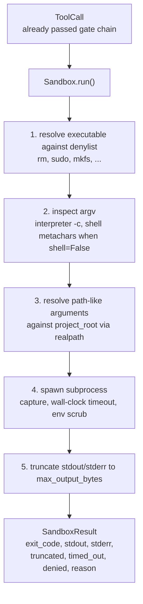
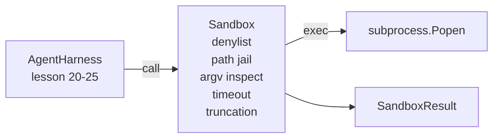

# 캡스톤 26 교훈: 샌드박스 러너, 데닐리스트, 파스 포로

> 검증 게이트는 도구 호출이 실행되어야하는지 여부를 결정합니다. 모래 상자는 그것이 일어날 때 어떤 일이 일어날지 결정합니다. 이 수업은 위험한 실행 파일을 거부하는 하위 프로세스 런어를 배포합니다. 위험한 argv 형태를 거부합니다. 프로젝트 루트로 모든 파일 경로를 포로로, 과장 출력을 단축하고, 모델과 운영체제 사이에 있는 두 층 중 두 번째입니다.

**Type:** Build
**Languages:** Python (stdlib)
**Prerequisites:** Phase 19 · 25 (verification gates and observation budget), Phase 14 · 33 (instructions as constraints), Phase 14 · 38 (verification gates)
**Time:** ~90 minutes

## 학습 목표

- `Sandbox`수업 포장`subprocess.run`시간제, 포획, 단축
- 이름으로 델리리스트에 대한 명령과 구조로 ARGV 검사에 대한 명령을 거부합니다.
- 선언된 프로젝트 루트 이외에 해결되는 모든 경로 논쟁을 거부합니다.
- 셸 모드가 꺼져 있을 때 셸 메타캐릭터를 거부합니다.
- 구조화된 복귀`SandboxResult`하류 관찰 가능성과 eval 이 흡수할 수 있는

## 문제

을 할 수 있는 코딩 에이전트는 백도어 설치, 키를 빼내기, 개발자 노트북을 벽돌로 만들거나 한 번씩 클라우드 빌트를 쌓을 수 있습니다. 가장 적은 비용의 방어 방법은 을 주지 않는 것입니다. 두 번째로 적은 비용은 정확한 패턴 목록에 대해 거절하는 모래 상자입니다.

3가지 종류의 실패가 에이전트 흔적에서 반복됩니다.

첫 번째는 위험한 실행형입니다. 경로 문제를 해결하기 위해 압력을 받는 모델은 시도합니다.`sudo``chmod -R 777``rm -rf``mkfs``dd`이 중 누구도 에이전트 경주에 속하지 않습니다. 덴일리스트는 이름과 별명으로 잡습니다.

두 번째는 ARGV 트릭입니다. 이 없다고 말한 모델은 통역자를 통해 공격을 가할 것입니다.`python3 -c "import os; os.system('rm -rf /')"``bash -c '...'``node -e '...'``perl -e '...'`박은 모든 통역자가 박을 가지고 실행한다는 것을 알아야 합니다`-c`- 플래그는 추가적인 단계로 발사된 소리일 뿐이야

세 번째는 경로 탈출입니다. 모델은 읽어야 한다고 합니다.`./src/main.py`대신 읽습니다`../../etc/passwd`모래 상자는 모든 논쟁을 해결함으로써 모든 논쟁을 포로로 만듭니다`os.path.realpath`그리고 선전을 주장하는 것

샌드박스는 운영 체제 의미에서 보안 경계가 아닙니다. 코드 실행을 가진 결정된 공격자는 여전히 튀어나갈 수 있습니다. 샌드박스는 개발 시간 경비 라일입니다. 그것은 일반적인 실패 모드를 크게 만들고, 순수한 부능으로 인해 에이전트가 피해를 입는 것을 막습니다.

## 개념



모래 상자는 네 개의 거부 축을 가지고 있습니다. 이름, argv, 경로, 구조. 각 축은 호출의 순수 함수입니다. 아직 하위 프로세스가 없습니다. 하위 프로세스는 모든 축이 지나면만 생깁니다.

`SandboxResult`출력 코드는 기존의 코드: 0 성공, 0 실패, 더 3 sentinel 코드 (-100), timed_out (-101), 그리고 줄여서 (출력 코드는 실제, 플래그 세트). 하류 수업은 이 구조화된 결과를 파싱하는 대신 읽습니다 stderr.

```figure
cg-path-jail
```

## 건축



데닐리스트는 실행 가능한 기본 이름의 한 묶음입니다.`/bin/rm``/usr/bin/rm`) 모두 동일한 기본 이름에 결의됩니다. argv 검사 는 해석자 형태를 알고 있습니다. argv[0]가 해석자이며 나중에 된 모든 arg는 `-c`또는`-e`셸 메타캐릭터 (`;``|``&``>``<`, 등판,`$()`) 요청이 명시적으로 껍질을 요청하지 않은 경우 거절을 일으킨다.

길의 감옥은 가장 미묘한 조각입니다. 모래 상자는`project_root`건설에서. 어떤 주장도 경로처럼 보이면 (`/`또는 기존 파일과 일치하는 파일) 를 정상화하여`os.path.realpath`, 다음으로 프로젝트 루트의 실제 경로를 확인합니다. 해결 된 목표가 루트 아래에 있지 않으면 거부합니다.

## 당신이 건설할 것은

시행은`main.py`더해 검사를

1. `SandboxResult`데이터 클래스: exit_code, stdout, stderr, truncated, timed_out, denied, reason, duration_ms.
2. `SandboxConfig`데이터 클래스: project_root, max_output_bytes, timeout_seconds, denylist, interpreter_block.
3. `Sandbox`클래스:`run(argv, *, shell=False, cwd=None)``SandboxResult`- 그래
4. 내부 거부 보조:`_check_executable_denylist``_check_argv_interpreter``_check_shell_metachars``_check_path_jail`- 그래
5.                                        `truncated`플래그와 캡처된 스트림의 마커 라인
6. 아래쪽에 있는 데모: 합법적이고 적대적인 호출의 연속입니다. 각각의 결과는 표시됩니다.

모래 상자는 사용한다`subprocess.run``shell=False`기본적으로`capture_output=True`벽 시계 시간대 `timeout`의논`TimeoutExpired`, 샌드박스는 프로세스 그룹을 죽이고 샌드박스 결과물을 합성합니다.

## 왜 이게 진짜 모래 상자가 아닌지

수업 샌드박스는 이름 공간, cgroup, seccomp, gVisor, Firecracker 또는 어떤 커널 수준의 고립을 사용하지 않습니다. 하위 프로세스가 할 수있는 모든 것을 샌드박스는 할 수 있습니다. 보호는 구조적입니다. 에이전트는 가장 일반적인 위험한 호출을 거부하고, 고음의 거부는 침묵으로 실행하는 대신 관찰 될 수 있습니다.

생산 에이전트들을 위해 위층을 추가합니다. 비공리예로운 Docker 컨테이너 안에 실행, 마이크로VM 내부에서 실행, drop 기능을, 프로젝트 루트 읽기-만 및 스크래치 dir 읽기-쓰기 장착, 메모리 및 CPU에 제한을 설정, 환경을 알려진 안전한 백지 목록으로 스크래프. 레슨 29이 이것을 일부 수행합니다. 운영 체제 격리 이 수업의 범위를 벗어납니다.

## 실행

```bash
cd phases/19-capstone-projects/26-sandbox-runner-denylist
python3 code/main.py
python3 -m pytest code/tests/ -v
```

데모는 임시 디렉토리를 생성하고, 깨끗한 파일을 넣고, 전화의 배터리를 실행합니다. 법적 호출은 성공합니다. 거절된 호출은 SandboxResult으로 반환됩니다.`denied=True`시간제 종료가 돌아왔어요`timed_out=True`. 단절 세트`truncated=True`. 데모는 JSON 결과 테이블을 인쇄하고 0을 빠져나갑니다.

## 이 코스가 A 트랙의 나머지 부분과 어떻게 얽혀있는지

수업 25 은 게이트 체인을 생성하였다. 수업 26 은 게이트 ALLOW 를 실행한 실행자 이다. 수업 27 의 eval harness 은 작업 당 예상 출력 코드 에 대한 샌드박스 결과 를 비교 한다. 수업 28 은                                                                                                                                                                                                                                     `gen_ai.tool.execution`각 주위를 `Sandbox.run`레슨 29의 엔드-투-엔드 데모는 두 층을 통해 실제 코딩 에이전트를 연결합니다.
