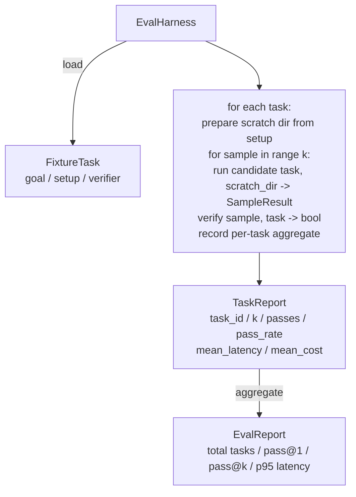

# 캡스톤 교훈 27: 일정한 과제와 동등한 배합

> 코딩 에이전트는 당신이 측정하는 작업과 같은 수준입니다. 이 수업은 고정 작업의 폴더를 가져가 후보자 에이전트를 통해 각각 실행하고, 점수가 결정적 검증기를 통해 통과하거나 실패하고, 결과를 pass@1, pass@k, 평균 지연 및 평균 비용으로 합쳐줍니다. 반지는 사실의 원천입니다. 이 반전자는 반전기를 볼 수 있습니다.

**Type:** Build
**Languages:** Python (stdlib)
**Prerequisites:** Phase 19 · 25 (verification gates), Phase 19 · 26 (sandbox runner), Phase 14 · 30 (eval-driven agent development), Phase 14 · 19 (SWE-bench and GAIA benchmarks)
**Time:** ~90 minutes

## 학습 목표

- 고정 작업은 목표, 설정 및 검증자의 세 번째로 정의하십시오.
- 작업에 따라 여러 샘플 실행을 점수를 받고 pass@1와 pass@k를 계산합니다.
- 평균 및 95번째 비율의 매트릭으로 지연과 비용을 합쳐
- 와이어 결정적 검증기 (파일 디프리, 출력 코드, regex match) 를 재사용 가능한 함수에
- 회귀 추적 스크립트가 섭취할 수 있는 구조화된 JSON 보고서를 발급하십시오.

## 문제

3가지 실패 모드 페스트 에이전트 벤치마크는 평가 띠 없이 만들어졌습니다.

첫 번째 것은 검증되지 않은 통과입니다. 에이전트는 버그를 수정했다고 말합니다. 인간들이 디프에 눈을 돌고, 스위트는 녹색으로 표시되어 있습니다. 그리고 3주 후에 회귀 테스트는 동일한 버그를 표면에 내세우고 있습니다. 에이전트는 실제로 아무것도 수정하지 않고 합리적으로 논의를 했다.

두 번째 것은 감지되지 않은 회귀입니다. 프롬프트 템플릿의 변경은 에이전트를 고음한 작업에서 4% 더 좋아하고 조용한 작업에서 14% 더 나쁘게 만듭니다. 금 집합과 작업 당 점수가 없으면 회귀가 메인으로 올라와 고객이 불평 할 때만 표면에 나타납니다.

세 번째는 과제당 유동입니다. 평가는 월요일 100개의 과제와 금요일 95개의 과제로 진행되었습니다. 누군가가 5개의 과제를 개명했기 때문입니다. 합격률은 5%의 향상처럼 보입니다. 그렇지 않습니다.

이 배너스는 이러한 오류를 사실로 바꾸는 프로그램입니다. 모든 고정된 것을 실행합니다. 모든 시간, 재생 가능한 순서로, 결정적 검사에 대해 진실 또는 거짓을 반환하는 검증자에 대해.

## 개념

```mermaid
flowchart LR
  F1[fixtures/task_001/<br/>task.json + expected/] --> Harness
  F2[fixtures/task_002/<br/>...] --> Harness
  Harness[Harness<br/>for each task:<br/>setup / run agent k samples /<br/>verify each sample /<br/>record latency, cost]
  Harness --> Report[EvalReport<br/>pass@1 / pass@k<br/>mean ms / p95 ms<br/>mean cost]
```

A`FixtureTask`작은 JSON 파일과 선택형 파일입니다`expected/`JSON는`id`, a `goal`(사진대표에게 전달된 간첩)`setup`블록 (파일들이 스크래치 dir에 떨어질 것)`verifier`블록: 검증자 블록은 리네스의 검증자 레지스트리에서 함수를 지정하고 그 주장을 제공합니다.

세 가지 검증자 형태는 대부분의 유용한 작업을 다루고 있습니다.

첫 번째는`file_equals`에이전트가 실행되면 이름 붙여진 파일을 예상된 내용과 비교해 보세요. 이것은 "이 버그를 정확히 이렇게 수정하세요" 작업을 잡습니다.

두 번째는`regex_match`.이번 파일의 내용은 regex에 맞게 일치합니다. 이것은 "함수가 존재해야하고 X를 반환해야 한다"라는 작업을 잡습니다.

세번째는`shell_exit_zero`. 배너스는 셸 명령어를 실행 (강좌 26번의 샌드박스) 으로 실행하고 명령어가 0에서 벗어난 경우에만 작업을 통과합니다. 이것은 "테스트가 통과해야 한다" 작업을 잡습니다.

배너스는 모든 작업을 수행합니다`k` ()`1 - (1 - p)^k`여기서 p는 경험적 통과율입니다. 배너스는 원자력 수를 보고하여 변수를 확인할 수 있습니다. 지연은 샘플 당 벽 시계입니다. 비용은 에이전트가 자부신하는 것 (토큰 수, USD, 또는 둘 다); 배너스는 샘플을 합하여 작업 당 및 합자 수를 제시합니다.

```figure
pass-at-k
```

## 건축



후보자는 호출할 수 있습니다:`Callable[[FixtureTask, str], SampleResult]`. 띠는 스크래치 디렉토리를 생성합니다`tempfile.mkdtemp()`이 은 지원자의 작업 방식에 상관하지 않습니다. 지원자는 결정적인 패치 애플리케이션 (용용용  자체 테스트), 실제 LLM 에이전트, 퓨저이 될 수 있습니다. 계약은 SampleResult입니다.

## 당신이 건설할 것은

`main.py`배:

1. `FixtureTask`데이터 클래스
2. `SampleResult`데이터 클래스: success_self_reported, latency_ms, cost_units, 편집.
3. `TaskReport``EvalReport``to_dict()`- 그래
4. `VerifierRegistry`기능에 대한 지도 확인기 이름. 내장된 확인기: file_equals, regex_match, shell_exit_zero.
5. `EvalHarness`클래스. 후보에 대한 작업 디렉토리를 실행합니다. EvalReport을 반환합니다.
6. 5개의 고정 작업이 묶여 있습니다 `tasks/`이 부분의 본문은
   - 한 사람씩`fizzbuzz`
   -  실종된 반환`factorial`
   - 오류 메시지의 타이핑 오류
   - 빈 함수 몸체
   - 연결된 목록의 통로를 하나씩
7. 결정적 기준 후보 (`apply_known_fixes`) 가이스는 1.0의 깨끗한 패스@1를 증명하기 위해 사용된다.
8. 데모는 EvalReport JSON를 인쇄하고 0을 빠져나갑니다.

고정 작업은 JSON 파일로 묶여 있습니다.`tasks/`+        `tasks/<id>/buggy/`그리고`tasks/<id>/expected/`배너스는 버그리를 스크래치더로 복사하고 후보자에게 넘겨주고 예상과 맞지 않게 확인합니다.

## 왜 그냥 1번만 넘지 않고

실제 LLM 에이전트는 스토카스틱하다. 0.6의 패스@1는 실패처럼 보입니다. 0.95의 패스@5는 에이전트가 대부분의 경우 올바른 답을 얻지만 초기 샘플에서 잘못 선택한다고 말합니다. 수정은 샘플링과 순위입니다. 항상 더 많은 훈련이 아닙니다. Pass@k는 그것을 가시적으로 만듭니다.

Pass@k 는 pass@1과 함께 보고됩니다. 왜냐하면 pass@k 는 실제 실패에 대해 논문을 작성하기 때문입니다. 모델이 20번마다 한 번 올바른 답을 얻으면 유용한 대리인이 없습니다.

## 이 코스가 A 트랙의 나머지 부분과 어떻게 얽혀있는지

25강은 게이트 체인을 만들어냈고 26강은 샌드박스를 만들어냈고, 배너스는 샌드박스를 모든 용도로 사용한다.`shell_exit_zero`검증기: 레슨 28은 각 리너스 실행을 OTel 추적으로 포장합니다. 레슨 29는 팩트 된 장착 장치 중 하나에 대한 엔드-투-엔드 데모를 실행하고 참조 후보에게 pass@1 = 1.0을 주장합니다.

## 실행

```bash
cd phases/19-capstone-projects/27-eval-harness-fixture-tasks
python3 code/main.py
python3 -m pytest code/tests/ -v
```

데모는 EvalReport을 JSON로 인쇄합니다. 여기에는 pass@1, pass@5, 평균 지연시간 및 각 작업 분해가 포함됩니다. 출력 코드는 0입니다. 테스트는 검증기 기능, pass@k 수학, 고정 부하 및 펀들된 참조 후보에 대한  끝에서 끝까지 포함됩니다.
