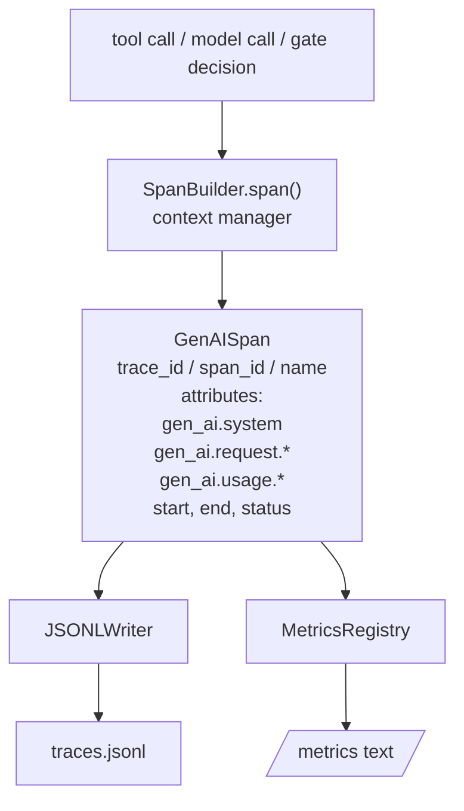
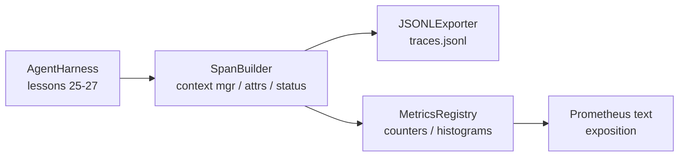

# 캡스톤 28 교훈: OTel GenAI 스파스와 프로메테우스 메트릭스

> 관찰가능하지 않은 에이전트 하네스는 돈을 버는 블랙박스입니다. 이 수업은 OpenTelemetry GenAI 의미 협약에 따라 기록을 발송하는 스팸 빌더를 수동으로 롤합니다.

**Type:** Build
**Languages:** Python (stdlib)
**Prerequisites:** Phase 19 · 25 (verification gates), Phase 19 · 26 (sandbox), Phase 19 · 27 (eval harness), Phase 13 · 20 (OpenTelemetry GenAI), Phase 14 · 23 (OTel GenAI conventions)
**Time:** ~90 minutes

## 학습 목표

- OpenTelemetry GenAI 의미 협약에 따라 형성된 스파인 데이터 클래스를 구축하십시오.
- JSONL 수출자를 구현하여 각 라인에 한 개의 독립된 스랜을 작성합니다.
- 레이블과 Prometheus 텍스트 형식 노출을 가진 카운터와 히스토그램을 구축하십시오.
- 기간, 상태 및 예외를 기록하는 기간 컨텍스트 관리자에서 모든 호출을 포장합니다.
- 방출된 랜드는 반도 이동 여부를 확인합니다`json.loads`그리고 스펙 모양과 일치합니다.

## 문제

생산에 있는 코딩 에이전트는 매 번마다 세 가지 클래스 인 인물을 생성합니다. 모델 호출, 도구 실행, 검증 게이트 결정. 구조화된 텔레메트리 없이는 이 중 어느 것도 유용하지 않습니다.

첫 번째 실패 모드는 실종된 흔적이에요. 화요일에 뭔가 잘못되었지만 유일한 기록은 500 라인 채팅 로그입니다. 어떤 도구가 실행되었는지, 얼마나 오래 걸렸는지, 얼마나 많은 토큰이 프롬프트에 들어갔는지, 또는 게이트가 무언가를 거부했는지에 대한 기록이 없습니다. 에이전트 저자는 추측해야합니다.

두 번째 실패 모드는 눈에 띄지 않는 흔적입니다. 배지대는 스펜을 썼지만 자체적으로 부착된 필드 이름을 사용했습니다. 그라파나, 허니컴브, 자이거 또는 지역 CLI에서 아무것도 읽을 수 없습니다. 팀 스택에 존재하는 도구가 무엇이든 스펜이 표준적이지 않기 때문에 낭비됩니다.

세 번째 실패 모드는 무합중 메트릭입니다. 추적에서 느린 도구 호출을 볼 수 있지만, "최후 한 시간 동안 read_file 호출의 p95 지연시간은 무엇입니까?"에 대답할 수 없습니다. 메트릭이 없기 때문에, 흔적이만 있습니다.

OpenTelemetry GenAI의 의미적 협약은 정확히 이 목적을 위해 존재한다. 그들은 LLM 프레임워크에서 방출자 범위를 공유하는 작은 표준 속성을 정의합니다. 당신의 배너스가 그 속성을 작성하면 OTel 호환 backend이 읽을 수 있습니다.

## 개념



배너스의 모든 동작은 스파인 (spane) 을 생성한다. 스파인은 트레이스 아이디 (전체 에이전트 호출), 스파인 아이디 (이 한 동작), 이름 (예를 들어) 를 가지고 있다.`gen_ai.chat``gen_ai.tool.execution`), GenAI 협약에 따라 나타나는 속성, 시작과 종료 시간, 그리고 상태.

GenAI 협약은 이러한 속성 키를 표준화합니다: `gen_ai.system`(어떤 공급자, 예를 들어`anthropic``openai`), `gen_ai.request.model`(모델 아이디)`gen_ai.request.max_tokens``gen_ai.usage.input_tokens``gen_ai.usage.output_tokens``gen_ai.response.model``gen_ai.response.id``gen_ai.operation.name`, 그리고 도구별 키`gen_ai.tool.name`그리고`gen_ai.tool.call.id`- 그래

수출자는 JSONL를 작성합니다. 한 라인당 한 개의 JSON 객체입니다. 이것은 하류 도구가 스트리밍,  및 수입 할 수있는 가장 간단한 형식입니다. 실제 OTel 수출자는 OTLP gRPC를 말할 것입니다. 수업의 JSONL 수출자는 오프라인 동등이며 모든 작업장에서 0을 출력합니다.

매트릭은 흔적 옆에 있습니다. 도구 호출의 각 카운터 인크리먼트: `tools_called_total{tool="read_file"}`. 히스토그램은 관찰된 지연을 기록합니다: `tool_latency_ms{tool="read_file"}`. 둘 다 프롬테우스 텍스트 노출 형식으로 serialise, 이는 pull 기반 매트릭의 실제 표준입니다.

```figure
trace-spans
```

## 건축



스펜 빌더는 작은 클래스입니다`span(name, attrs)`컨텍스트 매니저가 입력 시 시작 시간을 기록하고 출입 시 종료 시간을 기록하고, 추가된 경우 예외를 붙이고, 최종된 기간을 수출자에게 밀어냅니다.

메트릭 레지스트리는 두 개의 디킷입니다.`{(name, frozen_labels): int}`히스토그램은 원본을 목록에 보관하고 노출 시 프로메테우스 히스토그램 버킷에 serialise 합니다.

## 당신이 건설할 것은

`main.py`배:

1. `GenAISpan`데이터 클래스: trace_id, span_id, parent_span_id, 이름, 속성, start_unix_nano, end_unix_nano, 상태, status_message, 이벤트.
2. `SpanBuilder``span(name, attrs, parent=None)`컨텍스트 매니저
3. `JSONLExporter``export(span)`한 줄이 더해집니다.
4. `Counter`그리고`Histogram`수업과 함께`MetricsRegistry`- 그래
5. `prometheus_exposition(registry)`텍스트 형식의 출력을 생성합니다.
6. `wrap_tool_call(name)`스파인을 방출하고 매트릭을 업데이트하는 데코레이터
7. 데모: 전체 에이전트 호출을 합성합니다 (gen_ai.chat 범위는 도구 범위를 중심으로), traces.jsonl를 작성하고, Prometheus 노출을 인쇄하고, 0을 빠져나갑니다.

스파인 ID와 트레이스 ID는 16바이트의 스펙트 문자열입니다.`os.urandom`OTel의 W3C 추적 맥락과 일치합니다. 수출자는 결코 던지지 않습니다. IO 오류가 표면에 나타납니다. 하지만 배너스는 계속 작동합니다.

히스토그램은 고정된 버킷 세트를 가지고 있습니다 (밀리초의 지연시간에 대한 OTel 기본값은 5, 10, 25, 50, 100, 250, 500, 1000, 2500, 5000, 10000, +Inf). 샘플은 목록으로 저장되며, 수요에 따라 버킷당 노출 계산이 됩니다.

## 왜 오프네트레미트리-SDK 대신 손으로 롤하는

OTel Python SDK는 실제 의존성이다. 또한 몇 천 줄의 코드, OTLP 수출자에게는 여러 프로세스, 수업 예산을 압도하는 실행 시간 비용이다. 핸드롤 버전은 와이어 형식을 가르칩니다. 생산에서 동일한 속성을 실제 SDK에 전렬하여 OTLP 수출자, 배팅 및 리소스 탐지 기능을 무료로 얻을 수 있습니다.

컨벤션은 안정적입니다. 수업이 발송하는 와이어 형식은 2030 년에도 계속 분석될 것입니다. OTel는 GenAI 속성 이름을 결코 깨지 않고 새로운 이름을 추가합니다.

## 이 코스가 A 트랙의 나머지 부분과 어떻게 얽혀있는지

25강은 게이트 체인을 만들어 냈습니다. 26강은 샌드박스를 만들어 냈습니다. 27강은 eval 을 만들어 냈습니다. 28강은 세 가지를 모두 관찰할 수 있게 해줍니다. 29강은 엔드-투-엔드 데모의 모든 단계를 팽창으로 묶고 끝에서 프로메테우스 텍스트를 인쇄합니다.

## 실행

```bash
cd phases/19-capstone-projects/28-observability-otel-traces
python3 code/main.py
python3 -m pytest code/tests/ -v
```

데모는 `traces.jsonl`수업의 작업 디어 (말에 정제) 에서, 세 개의 스펜의 샘플을 인쇄하고, 카운터 및 히스토그램을 위한 프로메테우스 노출을 인쇄합니다. 테스트는 스펜이 돌아와 돌아가는 것을 확인하고, 가논적인 GenAI 속성이 존재하고, 인크리멘트를 올바르게 카운터하고, 히스토그램 노출은 예상되는 버킷 카운트를 포함하고 있음을 확인합니다.
